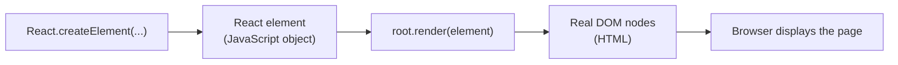
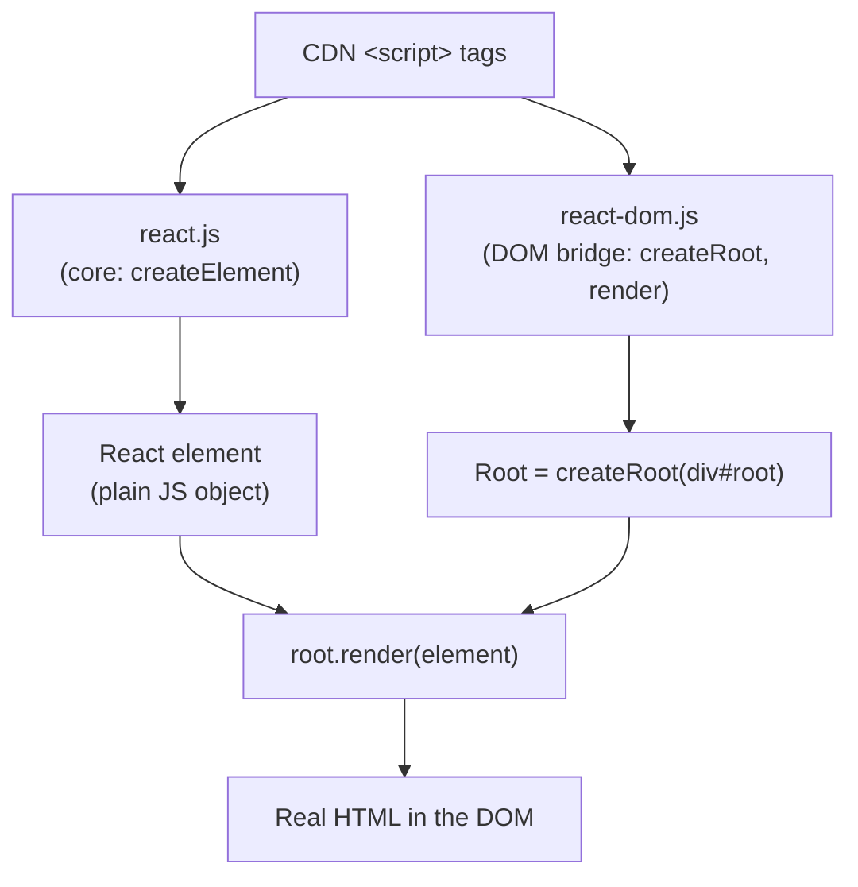

# Namaste React – Episode 1 (Inception): Building "Hello World" with Core React

## Overview

This document is a complete set of learning notes based on the first episode of the *Namaste React* series, "Inception". The episode starts from an empty folder and builds the same "Hello World" page three times:

1. With plain **HTML**.
2. With plain **JavaScript** (the browser DOM API).
3. With **React**, loaded into the page through CDN links, using only core React (`React.createElement`, `ReactDOM.createRoot`, and `root.render`). No JSX, no build tools, no `create-react-app`.

The central idea of the episode is that **React is "just JavaScript"**: a library written in JavaScript that you load into a page like any other script. The episode builds that understanding by showing what React's files actually contain, what a React element really is, and how rendering works.

> **How to read these notes**
> - Content taken from the transcript is presented as the instructor taught it.
> - Material marked **📘 Supplementary** was added for clarity and is not stated in the transcript.
> - Material marked **✏️ Correction / Clarification** fixes or refines something from the transcript.
> - Material marked **❓ Unclear** flags something the transcript does not make clear.

## Learning Objectives

After studying these notes you should be able to:

- Explain why a browser cannot understand React code on its own, and how a CDN `<script>` tag solves this.
- Explain what `react.development.js` and `react-dom.development.js` are and why React is split into two files.
- Create elements with `React.createElement(type, attributes, children)`.
- Create a root with `ReactDOM.createRoot(...)` and render with `root.render(...)`.
- Explain why a React element is a plain JavaScript object and not an HTML tag.
- Build nested structures and sibling elements using `createElement`.
- Explain why script order matters, and that `root.render` **replaces** the root's content rather than appending to it.
- Explain why React is called a library and not a framework.

## Prerequisites

- Basic HTML, CSS, and JavaScript (the instructor states these are prerequisites for the course).
- Familiarity with the DOM APIs `document.createElement`, `document.getElementById`, `innerHTML`, and `appendChild`. (The episode recaps them.)
- **Google Chrome** and **VS Code** installed (the instructor uses both throughout the series).

## Table of Contents

1. [Introduction and Course Approach](#1-introduction-and-course-approach)
2. [Environment Setup](#2-environment-setup)
3. [Hello World with Plain HTML](#3-hello-world-with-plain-html)
4. [Hello World with JavaScript](#4-hello-world-with-javascript)
5. [Getting React into the Project (CDN)](#5-getting-react-into-the-project-cdn)
6. [Hello World with React](#6-hello-world-with-react)
7. [Moving React Code into app.js and Script Order](#7-moving-react-code-into-appjs-and-script-order)
8. [Attributes (Props) and CSS](#8-attributes-props-and-css)
9. [What Is a React Element?](#9-what-is-a-react-element)
10. [Nested Elements and Siblings](#10-nested-elements-and-siblings)
11. [How `root.render` Works](#11-how-rootrender-works)
12. [React Is a Library, Not a Framework](#12-react-is-a-library-not-a-framework)
13. [Concept Relationships at a Glance](#13-concept-relationships-at-a-glance)
14. [Common Mistakes and Troubleshooting](#14-common-mistakes-and-troubleshooting)
15. [Best Practices](#15-best-practices)
16. [Exercises and Practice Tasks](#16-exercises-and-practice-tasks)
17. [Homework Questions from the Instructor](#17-homework-questions-from-the-instructor)
18. [Key Takeaways](#18-key-takeaways)
19. [Glossary](#19-glossary)
20. [References and Further Learning](#20-references-and-further-learning)

---

## 1. Introduction and Course Approach

### 1.1 About the series

*Namaste React* aims to take learners "from zero to hero". The instructor describes React as the most popular JavaScript library for building large-scale front-end applications, and says the series will cover:

- Starting from scratch and working up to production-ready, optimized applications.
- How React code works behind the scenes.
- Why React is fast.
- How React code is transformed and read by the browser.
- Practical coding from the very first episode, not slide-based theory.

### 1.2 Study tips from the instructor

| # | Tip | Why it helps |
|---|-----|--------------|
| 1 | **Make your own notes** in a notebook with a pen. | Writing things down personally strengthens recall. |
| 2 | **Use a laptop or desktop and code along.** Pause the video often and type what is being typed. | "Just watching these videos will not affect anything." Results come from applying the knowledge yourself. |
| 3 | **Keep your own GitHub repository** (for example `namaste-react`) and push assignments, theory answers, and coding exercises. | Useful for revision later, and a visible record of your progress. |

### 1.3 The "be curious" mindset

A recurring theme is that a good engineer questions every small detail, such as: *Why a CDN? What is `crossorigin`? What is a React element, really?* The instructor assigns several of these questions as homework (see [Section 17](#17-homework-questions-from-the-instructor)).

---

## 2. Environment Setup

### 2.1 Tools

- **Google Chrome** with its **Developer Console** (right-click → *Inspect*). You will use the *Elements* and *Console* tabs.
- **VS Code** as the code editor.

### 2.2 Create the project folder

1. Create a new empty folder named `Namaste React`.
2. Open it in VS Code (the instructor drags the folder onto VS Code).

The folder is empty; everything is built from scratch.

> 📘 **Supplementary:** Using a name without spaces, such as `namaste-react`, is generally safer for tooling later in the series.

---

## 3. Hello World with Plain HTML

### 3.1 Goal

Create a page that shows only a "Hello World" heading, using nothing but HTML.

### 3.2 Step-by-step

1. In the project folder, create a file called `index.html`.
2. Generate the HTML skeleton using **Emmet** (built into VS Code). Type `html:5` and press `Enter`.
3. Set the `<title>` to `Namaste React`.
4. In `<body>`, create a container `div` with an id of `root`, and put an `<h1>` inside it.

**Syntax / Structure** (instructor's page, written out in full):

```html
<!DOCTYPE html>
<html lang="en">
<head>
  <meta charset="UTF-8" />
  <meta name="viewport" content="width=device-width, initial-scale=1.0" />
  <title>Namaste React</title>
</head>
<body>
  <div id="root">
    <h1>Hello World</h1>
  </div>
</body>
</html>
```

### 3.3 Explanation

| Piece | Purpose |
|-------|---------|
| `html:5` + Enter | An Emmet abbreviation that expands into a full HTML5 skeleton. |
| `<title>` | Text shown in the browser tab. |
| `<div id="root">` | A container the instructor will later target from JavaScript and React. |
| `<h1>Hello World</h1>` | The heading displayed on the page. |

### 3.4 Expected result

Open `index.html` in Chrome (double-click the file). You see a white page with "Hello World". In DevTools → **Elements**, the HTML shown is exactly what you wrote.

---

## 4. Hello World with JavaScript

### 4.1 Goal

Produce the same page, but create the `<h1>` with JavaScript and inject it into `#root`.

### 4.2 Why do this?

It shows that the browser can already manipulate the page with JavaScript, using APIs the browser provides. React will later do the same job, with different helper functions.

### 4.3 Step-by-step

1. Remove the hard-coded `<h1>` from `index.html` (leave an empty `<div id="root"></div>`).
2. Add a `<script>` tag. Anything inside it is JavaScript that the browser runs.
3. Create the heading with `document.createElement("h1")`.
4. Set its text with `heading.innerHTML`.
5. Find the root with `document.getElementById("root")`.
6. Insert the heading with `root.appendChild(heading)`.

```html
<body>
  <div id="root"></div>

  <script>
    const heading = document.createElement("h1");
    heading.innerHTML = "Hello World from JavaScript";

    const root = document.getElementById("root");
    root.appendChild(heading);
  </script>
</body>
```

### 4.4 Explanation of the code

| Line | What it does |
|------|--------------|
| `document.createElement("h1")` | Creates an `<h1>` DOM node in memory (not yet on the page). |
| `heading.innerHTML = "..."` | Puts text inside the heading. |
| `document.getElementById("root")` | Returns a reference to the `<div id="root">` node. |
| `root.appendChild(heading)` | Makes the heading a child of the root `div`, which displays it. |

> The instructor notes that `appendChild` is a method available on every HTML node.

### 4.5 Expected result

Refresh the page: "Hello World from JavaScript" appears. In **Elements**, the `<h1>` is inside `<div id="root">`, but it was **created by JavaScript**, not typed in the HTML.

### 4.6 Key question: how does the browser know these APIs?

`document`, `createElement`, `innerHTML`, and `getElementById` are "superpowers browsers already have". Browsers contain a **JavaScript engine** that executes JavaScript and provide these APIs to it.

The browser does **not** understand React. The project is also not configured to use React yet. So React has to be brought in first.

---

## 5. Getting React into the Project (CDN)

### 5.1 Definition: CDN

A **CDN (Content Delivery Network)** is a network of servers where files, including the React library, are hosted. Instead of downloading React yourself, you point a `<script>` tag at the CDN's URL and the browser fetches it.

The instructor calls this "the first way" of adding React to a project. Other ways come later in the series (a bundler-based setup instead of `create-react-app`'s large file set).

### 5.2 Why it matters

- It is the **simplest possible way** to start using React: no installs, no build tools.
- It shows exactly what React is: a JavaScript file.
- It works for adding React to an existing page.

### 5.3 How to do it

The CDN links come from the official React documentation. The instructor copies two `<script>` tags and pastes them near the end of `<body>`, just before it closes, after removing the earlier DOM-based script.

**Syntax** (✏️ the transcript does not show the exact URLs):

```html
<body>
  <div id="root"></div>

  <!-- React core -->
  <script crossorigin src="https://unpkg.com/react@18/umd/react.development.js"></script>
  <!-- React DOM -->
  <script crossorigin src="https://unpkg.com/react-dom@18/umd/react-dom.development.js"></script>
</body>
```

> 📘 **Supplementary – version note:** The episode teaches React 18. React 19 removed the UMD builds that this CDN approach relies on, so for following this episode exactly, use React **18** links as shown. Always confirm current links in the official React documentation.

### 5.4 What is inside those files?

Opening a link shows a large block of code. The instructor stresses:

- It is **plain JavaScript**: functions and variables. "React at the end of the day is just JavaScript."
- It was written by **developers at Facebook** (now Meta), who are "developers just like you and me". The file even contains a Facebook copyright notice.
- It is the **source code of React**.

> 📘 **Supplementary:** React is now maintained by Meta and a community of contributors.

### 5.5 What happens once the scripts load?

Reload the page (the heading is gone, since the DOM script was removed) and type `React` in the Chrome **Console**. You will see an object. This `React` global variable did not come from your code; it comes from the file you loaded from the CDN.

Exploring it shows useful members such as `Children`, `Component`, `Fragment`, and `Profiler`, and an odd property named like `__SECRET_INTERNALS_DO_NOT_USE_OR_YOU_WILL_BE_FIRED`. The instructor points this out as a curiosity: it is an internal React object that application code must not use.

### 5.6 Why two files? `react` vs `react-dom`

| File | Role | Instructor's description |
|------|------|--------------------------|
| `react.development.js` | **Core React.** Creating elements, components, and the central algorithms. | "The core of React." |
| `react-dom.development.js` | **React for the browser's DOM.** Rendering into and modifying the DOM. | "A bridge" between React and the browser. |

**Why separate?** React does not only run in browsers. The same core is used on **mobile phones** (React Native) and in other environments. Each environment has its own environment-specific code, so the platform-specific part is separate. Loading `react-dom` gives you the global `ReactDOM`.

> ❓ **Unclear:** The transcript mentions "react 3D" as another place React is used. This is likely a reference to React-based 3D renderers (such as React Three Fiber), but the transcript does not make this explicit.

### 5.7 The analogy from the transcript

There are two kinds of developers:

- **Library builders** (the Facebook developers who build React).
- **Application developers** (you), who use React's "superpowers" to build web apps.

Loading the two scripts injects those superpowers into your page.

### 5.8 Checkpoint

Before continuing, make sure you can:
- Create `index.html` with a "Hello World".
- Recreate it using JavaScript.
- Add the two CDN script tags and see `React` and `ReactDOM` in the console.

---

## 6. Hello World with React

### 6.1 Goal

Create an `<h1>` with the text "Hello World from React" inside `#root`, using React.

### 6.2 The three things to remember

| API | Library | Purpose |
|-----|---------|---------|
| `React.createElement` | React (core) | Create an element (a description of an `h1`) |
| `ReactDOM.createRoot` | React DOM | Create a root where React will manage the DOM |
| `root.render` | React DOM | Render an element into the root |

### 6.3 `React.createElement`

**Definition:** The React equivalent of `document.createElement`, but with a different shape.

**Syntax:**

```javascript
React.createElement(type, attributes, children);
```

| Argument | Meaning |
|----------|---------|
| 1. `type` | The tag to create (`"h1"`, `"div"`, `"p"`, `"span"`, ...) |
| 2. `attributes` | An **object** with attributes for the tag (use `{}` if there are none) |
| 3. `children` | What goes inside the tag: text, another element, or an array of them |

### 6.4 `ReactDOM.createRoot`

React needs a **root**: the place where it will do all its DOM work. Creating an element is a core React concern, so it lives in `React`. Creating a root and rendering into the DOM is a DOM concern, so it lives in `ReactDOM`.

```javascript
const root = ReactDOM.createRoot(document.getElementById("root"));
```

### 6.5 `root.render`

```javascript
root.render(heading);
```

### 6.6 Complete example

```html
<body>
  <div id="root"></div>

  <script crossorigin src="https://unpkg.com/react@18/umd/react.development.js"></script>
  <script crossorigin src="https://unpkg.com/react-dom@18/umd/react-dom.development.js"></script>

  <script>
    const heading = React.createElement("h1", {}, "Hello World from React");

    const root = ReactDOM.createRoot(document.getElementById("root"));
    root.render(heading);
  </script>
</body>
```

### 6.7 Explanation of the example

1. `React.createElement("h1", {}, "Hello World from React")` builds a React **element** that describes an `<h1>` with that text. The `{}` is an empty attributes object for now.
2. `document.getElementById("root")` finds the `div`.
3. `ReactDOM.createRoot(...)` tells React that this `div` is its root.
4. `root.render(heading)` converts the element into a real `<h1>` and puts it inside the root.

### 6.8 Expected result

The page shows "Hello World from React". In **Elements**, an `<h1>` appears inside `<div id="root">`.

### 6.9 Comparison with the JavaScript version

| Task | Plain JavaScript | React |
|------|------------------|-------|
| Create the heading | `document.createElement("h1")` | `React.createElement("h1", {}, "...")` |
| Set the text | `heading.innerHTML = "..."` | Third argument of `createElement` |
| Find the container | `document.getElementById("root")` | `document.getElementById("root")` (then pass to `createRoot`) |
| Put it on the page | `root.appendChild(heading)` | `root.render(heading)` |

### 6.10 Why start this way?

The instructor deliberately avoids `npx create-react-app` and its "big corpus of project files". The goal is to teach the **core** first so React feels simple.

---

## 7. Moving React Code into app.js and Script Order

### 7.1 Why move the code?

Writing all React code inside `<script>` tags in the HTML is "not a good practice". Instead, put it in a separate JavaScript file.

### 7.2 Tutorial

1. Create `app.js` in the project folder.
2. Cut the React code from the inline `<script>` and paste it into `app.js`.
3. Reference it with a `<script src="app.js"></script>` tag.

**`app.js`:**

```javascript
const heading = React.createElement("h1", {}, "Hello World from React");

const root = ReactDOM.createRoot(document.getElementById("root"));
root.render(heading);
```

**`index.html` (body):**

```html
<body>
  <div id="root"></div>

  <script crossorigin src="https://unpkg.com/react@18/umd/react.development.js"></script>
  <script crossorigin src="https://unpkg.com/react-dom@18/umd/react-dom.development.js"></script>
  <script src="app.js"></script>
</body>
```

Refresh: it works exactly as before.

### 7.3 Script order matters

Scripts run **in the order they appear** in the HTML. `app.js` uses `React` and `ReactDOM`, so the React scripts must load first.

If you put `app.js` **above** the React scripts, the console shows an error like:

```text
Uncaught ReferenceError: React is not defined
```

The instructor encourages deliberately trying this to see the error.

### 7.4 Related questions the instructor raises

- Can the scripts go in `<head>` instead of the end of `<body>`?
- Why is `crossorigin` written on the CDN scripts?
- What is the difference between `react.development.js` and `react.production.js`? Can production files be used here?

These are left as homework (see [Section 17](#17-homework-questions-from-the-instructor)).

### 7.5 The philosophy behind React (from the transcript)

The instructor explains that React was built around the idea that web pages should be manipulated with JavaScript. Updating the DOM (adding or removing nodes when the user interacts with the page) is described as a costly operation, and libraries like React provide helpers to do this in a performant way. From here on in the course, almost everything is done in JavaScript, and the HTML file is touched very little.

> ✏️ **Clarification:** The transcript calls DOM manipulation "the most costly operation". More precisely, repeated or unnecessary DOM updates can be a major source of slowness in interactive pages. React's reconciliation work (covered later in the series) aims to reduce unnecessary updates. This "why React is fast" topic is promised in later episodes.

---

## 8. Attributes (Props) and CSS

### 8.1 The second argument: the attributes object

The second argument to `createElement` is where you give a tag its **attributes**, such as an `id` or a `class`.

```javascript
const heading = React.createElement(
  "h1",
  { id: "heading" },
  "Hello World from React"
);
```

Refresh and inspect it in **Elements**:

```html
<h1 id="heading">Hello World from React</h1>
```

Any key you add becomes an attribute. The instructor demonstrates this with made-up attributes:

```javascript
const heading = React.createElement(
  "h1",
  { id: "heading", xyz: "abc" },
  "Hello World from React"
);
```

which renders as `<h1 id="heading" xyz="abc">...`.

### 8.2 Adding CSS

1. Create `index.css`.
2. Link it in `<head>` of `index.html`.
3. Style the heading.

```html
<head>
  <title>Namaste React</title>
  <link rel="stylesheet" href="index.css" />
</head>
```

```css
h1 {
  color: red;
}
```

The heading turns red. The instructor notes that regular CSS works as usual and that Tailwind will be covered later.

### 8.3 Common mistake

> The instructor mentions the stylesheet link as `href="index.css"`. Make sure the file name matches exactly, including case, or the style will not load.

> 📘 **Supplementary:** To give an element a CSS class in React, you would use the `className` key in the attributes object (for example `{ className: "title" }`), because `class` is a reserved word in JavaScript. The transcript does not cover this.

---

## 9. What Is a React Element?

### 9.1 Definition

Add `console.log(heading)` after creating it. You might expect an HTML element. Instead, the console shows an **object**.

> **A React element is a plain JavaScript object.** It is *not* an HTML tag.

### 9.2 What the object contains

- **`type`**: the tag (for example `"h1"`).
- **`props`**: an object that combines the **attributes** (second argument) and the **children** (third argument).

### 9.3 How it becomes real HTML

1. `React.createElement(...)` returns a JavaScript object (the element).
2. `root.render(element)` takes that object.
3. React (through React DOM) converts it into the real HTML nodes the browser understands.
4. Those nodes are placed inside the root.



### 9.4 Why it matters

- Many people believe `heading` is an `<h1>` already; it is not "that HTML tag yet".
- Understanding this object-to-DOM step is the base for later topics such as components, props, and rendering.

### 9.5 Remember

Write this in your notebook: **a React element is an object, and it becomes HTML when rendered.**

---

## 10. Nested Elements and Siblings

### 10.1 Goal (the target HTML)

```html
<div id="parent">
  <div id="child">
    <h1>I'm an h1 tag</h1>
  </div>
</div>
```

### 10.2 Approach

Each level is created with `createElement`. The **third argument** (children) can itself be another `createElement` call.

```javascript
const parent = React.createElement(
  "div",
  { id: "parent" },
  React.createElement(
    "div",
    { id: "child" },
    React.createElement("h1", {}, "I'm an h1 tag")
  )
);

const root = ReactDOM.createRoot(document.getElementById("root"));
root.render(parent);
```

### 10.3 Explanation

| Layer | Code | Role |
|-------|------|------|
| Outer | `createElement("div", { id: "parent" }, ...)` | The parent `div` |
| Middle | `createElement("div", { id: "child" }, ...)` | The child `div`, passed as the parent's children |
| Inner | `createElement("h1", {}, "I'm an h1 tag")` | The `h1`, passed as the child's children |

Logging `parent` shows an object whose `props.children` is another object (the child `div`), whose `props.children` is yet another object (the `h1`). **It is objects all the way down.**

### 10.4 Expected result

In **Elements**: `#root` → `#parent` → `#child` → `<h1>`.

### 10.5 Siblings: passing an array of children

To make two siblings inside the child `div` (an `h1` and an `h2`), pass an **array** as the third argument.

```javascript
const parent = React.createElement(
  "div",
  { id: "parent" },
  React.createElement("div", { id: "child" }, [
    React.createElement("h1", {}, "I'm an h1 tag"),
    React.createElement("h2", {}, "I'm an h2 tag"),
  ])
);
```

Result:

```html
<div id="parent">
  <div id="child">
    <h1>I'm an h1 tag</h1>
    <h2>I'm an h2 tag</h2>
  </div>
</div>
```

**Rule from the transcript:**

- One child → pass it directly.
- Multiple children → pass an **array**.

### 10.6 The `key` warning

When you pass an array of children, the console shows a warning asking for a `key`. The instructor says not to worry yet and promises to cover it in the next episode.

> 📘 **Supplementary:** React uses `key` to identify items in a list efficiently. The warning is harmless for this exercise.

### 10.7 A more complex structure (two children, each with two siblings)

Target:

```html
<div id="parent">
  <div id="child1">
    <h1>I'm an h1 tag</h1>
    <h2>I'm an h2 tag</h2>
  </div>
  <div id="child2">
    <h1>I'm an h1 tag</h1>
    <h2>I'm an h2 tag</h2>
  </div>
</div>
```

Code:

```javascript
const parent = React.createElement("div", { id: "parent" }, [
  React.createElement("div", { id: "child1" }, [
    React.createElement("h1", {}, "I'm an h1 tag"),
    React.createElement("h2", {}, "I'm an h2 tag"),
  ]),
  React.createElement("div", { id: "child2" }, [
    React.createElement("h1", {}, "I'm an h1 tag"),
    React.createElement("h2", {}, "I'm an h2 tag"),
  ]),
]);

const root = ReactDOM.createRoot(document.getElementById("root"));
root.render(parent);
```

### 10.8 Why this motivates JSX

This code is correct but hard to read, and it gets worse as structure grows. The instructor calls it "ugly", "tedious", and "untidy". This is exactly why **JSX** exists; it will be covered in the next episode. This is the last time the course uses raw `React.createElement` heavily, but it was taught on purpose so you understand React's core.

> ✏️ **Clarification:** The instructor says React "can only be written in JSX" is a misconception. JSX is a convenience syntax; the core is what you have just learned.

---

## 11. How `root.render` Works

### 11.1 Rendering replaces, it does not append

Suppose `#root` already contains static HTML:

```html
<div id="root">
  <h1>Akshay is here</h1>
</div>
```

and your script runs `root.render(parent)`. The existing heading is **replaced** by the rendered output. Everything already inside the root is replaced, no matter how many tags it contains.

> **Remember: replace, not append.**

### 11.2 Why you might briefly see the old content

You can see the old text flash for a few milliseconds on refresh. The browser processes the page top to bottom:

1. The browser parses the HTML and displays "Akshay is here".
2. It loads the `react` script.
3. It loads the `react-dom` script.
4. It loads and runs `app.js` line by line.
5. When `root.render(...)` runs, React replaces the root's content.

All of this is quick, which is why the flash is so short.

### 11.3 Content outside the root is untouched

Add an `<h1>` **above** and **below** `#root`:

```html
<h1>Hello, top of root</h1>
<div id="root"></div>
<h1>Hello, below root</h1>
```

After rendering, the two outer headings stay exactly as they were. React only controls the `div` you passed to `createRoot`.

---

## 12. React Is a Library, Not a Framework

### 12.1 Definition from the transcript

React is a **bare-bones, minimal JavaScript library**: a piece of JavaScript code from Facebook developers that gives helper methods for building fast applications.

### 12.2 Why "library"?

Because React can be applied to **just a small part of a page**. If you create the root on a header, React only controls the header. You can use it in a footer, a sidebar, or even a single card.

### 12.3 Library vs framework (as presented)

| | Library (React) | Framework (as described in the transcript) |
|---|-----------------|--------------------------------------------|
| Scope | Can control a small piece of an existing page | Typically requires building the whole app with it |
| Weight | Minimal; "no baggage" | Comes with lots of built-in things |
| Adding to existing project | Inject through CDN links and start using | Usually harder |
| Works with older tech | Can be added to an app that already uses jQuery or similar | n/a |

> ✏️ **Clarification:** The instructor also says that "not all frameworks" force a whole-app approach, and that other frameworks can sometimes be added to an existing app too. The distinction is a general tendency, not a strict rule.

### 12.4 Can React still build large applications?

Yes. The instructor promises that upcoming episodes build large-scale applications with it.

---

## 13. Concept Relationships at a Glance



**Order of events when the page loads:**

1. The browser parses the HTML and shows any static content.
2. `react` loads and defines the global `React`.
3. `react-dom` loads and defines the global `ReactDOM`.
4. `app.js` runs: elements are created (objects), a root is created, `render` is called.
5. React converts the elements to DOM nodes and replaces the root's content.

---

## 14. Common Mistakes and Troubleshooting

| Problem | Likely cause | Fix |
|---------|--------------|-----|
| `Uncaught ReferenceError: React is not defined` | `app.js` loads before the React scripts, or the CDN scripts failed to load | Put the React and React DOM scripts **above** `app.js`; check the network connection and URLs |
| `ReactDOM is not defined` | The `react-dom` script is missing or after `app.js` | Add it before `app.js` |
| Blank page, no error | Script file path is wrong, or `#root` is missing or misspelled | Check the `src` path and that the id is exactly `root` |
| `Target container is not a DOM element` | `getElementById` returned `null` (wrong id, or script ran before the `div` existed) | Make sure the `div` exists before the script and ids match |
| Heading is not red | `index.css` not linked or wrong file name | Check the `<link>` tag and file name |
| `console.log(heading)` shows an object, not HTML | Expected behavior | Remember a React element is an object |
| Warning about `key` when using an array of children | React wants keys for list items | Ignore for now; keys are covered in the next episode |
| Old static content disappears | `root.render` replaces content | Put anything you want to keep **outside** the root |
| Two siblings do not show | Passed two children as separate args, or forgot the array | Pass an **array** of children as the third argument |

> 📘 **Supplementary:** `createElement` can also accept multiple children as extra arguments (`createElement("div", null, a, b)`), which avoids the key warning. The transcript teaches the array form only.

---

## 15. Best Practices

- **Keep JavaScript in separate files** (`app.js`) rather than inline scripts.
- **Load libraries before the code that uses them.**
- **Experiment deliberately**: reorder scripts, add content around the root, log objects. Seeing the errors teaches you.
- **Know what each tool does**: why CDN, why `crossorigin`, why two React files.
- **Put anything React should not touch outside the root element.**
- **Code along, take notes, and commit to GitHub.**

---

## 16. Exercises and Practice Tasks

### Exercise 1 – Three Hello Worlds
- [ ] Create `index.html` with a hard-coded "Hello World".
- [ ] Recreate it with the DOM API (`createElement`, `getElementById`, `appendChild`).
- [ ] Recreate it with React via CDN links.

*Expected result:* the same visible page each time; only how the heading is created changes.

### Exercise 2 – Split the code
- [ ] Move your React code to `app.js`.
- [ ] Reference it with `<script src="app.js">`.
- [ ] Move `app.js` above the React scripts. Note the error. Move it back.

*Expected result:* `React is not defined` when the order is wrong.

### Exercise 3 – Attributes and CSS
- [ ] Give the heading `id: "heading"`, and a custom attribute like `xyz: "abc"`.
- [ ] Create `index.css` and color the heading red.

*Expected result:* attributes visible in **Elements**; heading is red.

### Exercise 4 – Inspect an element
- [ ] `console.log(heading)` and expand the object.
- [ ] Find `type` and `props`, and locate your children inside `props`.

### Exercise 5 – Nested structure
- [ ] Build the `parent` → `child1`/`child2` → `h1`/`h2` structure from [Section 10.7](#107-a-more-complex-structure-two-children-each-with-two-siblings).

*Expected result:* the DOM tree in **Elements** matches the target HTML.

### Exercise 6 – Replace vs append
- [ ] Put an `<h1>` inside `#root` in the HTML and render a React element into it.
- [ ] Add `<h1>` elements above and below `#root`.

*Expected result:* the inside heading is replaced; the outer headings stay.

### Exercise 7 – Partial React
- [ ] Add a `<header id="header-root">` and a `<footer>` to the page. Render React into just the header.

*Expected result:* only the header content is React-controlled.

---

## 17. Homework Questions from the Instructor

The transcript explicitly assigns or implies these research tasks:

1. **What is a CDN?** Why do developers use CDNs?
2. **What is `crossorigin`?** Why is it written on the script tags?
3. **What is the difference between `react.development.js` and `react.production.js`?** Can the production file be used here?
4. **Can the script tags be placed in `<head>` instead of the end of `<body>`?** What changes?
5. **Does file order matter?** (Answered in the episode: yes.)
6. **What exactly is a React element?** (Answered in the episode: an object.)
7. **Why is React a library rather than a framework?**

---

## 18. Key Takeaways

- React is **just JavaScript**: a library written by developers and loaded like any other script.
- Browsers do not understand React by themselves; load it via **CDN `<script>` tags**.
- Two files are loaded: **`react`** (core) and **`react-dom`** (bridge to the browser DOM). The split exists because React works on more than browsers.
- Core API trio: **`React.createElement`**, **`ReactDOM.createRoot`**, **`root.render`**.
- `createElement(type, attributes, children)`: attributes go in the second argument; children in the third (single child or an **array**).
- A **React element is a plain JavaScript object**; `render` converts it into real HTML.
- **Script order matters**: React scripts must come before `app.js`.
- `root.render` **replaces** the root's content; content **outside** the root is untouched.
- React can control **a small part** of a page, which is why it is a **library**.
- Raw `createElement` becomes unwieldy for nested UI, which motivates **JSX** (next episode).

---

## 19. Glossary

| Term | Meaning |
|------|---------|
| **CDN** | Content Delivery Network; servers that host files so you can load them via a URL. |
| **Emmet** | A VS Code feature that expands short abbreviations (such as `html:5`) into code. |
| **DOM** | Document Object Model; the browser's tree representation of the page. |
| **JavaScript engine** | The part of the browser that runs JavaScript. |
| **React** | The core library for creating elements and components. |
| **ReactDOM** | The library that connects React to the browser DOM (roots and rendering). |
| **React element** | A plain JavaScript object describing what to render. |
| **Props** | The object on an element that holds its attributes and children. |
| **Root** | The DOM node that React controls, created with `ReactDOM.createRoot`. |
| **Render** | Converting React elements into real DOM nodes inside the root. |
| **Sibling** | Elements that share the same parent. |
| **Library vs framework** | A library is a set of helpers you can use in part of an app; a framework generally dictates the structure of the whole app. |
| **JSX** | A syntax extension that makes writing elements easier (coming in the next episode). |
| **`key`** | A special prop React uses to track items in lists (coming in the next episode). |

---

## 20. References and Further Learning

- Official React documentation: <https://react.dev> (the transcript refers to the official docs for CDN links).
- MDN Web Docs on `document.createElement`, `getElementById`, and `appendChild`.
- MDN Web Docs on the `crossorigin` attribute.
- Search topics: "What is a CDN", "React development vs production build", "CORS".
- **Next episode in the series:** *Igniting Our App*.

> 📘 **Supplementary:** Links above point to general documentation sites; the transcript itself does not give specific URLs besides mentioning the official React site.
