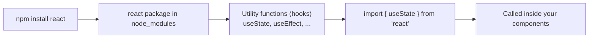
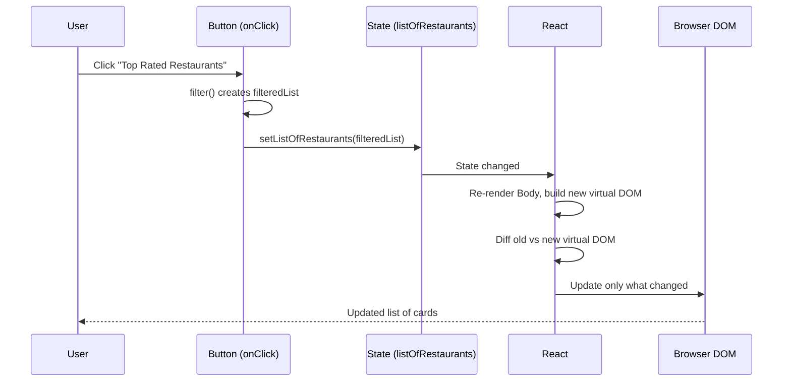
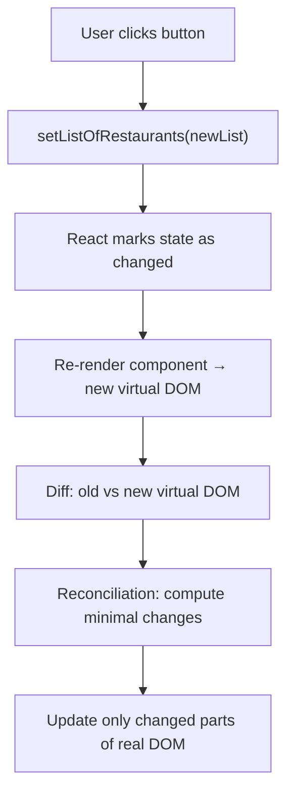
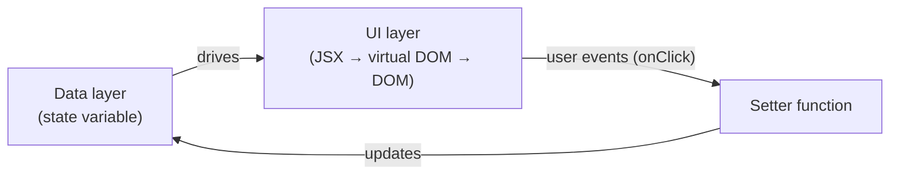

# Namaste React, Episode 5 — "Let's Get Hooked": Project Structure, Import/Export, `useState`, and How React Updates the UI

## Overview

This document turns the transcript of **Namaste React, Episode 5** into standalone learning notes. The episode continues a food-ordering app built with live restaurant data and covers three big ideas:

1. **Restructuring a React project.** Moving from one ~2,000-line `app.js` to a `src/` folder with one file per component, plus separate files for constants and mock data.
2. **ES module exports and imports.** The difference between *default* and *named* exports and imports.
3. **Your first React Hook, `useState`.** Building an interactive "Top Rated Restaurants" filter, and understanding *why* React re-renders: state variables, the virtual DOM, the diff algorithm, reconciliation, and React Fiber.

> **Labelling convention used in this document**
> - **[Transcript]** marks material taken directly from the episode (cleaned of filler and transcription errors).
> - **[Supplementary]** marks explanations, examples, or corrections added to make the material easier to understand.
> - **[Unclear]** marks details the transcript does not make certain.

---

## Learning Objectives

After studying these notes you should be able to:

- Explain why React projects are split into many files and apply a simple, conventional folder structure (`src/`, `components/`, `utils/`).
- Name component files correctly and decide on `.js` vs `.jsx` extensions with confidence.
- Explain **default export / default import** versus **named export / named import**, and know when each is used.
- Explain why hard-coded data (URLs, mock data) should not live inside component files.
- Attach event handlers (such as `onClick`) in JSX.
- Explain why changing a normal JavaScript variable does **not** update the UI.
- Define a React Hook and use `useState` to create a **state variable** and its **setter function**.
- State the rule "when a state variable changes, React re-renders the component" and explain what happens behind the scenes (virtual DOM → diff → reconciliation → DOM update).
- Explain array destructuring and why `useState` returns an array.
- Answer the interview question "Why is React fast?" accurately.

## Prerequisites

- Basic HTML, CSS, and JavaScript (variables, functions, arrow functions, arrays, objects).
- Familiarity with the earlier episodes: JSX, functional components, `React.createElement`, props, `map()`, and the `key` prop.
- A working project from previous episodes (a "Namaste Food" app) bundled with **Parcel**, with `npm` installed.
- Knowledge of `map`, `filter`, and `reduce`. The instructor refers to a separate "map filter reduce" video for this.

---

## Table of Contents

- [1. Introduction: Why React at All?](#1-introduction-why-react-at-all)
- [2. Restructuring the Project](#2-restructuring-the-project)
  - [2.1 Why split one large file?](#21-why-split-one-large-file)
  - [2.2 The `src` folder](#22-the-src-folder)
  - [2.3 The `components` folder](#23-the-components-folder)
  - [2.4 Folder-structure strategies](#24-folder-structure-strategies)
  - [2.5 File naming and `.js` vs `.jsx`](#25-file-naming-and-js-vs-jsx)
  - [2.6 Tutorial: moving the app into `src/`](#26-tutorial-moving-the-app-into-src)
- [3. Exporting and Importing Modules](#3-exporting-and-importing-modules)
  - [3.1 Moving a component to its own file](#31-moving-a-component-to-its-own-file)
  - [3.2 Default export and default import](#32-default-export-and-default-import)
  - [3.3 Named export and named import](#33-named-export-and-named-import)
  - [3.4 Comparison table](#34-comparison-table)
  - [3.5 Import path and file extension](#35-import-path-and-file-extension)
- [4. Keeping Hard-Coded Data Out of Components](#4-keeping-hard-coded-data-out-of-components)
- [5. Making the App Dynamic: The Top-Rated Filter](#5-making-the-app-dynamic-the-top-rated-filter)
  - [5.1 Feature description](#51-feature-description)
  - [5.2 Adding the button](#52-adding-the-button)
  - [5.3 Event handlers in React](#53-event-handlers-in-react)
- [6. The Problem: A Normal Variable Doesn't Update the UI](#6-the-problem-a-normal-variable-doesnt-update-the-ui)
- [7. React Hooks and `useState`](#7-react-hooks-and-usestate)
  - [7.1 What is a Hook?](#71-what-is-a-hook)
  - [7.2 The two most important hooks](#72-the-two-most-important-hooks)
  - [7.3 Creating a state variable](#73-creating-a-state-variable)
  - [7.4 Updating state with the setter](#74-updating-state-with-the-setter)
  - [7.5 Complete working filter](#75-complete-working-filter)
- [8. What Happens Behind the Scenes](#8-what-happens-behind-the-scenes)
  - [8.1 Re-rendering](#81-re-rendering)
  - [8.2 Virtual DOM](#82-virtual-dom)
  - [8.3 The diff algorithm](#83-the-diff-algorithm)
  - [8.4 Reconciliation and React Fiber](#84-reconciliation-and-react-fiber)
  - [8.5 Why React is fast](#85-why-react-is-fast)
- [9. Array Destructuring](#9-array-destructuring)
- [10. How the Concepts Connect](#10-how-the-concepts-connect)
- [11. Common Mistakes and Troubleshooting](#11-common-mistakes-and-troubleshooting)
- [12. Best Practices](#12-best-practices)
- [13. Exercises and Practice Tasks](#13-exercises-and-practice-tasks)
- [14. Key Takeaways](#14-key-takeaways)
- [15. Glossary](#15-glossary)
- [16. References and Further Learning](#16-references-and-further-learning)

---

## 1. Introduction: Why React at All?

### Recap of the previous episode [Transcript]

- The food-ordering app listed restaurant cards using **live data** from Swiggy's API rather than mock data.
- This illustrated **config-driven UI**: the UI is driven by a configuration/data payload sent by the back end. The API effectively controls what the web page shows.
- At that point the UI looked "clumsy", but the instructor promised more polished work ahead.

### "You can do everything React does without React" [Transcript]

Everything React (or any other framework) can do can also be done with plain HTML, CSS, and JavaScript, because React itself is JavaScript behind the scenes. So why use it?

- A framework or library makes the **developer experience easier**.
- You **write less code** and do **more on the page**.
- React helps you build **large, scalable, production-ready, performant** applications.
- React also **optimizes** page updates so things happen quickly.

This episode demonstrates the first real "superpower" of React: keeping the **UI in sync with the data**.

---

## 2. Restructuring the Project

### 2.1 Why split one large file?

**[Transcript]** In the previous episode all components (`AppLayout`, `Header`, `Body`, `RestroCard`) lived in a single `app.js` that had grown to **1,982 lines**.

| Aspect | One big file | One file per component |
|---|---|---|
| Reading and navigating | Hard; lots of scrolling | Easy; the file name tells you what's inside |
| Team collaboration | Frequent merge conflicts | Developers work on separate files |
| Reuse | Hard to reuse a component elsewhere | Import it anywhere |
| Scalability | Real projects have *thousands* of components; this cannot work | Scales naturally |

Important nuance from the transcript:

- Putting everything in one file is **technically fine**. Parcel eventually bundles, minifies, and compresses all your code into a few files anyway.
- But **source code is written for humans**. Splitting code logically is what "production-ready" code looks like.

> **File-size rule of thumb [Transcript]:** At Uber the practice (not a hard rule) was to keep a file under roughly **100 lines**. If a component file grows past 100–200 lines, you are probably doing too much in it and should split it into smaller components or files.

### 2.2 The `src` folder

- By convention, the main code of a React project goes in a **`src`** folder (short for "source").
- The instructor admits he doesn't know the original reason, but nearly every project he has worked on uses `src`. It's **not required**; you can build an entire app without it. It's simply an industry convention.

### 2.3 The `components` folder

- Inside `src`, create a **`components`** folder.
- `app.js` holds the **root-level code** (the app layout and `ReactDOM` render call). All other components go in `components/`.

### 2.4 Folder-structure strategies

**[Transcript]** React has **no official opinion** on how to structure files. The React documentation says it doesn't matter. It's up to the **developer, team, project lead, or project owner**.

Two common approaches mentioned (as described in the React docs):

| Approach | Description | Example |
|---|---|---|
| **Group by feature or route** | Keep all files for a feature together (components, CSS, tests) | `feed/`, `profile/`, `search/`, `restaurant/`, `header/` |
| **Group by file type** | Keep all files of one kind together | `components/`, `api/` |

Advice from the docs and the instructor:

- **Avoid too much nesting** (don't create a new folder for every file).
- Find a "sweet spot".
- **Don't overthink it.** Start with something simple and **restructure later** as the app grows.

This project uses the simple, widely used layout:

```text
namaste-react/
├── index.html
├── README.md
├── package.json
└── src/
    ├── app.js
    ├── components/
    │   ├── Header.js
    │   ├── Body.js
    │   └── RestaurantCard.js
    └── utils/
        ├── constants.js
        └── mockData.js
```

> **[Supplementary]** The instructor names files by the component names used in the series (for example `RestroCard`). This document uses `RestaurantCard` for clarity in the code, but any consistent name works, as long as the file name matches the component name.

### 2.5 File naming and `.js` vs `.jsx`

**Naming rule [Transcript]:** Name a component's file **exactly like the component**, starting with a capital letter (`Header` → `Header.js`, `Body` → `Body.js`). Then any developer knows that `Header.js` contains the `Header` component.

**Extensions [Transcript]:** Some developers use `.jsx` for files containing JSX (and `.tsx` for TypeScript). Others use `.js`. The instructor's view:

- He used **`.js`** across many projects (including at Uber).
- JSX is ultimately JavaScript, and the choice makes **no functional difference**.
- Teams differ, so you'll see all of these in the industry. Follow your team's convention. If you're free to choose, **keep it simple**.

> **[Supplementary]** Some tools (certain Vite and Next.js setups, for example) are stricter about extensions, but with the Parcel setup in this series `.js` works fine.

**The same file-name rule for non-component files [Transcript]:** non-component files use lowercase names (`constants.js`, `mockData.js`) because they don't contain components. The capitalization itself hints at what a file holds.

### 2.6 Tutorial: moving the app into `src/`

**Objective:** Move `app.js` into `src/` and keep the app working.

**Prerequisites:** The project from Episode 4, running with Parcel.

**Steps**

1. Create a folder named `src` at the project root.
2. Move `app.js` into `src/`.
3. **Observe:** the build fails, because `index.html` still points to the old location.
4. Open `index.html` and update the script path:

   ```html
   <!-- before -->
   <script type="module" src="./app.js"></script>

   <!-- after -->
   <script type="module" src="./src/app.js"></script>
   ```

5. Save. The app should work again.
6. **Clean up `app.js`:** The long explanatory comments were moved into `README.md` (under a "Namaste Food" heading) so they stay available for reference without cluttering the code.

**Expected result:** The page looks the same as before. Only the file layout changed.

**Troubleshooting**

| Symptom | Cause | Fix |
|---|---|---|
| Parcel build fails after moving `app.js` | `index.html` still references the old path | Update the `src` attribute of the `<script>` tag |
| Page is blank | Wrong relative path | Check `./src/app.js` is correct relative to `index.html` |

---

## 3. Exporting and Importing Modules

### 3.1 Moving a component to its own file

**Problem:** After moving `Header` into `components/Header.js`, `app.js` throws an error saying `Header` is not defined, because `app.js` no longer contains it.

**Solution:** *Export* the component from its own file, then *import* it where it's used.

> **"First give, then take" [Transcript]:** You must **export** before you can **import**. A common mistake is trying to import something that was never exported.

### 3.2 Default export and default import

**Definition:** A file's *default export* is the single main thing it exposes. In English: "by default, `Header.js` gives you the Header component."

**Rule:** A file can have **only one** default export. Writing it twice gives an error (*"A module cannot have multiple default exports"*).

**Syntax**

```js
// components/Header.js
const Header = () => {
  return (
    <div className="header">
      <div className="logo-container">
        
      </div>
      {/* nav items ... */}
    </div>
  );
};

export default Header;
```

```js
// app.js
import Header from "./components/Header";
```

**Explanation**

- `export default Header;` makes `Header` the file's default export.
- `import Header from "./components/Header";` imports it. Note: **no curly braces**.
- `./` means "start from the current folder" (here `src/`), then `components/Header`.

The same pattern applies to `Body`:

```js
// components/Body.js
const Body = () => { /* ... */ };
export default Body;
```

```js
// app.js
import Body from "./components/Body";
```

> **Tip [Transcript]:** VS Code's autocomplete suggests imports when you start typing a component name. Press Enter to accept. But understand *why* the braces do or don't appear (see 3.3).

**The `RestaurantCard` component**

`RestaurantCard` is used by `Body`, not by `app.js`, so **`Body.js`** imports it. Because both files sit in the same folder, the path is `./RestaurantCard`:

```js
// components/Body.js
import RestaurantCard from "./RestaurantCard";
```

> **Key point [Transcript]:** You can import and export between *any* files; imports don't have to be in `app.js`. Always check the **relative path** from the importing file.

**Where did `React` come from?** `import React from "react"` is a default import from the `react` package in `node_modules`. Somewhere inside that package someone exported it. Understanding exports/imports explains how everything you import is wired up.

### 3.3 Named export and named import

**Why it exists:** Since a file can have only one default export, you need another way to export **multiple things** from one file. That's the **named export**.

**Syntax**

```js
// utils/constants.js
export const CDN_URL = "https://example.com/image/upload/";   // placeholder
export const LOGO_URL = "https://example.com/logo.png";        // placeholder
```

```js
// components/RestaurantCard.js
import { CDN_URL } from "../utils/constants";
```

**Explanation**

- `export` in front of a `const` makes it a *named export*. You can export as many as you want.
- When importing a named export, wrap the name in **curly braces**: `{ CDN_URL }`. The name must match exactly.
- The path is `../utils/constants` because `RestaurantCard.js` is inside `components/` and `utils/` is a sibling folder. `..` means "go up one level".

**Using the imported value in JSX**

```jsx
// ✅ Correct: a JavaScript variable inside curly braces


// ❌ Wrong: this passes the literal text "LOGO_URL" as the string

```

**You can also export components by name [Transcript]:**

```js
// Header.js
export const Header = () => { /* ... */ };
```
```js
// app.js
import { Header } from "./components/Header";
```

It works, but the instructor's guidance is: **prefer default exports for components** unless a file exports multiple things. Use named exports when a file exports multiple things.

### 3.4 Comparison table

| Feature | Default export / import | Named export / import |
|---|---|---|
| Export syntax | `export default Header;` | `export const CDN_URL = "...";` |
| Import syntax | `import Header from "./Header";` | `import { CDN_URL } from "./constants";` |
| How many per file | **One** | **Many** |
| Curly braces on import | No | **Yes** |
| Import name | Any name you choose | Must match the exported name |
| Typical use | One component per file | Constants, utilities, several exports |

Why this matters: copying code or relying on autocomplete often adds or removes braces automatically, so many developers use both forms without knowing why. Knowing the rule makes errors easy to diagnose.

### 3.5 Import path and file extension

**[Transcript]** Some developers write the extension (`./components/Header.js`), others omit it (`./components/Header`). Both work here. The instructor recommends: **use `.js` for files and omit the extension in imports**. The same convention is used in every episode.

> **[Supplementary correction]** The transcript says "React will treat it as a JavaScript file by itself". More precisely, the **bundler** (Parcel here) resolves the module and tries common extensions such as `.js`, `.jsx`, `.ts`, and `.tsx`. React itself does not resolve files. Bundler configuration can differ between tools.

---

## 4. Keeping Hard-Coded Data Out of Components

**[Transcript] Rule:** Never keep hard-coded data (URLs, strings, mock data) inside component files. This is an industry best practice.

Three hard-coded items existed in the app:

1. The **restaurant list** (mock data).
2. The **CDN image URL** (used in the restaurant card).
3. The **logo URL** (used in the header).

**Solution:** Create a **`utils`** folder (some teams call it `common` or `config`) for utilities shared across the whole app, and put the data there:

| File | Contents | Export style |
|---|---|---|
| `utils/constants.js` | `CDN_URL`, `LOGO_URL` | **Named** exports (two items in one file) |
| `utils/mockData.js` | The big restaurant list | **Default** export (one item) |

**Constant naming convention [Transcript]:** constants are written in **UPPER_SNAKE_CASE** (`CDN_URL`, `LOGO_URL`).

**Step-by-step**

1. Create `src/utils/constants.js`.
2. Cut the CDN URL from `RestaurantCard.js` and the logo URL from `Header.js`, and paste them as named exports.
3. Create `src/utils/mockData.js`. Move the large restaurant list there and export it by default:

   ```js
   // utils/mockData.js
   const resList = [ /* ...restaurant objects... */ ];
   export default resList;
   ```

4. Import in `Body.js`:

   ```js
   import resList from "../utils/mockData";
   ```

5. Import constants in `RestaurantCard.js` and `Header.js`:

   ```js
   import { CDN_URL } from "../utils/constants";   // RestaurantCard.js
   import { LOGO_URL } from "../utils/constants";  // Header.js
   ```

> **[Transcript]** The instructor made a typo, naming the file `constant.js` while importing `constants`, which caused a "module not found" error until the names matched. This is a very typical beginner error.

**Why this matters:** In a large app, any component (for example a future `Footer`) may need the same logo URL. One central file avoids duplication and makes updates trivial.

**What happens without this step:** If you move the list out of `app.js` without importing it, you get the error *"restList is not defined"*. React can't find a variable that doesn't exist in the file's scope.

> **[Unclear]** The transcript spells the list name inconsistently ("rest list", "restlist"). This document uses `resList`.

---

## 5. Making the App Dynamic: The Top-Rated Filter

### 5.1 Feature description

So far the app was **static**: a read-only page with no interactions. Now we add a **button** that filters restaurants, so the page responds to the user.

- Button label: **Top Rated Restaurants**.
- Behavior: on click, show only restaurants with an average rating **greater than 4**.
- Example from the transcript: Meghna Foods (4.4) stays, while KFC (3.8) disappears.

> The instructor teaches through **project-based learning**: we build features, and learn concepts as we need them.

### 5.2 Adding the button

In `Body.js`, the temporary search bar area becomes a filter area (search will be built later):

```jsx
<div className="filter">
  <button className="filter-btn">Top Rated Restaurants</button>
</div>
```

Basic CSS (the transcript adds margin and a pointer cursor so the button looks clickable):

```css
.filter-btn {
  margin: 10px;
  cursor: pointer;
}
```

### 5.3 Event handlers in React

**Definition:** An event handler is a function that runs when something happens (a click, a mouseover, and so on).

**How:** Pass an attribute named `onClick` (camelCase) with a **callback function** wrapped in curly braces (because it's JavaScript inside JSX):

```jsx
<button
  className="filter-btn"
  onClick={() => {
    console.log("Button clicked");
  }}
>
  Top Rated Restaurants
</button>
```

**Expected result:** Each click prints `Button clicked` in the browser console. In the transcript the instructor clicked 10 times and saw 10 logs.

**Other events:** React has equivalents for DOM events, for example `onMouseOver`, `onMouseEnter`, `onBlur`. (The instructor looked up the hover event during the video; in React it's `onMouseOver`/`onMouseEnter`, and there is no `onHover`.)

| Plain HTML/JS | React JSX |
|---|---|
| `onclick="fn()"` (lowercase, string) | `onClick={fn}` (camelCase, function) |
| `onmouseover` | `onMouseOver` |
| `onblur` | `onBlur` |

---

## 6. The Problem: A Normal Variable Doesn't Update the UI

The instructor builds this up from first principles, which is the most important lesson of the episode.

### 6.1 The UI is driven by data

The cards come from a list. If the list changes, the UI *should* change, since this is a config-driven UI. With an empty list you see no cards; with one object you see one card; with two, two cards.

**[Transcript]** To simplify, he temporarily replaced the big mock list with a tiny list of sample restaurants (KFC 3.8, Domino's 4.5, and later McDonald's 4.1), with **unique `id`s** so React doesn't warn about duplicate keys:

> *Warning: Encountered two children with the same key.* The cause was copy/pasting objects with the same `id`. The fix is to give each a unique `id`.

### 6.2 The failed attempt with a normal variable

```jsx
const Body = () => {
  let listOfRestaurants = [ /* KFC, Domino's, MCD ... */ ];

  return (
    <div className="body">
      <button
        className="filter-btn"
        onClick={() => {
          listOfRestaurants = listOfRestaurants.filter(
            (res) => res.data.avgRating > 4
          );
          console.log(listOfRestaurants);
        }}
      >
        Top Rated Restaurants
      </button>
      {/* cards rendered from listOfRestaurants */}
    </div>
  );
};
```

**Observations [Transcript]:**

1. First attempt: `Assignment to constant variable` error, because the variable was declared with `const`. Change it to `let`.
2. After the fix, the console shows the list **was filtered** (only Domino's and MCD remain).
3. **But the page still shows all cards.** The data changed; the UI did not.

> **[Unclear]** The exact field name for the rating in the mock data isn't stated in the transcript; it is probably `res.data.avgRating` (the instructor says "average rating"). Use whatever field your data actually has.

### 6.3 Why?

React doesn't watch ordinary JavaScript variables. Nothing tells React "this data changed, redraw the UI". We would have to manually update the DOM, which is the tedious, error-prone work React exists to remove.

**The core problem all UI frameworks (React, Angular, Vue) solve [Transcript]:** keep the **data layer** and **UI layer** in sync, and update the DOM efficiently.

**Solution:** give the variable "superpowers" using React's `useState` hook. A variable made this way is called a **state variable**.

---

## 7. React Hooks and `useState`

### 7.1 What is a Hook?

**Definition [Transcript]:**

- A functional component is just a normal JavaScript **function**.
- A React element is just a plain JavaScript **object**.
- A **Hook is just a normal JavaScript function**, written by the React (Facebook) developers and shipped inside the `react` package, which you got when you ran `npm install react`.

The only special thing is that these utility functions contain logic inside React that gives them "superpowers".



### 7.2 The two most important hooks

| Hook | Purpose | Covered in |
|---|---|---|
| **`useState`** | Create powerful **state variables** | This episode |
| **`useEffect`** | Run side effects (covered later) | Upcoming episodes |

The instructor estimates these two hooks make up the vast majority of everyday React work (about 80% `useState` / 20% `useEffect` is his rough statement). Other hooks exist but are used far less often.

### 7.3 Creating a state variable

#### Definition

A **state variable** is a special local variable created with `useState`. React **tracks** it. When it changes (through its setter), React re-renders the component.

#### Syntax

```js
import { useState } from "react";   // a NAMED import

const [listOfRestaurants, setListOfRestaurants] = useState(initialValue);
```

#### Step by step

1. **Import `useState` as a named import** from `"react"`. It's a named export of the React package. (This is why the earlier lesson on named imports matters.)
2. Call `useState(...)` **inside the component function**. The value you pass is the variable's **default (initial) value**.
3. `useState` returns an **array** with two elements. You receive them via destructuring:
   - Element 0 → the current value (`listOfRestaurants`).
   - Element 1 → a function to update it (`setListOfRestaurants`).

#### Normal variable vs state variable

```js
// Normal JavaScript variable
let listOfRestaurants = [];

// React state variable
const [listOfRestaurants, setListOfRestaurants] = useState([]);
```

#### Default values

| Call | Default value |
|---|---|
| `useState([])` | Empty list |
| `useState(null)` | `null` |
| `useState([oneRestaurant])` | A list of one restaurant |
| `useState(resList)` | The full mock list (15 restaurants) |

The transcript tested several of these. With one restaurant as the default, one card appeared; with three, three cards; with `resList`, all 15. State variables **read exactly like normal variables**, so `listOfRestaurants.map(...)` works unchanged.

#### Scope

A state variable created in `Body` is a **local state variable**: its scope is the `Body` component's function.

#### Naming convention for the setter

Name the setter **`set` + variable name**: `listOfRestaurants` → `setListOfRestaurants`. This is a convention, not a rule, but everyone follows it.

### 7.4 Updating state with the setter

**Never assign directly:**

```js
listOfRestaurants = filteredList;   // ❌ Not the way to update state
```

**Call the setter:**

```js
setListOfRestaurants(filteredList); // ✅ Correct
```

**Why two things?** [Transcript] There must be a **trigger** that tells React to start its diff algorithm and update the UI. Calling the setter *is* that trigger. Assigning directly with `=` triggers nothing.

Equivalent for emptying the list: `setListOfRestaurants([])` is the React way of writing `listOfRestaurants = []`.

### 7.5 Complete working filter

#### Problem

Show only restaurants with rating > 4 when the user clicks **Top Rated Restaurants**.

#### Setup

- Files from Sections 2–4 in place: `Body.js`, `RestaurantCard.js`, `utils/mockData.js`.
- Mock data entries have a unique `id` and an average rating field.

#### Code

```jsx
// src/components/Body.js
import { useState } from "react";
import RestaurantCard from "./RestaurantCard";
import resList from "../utils/mockData";

const Body = () => {
  // State variable with the full mock list as default value
  const [listOfRestaurants, setListOfRestaurants] = useState(resList);

  return (
    <div className="body">
      <div className="filter">
        <button
          className="filter-btn"
          onClick={() => {
            // Plain JavaScript filtering
            const filteredList = listOfRestaurants.filter(
              (res) => res.data.avgRating > 4
            );
            // Tell React about the new data
            setListOfRestaurants(filteredList);
          }}
        >
          Top Rated Restaurants
        </button>
      </div>

      <div className="res-container">
        {listOfRestaurants.map((restaurant) => (
          <RestaurantCard key={restaurant.data.id} resData={restaurant} />
        ))}
      </div>
    </div>
  );
};

export default Body;
```

#### Explanation

| Line | Purpose |
|---|---|
| `import { useState } from "react"` | Named import of the hook |
| `useState(resList)` | Creates state, default = all restaurants |
| `[listOfRestaurants, setListOfRestaurants]` | Destructures the current value and its setter |
| `.filter(res => res.data.avgRating > 4)` | Builds a **new** array with only top-rated restaurants |
| `setListOfRestaurants(filteredList)` | Updates the state and triggers a re-render |
| `.map(...)` with `key` | Renders one card per restaurant; `key` must be unique |

#### Expected result

1. On page load: all 15 restaurant cards.
2. Click **Top Rated Restaurants**: the page immediately updates to only restaurants rated above 4. The instructor describes this as "magic", with no manual DOM code at all.

> In the browser's **Elements** tab you can watch the `res-container` change as you click. React updates the DOM for you.

#### How it works (sequence)



#### Alternative / improvement [Supplementary]

After filtering, the original list is gone from state, so there's no way to "show all again". Real apps usually keep **two** pieces of state (the full list and the filtered list) or add a "reset" button. The transcript doesn't cover this yet; later episodes build on filtering and search.

---

## 8. What Happens Behind the Scenes

### 8.1 Re-rendering

> **The key rule [Transcript]:** *Whenever a state variable updates, React re-renders the component.*

- "Render" means React calls your component function and updates the page output.
- When you call `setListOfRestaurants(...)`, React re-runs `Body` with the new value, finds out what's different, and updates the page. It does this *very quickly*.
- React is "keeping an eye" on state variables created with `useState`. It can't do that with plain variables.

A normal variable change **does not** trigger a re-render; a state variable change **does**.

### 8.2 Virtual DOM

| Term | Meaning |
|---|---|
| **Actual DOM** | The real tree of HTML elements in the browser (divs, images, and so on) |
| **Virtual DOM** | A **JavaScript object representation** of the actual DOM that React keeps in memory |

**[Transcript]** Remember `React.createElement(...)`: it returns a plain **object** (a React element). JSX is converted into these objects, and a whole component tree becomes one large, nested object. That nested object is, in essence, the virtual DOM. The instructor demonstrates this by `console.log`-ing a component's JSX (for example `console.log(<Body />)`) and showing the printed object.

> **Note [Transcript]:** Virtual DOM is **not a React-only idea**. The concept existed in software engineering before React; React built its core algorithm on top of it.

### 8.3 The diff algorithm

**Definition:** The diff algorithm compares the **old virtual DOM** with the **new virtual DOM** and finds the differences, much like a `git diff` between two versions of a file.

**Example [Transcript]:** A container holds 7 restaurant cards. After clicking the filter, only 3 should remain. React diffs old vs new, determines that 4 cards must go, then updates only that part of the real DOM.

**Why diffing objects is fast [Transcript]:** Comparing two HTML trees is expensive, while comparing two JavaScript objects is fast. React diffs the cheap objects and only touches the expensive real DOM where needed.

### 8.4 Reconciliation and React Fiber

- **Reconciliation** is the process by which React works out what changed (via the diff) and updates the DOM accordingly.
- **React Fiber** is the **implementation of the reconciliation algorithm** introduced with **React 16**. It is described as the new core algorithm for diffing and updating the DOM.
- Fiber supports **incremental rendering**: splitting rendering work into chunks spread over multiple frames.

> **[Supplementary correction/clarification]** The instructor says "2016" and then corrects himself to "React 16". Fiber's development began around 2016, but **React 16 itself shipped in 2017**. The course uses React 18.

**Recommended reading [Transcript]:** the *React Fiber Architecture* document on GitHub by **acdlite** (a React core team member), plus the official React "Reconciliation" page. The instructor warns that it is hard to explain fully and encourages self-study.

### 8.5 Why React is fast

**Interview answer [Transcript]:**

> React is fast because it performs **efficient DOM manipulation**. It keeps a virtual DOM, uses a diff algorithm to find the minimal change between virtual DOMs, and updates only that part of the real DOM.

Common wrong answers the instructor warns about:

- "React minifies our code" — **No.** Minification and bundling are done by the **bundler** (Parcel), not React.
- "React bundles chunks" — same; that's the bundler.

React's strength is **DOM manipulation / UI-data synchronization**.



---

## 9. Array Destructuring

**[Transcript]** `useState` returns an **array**. Many developers copy the following syntax without understanding it:

```js
const [listOfRestaurants, setListOfRestaurants] = useState(resList);
```

This is plain **JavaScript array destructuring**, not special React syntax. It is shorthand for:

```js
const arr = useState(resList);
const listOfRestaurants = arr[0];       // current value
const setListOfRestaurants = arr[1];    // setter function
```

Both forms work. Destructuring just does it "on the fly". Because the names come from *your* destructuring, you can name them anything, but follow the `thing` / `setThing` convention.

**Mini example [Supplementary]**

```js
const colors = ["red", "green"];
const [first, second] = colors;
console.log(first);  // "red"
console.log(second); // "green"
```

> **Advice from the instructor:** Be curious about every small piece of syntax. Questions like "why does this return an array?" and "why two things?" lead to real understanding.

---

## 10. How the Concepts Connect

| Earlier idea | How it supports this episode |
|---|---|
| Config-driven UI | The data (list) determines the UI, so changing the data should change the UI |
| `map()` | Renders one card per list item; works unchanged with state |
| `filter()` | Pure JavaScript used to compute the new list |
| React elements are objects | Explains the virtual DOM: a tree of these objects |
| Named vs default imports | `useState` is a **named** import from `react` |
| Components as functions | A re-render is React calling the function again |
| `key` prop | Helps React identify items during the diff |



---

## 11. Common Mistakes and Troubleshooting

| # | Mistake / Error | Why it happens | Fix |
|---|---|---|---|
| 1 | Build fails after moving `app.js` | `index.html` still points to the old path | Change to `./src/app.js` |
| 2 | `Header is not defined` | Component moved but not imported | `export default Header` then `import Header from "./components/Header"` |
| 3 | Importing something that was never exported | Forgot the "give before take" rule | Add the `export` first |
| 4 | `A module cannot have multiple default exports` | Two `export default` in one file | Keep one default; use named exports for the rest |
| 5 | Import is `undefined` or errors with braces | Mixed up default and named import syntax | Default: `import X from`; Named: `import { X } from` |
| 6 | `Cannot resolve ... constants` | File named `constant.js` but imported `constants` | Make file name and import match exactly |
| 7 | `restList is not defined` | List moved to another file but not imported | Import it in the file that uses it |
| 8 | Image `src` shows the text `LOGO_URL` | Wrote `src="LOGO_URL"` (a string) | Use `src={LOGO_URL}` |
| 9 | `Assignment to constant variable` | Reassigning a `const` | Use `let` (for a normal variable) or `setX` (for state) |
| 10 | Duplicate `key` warning | Copy-pasted objects with the same `id` | Give each object a unique `id` |
| 11 | Data filtered in console but UI unchanged | Using a plain variable | Use `useState` and the setter |
| 12 | UI doesn't update after `list = newList` on a state variable | Assigned directly | Call `setList(newList)` |

---

## 12. Best Practices

1. **One component per file**, named exactly like the component (`Header.js`).
2. Keep source code in `src/`, components in `src/components/`, shared helpers and data in `src/utils/`.
3. **Don't over-think structure.** Start simple and restructure as the app grows.
4. Keep files short (about 100 lines is a good soft target). Split when they grow.
5. **Default export for a file's main item** (component); **named exports** for multiple items.
6. Never hard-code URLs, strings, or mock data inside components; keep them in `constants.js` / `mockData.js`.
7. Write constants in `UPPER_SNAKE_CASE`.
8. Be consistent about file extensions and import style across the project (the instructor: `.js`, no extension in imports).
9. Use `useState` for any data that should update the UI; update it only through the setter.
10. Name setters `setXxx`.
11. Give list items unique `key` values.
12. **[Supplementary]** Call hooks at the **top level** of a component (not inside loops, conditions, or nested functions), and only in components or custom hooks. This is a formal Rules of Hooks requirement; the transcript's examples already follow it.
13. **[Supplementary]** Treat state as read-only: create a **new** array (such as with `filter`) and pass it to the setter, rather than mutating the existing array.

---

## 13. Exercises and Practice Tasks

- [ ] **Restructure:** Take your own app and split it into `src/`, `components/`, and `utils/` as shown in Section 2. *Expected:* the app looks and behaves exactly as before.
- [ ] **Constants:** Move at least two hard-coded strings into `constants.js` and import them with named imports.
- [ ] **Homework from the transcript:** *Can a file have a default export and named exports at the same time?* Try it yourself. *Solution guidance [Supplementary]:* yes. A file may have **one** default export plus any number of named exports, and you import them together:
  ```js
  // utils.js
  export const A = 1;
  const main = () => {};
  export default main;
  ```
  ```js
  import main, { A } from "./utils";
  ```
- [ ] **Event practice:** Add an `onMouseOver` handler to a button that logs a message. *Expected:* the message prints when you hover.
- [ ] **State practice:** Create `const [count, setCount] = useState(0)` with a button that increases the count. Show the count in the UI. *Expected:* the number updates on every click.
- [ ] **Break it on purpose:** Replace `useState` with a plain `let` variable in your filter and confirm the UI does not update while `console.log` shows the data changing.
- [ ] **Different threshold:** Change the filter to ratings above 4.2. Check which restaurants remain.
- [ ] **Stretch (Supplementary):** Add a second button that restores the full list. (Hint: keep the original list in a separate variable or in a second state variable.)
- [ ] **Read:** the GitHub *React Fiber Architecture* document and the official React *Reconciliation* page. Write 3–5 sentences summarizing the diff algorithm in your own words.

---

## 14. Key Takeaways

- Splitting an app into **files per component** is the production standard; React itself doesn't mandate any folder structure.
- Use `src/`, `components/`, and `utils/` as a simple starting layout; **don't overthink**, and restructure later.
- **"First give, then take":** export before you import.
- **Default export** → one per file, imported **without** braces. **Named export** → many per file, imported **with** braces.
- Never keep hard-coded data in component files.
- Event handlers in React are attributes such as `onClick={() => {...}}`.
- A normal variable changing does **not** update the UI.
- A **Hook** is just a normal JavaScript utility function provided by React.
- `useState` returns `[value, setter]`, and **changing state through the setter makes React re-render the component**.
- React keeps the **data layer and UI layer in sync** by: new virtual DOM → **diff** against the old → **reconciliation** → minimal real-DOM updates. This design (implemented via **React Fiber** since React 16) is why React is fast at DOM manipulation.
- Bundling and minification come from the **bundler**, not from React.

---

## 15. Glossary

| Term | Definition |
|---|---|
| **Component file** | A file containing one React component, named after it (`Header.js`) |
| **`src` folder** | Conventional folder holding an app's source code |
| **Default export** | The single main export of a module (`export default X`) |
| **Named export** | One of possibly many exports from a module (`export const X`) |
| **Import path** | The relative location of the module being imported (`./`, `../`) |
| **Mock data** | Fake or sample data used during development |
| **Event handler** | Function that runs in response to an event such as a click |
| **Callback function** | A function passed to another function or attribute to be run later |
| **Hook** | A React utility function (such as `useState`) providing special features |
| **State variable** | A variable created with `useState` whose changes trigger re-renders |
| **Setter function** | The function returned by `useState` used to update state |
| **Re-render** | React running a component again and updating the UI after state changes |
| **Virtual DOM** | An in-memory JavaScript object representation of the real DOM |
| **Actual DOM** | The browser's real element tree |
| **Diff algorithm** | Compares old and new virtual DOM to find what changed |
| **Reconciliation** | React's process of updating the DOM based on the differences |
| **React Fiber** | React's reconciliation implementation introduced in React 16 |
| **Incremental rendering** | Splitting rendering work into chunks over multiple frames |
| **Array destructuring** | JavaScript syntax to unpack array items into variables |
| **Config-driven UI** | A UI whose content and layout are driven by data/config from the back end |

---

## 16. References and Further Learning

- React documentation on file structure ("File Structure" page on react.dev / the legacy docs)
- React documentation: **State: A Component's Memory** and the `useState` reference
- React legacy docs: **Reconciliation**
- GitHub: **acdlite / react-fiber-architecture**
- MDN Web Docs: **JavaScript modules** (`import` / `export`), **Destructuring assignment**, **`Array.prototype.filter`**
- The instructor's earlier "Map, Filter, Reduce" video (referenced in the transcript)
- Next in the series: `useEffect` and more on re-rendering

> **Verification note:** This document was prepared from the transcript only, without live lookups of external documentation. Check the official React docs for current API details.
