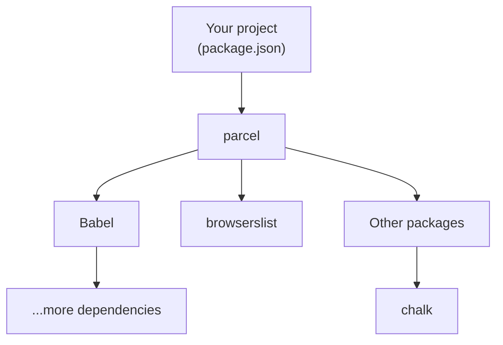
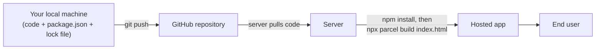
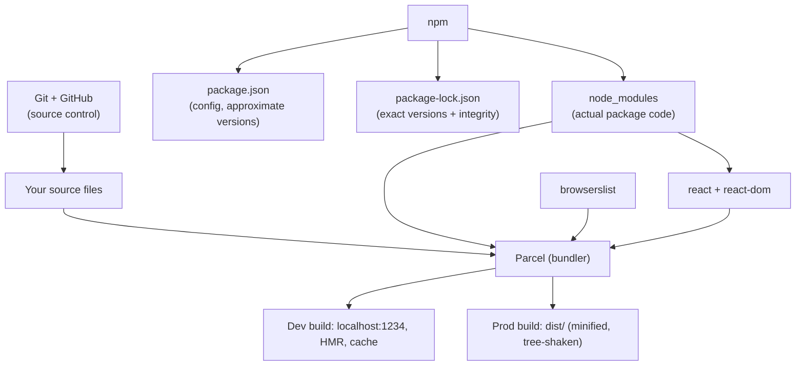

# Namaste React – Episode 2 (Igniting the App): Git, npm, Parcel, and Production-Ready Builds

## Overview

Episode 1 built a "Hello World" with React loaded from CDN links. That code works, but it is not ready for production: it is not bundled, minified, compressed, or optimized, and React is fetched from a remote server on every page load.

Episode 2, "Igniting the App", takes that small project and builds the tooling a real React application needs, by hand, instead of generating it with `create-react-app`. The instructor's stated goal is that you understand what a scaffold like Create React App does for you, so you can explain it in an interview and build it yourself. The episode covers:

1. Putting the project on GitHub (Git basics).
2. What npm is, and how `package.json` and `package-lock.json` work.
3. What a bundler is, and installing **Parcel**.
4. Dev vs normal dependencies, version prefixes (`^`, `~`), `node_modules`, and transitive dependencies.
5. What belongs in Git and what goes in `.gitignore`.
6. Running Parcel (`npx parcel index.html`): dev server, HMR, caching.
7. Replacing the CDN links with npm-installed `react` and `react-dom`, using `import` and `type="module"`.
8. Everything else Parcel does, and creating a production build.
9. Supporting older browsers with `browserslist`.

> **How to read these notes**
> - Content from the transcript is presented as the instructor taught it.
> - **📘 Supplementary** marks material added for clarity that is not stated in the transcript.
> - **✏️ Correction / Clarification** marks places where the transcript is inaccurate or imprecise.
> - **❓ Unclear** marks something the transcript does not make clear.

## Learning Objectives

After studying these notes you should be able to:

- Initialize a Git repository, connect it to a GitHub remote, and push code.
- Explain what npm is, what `npm init` does, and what `package.json` stores.
- Distinguish packages, dependencies, dev dependencies, and transitive dependencies.
- Explain the difference between `package.json` and `package-lock.json`, and between caret (`^`) and tilde (`~`) versions.
- Explain what `node_modules` is and why it should not be committed to Git.
- Explain what a bundler does and list the main things Parcel does for you.
- Explain the difference between `npm` and `npx`.
- Replace CDN links with npm-installed React, and use `import` in a browser module script.
- Create a development build and a production build with Parcel.
- Configure `browserslist` to control which browsers your app supports.
- Explain, in interview terms, why a React app is fast and what is doing the work.

## Prerequisites

- Completion of Episode 1 (the `index.html`, `app.js`, `index.css` project).
- Node.js installed (this provides `npm` and `npx`). ✏️ The transcript assumes this but never says so.
- Git installed, and a GitHub account.
- A terminal (the VS Code integrated terminal works).

## Table of Contents

1. [Pushing the Project to GitHub](#1-pushing-the-project-to-github)
2. [What "Igniting" an App Means](#2-what-igniting-an-app-means)
3. [npm and package.json](#3-npm-and-packagejson)
4. [Bundlers and Parcel](#4-bundlers-and-parcel)
5. [Dependencies, Versions, and the Lock File](#5-dependencies-versions-and-the-lock-file)
6. [node_modules and Transitive Dependencies](#6-node_modules-and-transitive-dependencies)
7. [What to Commit and What to Ignore](#7-what-to-commit-and-what-to-ignore)
8. [Igniting the App with Parcel](#8-igniting-the-app-with-parcel)
9. [Replacing the CDN with npm-Installed React](#9-replacing-the-cdn-with-npm-installed-react)
10. [Hot Module Replacement and Caching](#10-hot-module-replacement-and-caching)
11. [Everything Else Parcel Does](#11-everything-else-parcel-does)
12. [Building for Production](#12-building-for-production)
13. [How Code Flows from Local to Server](#13-how-code-flows-from-local-to-server)
14. [Supporting Older Browsers with browserslist](#14-supporting-older-browsers-with-browserslist)
15. [Putting It All Together](#15-putting-it-all-together)
16. [Common Mistakes and Troubleshooting](#16-common-mistakes-and-troubleshooting)
17. [Best Practices](#17-best-practices)
18. [Exercises and Practice Tasks](#18-exercises-and-practice-tasks)
19. [Homework and Curiosity Questions](#19-homework-and-curiosity-questions)
20. [Key Takeaways](#20-key-takeaways)
21. [Glossary](#21-glossary)
22. [References and Further Learning](#22-references-and-further-learning)

---

## 1. Pushing the Project to GitHub

### 1.1 Why do this first?

The instructor pushes Episode 1's code to GitHub before teaching anything new. It is a good habit, it lets viewers see the code, and it gives you a safe history to return to.

### 1.2 Git vs GitHub

| | Git | GitHub |
|---|-----|--------|
| What it is | A version-control tool that runs on your machine | A website/service that **hosts** Git repositories |
| Needs internet? | No (for local work) | Yes |

The instructor stresses that many engineers confuse the two. They are different things. (He jokes that a "Namaste Git" series may exist someday.)

> ✏️ **Clarification:** The transcript at one point calls GitHub "a client". It is better described as a hosting service for Git repositories. Other hosts exist (GitLab, Bitbucket).

### 1.3 Tutorial: create the repository and push

**Objective:** Get your local `Namaste React` folder onto GitHub.

**Prerequisites:** A GitHub account; Git installed; your project folder from Episode 1.

**Step 1 – Create the repository on GitHub.**
On github.com, create a new repository named `namaste-react` (the instructor uses "Namaste React"), set it to **public**, and do not add a README (you will add one locally).

**Step 2 – Initialize Git locally.**

```bash
git init
```

This turns the folder into a Git repository. Before this the folder was not tracked by Git.

**Step 3 – Rename the default branch to `main`.**

```bash
git branch -M main
```

Locally, Git's default branch may be `master`, while GitHub's default is `main`. The `-M` flag renames (and forces the rename of) the current branch.

**Step 4 – Add a README.**
Create `README.md` (a Markdown file) with a line such as `Namaste React`.

**Step 5 – Stage and commit.**

```bash
git add .
git commit -m "Episode 1"
```

| Command | Meaning |
|---------|---------|
| `git add .` | Stage all changed/new files for the next commit |
| `git commit -m "..."` | Record a snapshot with a message |

**Step 6 – Connect the remote.** (Done once per project.) GitHub shows you this command on the new repository's page.

```bash
git remote add origin <your-repository-url>
```

`origin` is the conventional name for the remote repository. Without this step your local Git does not know where "remote" is.

**Step 7 – Push.**

```bash
git push origin main
```

This pushes the `main` branch to the remote called `origin`.

### 1.4 Expected result

Refresh the repository page on GitHub: your files appear on the `main` branch, with the commit message "Episode 1". Clicking the commit shows the changes in it.

### 1.5 Troubleshooting (authentication)

The instructor warns that many learners get stuck at the push step because Git asks for credentials or fails with an authentication error. His advice:

- Search online for how to **set up SSH keys for GitHub** (a public/private key pair).
- Once the push works, your Git setup is correct.
- He had already set up SSH, which is why his push is smooth.

> 📘 **Supplementary:** GitHub no longer accepts account passwords for Git operations over HTTPS; use SSH keys or a personal access token.

### 1.6 Tip: keep notes in the repo

Create a `notes` folder (for example one file per episode) and push it with your assignments. It helps with revision.

---

## 2. What "Igniting" an App Means

### 2.1 The problem with our current code

So far we have `index.html`, `app.js`, `index.css`, and a README. Is it ready for production? **No.** Before shipping, a real app typically needs:

| Production need | Meaning |
|-----------------|---------|
| **Bundling** | Combine many files into a few |
| **Minification** | Remove whitespace and shorten names to shrink files |
| **Compression** | Make the files smaller still for transfer |
| **Removing comments and `console.log`s** | Keep them out of production code |
| **Code splitting / chunking** | Split code into pieces loaded when needed |
| **Image optimization** | Reduce image size |
| **Caching** | Speed up repeated builds and loads |

### 2.2 The `create-react-app` comparison

Most online React tutorials start with `npx create-react-app`. That generates a scaffold that is **already "ignited"**: it contains a bundler, local server, and so on. The instructor wants you to understand **what is actually inside** such a scaffold, so in this episode you build your own small version.

### 2.3 Key message: React alone does not make an app fast

> A lot of developers say, "React makes my app fast." React helps, but a production app also depends on **many other packages** (bundlers, minifiers, compilers, and so on) written by other people.

This matters in interviews and system-design discussions: you should be able to say what actually makes an app fast and production-ready.

---

## 3. npm and package.json

### 3.1 What is npm?

npm is the **standard repository and package manager** for JavaScript packages. Libraries and utilities you might need are hosted there, and the `npm` tool downloads and manages them in your project.

### 3.2 Does npm stand for "Node Package Manager"?

The instructor says **no**: npm's official website does not define it that way. On the npm site, the name is humorously "expanded" into random phrases each time you click it, and there is an `expansion` list in a GitHub repository where people have submitted joke expansions. His point: **npm is not officially an abbreviation**.

> ✏️ **Clarification:** In day-to-day use it *does* act as the package manager that ships with Node.js, which is why people read it as "Node Package Manager". The instructor himself notes this has no interview relevance.

### 3.3 Why use npm?

- It gives you one standard way to install any package (`npm install ...`).
- It records which packages and versions your project uses.
- Scaffolds like `create-react-app` include npm already. Here you add it manually to see how it works.

### 3.4 Tutorial: `npm init`

**Objective:** Make the project an npm project.

**Command:**

```bash
npm init
```

(Many people use `npm init -y` to accept all defaults. The instructor deliberately does **not**, so he can explain each prompt.)

**The prompts, as demonstrated:**

| Prompt | Instructor's answer / note |
|--------|----------------------------|
| package name | `namaste-react` |
| version | `1.0.0` (default) |
| description | a short description of the course project |
| entry point | left as default (see note below) |
| test command | `jest` (used in a later episode on testing) |
| git repository | the GitHub URL (picked up automatically from the remote) |
| keywords | optional (he later removes the messy ones he typed) |
| author | your name |
| license | default |
| "Is this OK?" | `yes` |

> ❓ **Unclear:** The instructor says the default entry point is not `index.html`; npm suggests `index.js`/`app.js`. This matters later (see [Section 12.3](#123-troubleshooting-the-main-field-conflict)).

### 3.5 Result: `package.json`

A new file, `package.json`, appears. It is the **configuration file for npm**: the data you typed (name, version, description, and so on) stored as JSON.

```json
{
  "name": "namaste-react",
  "version": "1.0.0",
  "description": "This is Namaste React",
  "scripts": {
    "test": "jest"
  },
  "author": "Your Name",
  "license": "ISC"
}
```

> 📘 **Supplementary:** The exact fields npm generates vary by npm version. The sample above is illustrative.

### 3.6 Packages and dependencies are the same thing

Your project is **dependent** on the packages it uses, so packages are also called **dependencies**. npm tracks:

- which dependencies the project uses, and
- which version of each.

`package.json` is where that tracking lives.

---

## 4. Bundlers and Parcel

### 4.1 Definition

A **bundler** packages your app so it can be shipped to production. It takes your source files and produces optimized output (bundled, minified, compressed, and so on).

### 4.2 Why it matters

Without a bundler, your project consists of loose HTML, CSS, and JS files exactly as you wrote them. A bundler is what turns them into something fit for real users.

### 4.3 Common bundlers

| Bundler | Notes from the transcript |
|---------|---------------------------|
| **Webpack** | Used behind the scenes by `create-react-app` (together with Babel) |
| **Parcel** | The one chosen for this course |
| **Vite** | Mentioned as another option (the transcript spells it "wheat"/"weed") |

The instructor says all bundlers do broadly the same job with different algorithms. He chooses Parcel because it is **easy to configure** ("zero config").

### 4.4 Analogy from the transcript

The app so far is a **skeleton with bones**. Parcel **gives it muscles and strength**.

### 4.5 Installing Parcel

```bash
npm install -D parcel
```

| Part | Meaning |
|------|---------|
| `npm` | The package manager |
| `install` | Add a package to the project |
| `-D` | Install as a **dev dependency** |
| `parcel` | The package name |

**What happens:** npm fetches Parcel from the npm registry (taking about a minute) and puts its code in `node_modules`. It also records Parcel in `package.json`.

### 4.6 Dev dependencies vs normal dependencies

| | Dev dependency | Normal dependency |
|---|----------------|-------------------|
| Needed during | Development/build | Development **and** production |
| Install flag | `-D` (or `--save-dev`) | none |
| Section in `package.json` | `devDependencies` | `dependencies` |
| Examples in this episode | `parcel` | `react`, `react-dom` |

Parcel does the bundling work at build time, so it is a dev dependency.

> ✏️ **Clarification:** The transcript says "chunking and minification is done on production [but] we will do this in our development phase", which is a little muddled. The point is: tools that process your code at build time are dev dependencies; code your app needs to run is a normal dependency.

### 4.7 Result in `package.json`

```json
"devDependencies": {
  "parcel": "^2.8.3"
}
```

The instructor's installed version was `2.8.3`. Your version will likely differ.

---

## 5. Dependencies, Versions, and the Lock File

### 5.1 Caret (`^`) and tilde (`~`)

The `^` before `2.8.3` is called a **caret**. A related symbol is the tilde `~`.

Versions follow **MAJOR.MINOR.PATCH** (for example `2.8.3`).

| Prefix | Meaning | Example `^2.8.3` / `~2.8.3` |
|--------|---------|------------------------------|
| `^` caret | Allow updates that do not change the **major** version | `2.8.3` → `2.9.0`, `2.8.4`; **not** `3.0.0` |
| `~` tilde | Allow only **patch** updates | `2.8.3` → `2.8.4`; **not** `2.9.0` |
| no prefix | Exact version only | only `2.8.3` |

**Why it matters:** major upgrades often contain breaking changes. The instructor recommends keeping the caret, which updates "automatically" for non-breaking releases, and says you should know this difference for interviews.

> ✏️ **Correction:** In the transcript, the instructor says that tilde "will install the major version automatically" and calls `2.8.4` a "minor" upgrade. That is not accurate. Per npm's semver rules, **tilde is the *stricter* option** (patch updates only), and `2.8.3` → `2.8.4` is a **patch** upgrade; the caret additionally allows minor upgrades (`2.8.x` → `2.9.0`). The "install" of a newer version also only happens when you run `npm install`/`npm update` with no lock file, or update explicitly. The instructor's overall conclusion (caret is a safe default; know the difference) still holds.

### 5.2 Removing the prefix

If you never want upgrades, delete the `^` so the version is exact (`"parcel": "2.8.3"`).

### 5.3 `package-lock.json`

A second file appears after installing Parcel: `package-lock.json`. Are these the same? No.

| | `package.json` | `package-lock.json` |
|---|----------------|---------------------|
| Purpose | Your project's configuration and the **approximate** versions it accepts | A record of the **exact** versions actually installed |
| Version style | `^2.8.3` (a range) | `2.8.3` (exact) |
| Covers | Direct dependencies (what you installed) | All dependencies, including **transitive** ones |
| Edited by | You (and npm) | npm (automatically) |

Even if `2.8.5` is released tomorrow, the lock file keeps recording `2.8.3` until you deliberately update.

### 5.4 The `integrity` field

Inside the lock file, each package entry has an `integrity` value: a hash (the transcript says "SHA-512"). It exists so that **the exact code you tested locally is the same code that is installed on production**. This protects against the classic "works on my machine but breaks in production" problem.

### 5.5 Why both files must be committed

- `package.json` says what the project needs.
- `package-lock.json` pins exact versions so every machine gets identical dependencies.

The instructor notes that many developers forget to commit the lock file; it is important to commit it.

---

## 6. node_modules and Transitive Dependencies

### 6.1 What is `node_modules`?

After `npm install parcel`, a `node_modules` folder appears, containing **the actual code of every package** that was fetched from npm. `package.json` is configuration; `node_modules` is where the real code lives, "like a database" for your packages.

It gets very large (3,575 files in the instructor's case from just Parcel). There is a famous meme about `node_modules` being the heaviest object in the universe.

### 6.2 Why so many folders for one package?

You installed only Parcel, but `node_modules` contains thousands of files. That is because:

- Parcel depends on other packages (Babel, browserslist, chalk, and many more).
- Those packages depend on still other packages.

This is called **transitive dependencies**.



### 6.3 Every package has its own `package.json`

Open `node_modules/parcel` and you will find its own `package.json` with its own `dependencies`. So a project does **not** have just one `package.json`; every package in the dependency tree has one. Together they form a **dependency tree**, which is why `node_modules` becomes huge.

### 6.4 The "manager" analogy

The instructor compares the packages to a government: the main package (React) and the manager of the tools (Parcel) work together, with many smaller "ministers" (supporting packages) handling specific jobs. The point: **Parcel cannot do everything alone; it coordinates many helper libraries**. None of those folders is garbage.

---

## 7. What to Commit and What to Ignore

### 7.1 The rule

> **Whatever you can regenerate, do not commit to Git.**

### 7.2 Should `node_modules` go to GitHub? No.

Because you already have `package.json` and `package-lock.json`, you can recreate `node_modules` at any time.

**Demonstration:**
1. Delete the `node_modules` folder.
2. Run:

```bash
npm install
```

3. npm reads `package.json` and `package-lock.json` and rebuilds `node_modules` with the same versions.

### 7.3 Tutorial: `.gitignore`

**Objective:** Stop Git from tracking generated folders.

1. Create a file named `.gitignore` in the project root.
2. Add entries (one per line).

```gitignore
node_modules
.parcel-cache
dist
```

> The transcript first adds `/node_modules`. The `.parcel-cache` and `dist` entries are added later in the episode, once those folders exist (see [Section 12.5](#125-what-goes-in-gitignore)).

**Result:** In VS Code's source-control view the changed-file count drops from about 3,575 to a handful of real files, and the ignored folders appear in a muted grey colour.

### 7.4 Summary table

| File / folder | Commit to Git? | Why |
|---------------|----------------|-----|
| `index.html`, `app.js`, `index.css`, `README.md` | ✅ Yes | Your source code |
| `package.json` | ✅ Yes | Declares dependencies |
| `package-lock.json` | ✅ Yes | Pins exact versions |
| `.gitignore` | ✅ Yes | Tells Git what to skip |
| `node_modules/` | ❌ No | Regenerated with `npm install` |
| `.parcel-cache/` | ❌ No | Regenerated automatically by Parcel |
| `dist/` | ❌ No | Regenerated by Parcel builds |

---

## 8. Igniting the App with Parcel

### 8.1 The command

```bash
npx parcel index.html
```

### 8.2 `npm` vs `npx`

| Command | Meaning |
|---------|---------|
| `npm install <pkg>` | **Install** a package |
| `npx <pkg>` | **Execute** a package |

So `npx parcel index.html` means "run Parcel, using `index.html` as the entry (source) file".

> ✏️ **Clarification:** The transcript misspeaks once ("NPX means installing"), then corrects itself to "executing a package". The latter is correct.

### 8.3 What happens

Parcel reads `index.html`, builds a **development build**, and **starts a local server**:

```text
Server running at http://localhost:1234
Built in 874ms
```

Your app is now served at `http://localhost:1234` instead of opening a file path directly in the browser, which is how real apps are served.

> 📘 **Supplementary:** The exact message format depends on the Parcel version.

### 8.4 What the dev build and server give you

- A local web server on port 1234.
- A development bundle written to a `dist` folder.
- Automatic rebuilding and refreshing when you save files (see [Section 10](#10-hot-module-replacement-and-caching)).

---

## 9. Replacing the CDN with npm-Installed React

### 9.1 Why the CDN approach is not preferred

Episode 1 loaded React from a CDN. The instructor says this is **not the preferred way**, for two reasons:

1. **Network cost.** Each CDN script triggers a network request to a remote host (for example unpkg.com). If React is already in `node_modules`, no extra network call is needed.
2. **Version management.** If React 19 comes out tomorrow, you would have to edit URLs in your HTML. With npm, the version lives in `package.json` alongside every other dependency and is easy to manage.

### 9.2 Tutorial: install React and ReactDOM

**Objective:** Get React from npm instead of a CDN.

**Step 1 – Install React as a normal dependency** (no `-D`, because the app needs React in production):

```bash
npm install react
```

**Step 2 – Install React DOM:**

```bash
npm install react-dom
```

`npm i` is a shorthand for `npm install`:

```bash
npm i react-dom
```

**Step 3 – Verify.** `package.json` now has:

```json
"dependencies": {
  "react": "^18.2.0",
  "react-dom": "^18.2.0"
}
```

(The instructor's versions were `18.2.0`.) `package-lock.json` and `node_modules` include them too.

**Step 4 – Remove the two CDN `<script>` tags** from `index.html`.

> 📘 **Supplementary:** `npm install react react-dom` installs both in one command. Also, the latest React release may be newer than 18; check which version you want. This course uses patterns from React 18.

### 9.3 First failure: `React is not defined`

If you start the server (`npx parcel index.html`) and refresh, you get:

```text
ReferenceError: React is not defined
```

**Why:** Before, `React` was a global created by the CDN script. Now `React` exists only inside `node_modules`, and your code does not yet know how to reach it.

### 9.4 Fix part 1: `import`

At the top of `app.js`:

```javascript
import React from "react";
import ReactDOM from "react-dom";
```

**What `import` means:** "Bring in the `react` package that lives in `node_modules` and call it `React` in this file." The same applies to `react-dom`.

### 9.5 Second failure: "Browser scripts cannot have imports or exports"

Parcel now reports a clear, readable error:

```text
Browser scripts cannot have imports or exports.
```

**Why:** In `index.html`, `<script src="app.js">` is a normal browser script. Normal scripts do not allow `import`/`export`.

### 9.6 Fix part 2: `type="module"`

Tell the browser this file is a **module**:

```html
<script type="module" src="app.js"></script>
```

The error disappears and the app renders again, now with React coming from `node_modules`.

### 9.7 Warning: `react-dom/client`

A warning says to import `createRoot` from `react-dom/client`. In React 18, the correct import is:

```javascript
import ReactDOM from "react-dom/client";
```

The warning goes away.

### 9.8 The instructor's teaching approach

He intentionally lets you hit these errors rather than hiding them: "Developers' life is to face bugs and errors." He also points out that Parcel's error display is much friendlier than a raw red console message (see [Section 11](#11-everything-else-parcel-does)).

### 9.9 Final `app.js` for this stage

```javascript
import React from "react";
import ReactDOM from "react-dom/client";

const parent = React.createElement("div", { id: "parent" }, [
  React.createElement("div", { id: "child1" }, [
    React.createElement("h1", {}, "This is Namaste React 🚀"),
    React.createElement("h2", {}, "I'm an h2 tag"),
  ]),
  React.createElement("div", { id: "child2" }, [
    React.createElement("h1", {}, "I'm an h1 tag"),
    React.createElement("h2", {}, "I'm an h2 tag"),
  ]),
]);

const root = ReactDOM.createRoot(document.getElementById("root"));
root.render(parent);
```

> ✏️ The transcript shows only the changed line (text changed to "This is Namaste React 🚀"). The rest is the nested structure from Episode 1; reconstructed here so the example is complete.

### 9.10 Final `index.html`

```html
<!DOCTYPE html>
<html lang="en">
<head>
  <meta charset="UTF-8" />
  <meta name="viewport" content="width=device-width, initial-scale=1.0" />
  <title>Namaste React</title>
  <link rel="stylesheet" href="index.css" />
</head>
<body>
  <div id="root"></div>
  <script type="module" src="app.js"></script>
</body>
</html>
```

### 9.11 Before and after

| | Episode 1 (CDN) | Episode 2 (npm) |
|---|------------------|-----------------|
| Where React comes from | Remote CDN URL | `node_modules` |
| Version control | URL in HTML | `package.json` / lock file |
| Using React in JS | Global `React` | `import React from "react"` |
| Script tag | `<script src="app.js">` | `<script type="module" src="app.js">` |
| Serving | Open file directly | Parcel dev server |

---

## 10. Hot Module Replacement and Caching

### 10.1 HMR (Hot Module Replacement)

Change some text in `app.js` and save. The browser updates **automatically**, with no manual refresh. The same happens when you edit `index.html` (for example the `<title>`). This is **HMR**.

### 10.2 How Parcel does it: file watching

Parcel uses a **file-watching algorithm**, which the instructor says is written in **C++**, to monitor your files. Every time you save, Parcel rebuilds and pushes the update to the browser.

### 10.3 Build times keep shrinking: caching

The terminal prints how long each rebuild took. The instructor observes:

| Build | Time (instructor's machine) |
|-------|-----------------------------|
| First build | ~495 ms (after deleting the cache) |
| Next save | ~19 ms |
| Later saves | ~9 ms, ~6 ms |

Builds get faster because Parcel **caches** its work. The cache lives in the `.parcel-cache` folder (binary files). Deleting `.parcel-cache` and restarting makes the next build slower again, proving the cache is responsible.

### 10.4 Dev server recap

By running one command, Parcel gives you: a dev build, a local server, HMR, file watching, and caching.

---

## 11. Everything Else Parcel Does

The instructor spends time appreciating Parcel and urges you to read its documentation (parceljs.org). His list:

| Feature | What it means |
|---------|---------------|
| **Dev build** | A development bundle with fewer optimizations |
| **Local server** | Hosts the dev build (port 1234) |
| **HMR** | Updates the browser automatically on save |
| **File watching algorithm** | Detects file changes (C++ implementation) |
| **Caching** | Faster rebuilds (`.parcel-cache`) |
| **Image optimization** | Reduces image sizes (images are expensive to load) |
| **Minification** | Removes whitespace, shortens names |
| **Bundling** | Combines many files into few |
| **Compression** | Makes files smaller |
| **Consistent hashing** | A hashing technique (a large topic; read separately) |
| **Code splitting** | Splits the code so parts load when needed |
| **Differential bundling** | Produces separate bundles for modern and older browsers |
| **Diagnostics / error handling** | Clear, readable errors, including in the terminal |
| **HTTPS in development** | `npx parcel index.html --https` serves over HTTPS, useful for testing features that need SSL |
| **Tree shaking** | Removes unused code |
| **Different dev and production builds** | Production does more optimization and takes longer |

The docs also mention features such as `--lazy` dev builds, web workers, and service workers.

### 11.1 Tree shaking explained

Imagine your project has hundreds of functions but your app uses only five. **Tree shaking** removes the unused ones from the final bundle, so users download less code.

### 11.2 Differential bundling explained

Different users have different browsers (new Chrome, old Internet Explorer, mobile browsers). Parcel can create bundles tailored for older browsers (for example, a fallback bundle for browsers that do not support modules), so the app works across more of them.

### 11.3 React vs the tooling

React is not minifying your code, compressing images, or bundling files. **That is the bundler's job.** The instructor has heard developers say in interviews that "React minifies our code" and says that is wrong. When asked why a React app is fast, a strong answer mentions both React *and* the tooling (bundling, minification, tree shaking, caching, code splitting, and so on).

---

## 12. Building for Production

### 12.1 Command

```bash
npx parcel build index.html
```

### 12.2 Tutorial

**Objective:** Create a production-ready build.

1. Make sure you have removed the `main` field from `package.json` (see below).
2. Run the build command.
3. Look at the new `dist` folder.

### 12.3 Troubleshooting the `main` field conflict

If you run the build command with `"main": "app.js"` still in `package.json`, Parcel reports a conflict.

**Why:** `main` is npm's way of declaring a package's entry point. Parcel gets its entry from the command line (`index.html`), so the two settings conflict.

**Fix:** Delete the `"main"` line from `package.json`, save, and run the command again.

> ✏️ **Clarification:** The exact error text depends on the Parcel version; the transcript only says there will be a conflict. Removing `main` is the instructor's fix.

### 12.4 What you get in `dist`

| File | Notes |
|------|-------|
| One **HTML** file | Minified onto a single line |
| One **CSS** file | Minified |
| One **JS** file | Bundled, minified, tree-shaken; variable names changed |
| `.map` files | Source maps (mappings used by tooling); ignore for now |

Opening the JS file shows your code compressed and renamed beyond recognition. Even `root.render` and your variable names (`parent`, `heading`) have been shortened. This is the **production-ready** output: highly optimized, ready to serve to users.

**Timing:** The production build took noticeably longer than the dev build's first build (about 1.46 s in the instructor's run versus ~495 ms), because more optimization happens.

> The same three files result no matter how many source files you have: ten or twenty files are bundled down to these few.

### 12.5 What goes in `.gitignore`

The `dist` and `.parcel-cache` folders are **generated**. They are regenerated each time you run Parcel (dev server or build), so they should not be pushed:

```gitignore
node_modules
.parcel-cache
dist
```

### 12.6 Dev build vs production build

| | Dev build | Production build |
|---|-----------|------------------|
| Command | `npx parcel index.html` | `npx parcel build index.html` |
| Purpose | Fast feedback while coding | Optimized files to ship |
| Server | Yes (`localhost:1234`) | No server; just output files |
| Optimization | Light | Heavy (minify, tree shake, and so on) |
| Speed | Faster | Slower |

> ✏️ **Clarification:** The transcript says the `dist` folder is written for development builds as well; that is correct for the Parcel version shown, and it is why the instructor deletes it and watches it regenerate.

---

## 13. How Code Flows from Local to Server

The instructor draws this on paper to explain why only some files go to Git.



Key points:

- Your local machine never connects directly to the server. Code travels through Git.
- The server pulls the code (which includes `package.json` and `package-lock.json` but **not** `node_modules`).
- On the server, `npm install` recreates `node_modules`, and the build command recreates `dist`.
- Therefore `node_modules`, `.parcel-cache`, and `dist` on the server are **separate copies** that are generated there.

---

## 14. Supporting Older Browsers with browserslist

### 14.1 What it is

**browserslist** is an npm package (already present in `node_modules`, installed as a dependency of Parcel) that lets you declare **which browsers your app must support**. Parcel and Babel use that information to decide how much extra code or compatibility handling to add.

### 14.2 Why it matters

- Supporting very old browsers adds extra code, so supporting everything makes the app heavier.
- Supporting too few browsers may exclude real users.
- The right target depends on your audience. A government website might need 99% coverage; a developer-focused course app can accept less.

### 14.3 Tutorial: add browserslist to `package.json`

**Objective:** Support the last two versions of every browser.

Add a `browserslist` key:

```json
{
  "browserslist": ["last 2 versions"]
}
```

Other examples from the transcript:

```json
"browserslist": ["last 2 chrome versions"]
"browserslist": ["last 2 chrome versions", "last 2 firefox versions"]
"browserslist": ["last 10 chrome versions"]
```

### 14.4 How to read it correctly

The configuration states a **guarantee**, not a restriction. If you list "last 2 Chrome versions", the app will definitely work in those; it **might also** work in other browsers (such as Edge), but that is not guaranteed.

### 14.5 Explore with browserslist.dev

The site `browserslist.dev` lets you type a query and shows which browser versions match and **what percentage of global users** they cover. Examples reported by the instructor (the numbers date from when he recorded):

| Query | Approx. global coverage |
|-------|-------------------------|
| last 2 Chrome versions | ~17% |
| last 10 Chrome versions | ~22% |
| last 2 versions (all browsers) | ~79% |
| last 10 versions (all browsers) | ~93% |

> 📘 **Supplementary:** Coverage figures change over time. Check the site yourself.

The instructor settles on **`last 2 versions`** (about 80% coverage) for this course. Browserslist also supports queries like coverage by country (for example, "95% in US"), and many other query types; see its documentation.

---

## 15. Putting It All Together

### 15.1 Relationship map



### 15.2 What we built

Parcel + Babel + browserslist + npm, combined, are essentially the core of what `create-react-app` provides. You have effectively built a **small create-react-app of your own**.

### 15.3 Interview-ready summary

If asked "why is your React app fast / how is it production-ready?", you can say:

- React itself updates the UI efficiently (covered in later episodes).
- A **bundler** (Parcel) bundles, minifies, compresses, tree-shakes, code-splits, caches, optimizes images, and creates separate dev and production builds.
- **browserslist** controls browser compatibility.
- **npm** manages dependencies; `package-lock.json` ensures reproducible installs.

---

## 16. Common Mistakes and Troubleshooting

| Problem | Likely cause | Fix |
|---------|--------------|-----|
| `git push` fails with auth error | No SSH key or token configured | Set up GitHub SSH keys (or a personal access token) |
| `git push origin main` says branch not found | Local branch is still `master` | `git branch -M main` before committing/pushing |
| `React is not defined` after removing the CDN | No `import` for React | `import React from "react"` |
| "Browser scripts cannot have imports or exports" | Script tag is not a module | Use `<script type="module" src="app.js">` |
| Warning about `react-dom` import | React 18 expects the client entry | `import ReactDOM from "react-dom/client"` |
| Parcel build conflict about entry | `"main"` field in `package.json` | Remove `"main"` |
| Thousands of changed files in Git | `node_modules` is not ignored | Add `node_modules` to `.gitignore` (before the first commit if possible) |
| `node_modules` missing after clone | Not committed (correct!) | Run `npm install` |
| Dependencies differ between machines | Lock file not committed | Commit `package-lock.json` |
| Build is slow after deleting `.parcel-cache` | Cache rebuilt from scratch | Expected; later builds will be fast again |
| Port already in use | Another Parcel server is running | Stop the old server (Ctrl+C) or use another port |

> 📘 **Supplementary:** If you accidentally committed `node_modules` before adding `.gitignore`, ignoring it afterwards will not remove it from history; use `git rm -r --cached node_modules` and commit.

---

## 17. Best Practices

- Commit early and often, and keep your repository organized (notes by episode, assignments).
- **Always commit** `package.json` and `package-lock.json`.
- **Never commit** `node_modules`, `.parcel-cache`, or `dist`; use `.gitignore`.
- Install **build tools as dev dependencies** (`-D`) and **runtime libraries as normal dependencies**.
- Prefer the **caret** (`^`) for versions unless you need a fixed version.
- Install React from npm rather than a CDN for real projects.
- Read the error messages; Parcel's diagnostics are designed to help.
- Read the documentation of the tools you use (the instructor read Parcel's docs to learn all this).
- Choose `browserslist` targets that match your real audience.

---

## 18. Exercises and Practice Tasks

### Exercise 1 – Git setup
- [ ] Create a GitHub repository and push your Episode 1 code using `git init`, `git branch -M main`, `git add .`, `git commit`, `git remote add origin ...`, `git push origin main`.

*Expected result:* the files appear on GitHub's `main` branch.

### Exercise 2 – `npm init`
- [ ] Run `npm init` (not `-y`) and read each prompt.
- [ ] Open `package.json` and match each field to the prompt it came from.

### Exercise 3 – Install Parcel
- [ ] Run `npm install -D parcel`.
- [ ] Inspect `package.json` (`devDependencies`), `package-lock.json` (find Parcel and its `integrity`), and `node_modules/parcel`.

### Exercise 4 – Explore transitive dependencies
- [ ] Open `node_modules/parcel/package.json` and list three of its dependencies.
- [ ] Open one of *those* packages' `package.json`. Do they have dependencies too?

### Exercise 5 – Regenerate `node_modules`
- [ ] Add `node_modules` to `.gitignore`.
- [ ] Delete the `node_modules` folder and run `npm install`.

*Expected result:* the folder is recreated; your app still works.

### Exercise 6 – Run the dev server
- [ ] Run `npx parcel index.html` and open `localhost:1234`.
- [ ] Edit text in `app.js` and save. Watch the browser update and note the build times in the terminal.
- [ ] Delete `.parcel-cache`, restart, and compare the first build time.

### Exercise 7 – Move React to npm
- [ ] Run `npm install react react-dom`.
- [ ] Remove the CDN scripts.
- [ ] Reproduce the errors on purpose (no `import`, then no `type="module"`) and fix each.

### Exercise 8 – Production build
- [ ] Remove `"main"` from `package.json`.
- [ ] Run `npx parcel build index.html`.
- [ ] Open `dist/` and find your code inside the minified JS file.

### Exercise 9 – browserslist
- [ ] Add `"browserslist": ["last 2 versions"]` to `package.json`.
- [ ] Try different queries on browserslist.dev and note the coverage.

### Exercise 10 – Version prefixes
- [ ] In `package.json`, change `^` to `~` and then remove it. Read about what each allows, and write a short note.

---

## 19. Homework and Curiosity Questions

Questions the instructor raises or assigns (research them yourself):

1. What is the difference between **Git** and **GitHub**?
2. How do you set up **SSH keys** for GitHub?
3. What is the difference between `^` (caret) and `~` (tilde) in `package.json`?
4. What is the difference between `package.json` and `package-lock.json`? What is the `integrity` hash for?
5. What are **transitive dependencies**?
6. What is the difference between **dev dependencies** and normal dependencies?
7. What is the difference between `npm` and `npx`?
8. What is **consistent hashing**? (Referenced but not explained.)
9. What do **tree shaking**, **code splitting**, and **differential bundling** mean?
10. What are **HMR** and the **file watching algorithm**?
11. Read Parcel's documentation, and explore `browserslist` query options.
12. Complete the assignments published with this episode, and push them to GitHub.

---

## 20. Key Takeaways

- Push your project to Git/GitHub early; **Git and GitHub are different things**.
- **npm** manages your dependencies; `npm init` creates `package.json`.
- **`package.json`** = configuration and approximate versions; **`package-lock.json`** = exact versions plus integrity hashes.
- **`node_modules`** holds all the real package code, including **transitive dependencies**, and is regenerable with `npm install`.
- **Do not commit what you can regenerate**: `node_modules`, `.parcel-cache`, `dist`.
- A **bundler** (Parcel, Webpack, Vite) prepares your app for production.
- `npm install -D` installs **dev dependencies**; `react` and `react-dom` are **normal dependencies**.
- `npx` **executes** a package; `npm install` **installs** it.
- `npx parcel index.html` starts a dev server on `localhost:1234` with **HMR**, file watching, and caching.
- `npx parcel build index.html` produces optimized **production** files in `dist`.
- Using npm-installed React requires `import` statements and `<script type="module">`.
- **React is not what minifies, bundles, or optimizes your code**; the tooling around it does.
- `browserslist` controls which browsers your app targets.
- Together, these pieces are essentially what Create React App gives you, and now you know how they work.

---

## 21. Glossary

| Term | Meaning |
|------|---------|
| **Git** | A local version-control system |
| **GitHub** | A hosting service for Git repositories |
| **origin** | The conventional name of the remote repository |
| **npm** | JavaScript's package manager and registry (not officially an acronym) |
| **npx** | Runs (executes) a package |
| **package / dependency** | A library your project uses |
| **dev dependency** | A dependency needed only during development/build |
| **transitive dependency** | A dependency of one of your dependencies |
| **`package.json`** | npm's configuration file for the project |
| **`package-lock.json`** | Records the exact installed versions and integrity hashes |
| **`node_modules`** | Folder containing the actual code of all installed packages |
| **semver** | MAJOR.MINOR.PATCH versioning |
| **caret `^`** | Allows minor and patch updates |
| **tilde `~`** | Allows patch updates only |
| **`.gitignore`** | File listing paths Git should not track |
| **Bundler** | Tool that packages source files for production |
| **Parcel** | The bundler used in this course |
| **HMR** | Hot Module Replacement; browser updates on save |
| **Cache** | Stored results that make later builds faster (`.parcel-cache`) |
| **Minification** | Removing unnecessary characters to shrink code |
| **Tree shaking** | Removing unused code from the bundle |
| **Code splitting** | Dividing code into pieces loaded as needed |
| **Differential bundling** | Separate bundles for modern vs older browsers |
| **`dist`** | Output folder for built files |
| **Dev build / production build** | Fast, lightly-optimized build vs fully optimized build |
| **browserslist** | Configuration of target browsers |
| **ES module** | A JavaScript file that can use `import`/`export` (`type="module"`) |

---

## 22. References and Further Learning

- Parcel documentation: <https://parceljs.org>
- npm: <https://www.npmjs.com> and the npm docs on `package.json`, `package-lock.json`, and semver ranges
- browserslist: <https://browsersl.ist> (the instructor uses browserslist.dev) and its GitHub repository for query syntax
- GitHub docs: setting up SSH keys and creating repositories
- Semantic Versioning: <https://semver.org>
- MDN: JavaScript modules (`import` / `export`, `type="module"`)
- Topics to search: "consistent hashing", "tree shaking", "code splitting", "differential bundling", "hot module replacement"
- **Next episode:** *Laying the Foundation*, where the series starts using React itself (JSX and components).
