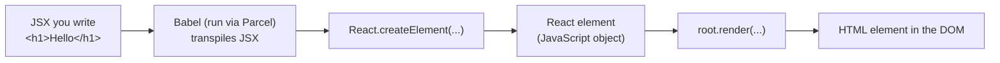
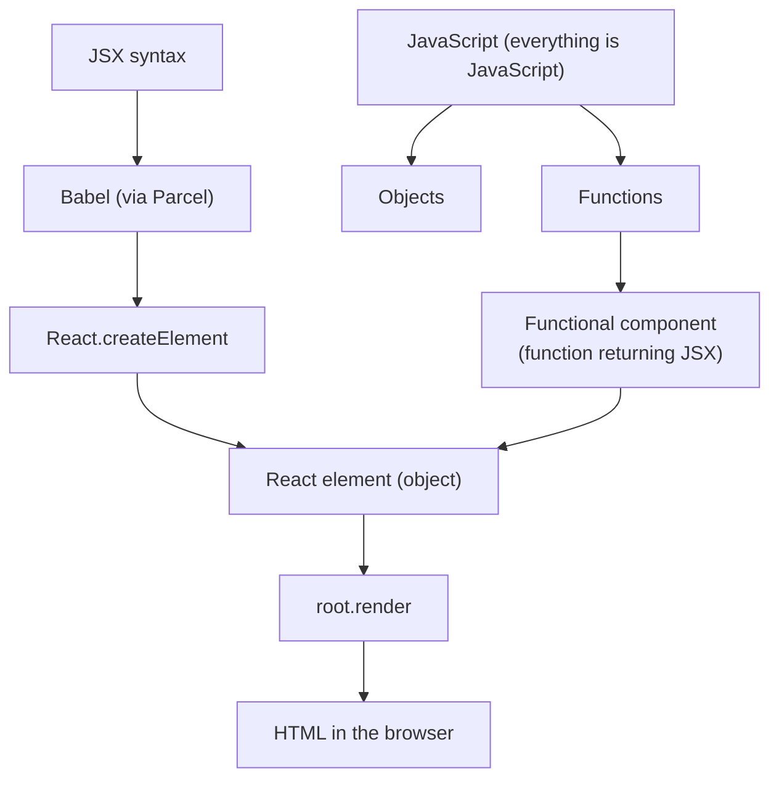

# Namaste React – Episode 3 (Laying the Foundation): npm Scripts, JSX, Babel, and Functional Components

## Overview

Episodes 1 and 2 built a tiny React app by hand and set up Parcel, npm, and a production build. Episode 3 "lays the foundation" for writing real React code. The instructor stresses that this is one of the most important episodes of the series. It covers:

1. **npm scripts** (`start`, `build`) so you no longer type long `npx parcel ...` commands.
2. A recap of **React elements** (they are plain objects).
3. **JSX**: why it exists, what it is (and is not), and how it actually runs in the browser, via **Babel**.
4. JSX syntax rules: `className`, camelCase attributes, and multi-line parentheses.
5. **React functional components**, including arrow-function shorthand and **component composition**.
6. Embedding **JavaScript expressions** in JSX with `{ }`.
7. Why JSX protects you from **cross-site scripting (XSS)** in many cases.
8. Three equivalent ways to render a component.

The recurring message of the episode: **JSX is not React, JSX is not HTML, and at the end of the day it is all JavaScript.**

> **How to read these notes**
> - Content from the transcript is presented as the instructor taught it.
> - **📘 Supplementary** marks material added for clarity that is not stated in the transcript.
> - **✏️ Correction / Clarification** marks places where the transcript is inaccurate, overstated, or outdated.
> - **❓ Unclear** marks something the transcript does not make clear.

## Learning Objectives

After studying these notes you should be able to:

- Define `start` and `build` scripts in `package.json` and run them with `npm start`, `npm run start`, and `npm run build`.
- Explain what a React element is and how it differs from a DOM element.
- Explain what JSX is, why it was created, and why "JSX is HTML inside JavaScript" is a misconception.
- Describe how JSX becomes `React.createElement(...)` calls and who does the conversion (Babel, managed by Parcel).
- Write valid JSX: `className`, camelCase attributes, parentheses around multi-line JSX.
- Create a React functional component and render it with `<Component />`.
- Explain component composition and use it.
- Put JavaScript expressions, React elements, and components inside JSX with `{ }`.
- Explain how JSX helps prevent injection (XSS) attacks, and where that protection stops.

## Prerequisites

- Episodes 1 and 2 completed: the project with `index.html`, `app.js`, `index.css`, npm, Parcel, and `react`/`react-dom` installed from npm.
- Comfort with JavaScript functions and arrow functions, `const`, and the `import` syntax.

## Table of Contents

1. [Running the Project: npm Scripts](#1-running-the-project-npm-scripts)
2. [Recap: React Elements](#2-recap-react-elements)
3. [Why JSX Exists](#3-why-jsx-exists)
4. [What JSX Is and Is Not](#4-what-jsx-is-and-is-not)
5. [How JSX Runs: Babel and Transpilation](#5-how-jsx-runs-babel-and-transpilation)
6. [JSX Syntax Rules](#6-jsx-syntax-rules)
7. [Editor Extensions the Instructor Uses](#7-editor-extensions-the-instructor-uses)
8. [React Components](#8-react-components)
9. [Component Composition](#9-component-composition)
10. [JavaScript Inside JSX](#10-javascript-inside-jsx)
11. [JSX and Injection Attacks](#11-jsx-and-injection-attacks)
12. [Three Ways to Render a Component](#12-three-ways-to-render-a-component)
13. [Putting It All Together](#13-putting-it-all-together)
14. [Common Mistakes and Troubleshooting](#14-common-mistakes-and-troubleshooting)
15. [Best Practices](#15-best-practices)
16. [Exercises and Practice Tasks](#16-exercises-and-practice-tasks)
17. [Homework and Curiosity Questions](#17-homework-and-curiosity-questions)
18. [Key Takeaways](#18-key-takeaways)
19. [Glossary](#19-glossary)
20. [References and Further Learning](#20-references-and-further-learning)

---

## 1. Running the Project: npm Scripts

### 1.1 Definition

An **npm script** is a named command stored in the `scripts` section of `package.json`. Instead of typing a long command, you run it by name.

### 1.2 Why it matters

- Until now you started the project with `npx parcel index.html`. The development and production commands are different, and long commands are easy to forget.
- Putting them in scripts is an **industry-standard convention** in React and in most JavaScript projects.
- If you join a new company and do not know how to run a project, **open `package.json` and look at `scripts`**. You will almost always find `start`, `build`, or similar.

### 1.3 Syntax

```json
{
  "scripts": {
    "start": "parcel index.html",
    "build": "parcel build index.html",
    "test": "jest"
  }
}
```

| Script | What it runs | Purpose |
|--------|--------------|---------|
| `start` | `parcel index.html` | Starts the project in **development mode** (dev server, HMR) |
| `build` | `parcel build index.html` | Creates the **production build** in `dist` |

The script names are your choice. `start` and `build` are the common conventions. The instructor notes: "you can name it whatever you wish".

> 📘 **Supplementary:** Inside scripts, you do not need the `npx` prefix. npm adds the project's local `node_modules/.bin` folder to the path when it runs a script, so `parcel` resolves to the locally installed Parcel.

### 1.4 Tutorial: use the scripts

**Objective:** Start and build the project using npm scripts.

1. Open `package.json` and add the `start` and `build` scripts as shown above.
2. Start the dev server:

```bash
npm run start
```

3. Or use the shortcut:

```bash
npm start
```

4. Create a production build:

```bash
npm run build
```

### 1.5 Explanation

| Command | Equivalent to |
|---------|---------------|
| `npm run start` | `npx parcel index.html` |
| `npm start` | `npm run start` (a shortcut) |
| `npm run build` | `npx parcel build index.html` |

**Expected result:** `npm start` prints the local server address (for example `http://localhost:1234`). `npm run build` creates the HTML, CSS, and JS files in `dist`.

> ✏️ **Clarification:** The instructor says only `start` has a shortcut and that `npm build` does not work. That is essentially right for `build`: `npm build` is not your script, so use `npm run build`. For accuracy, npm also provides built-in shortcuts for a few other lifecycle scripts, such as `npm test`.

### 1.6 Common mistakes

| Mistake | Fix |
|---------|-----|
| Running `npm build` and expecting your script | Use `npm run build` |
| Forgetting to remove `"main"` from `package.json` (Episode 2) | Remove it, or the production build conflicts |
| Server not running when opening `localhost:1234` | Start it with `npm start` first |

---

## 2. Recap: React Elements

The instructor starts again from a nearly empty `app.js` to revise Episode 1's ideas. The `index.html` has only `<div id="root">` (with the old text "Akshay is here" still inside it).

### 2.1 DOM element vs React element

- A **DOM element** is an HTML element in the browser (for example an `<h1>`).
- A **React element** is React's equivalent of a DOM element. It is **not** an HTML element. It is a plain **JavaScript object**.

When the React element is rendered onto the DOM, it becomes a real HTML element.

### 2.2 Example from the transcript

```javascript
import React from "react";
import ReactDOM from "react-dom/client";

const heading = React.createElement(
  "h1",
  { id: "heading" },
  "Namaste React"
);

const root = ReactDOM.createRoot(document.getElementById("root"));
root.render(heading);
```

### 2.3 Explanation

| Part | Meaning |
|------|---------|
| `React.createElement("h1", { id: "heading" }, "Namaste React")` | Creates a React element (an object). Arguments: tag, attributes, children |
| `ReactDOM.createRoot(...)` | Creates the root (from `react-dom`, because we are targeting the browser) |
| `root.render(heading)` | Converts the object into HTML and places it in the root |

`console.log(heading)` prints an **object**, which proves a React element is an object.

### 2.4 `render` replaces content

`root.render(...)` **replaces** whatever is inside the root; it does not append. The text "Akshay is here" disappears once React renders. (This repeats Episode 1.)

### 2.5 The "Not Rendered" tip

The instructor mentions a common practice: put fallback text such as "Not Rendered" inside the root `div`. If React fails to render because of a bug, the fallback stays visible, so seeing it means "rendering has a problem".

```html
<div id="root">Not Rendered</div>
```

---

## 3. Why JSX Exists

### 3.1 The problem

`React.createElement` is the **core** way to create elements, but it is clumsy:

- It is hard to read, especially for nested structures.
- It feels like writing HTML inside JavaScript with poor syntax.

Compare how easy it is to see the intended output:

```html
<h1 id="heading">Namaste React</h1>
```

versus

```javascript
React.createElement("h1", { id: "heading" }, "Namaste React");
```

### 3.2 The solution

Facebook developers created **JSX** to make creating React elements easier for developers.

### 3.3 Background: how web pages used to be built

Traditionally: HTML held markup, JavaScript held logic, CSS held style, in separate files. Modern libraries and frameworks (React included) try to **merge markup and logic** in one place because they are related. JSX is React's convention for this.

### 3.4 Write code for humans first

The instructor asks: do we write code for machines or for humans? His answer: **for both, but first for humans.** If we only wrote for machines we would write binary. Code will be read by other developers, so a good library makes the developer's life easy. JSX is readable, and people who know HTML pick it up quickly.

---

## 4. What JSX Is and Is Not

### 4.1 Myths the instructor wants to break

| Myth | Reality |
|------|---------|
| "JSX is part of React." | **JSX is separate from React.** React can be written without JSX. |
| "React cannot be written without JSX." | You can build large apps without JSX; JSX just makes it easier. |
| "JSX is HTML inside JavaScript." | **JSX is not HTML.** It is an **HTML-like (or XML-like) syntax**. |
| "JSX is valid JavaScript." | **JSX is not valid JavaScript** that a browser's engine understands. |

> **Remember:** JSX is not HTML in JavaScript. JSX is an **HTML-like syntax**. The instructor adds it is probably even closer to XML. In interviews, saying "JSX is HTML in JavaScript" signals shaky fundamentals.

### 4.2 JSX example

Instead of `React.createElement`, write:

```jsx
const jsxHeading = <h1 id="heading">Namaste React using JSX 🚀</h1>;
```

### 4.3 JSX vs `createElement`

```javascript
// Core React
const heading = React.createElement("h1", { id: "heading" }, "Namaste React");

// JSX (equivalent)
const jsxHeading = <h1 id="heading">Namaste React</h1>;
```

Logging both in the console shows **the same object**. `jsxHeading` is a React element (an object), just like `heading`.

> **Careful with wording:** *JSX* is the syntax. A *React element* is the object. "JSX is a React element" is loose talk; the syntax **produces** a React element.

### 4.4 Rendering the JSX element

```javascript
root.render(jsxHeading);
```

The page shows "Namaste React using JSX 🚀", the same as before, with much cleaner code.

### 4.5 The decision

The instructor says this is **the last time** the course uses `React.createElement` directly. From here on it is JSX. He taught `createElement` first so you know what JSX really is, since many tutorials jump straight to Create React App and JSX.

---

## 5. How JSX Runs: Babel and Transpilation

### 5.1 The question

Is JSX valid JavaScript? **No.** The browser's JavaScript engine only understands **ECMAScript** (ES6 and the other ECMAScript versions). If you pass raw JSX to it, you get a syntax error at the `<`. So how does the app run?

### 5.2 The answer: transpiling before the engine sees it

Before your code reaches the JS engine, it is **transpiled**: converted to code the engine understands.

- **Parcel** is the manager that triggers this.
- **Babel** does the actual conversion. Parcel delegates the job to Babel.
- Babel is already in `node_modules` because **Parcel installed it** as one of its dependencies (a transitive dependency, as in Episode 2).

### 5.3 What is Babel?

- Babel is a **JavaScript compiler** (also called a **transpiler**).
- It reads code and converts it to other code.
- It was **not** created by Facebook (the instructor stresses this).
- Besides turning JSX into React code, Babel converts newer JavaScript (ES6+) into forms older browsers understand.
- Babel is an ordinary npm package of JavaScript code.

### 5.4 The pipeline



In words:

1. You write JSX.
2. Babel converts it to `React.createElement(...)`.
3. `React.createElement` returns a **React element** (a JavaScript object).
4. `root.render` converts that object to HTML and puts it on the page.

This is why `heading` and `jsxHeading` are the same.

### 5.5 See it yourself: Babel playground

On Babel's website there is an online playground (REPL). Type JSX such as `<h1>Namaste React</h1>` on the left; the right shows the output with `React.createElement(...)`.

> ✏️ **Clarification:** The playground shows `React.createElement` when using the "classic" JSX transform, as the instructor's demo does. Newer toolchains (React 17+) can use the "automatic" runtime, which compiles JSX to `_jsx(...)` calls from `react/jsx-runtime` and does not require `import React`. The idea is the same: JSX is compiled into function calls that produce element objects.

### 5.6 How Babel works internally (curiosity only)

The instructor briefly says Babel reads code token by token (tokenization), parses it, and builds an **Abstract Syntax Tree (AST)**, then generates new code. That is compiler theory, and he does not go deeper.

### 5.7 Why it matters

- It explains why JSX works only in a build setup that includes Babel (or a similar compiler).
- It explains why a bundler such as Parcel is more than "just a bundler".
- It reinforces: *the browser never sees JSX.*

---

## 6. JSX Syntax Rules

### 6.1 JSX is not HTML: attribute differences

| HTML | JSX | Why |
|------|-----|-----|
| `class="root"` | `className="root"` | `class` is a reserved word in JavaScript |
| `tabindex="1"` | `tabIndex="1"` | JSX attributes use **camelCase** |

Example:

```jsx
const heading = (
  <h1 className="head" tabIndex="5">
    Namaste React
  </h1>
);
```

In the browser's **Elements** panel, the output is normal HTML: `class="head"` and `tabindex="5"`. Babel/React translate the JSX names into the HTML attributes.

**Rule:** Use camelCase for JSX attributes.

### 6.2 Single-line vs multi-line JSX

- **Single line**: parentheses are optional.
- **Multi-line**: wrap the JSX in **round brackets `( )`**.

```jsx
// Single line - fine
const a = <h1>Hello</h1>;

// Multi-line - wrap in parentheses
const b = (
  <h1 className="heading" tabIndex="5">
    Hello
  </h1>
);
```

**Why the parentheses?** The instructor's explanation: Babel needs to know **where the JSX starts and where it ends**. If the JSX starts on a new line without parentheses, it can be parsed incorrectly.

> 📘 **Supplementary:** A concrete reason is JavaScript's automatic semicolon insertion. After `return` or `=` followed by a line break, JavaScript may treat the statement as finished. Parentheses prevent that.

### 6.3 JSX can be nested

Elements can contain other elements, exactly like HTML:

```jsx
const container = (
  <div id="container">
    <h1>Namaste React</h1>
  </div>
);
```

Compared with nested `React.createElement` calls, this is far more readable. (Imagine rebuilding Episode 1's nested parent/child structure with JSX.)

### 6.4 Homework from the instructor

Explore how common tags and attributes are written in JSX. For example:
- How do you write an `` with `src`?
- How do you write an `<a>` with `href`?

---

## 7. Editor Extensions the Instructor Uses

| Extension | What it does |
|-----------|--------------|
| **Prettier** | Automatically formats your code when you save (for example, it re-formats multi-line JSX and adds parentheses) |
| **Bracket Pair Colorizer** | Colors matching brackets differently so nested brackets are easy to read |
| **ESLint** | Linting: flags problematic code patterns |
| **Better Comments** | Makes comments easier to read |

> ✏️ **Clarification:** The original *Bracket Pair Colorizer* extension has been deprecated. VS Code now has **built-in bracket pair colorization** (enable it with the setting `editor.bracketPairColorization.enabled`). Prettier is typically used together with the "Format on Save" setting.

---

## 8. React Components

### 8.1 Everything is a component

The instructor says "everything in React is a component". A button, header, footer, card, heading, title, input box, search bar, and a list of cards are all components. The statement means a React UI is built entirely from components.

### 8.2 Two types of components

| | Class-based component | Functional component |
|---|----------------------|----------------------|
| Built with | JavaScript **classes** | JavaScript **functions** |
| Status | Old way; legacy | **New standard**; used by almost all new code |
| Taught in this course | Later (still needed for legacy code and some interviews) | Used from now on |

The instructor says that "99.99%" of new development uses functional components, so the course uses them by default, but class components will be taught later because legacy projects and some interviewers still use them.

### 8.3 Definition: functional component

> A **React functional component** is a **normal JavaScript function that returns some JSX** (a React element).

Nothing more. "A function that returns JSX is a functional component."

### 8.4 Naming rule

Component names **must start with a capital letter** (`HeadingComponent`, `Title`). That is how React (and Babel) knows it is a component and not a built-in HTML tag.

### 8.5 Syntax

**Arrow function with explicit `return`:**

```jsx
const HeadingComponent = () => {
  return <h1 className="heading">Namaste React Functional Component</h1>;
};
```

**Arrow function with implicit return (shorthand):**

```jsx
const HeadingComponent = () => <h1 className="heading">Namaste React Functional Component</h1>;
```

**Multi-line with implicit return:** wrap the JSX in parentheses.

```jsx
const HeadingComponent = () => (
  <div id="container">
    <h1 className="heading">Namaste React Functional Component</h1>
  </div>
);
```

**Regular `function` keyword also works:**

```jsx
function HeadingComponent() {
  return <h1 className="heading">Namaste React Functional Component</h1>;
}
```

### 8.6 Explaining the shorthand (plain JavaScript)

These two plain JavaScript functions are the same:

```javascript
const fn = () => {
  return true;
};

const fn2 = () => true;
```

If an arrow function's body is a single expression, you can drop `return` and the curly braces. The same applies to components.

The instructor says:
- Both styles are valid, and you will see both in industry code.
- He prefers the **explicit** `return` style in his own code because it is clearer, and says he will mostly use it.
- Arrow functions are the **industry convention** for components; the `function` keyword is not wrong, although arrow functions differ from regular functions in some respects (such as `this`), which he leaves to his JavaScript course.

### 8.7 Element vs component

| | React element | React component |
|---|---------------|-----------------|
| What it is | An **object** (result of `createElement`/JSX) | A **function** that returns JSX (an element) |
| Name | Any variable name | Capitalized |
| Example | `const heading = <h1>Hi</h1>;` | `const Heading = () => <h1>Hi</h1>;` |
| Render with | `root.render(heading)` | `root.render(<Heading />)` |

Converting an element into a component is as simple as capitalizing the name and wrapping it in an arrow function. The instructor says the deeper differences will come in the next episode.

### 8.8 Rendering a component

A component cannot be rendered like an element:

```jsx
root.render(HeadingComponent);   // ❌ Not how it works
root.render(<HeadingComponent />); // ✅ Correct
```

When Babel sees `<HeadingComponent />` it understands that a component with that name exists and should be used.

**Complete example:**

```jsx
import React from "react";
import ReactDOM from "react-dom/client";

const HeadingComponent = () => (
  <div id="container">
    <h1 className="heading">Namaste React Functional Component</h1>
  </div>
);

const root = ReactDOM.createRoot(document.getElementById("root"));
root.render(<HeadingComponent />);
```

**Expected result:** The page shows "Namaste React Functional Component". In **Elements**, `#root` contains `<div id="container">` and an `<h1>`.

---

## 9. Component Composition

### 9.1 Definition

**Component composition** means **putting one component inside another**.

The instructor jokes that interviewers like to ask about this, and that the term is hard to say quickly. Its meaning is simple: you compose components.

### 9.2 Example

```jsx
const Title = () => (
  <h1 className="heading">Namaste React</h1>
);

const HeadingComponent = () => (
  <div id="container">
    <Title />
    <h1 className="heading">Namaste React Functional Component</h1>
  </div>
);

root.render(<HeadingComponent />);
```

### 9.3 Explanation

- `Title` is a small component.
- `HeadingComponent` uses `<Title />` inside its JSX.
- Wherever `<Title />` appears, the output of `Title` is placed.

### 9.4 What the browser sees

The browser sees only normal HTML in the DOM. It does not know about "Title" or "HeadingComponent". Babel transpiles JSX; React converts everything to DOM elements; `root.render` puts them on the page.

### 9.5 Practice (from the instructor)

- Create two components.
- Convert a React element into a React component.
- Put a component inside another component.
- Write components both with and without `return`.
- Render a component.

---

## 10. JavaScript Inside JSX

### 10.1 The superpower

Inside JSX, anywhere you put **curly braces `{ }`**, you can write **any JavaScript expression**.

The instructor says this is why JSX is a mix of HTML-like syntax and JavaScript. It is a powerful feature you will use constantly to build UIs.

### 10.2 Examples

```jsx
const number = 10000;

const HeadingComponent = () => (
  <div id="container">
    {number}
    <h2>{number}</h2>
    <h2>{100 + 200}</h2>
    <h1 className="heading">Namaste React Functional Component</h1>
  </div>
);
```

| Expression | Result on page |
|------------|----------------|
| `{number}` | `10000` |
| `<h2>{number}</h2>` | an `h2` containing `10000` |
| `<h2>{100 + 200}</h2>` | an `h2` containing `300` |

### 10.3 Any JavaScript expression works

Even a `console.log`:

```jsx
{console.log("hello")}
```

It runs when the component renders. (Printing to the console renders nothing on the page, because `console.log` returns `undefined`.)

> 📘 **Supplementary:** `{ }` accepts **expressions** (things that produce a value), not statements such as `if` or `for`. Use ternaries (`cond ? a : b`) and `.map()` instead; these are covered later in the series.

### 10.4 Putting a React element inside a component

A React element is just a JavaScript variable, so you can embed it with `{ }`:

```jsx
const title = (
  <h1 className="head" tabIndex="5">
    Namaste React using JSX 🚀
  </h1>
);

const HeadingComponent = () => (
  <div id="container">
    {title}
    <h1 className="heading">Namaste React Functional Component</h1>
  </div>
);
```

### 10.5 Putting an element inside another element

```jsx
const elem = <span>React Element</span>;

const title = (
  <h1 className="head">
    {elem}
    Namaste React using JSX 🚀
  </h1>
);
```

The `span` appears inside the `h1`.

### 10.6 Putting a component inside an element

```jsx
const Title = () => <h1 className="head">Namaste React</h1>;
const HeadingComponent = () => <div id="container">{/* ... */}</div>;

const title = (
  <h1>
    <HeadingComponent />
  </h1>
);
```

This works, and so any element can contain any component, element, or expression. (In the instructor's demo, this created a `div` inside an `h1`, which is **invalid HTML**; do not do that in real code.)

### 10.7 Order of definitions matters (it is just JavaScript)

If two `const` variables refer to each other, you hit JavaScript's rules:

```text
ReferenceError: Cannot access 'HeadingComponent' before initialization
```

`const` variables cannot be used before they are initialized, and this is a **JavaScript** rule, not a React rule.

The instructor also demonstrated an **infinite loop**: putting a `Title` inside `HeadingComponent` and `HeadingComponent` inside `Title` makes the page freeze. A component must never (directly or indirectly) render itself unconditionally.

> ✏️ The infinite-loop demo is a cautionary example; do not try it in a tab you care about.

---

## 11. JSX and Injection Attacks

### 11.1 The scenario

Suppose you render data from an API:

```jsx
const data = getDataFromApi(); // imagine this returns text
const HeadingComponent = () => (
  <div>{data}</div>
);
```

What if the API returns **malicious data**, for example a script an attacker wants to run in users' browsers? If that script ran, the attacker could read cookies, local storage, and session storage, or steal information. This kind of attack is **cross-site scripting (XSS)**.

### 11.2 What JSX does

When you put data inside `{ }`, JSX **escapes (sanitizes)** it before rendering. The browser does not blindly execute it; the data is rendered as text. The instructor presents this as a built-in protection: you can use `{ }` freely.

### 11.3 Why it matters

- Developers get protection against a common class of injection attacks by default.
- It is a good thing to mention in interviews.

> ✏️ **Clarification (important):** The instructor says "nobody can do a malicious attack using this loophole". That is an **overstatement**. React escapes values rendered as *text children*. It does **not** protect you if you:
> - use `dangerouslySetInnerHTML`,
> - put untrusted values into some attributes (for example a `href` containing a `javascript:` URL), or
> - inject untrusted data into places outside JSX.
>
> Always validate and sanitize untrusted data, and avoid `dangerouslySetInnerHTML` with unsanitized input.

---

## 12. Three Ways to Render a Component

The instructor notes there are several equivalent ways to render a component inside JSX:

```jsx
const Title = () => <h1 className="head">Namaste React</h1>;

const HeadingComponent = () => (
  <div id="container">
    <Title />             {/* 1. self-closing tag */}
    <Title></Title>       {/* 2. opening and closing tags */}
    {Title()}             {/* 3. call it as a function */}
  </div>
);
```

| Syntax | Meaning |
|--------|---------|
| `<Title />` | Component used as a self-closing tag |
| `<Title></Title>` | Component with opening and closing tags |
| `{Title()}` | Calling the function directly inside `{ }` |

All three **render the same output** here. Each can be used any number of times; there is no limit (three titles appear above).

**Why does the function call work?** Because a component is just a JavaScript function that returns JSX, and `{ }` can hold any JavaScript expression, including a function call.

> ✏️ **Clarification:** `<Title />` and `<Title></Title>` are the same thing, but `{Title()}` is **not equivalent in general**. It works for this simple component, but calling a component as a function bypasses React's component handling (for example, it breaks the rules for hooks, which come later). Use `<Title />` in real code; treat `{Title()}` as a demonstration that "components are just functions". The instructor says the use of the tag forms and their rules will be covered in later episodes.

---

## 13. Putting It All Together

### 13.1 Complete example combining the episode

```jsx
import React from "react";
import ReactDOM from "react-dom/client";

// React element (JSX)
const elem = <span>React Element</span>;

// Another React element that contains elem
const title = (
  <h1 className="head" tabIndex="5">
    {elem}
    Namaste React using JSX 🚀
  </h1>
);

const number = 10000;

// Functional component
const Title = () => (
  <h1 className="head">Title Component</h1>
);

// Component composition + JavaScript in JSX
const HeadingComponent = () => (
  <div id="container">
    {title}
    <Title />
    <Title></Title>
    {Title()}
    <h2>{number}</h2>
    <h2>{100 + 200}</h2>
    <h1 className="heading">Namaste React Functional Component</h1>
  </div>
);

const root = ReactDOM.createRoot(document.getElementById("root"));
root.render(<HeadingComponent />);
```

> 📘 **Supplementary:** This combined example is assembled from the separate snippets taught in the episode. It is not shown in one piece in the transcript.

### 13.2 What happens when this runs

1. `npm start` runs Parcel, which bundles `app.js` and uses Babel to transpile JSX.
2. JSX becomes `React.createElement(...)` calls (or the automatic-runtime equivalent).
3. Those calls create React element objects (a tree of objects).
4. `root.render(<HeadingComponent />)` converts the tree into DOM nodes and replaces the root's content.
5. The browser displays plain HTML.

### 13.3 How the concepts relate



### 13.4 Concept comparison

| Concept | Is it React? | Is it JavaScript? | Notes |
|---------|-------------|-------------------|-------|
| `React.createElement` | Yes (core) | Yes | Returns an object |
| JSX | **No** (separate syntax) | **No** (needs transpiling) | Compiles to `createElement` |
| React element | Yes | An object | Result of JSX or `createElement` |
| Component | Yes | A function | Returns JSX |
| Babel | No | A JS package | Does the transpiling |
| Parcel | No | A JS package | Manages Babel and the build |

---

## 14. Common Mistakes and Troubleshooting

| Problem | Likely cause | Fix |
|---------|--------------|-----|
| Component renders as nothing or React treats it as an unknown HTML tag | Name starts with lowercase (`<heading />`) | Capitalize component names |
| Page is blank after `root.render(HeadingComponent)` | Passed the function instead of an element | `root.render(<HeadingComponent />)` |
| Warning/odd behaviour with `class` | Used `class` instead of `className` | Use `className` |
| `tabindex`/`onclick` not behaving as expected | Used lowercase attribute names | Use camelCase (`tabIndex`, `onClick`) |
| Syntax error pointing at `<` | JSX not transpiled (no Babel, or file type/setup issue) | Use Parcel (or another JSX-aware build setup) |
| Odd results with multi-line JSX | Missing parentheses | Wrap multi-line JSX in `( )` |
| `Cannot access '...' before initialization` | Used a `const` before its definition | Reorder definitions |
| Browser tab freezes | Components render each other in a loop | Remove the circular nesting |
| `div` inside `h1` | Invalid HTML nesting (even though React allows it) | Use valid HTML structure |
| `npm build` fails | `build` is not a built-in shortcut | `npm run build` |
| Console shows nothing for `{ "text" }` | Expecting `console.log` to print on the page | `console.log` prints to the console only |

---

## 15. Best Practices

- **Write code for humans first.** Choose readable syntax (JSX, descriptive names).
- Use **npm scripts** (`start`, `build`) and document how to run the project in them.
- **Capitalize** component names.
- Prefer **functional components** with arrow functions.
- Wrap **multi-line JSX in parentheses**.
- Use `className` and camelCase attributes.
- Use **valid HTML structure** (no `div` inside `h1`).
- Compose small components into larger ones.
- Understand every word you type: why `import`, why `const`, why an arrow function.
- Install helpful editor extensions (Prettier, ESLint), and let tools format your code.
- Do not rely on `{ }` escaping alone for security; avoid `dangerouslySetInnerHTML` with untrusted input.

---

## 16. Exercises and Practice Tasks

### Exercise 1 – npm scripts
- [ ] Add `start` and `build` scripts to `package.json`.
- [ ] Run `npm start`, then `npm run build`.

*Expected result:* the dev server starts; `dist` is created by the build.

### Exercise 2 – Element, then JSX
- [ ] Create an `h1` with `React.createElement` and log it.
- [ ] Create the same `h1` with JSX and log it.
- [ ] Compare the two logged objects.

*Expected result:* both are objects with the same structure.

### Exercise 3 – Babel playground
- [ ] Open Babel's online playground and type a small piece of JSX.
- [ ] Note the output.

*Expected result:* `React.createElement(...)` calls (or the automatic-runtime form).

### Exercise 4 – JSX attributes
- [ ] Create an element with `className` and `tabIndex`.
- [ ] Inspect the rendered HTML in the Elements panel.
- [ ] Look up how to write `` and `<a href>` in JSX.

### Exercise 5 – Multi-line JSX
- [ ] Write a multi-line JSX element without parentheses, then with parentheses. Note any differences or Prettier's behaviour.

### Exercise 6 – First component
- [ ] Convert an element into a component using an arrow function.
- [ ] Render it with `<Component />`.

### Exercise 7 – Return styles
- [ ] Write one component with explicit `return` and another with implicit return.
- [ ] Write one using the `function` keyword.

### Exercise 8 – Composition
- [ ] Create a `Title` component and render it inside a `HeadingComponent`.
- [ ] Render `Title` three ways: `<Title />`, `<Title></Title>`, and `{Title()}`.

### Exercise 9 – JavaScript in JSX
- [ ] Render a variable, a calculation (`100 + 200`), and a `console.log` inside JSX.
- [ ] Put a React element inside another element, and inside a component.

### Exercise 10 – Errors on purpose
- [ ] Use a `const` component before defining it and read the error.
- [ ] Rename a component to lowercase and observe what happens.

---

## 17. Homework and Curiosity Questions

1. What are the JSX forms of common tags and attributes (`img`/`src`, `a`/`href`)?
2. What is **Babel**, and what else does it do besides JSX?
3. What is an **Abstract Syntax Tree (AST)**?
4. What is **ECMAScript**, and what is the relationship between ES6 and JavaScript?
5. What is **cross-site scripting (XSS)**? How does JSX help, and what does it not protect against?
6. What are **class-based components**, and why are they considered legacy? (Coming later in the course.)
7. What is the difference between a **React element** and a **React component**? (Answered more fully in the next episode.)
8. What does **component composition** mean?
9. What differences exist between arrow functions and regular functions?
10. What are the differences between `<Title />`, `<Title></Title>`, and `{Title()}`? (To be explained later in the series.)

---

## 18. Key Takeaways

- **npm scripts** (`start`, `build`) make commands short and standard. `npm start` = `npm run start`; use `npm run build` for builds.
- A **React element** is a plain **object**; `createElement` and JSX both produce it.
- **JSX is not React, and it is not HTML.** It is an **HTML-like** syntax created to make React elements easier to write.
- JSX is **not valid JavaScript**; the browser's engine cannot read it. **Babel** (managed by Parcel) **transpiles** JSX into `React.createElement` calls before the engine sees it.
- JSX attributes use **camelCase** and `className`; wrap **multi-line JSX in parentheses**.
- A **functional component** is a **function that returns JSX**; names are **capitalized**; render it with `<Component />`.
- **Component composition** means nesting components inside components.
- `{ }` in JSX runs any **JavaScript expression**: variables, math, function calls, elements, components.
- JSX escapes values in `{ }` by default, which helps against XSS, but it is not a complete security solution.
- **Everything is JavaScript at the end of the day.** Strong fundamentals let you build large applications confidently.

---

## 19. Glossary

| Term | Meaning |
|------|---------|
| **npm script** | A named command in `package.json` run with `npm run <name>` |
| **React element** | An object describing a UI node, created by `createElement` or JSX |
| **DOM element** | An actual HTML element in the browser |
| **JSX** | An HTML-like syntax extension for writing React elements |
| **ECMAScript (ES6)** | The standard that JavaScript engines implement |
| **Transpile / compile** | Convert code from one form to another (JSX → JavaScript) |
| **Babel** | A JavaScript compiler/transpiler used to convert JSX and newer JS |
| **AST** | Abstract Syntax Tree; a tree representation of parsed code |
| **Component** | A reusable piece of UI; in modern React, a function returning JSX |
| **Functional component** | A JavaScript function that returns JSX |
| **Class-based component** | An older component style based on JavaScript classes |
| **Component composition** | Using components inside other components |
| **Implicit return** | Arrow function body that is a single expression, with no `return` keyword |
| **`className`** | JSX attribute equivalent to HTML `class` |
| **camelCase** | Naming style with no separators and capitals at word boundaries (`tabIndex`) |
| **XSS (cross-site scripting)** | An attack that injects malicious scripts into a page |
| **Sanitize / escape** | Make untrusted data safe to display |

---

## 20. References and Further Learning

- React documentation: <https://react.dev> (sections on JSX and components)
- Babel: <https://babeljs.io> and its online playground (REPL)
- MDN Web Docs: arrow functions, `const` and temporal dead zone, ECMAScript
- OWASP: Cross-Site Scripting (XSS)
- npm documentation: `scripts` in `package.json`
- VS Code: Prettier and ESLint extensions; built-in bracket pair colorization
- **Next episode:** the series continues with building more with components (the instructor says the next episode dives deeper into components).
