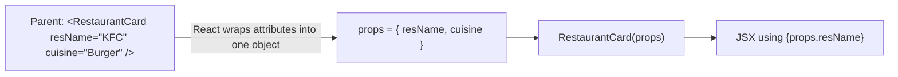
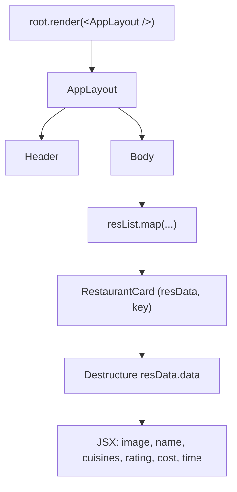

# Namaste React – Episode 4 (Talk Is Cheap, Show Me the Code): Building a Food Ordering App with Components, Props, and Lists

## Overview

Episodes 1–3 prepared the ground: React from scratch, Parcel and npm, JSX, and functional components. In Episode 4 the instructor starts building a **real-world application**, a **food-ordering app** in the style of Swiggy or Zomato. The episode is project-based: new concepts appear as the app needs them.

The episode covers:

1. **Planning before coding**: wireframe, then a component breakdown.
2. Building the **AppLayout**, **Header**, **Body**, and **RestaurantCard** components.
3. Three ways of styling: a CSS file, **inline styles**, and (later in the series) utility libraries such as Tailwind.
4. **Props**: passing dynamic data to components, and destructuring props.
5. **Config-driven UI**: how real-world data from a backend drives the interface.
6. Working with **real API data** (nested objects, arrays, string building, image CDNs).
7. Rendering lists with **`map`**, and why every list item needs a **`key`**.
8. Code clean-up: destructuring and optional chaining.

> **How to read these notes**
> - Content from the transcript is presented as the instructor taught it.
> - **📘 Supplementary** marks material added for clarity that is not stated in the transcript.
> - **✏️ Correction / Clarification** marks places where the transcript is imprecise, simplified, or outdated.
> - **❓ Unclear** marks something the transcript does not make clear.

## Learning Objectives

After studying these notes you should be able to:

- Plan a front-end app: sketch a wireframe and break it into components.
- Build a layout with composed components (`AppLayout` → `Header`, `Body` → `RestaurantCard`).
- Style React elements with CSS classes and with inline `style` objects, and explain the double curly braces.
- Explain what **props** are, pass them to a component, and read them (as `props.x` or by destructuring).
- Explain **config-driven UI** and why production APIs return data shaped like configuration.
- Render an array of objects as a list of components with `Array.prototype.map`.
- Explain why `key` is required, how React uses it, and why using the array index as a key is discouraged.
- Refactor repetitive code using destructuring and optional chaining.

## Prerequisites

- Episodes 1–3 completed: Parcel project with `react` and `react-dom` installed, `npm start` working, JSX, and functional components.
- JavaScript: objects, arrays, destructuring, template/string concatenation, and `map`, `filter`, `reduce` (the instructor recommends reviewing these).
- A browser with developer tools. A JSON-viewer browser extension is recommended (see [Section 6](#6-config-driven-ui-and-real-api-data)).

## Table of Contents

1. [Planning the App](#1-planning-the-app)
2. [Building the Layout Components](#2-building-the-layout-components)
3. [Building the Restaurant Card](#3-building-the-restaurant-card)
4. [Styling in React](#4-styling-in-react)
5. [Props: Making Components Dynamic](#5-props-making-components-dynamic)
6. [Config-Driven UI and Real API Data](#6-config-driven-ui-and-real-api-data)
7. [Using Real Data in the Card](#7-using-real-data-in-the-card)
8. [Rendering Lists with map](#8-rendering-lists-with-map)
9. [Keys in React](#9-keys-in-react)
10. [Refactoring and Clean Code](#10-refactoring-and-clean-code)
11. [Complete Working Example](#11-complete-working-example)
12. [Common Mistakes and Troubleshooting](#12-common-mistakes-and-troubleshooting)
13. [Best Practices](#13-best-practices)
14. [Exercises and Practice Tasks](#14-exercises-and-practice-tasks)
15. [Homework and Curiosity Questions](#15-homework-and-curiosity-questions)
16. [Key Takeaways](#16-key-takeaways)
17. [Glossary](#17-glossary)
18. [References and Further Learning](#18-references-and-further-learning)

---

## 1. Planning the App

### 1.1 Why "Talk is cheap, show me the code"

For three episodes the focus was setup and fundamentals. From this episode on the instructor builds a real app and applies those concepts.

### 1.2 The app: a food-ordering app

The instructor chooses a food-ordering app similar to Swiggy or Zomato (well-known Indian apps). The first app in the course is called **"Namaste Food"** (you may name yours anything). The course is **project-based learning**: build a production-style app and learn the concepts along the way.

> **Disclaimer from the instructor:** The app is not sponsored by or affiliated with any company. Assets and data from those sites are used for teaching purposes only. Use your own assets in your own projects.

### 1.3 Plan before you code

The key lesson of the first part:

> **A senior engineer plans first.** If planning is good, the code is easy to write.

Do not start by typing a header or restaurant image. First decide **what you are building and how it will look**.

### 1.4 Step 1: wireframe (UI mock)

Sketch the page on paper. The instructor's sketch:

| Area | Contents |
|------|----------|
| **Header** | Logo on the left; navigation links on the right (Home, About Us, Contact Us, Cart) |
| **Body** | A search bar; a collection of **restaurant cards** |
| **Footer** | Copyright, links, address, contact information |
| **Restaurant card** | Food image, restaurant name, star rating, cuisines, price for two, delivery time |

Later features (filtering, sorting, searching) are postponed. The wireframe gives everyone a shared picture: when the instructor says "the image in the card", you know which one.

### 1.5 Step 2: break the wireframe into components

```text
AppLayout
├── Header
│   ├── Logo
│   └── NavItems
├── Body
│   ├── Search
│   └── RestaurantContainer
│       └── RestaurantCard (many)
└── Footer
    ├── Copyright
    ├── Links
    └── Address / Contact
```

| Component | Role |
|-----------|------|
| **AppLayout** | The top-level component; contains everything |
| **Header** | Logo plus navigation items |
| **Body** | Search plus the list of restaurants |
| **RestaurantContainer** | The container that holds many cards |
| **RestaurantCard** | One restaurant; reused many times |
| **Footer** | Copyright, links, contact info (planned, not built in this episode) |

> Component names in the transcript are loose (for example "restro card", "res container"). These notes use `RestaurantCard` and `RestaurantContainer` for clarity. The class names used in code (`res-card`, `res-container`) follow the instructor's shorthand.

### 1.6 Why reusable components

The instructor repeats a rule of thumb: components are like functions, and you create functions so you can **reuse** them. Wherever you see repetition, such as many restaurant cards, build one component and reuse it.

---

## 2. Building the Layout Components

### 2.1 Starting from scratch

Delete the old code in `app.js` (keep the imports) and start with the top-level component. Start the dev server with:

```bash
npm start
```

### 2.2 The AppLayout component

`AppLayout` is a functional component returning one big container `div`:

```jsx
const AppLayout = () => {
  return (
    <div className="app">
      <Header />
    </div>
  );
};

const root = ReactDOM.createRoot(document.getElementById("root"));
root.render(<AppLayout />);
```

Render the **root-level component** (`AppLayout`), not individual children. Components inside it appear through composition.

### 2.3 The Header component

The header contains a logo container and navigation items.

```jsx
const Header = () => {
  return (
    <div className="header">
      <div className="logo-container">
        
      </div>
      <div className="nav-items">
        <ul>
          <li>Home</li>
          <li>About Us</li>
          <li>Contact Us</li>
          <li>Cart</li>
        </ul>
      </div>
    </div>
  );
};
```

**Explanation**

| Part | Purpose |
|------|---------|
| `className="header"` | CSS hook for the header (remember `className`, not `class`) |
| `logo-container` | Wrapper for the logo image |
| `` | JSX image tag; self-closing |
| `nav-items` with `<ul>` / `<li>` | Navigation links as a list; "Cart" is plain text for now (an icon can replace it later) |

The instructor searched online for a free logo design (a burger) to use as a placeholder. Use any image you are allowed to use.

### 2.4 First error: `class` vs `className`

When the instructor first ran the code, the console warned about an invalid DOM property `class`. This is the JSX rule from Episode 3: **use `className`**. It is an easy mistake when you come from HTML.

### 2.5 Nothing showed up: you must render the child

At first nothing appeared because `Header` had not been placed inside `AppLayout`. Component composition requires including `<Header />` in the parent's JSX (shown in 2.2).

### 2.6 Styling the header

The header initially looks wrong (a huge logo, vertical list). The instructor fixes it step by step in `index.css`:

```css
.header {
  display: flex;
  justify-content: space-between;
  border: 1px solid black;
}

.logo {
  width: 200px;
}

.nav-items ul {
  display: flex;
  list-style-type: none;
  font-size: 24px;
}

.nav-items li {
  padding: 10px;
  margin: 10px;
}
```

| Rule | Effect |
|------|--------|
| `display: flex` on `.header` | Logo and nav sit side by side |
| `justify-content: space-between` | Logo to the left, nav to the right |
| `.logo { width: 200px }` | Resize the large logo (he tried 100px, then 200px) |
| `.nav-items ul { display: flex }` | Lay the list items out horizontally |
| `list-style-type: none` | Remove the bullet dots |
| `.nav-items li { padding; margin }` | Spacing between nav items |
| `font-size: 24px` | Make the text larger |
| `border: 1px solid black` | Make the header visibly look like a header |

The instructor admits he is weak at CSS and says: **this is not "Namaste CSS"**; the focus is React. He encourages you to improve the styling yourself. Parcel's **HMR** updates the browser as soon as you save, which makes experimenting easy.

> ❓ **Unclear:** He tried adding horizontal padding to `.nav-items` and it did not visibly change anything (he moves on without resolving it). It is not important to the lesson.

### 2.7 Expected result

A header with the logo on the left and four nav items on the right, inside a bordered box.

---

## 3. Building the Restaurant Card

### 3.1 The Body component

```jsx
const Body = () => {
  return (
    <div className="body">
      <div className="search">Search</div>
      <div className="res-container">
        <RestaurantCard />
      </div>
    </div>
  );
};
```

Add `<Body />` to `AppLayout` after `<Header />`:

```jsx
const AppLayout = () => {
  return (
    <div className="app">
      <Header />
      <Body />
    </div>
  );
};
```

The search bar is just a placeholder `div` for now (an input and button will come later).

### 3.2 The RestaurantCard component (first, hard-coded version)

```jsx
const RestaurantCard = () => {
  return (
    <div className="res-card">
      
      <h3>Meghana Foods</h3>
      <h4>Biryani, North Indian, Asian</h4>
      <h4>4.4 stars</h4>
      <h4>38 minutes</h4>
    </div>
  );
};
```

**Explanation**

| Element | Content |
|---------|---------|
| `img` | Restaurant/food image |
| `h3` | Restaurant name |
| `h4` rows | Cuisines, rating, delivery time |

The instructor uses "Meghana Foods" (a Bangalore biryani restaurant he used to order from) as the sample.

### 3.3 Card styling

```css
.res-card {
  width: 200px;
  margin: 5px;
  padding: 5px;
  border: 1px solid black;
}

.res-card:hover {
  border: 1px solid black;
  cursor: pointer;
}

.res-logo {
  width: 100%;
}
```

(He experiments with fixed width and height values; he later removes the fixed height so the card sizes itself.)

Making the card feel interactive:
- `:hover` adds a visible border change.
- `cursor: pointer` turns the cursor into a hand.

### 3.4 Layout of multiple cards

Repeating `<RestaurantCard />` shows several cards, but they stack vertically. Make the container a wrapping flexbox:

```css
.res-container {
  display: flex;
  flex-wrap: wrap;
}
```

Now cards flow horizontally and wrap to new rows. (He briefly applied this to the wrong class and then corrected it, a reminder to check which element you are styling.)

### 3.5 Limitation

Every card says "Meghana Foods": the data is hard-coded. That leads to the next topic: **props**.

---

## 4. Styling in React

The instructor shows the ways to style a React app.

### 4.1 Way 1: a CSS file (class names)

Write normal CSS in `index.css` and use `className` in JSX. This is the approach used so far.

### 4.2 Way 2: inline styles

In HTML, `style="background-color: yellow"` takes a string. In JSX, `style` takes a **JavaScript object**:

```jsx
const styleCard = {
  backgroundColor: "#f0f0f0",
};

const RestaurantCard = () => (
  <div className="res-card" style={styleCard}>
    ...
  </div>
);
```

Or define the object directly in place:

```jsx
<div className="res-card" style={{ backgroundColor: "#f0f0f0" }}>
```

**Why two sets of curly braces?**

| Braces | Meaning |
|--------|---------|
| Outer `{ }` | "JavaScript expression starts here" (the JSX rule) |
| Inner `{ }` | A JavaScript **object** literal |

**Rules to remember**

- Property names are **camelCase** (`backgroundColor`, not `background-color`).
- Values are strings or numbers; properties are separated by commas, not semicolons.

The instructor's note: inline styles are **not the preferred way**; he shows them because you will encounter them and should understand them. He first tried `yellow` (ugly), then used a light-gray hex color.

### 4.3 Way 3: UI libraries and frameworks

Material UI, **Tailwind CSS**, and other libraries are also used. A separate episode of the series covers Tailwind in depth.

### 4.4 React's philosophy

The instructor summarizes React's philosophy: **write everything in JavaScript**. HTML-like markup (JSX), logic, and even styles can live in the same file.

---

## 5. Props: Making Components Dynamic

### 5.1 The problem

Every `RestaurantCard` shows the same hard-coded restaurant. How do we show "Meghana Foods" in one card and "KFC" in another, using the **same** component?

### 5.2 Definition

> **Props** (short for *properties*) are the data you pass into a component. **Passing props to a component is just like passing arguments to a function.**

Because a functional component is a normal JavaScript function, its props are its arguments.

### 5.3 Syntax: passing props

```jsx
<RestaurantCard resName="Meghana Foods" cuisine="Biryani, North Indian, Asian" />
<RestaurantCard resName="KFC" cuisine="Burger, Fast Food" />
```

### 5.4 How React delivers them

React collects all the props you pass into **one object** and passes it as the function's single argument.

```jsx
const RestaurantCard = (props) => {
  console.log(props);
  // { resName: "Meghana Foods", cuisine: "Biryani, North Indian, Asian" }
  return (/* ... */);
};
```

The console shows one object per card (two cards, two objects).

### 5.5 Using props

Because `props` is a JavaScript object, read it with `{ }` in JSX:

```jsx
const RestaurantCard = (props) => {
  return (
    <div className="res-card">
      <h3>{props.resName}</h3>
      <h4>{props.cuisine}</h4>
    </div>
  );
};
```

Now each card displays different data. You can pass **any number of props**.

### 5.6 Destructuring props

**Destructuring on the fly** (in the parameter list):

```jsx
const RestaurantCard = ({ resName, cuisine }) => {
  return (
    <div className="res-card">
      <h3>{resName}</h3>
      <h4>{cuisine}</h4>
    </div>
  );
};
```

**Destructuring inside the function body** (equivalent):

```jsx
const RestaurantCard = (props) => {
  const { resName, cuisine } = props;
  // ...
};
```

The instructor stresses: **this is plain JavaScript object destructuring, not React magic**. Many developers destructure on the fly; he prefers the more explicit form while teaching.

### 5.7 Data flow



### 5.8 Expected result

Two cards: one showing "Meghana Foods" and its cuisines, the other "KFC" with "Burger, Fast Food".

### 5.9 Common mistakes

| Mistake | Fix |
|---------|-----|
| Reading `resName` directly without `props.` | Use `props.resName` or destructure |
| Misspelling a prop name in one place | The value shows as empty (`undefined`); keep names identical |
| Passing a JavaScript object as a quoted string | See [Section 7.2](#72-passing-an-object-as-a-prop) |

---

## 6. Config-Driven UI and Real API Data

### 6.1 Looking at a real API

The instructor opens the live food-ordering site, goes to the **Network** tab in developer tools, finds the XHR/fetch call that returns the restaurant list, and previews the response.

Observations:

- The data is **deeply nested** and complicated.
- The response contains different **types of cards**: carousel (banners/offers), and a "see all restaurants" section, among others.
- Each restaurant is an object with fields such as name, cuisines, rating, cost, delivery time, and an image id.

**Tool tip:** Install a **JSON viewer** Chrome extension so JSON opened in a tab is formatted, collapsible, and searchable.

> ✏️ **Clarification:** Public-facing private APIs change shape and may block requests from other origins or stop working. For your own practice, copy a sample of the JSON into a local file/array (as the instructor does) rather than depending on a live endpoint. The exact URLs and JSON structure in these notes are illustrative and should be checked against the data you copy.

### 6.2 Definition: config-driven UI

> A **config-driven UI** is a user interface whose **layout and content are controlled by data (a configuration) sent from the backend**, rather than being fixed in the front-end code.

### 6.3 Why it exists

The instructor's reasoning:

- Offers/carousels differ by **city** (Bangalore, Delhi, Mumbai, and so on). Some cities may have none.
- Companies do not build a separate website per city. They build **one UI** and let the **data** decide what appears.
- If the backend sends no carousel, the UI simply does not show one.
- The same idea could change colors or content per region: the backend sends the config; the UI renders it.

The instructor gives this as an important **frontend system design** concept (he mentions building config-driven UIs at Paytm and Uber) and an interview-worthy topic.

### 6.4 Implication for front-end developers

- A senior front-end engineer should understand **both layers**: the **UI layer** and the **data layer**.
- You should be able to talk to backend engineers about what an API should return and why.
- "UI is powered by data."

The instructor also points out a small design flaw in the API he inspects: the response contains both a numeric cost value and a pre-formatted cost string. He says one of them is redundant (the string can be built from the number). It is probably the result of different developers adding fields over time.

### 6.5 Scope decision

The app will only use the **restaurant list** portion, and skip carousels.

---

## 7. Using Real Data in the Card

### 7.1 A restaurant object

One restaurant looks like this (simplified; the real object has many more fields):

```javascript
const resObj = {
  type: "restaurant",
  data: {
    id: "74453",
    name: "KFC",
    cloudinaryImageId: "bdcd233971b7c81bf77e1fa4471280eb",
    cuisines: ["Burgers", "Biryani", "American", "Snacks", "Fast Food"],
    costForTwo: 40000,
    deliveryTime: 36,
    avgRating: "3.8",
  },
};
```

> ❓ **Unclear / illustrative:** The transcript names these keys when reading the live data (`name`, `cuisines`, `avgRating`, `costForTwo`, `deliveryTime`, `cloudinaryImageId`, `id`) but does not show the full object. The values above are illustrative. Match the field names to **your** copied data.

Note `costForTwo` is in **paise** (40000 paise = ₹400).

### 7.2 Passing an object as a prop

Passing a whole object one field at a time is messy. Pass the object itself:

```jsx
<RestaurantCard resData={resObj} />
```

The braces matter:

| Code | What is passed |
|------|----------------|
| `resData="resObj"` | The **string** `"resObj"` ❌ |
| `resData={resObj}` | The **JavaScript object** ✅ |

### 7.3 Reading nested data

Inside the card, the data is nested: `props.resData.data.name`.

```jsx
const RestaurantCard = (props) => {
  const { resData } = props;
  return (
    <div className="res-card">
      <h3>{resData.data.name}</h3>
      <h4>{resData.data.cuisines.join(", ")}</h4>
      <h4>{resData.data.avgRating} stars</h4>
      <h4>₹{resData.data.costForTwo / 100} FOR TWO</h4>
      <h4>{resData.data.deliveryTime} minutes</h4>
    </div>
  );
};
```

### 7.4 Explanation of the interesting parts

| Expression | Why |
|------------|-----|
| `cuisines.join(", ")` | `cuisines` is an **array**. Rendering an array directly squashes items together; `join(", ")` makes a readable comma-separated string |
| `costForTwo / 100` | Convert paise to rupees. You can do math in `{ }` because JSX accepts any JavaScript expression |
| `₹` before `{ }` | Literal text mixed with an expression |

### 7.5 Names must match

The instructor hit errors from small mistakes while following live data:

- `resData is not defined` – he used a different variable name (`resObj`) than he passed.
- *"Received NaN for children attribute"* – he used `resData.costForTwo` instead of `resData.data.costForTwo` (the field is under `data`).
- *"Objects are not valid as a React child"* style problems occur if you try to render an object directly.

**Lesson:** the key you pass (`resData=`) is the name you read from `props`. Production data is nested, so read carefully; "this is why engineers pull their hair out with production APIs".

### 7.6 Building the image URL from an image id

The API gives only an **image id**, not a full URL. Images are hosted on a CDN (the instructor points out that large applications keep images on a CDN, here Cloudinary). The full URL is **a fixed CDN base URL plus the image id**.

```jsx
const CDN_URL = "https://YOUR-CDN-BASE-URL/"; // base URL from your data source


```

**Why braces?** String concatenation (`+`) is JavaScript, so the whole `src` value must be a JavaScript expression in `{ }`. A plain string would use quotes instead.

The instructor tested this by pasting another restaurant's image id and watching the image change, which showed the base URL stays the same and only the id differs.

> ❓ **Unclear:** The exact CDN base URL is not stated in the transcript. Use the URL you find in your own copy of the data, or use your own images.

> 📘 **Supplementary:** Modern code often uses a template literal: `` src={`${CDN_URL}${cloudinaryImageId}`} ``.

> A small mix-up in the lesson: the instructor accidentally edited the **header logo** instead of the card image while demonstrating, then moved the change to the card.

### 7.7 From one object to a list

In the real world the data is an **array of objects**, one per restaurant:

```javascript
const resList = [
  { data: { id: "1", name: "KFC", /* ... */ } },
  { data: { id: "2", name: "Meghana Foods", /* ... */ } },
  // 15 restaurants in the instructor's copy
];
```

Pass different elements to different cards:

```jsx
<RestaurantCard resData={resList[0]} />
<RestaurantCard resData={resList[1]} />
```

The same component now renders different restaurants. That is the payoff of a **reusable component** plus **props**.

---

## 8. Rendering Lists with map

### 8.1 The problem with hand-written cards

Writing `<RestaurantCard resData={resList[0]} />`, `resList[1]`, and so on is repetitive and does not scale (what if there are 20 or 100 restaurants, or a number you do not know in advance?).

### 8.2 Solution: loop over the array

Use the array method **`map`**: for each restaurant, return a card.

```jsx
const Body = () => {
  return (
    <div className="body">
      <div className="search">Search</div>
      <div className="res-container">
        {resList.map((restaurant) => (
          <RestaurantCard key={restaurant.data.id} resData={restaurant} />
        ))}
      </div>
    </div>
  );
};
```

### 8.3 Explanation

| Piece | Meaning |
|-------|---------|
| `{ ... }` | Start of a JavaScript expression inside JSX |
| `resList.map(...)` | Loop over every restaurant in the array |
| `(restaurant) => (<RestaurantCard ... />)` | A function called for each item; it **returns JSX** |
| `resData={restaurant}` | Pass that restaurant to the card as a prop |
| `key={restaurant.data.id}` | A unique key for each list item (see the next section) |

### 8.4 Expected result

All 15 restaurants render as cards. If the data has 5 or 50 items, the UI adjusts automatically. This is the **config-driven UI** idea in action: the data drives how many cards appear.

### 8.5 Why `map` and not a `for` loop?

A `for` loop works too, but `map`, `filter`, and `reduce` (functional programming) are the **common practice** in React code. The instructor says `map` is "our bread and butter" and recommends studying all three (he refers to his Namaste JavaScript video on `map`, `filter`, and `reduce`).

### 8.6 What this shows about React's design

- Markup and logic live together: a loop sits inside the JSX.
- The JSX returned from the map callback is just JavaScript producing elements.

---

## 9. Keys in React

### 9.1 The warning

After using `map`, the console warns:

```text
Warning: Each child in a list should have a unique "key" prop.
```

The instructor's advice: **do not ignore warnings**. This one points to something important.

### 9.2 The fix

Give each list item a unique `key`:

```jsx
{resList.map((restaurant) => (
  <RestaurantCard key={restaurant.data.id} resData={restaurant} />
))}
```

`key` is a **reserved prop name**. Use a **stable, unique id** from your data (here the restaurant id). Make this a habit **whenever you use `map`** to render a list.

### 9.3 Why React needs keys

The instructor's explanation (simplified): React needs to know **which list item is which** so it can update the page efficiently.

- Without keys, React cannot uniquely identify the cards. If a new card appears at the top, React cannot tell which card is new, so it treats the list as changed everywhere and ends up re-rendering them all.
- With unique keys (id1, id2, id3...), React sees that the existing keys are unchanged and only the new key needs a new element. Only one card is added.
- This is an important **performance optimization**, especially for long lists or infinite scrolling with hundreds of items.

> ✏️ **Clarification:** The instructor's explanation is a simplified mental model ("it re-renders all 15 restaurants"). More precisely, React compares the old and new lists (a process called **reconciliation**). Without stable keys it falls back to matching items by position, which can cause unnecessary re-creation or updates of elements, and bugs with component state or inputs. The takeaway is unchanged: use stable unique keys. Rendering and re-rendering are covered in more depth later in the series.

### 9.4 Index as key

The `map` callback also receives the **index** as a second argument:

```jsx
{resList.map((restaurant, index) => (
  <RestaurantCard key={index} resData={restaurant} />
))}
```

This silences the warning, but React's official documentation **recommends against** using indexes as keys when the order of items can change, because the key then tracks the position and not the item.

The instructor's ranking:

| Option | Verdict |
|--------|---------|
| **No key** | Not acceptable |
| **Index as key** | Works, but only a **last resort** (use only if there is truly no unique id) |
| **Unique id as key** | **Best practice** |

If your backend data has no unique id, ask the backend team to add one.

> 📘 **Supplementary:** Index keys are acceptable for static lists that never reorder, get filtered, or have items inserted or removed.

### 9.5 Where does the key go?

On the **outermost element returned from the `map` callback** (here the `RestaurantCard` element), not inside the card component.

---

## 10. Refactoring and Clean Code

### 10.1 Reviewing our own code

After making it work, the instructor "cleans the mess". The card repeats `resData.data.` many times, which is noisy.

### 10.2 Destructuring with optional chaining

```jsx
const RestaurantCard = (props) => {
  const { resData } = props;

  const {
    cloudinaryImageId,
    name,
    avgRating,
    cuisines,
    costForTwo,
    deliveryTime,
  } = resData?.data;

  return (
    <div className="res-card" style={{ backgroundColor: "#f0f0f0" }}>
      
      <h3>{name}</h3>
      <h4>{cuisines.join(", ")}</h4>
      <h4>{avgRating} stars</h4>
      <h4>₹{costForTwo / 100} FOR TWO</h4>
      <h4>{deliveryTime} minutes</h4>
    </div>
  );
};
```

**Explanation**

| Piece | Meaning |
|-------|---------|
| `resData?.data` | **Optional chaining**: if `resData` is `undefined` or `null`, the result is `undefined` instead of throwing an error |
| `const { ... } = resData?.data` | Destructure the fields once, so the JSX uses short names |

> ✏️ **Clarification:** If `resData` is `undefined`, `resData?.data` becomes `undefined`, and destructuring `undefined` still throws. Optional chaining guards the `.data` access but not the destructuring. For full safety, provide a fallback, such as `resData?.data ?? {}`. In this lesson the data is always present.

### 10.3 Other clean-up decisions

- Remove the fixed card `height` so the card sizes to its content.
- Keep code modular: one component per concern.
- Remove hard-coded cards in favor of the `map`.

---

## 11. Complete Working Example

> 📘 **Supplementary:** The transcript builds the app incrementally. This section assembles the final state into one runnable example. The sample data and the CDN placeholder must be replaced with your own.

### 11.1 `index.html`

```html
<!DOCTYPE html>
<html lang="en">
<head>
  <meta charset="UTF-8" />
  <meta name="viewport" content="width=device-width, initial-scale=1.0" />
  <title>Namaste Food</title>
  <link rel="stylesheet" href="index.css" />
</head>
<body>
  <div id="root">Not Rendered</div>
  <script type="module" src="app.js"></script>
</body>
</html>
```

### 11.2 `app.js`

```jsx
import React from "react";
import ReactDOM from "react-dom/client";

/*
 * Plan:
 * AppLayout
 *   Header (Logo, NavItems)
 *   Body (Search, RestaurantContainer -> RestaurantCard)
 *   Footer (planned)
 */

const LOGO_URL = "YOUR_LOGO_IMAGE_URL";
const CDN_URL = "YOUR_IMAGE_CDN_BASE_URL/";

// Sample data: replace with your own copied restaurant data
const resList = [
  {
    data: {
      id: "1",
      name: "KFC",
      cloudinaryImageId: "IMAGE_ID_1",
      cuisines: ["Burgers", "Fast Food"],
      costForTwo: 40000,
      deliveryTime: 36,
      avgRating: "3.8",
    },
  },
  {
    data: {
      id: "2",
      name: "Meghana Foods",
      cloudinaryImageId: "IMAGE_ID_2",
      cuisines: ["Biryani", "North Indian", "Asian"],
      costForTwo: 50000,
      deliveryTime: 38,
      avgRating: "4.4",
    },
  },
];

const Header = () => {
  return (
    <div className="header">
      <div className="logo-container">
        
      </div>
      <div className="nav-items">
        <ul>
          <li>Home</li>
          <li>About Us</li>
          <li>Contact Us</li>
          <li>Cart</li>
        </ul>
      </div>
    </div>
  );
};

const RestaurantCard = (props) => {
  const { resData } = props;
  const {
    cloudinaryImageId,
    name,
    avgRating,
    cuisines,
    costForTwo,
    deliveryTime,
  } = resData?.data;

  return (
    <div className="res-card" style={{ backgroundColor: "#f0f0f0" }}>
      
      <h3>{name}</h3>
      <h4>{cuisines.join(", ")}</h4>
      <h4>{avgRating} stars</h4>
      <h4>₹{costForTwo / 100} FOR TWO</h4>
      <h4>{deliveryTime} minutes</h4>
    </div>
  );
};

const Body = () => {
  return (
    <div className="body">
      <div className="search">Search</div>
      <div className="res-container">
        {resList.map((restaurant) => (
          <RestaurantCard key={restaurant.data.id} resData={restaurant} />
        ))}
      </div>
    </div>
  );
};

const AppLayout = () => {
  return (
    <div className="app">
      <Header />
      <Body />
    </div>
  );
};

const root = ReactDOM.createRoot(document.getElementById("root"));
root.render(<AppLayout />);
```

### 11.3 `index.css`

```css
.header {
  display: flex;
  justify-content: space-between;
  border: 1px solid black;
}

.logo {
  width: 200px;
}

.nav-items ul {
  display: flex;
  list-style-type: none;
  font-size: 24px;
}

.nav-items li {
  padding: 10px;
  margin: 10px;
}

.search {
  padding: 10px;
}

.res-container {
  display: flex;
  flex-wrap: wrap;
}

.res-card {
  width: 200px;
  margin: 5px;
  padding: 5px;
  border: 1px solid transparent;
}

.res-card:hover {
  border: 1px solid black;
  cursor: pointer;
}

.res-logo {
  width: 100%;
}
```

### 11.4 What happens at runtime



---

## 12. Common Mistakes and Troubleshooting

| Problem | Likely cause | Fix |
|---------|--------------|-----|
| Warning: invalid DOM property `class` | Used `class` instead of `className` | Use `className` |
| Page is blank | Component not rendered or not included in the parent | Render `<AppLayout />` and include children in the parent's JSX |
| Component shows as unknown tag / nothing | Lowercase component name | Capitalize component names |
| `resData is not defined` | Variable name differs from the one you passed | Use the exact name; read from `props` or destructure |
| `NaN` rendered or "Received NaN" warning | Wrong data path (for example missing `.data`) or dividing `undefined` | Check the data shape in the console (`console.log(props)`) |
| Cuisines appear squashed together | Rendering an array directly | Use `cuisines.join(", ")` |
| Props show as the text of the variable name | Passed a quoted string instead of `{variable}` | `resData={resObj}` |
| "Each child in a list should have a unique key" | Missing `key` on mapped items | Add `key={uniqueId}` |
| Cards stack vertically | Container lacks flex wrap | `display: flex; flex-wrap: wrap` on the container |
| Style not applied | Wrong selector or applied to the wrong element | Inspect the element and check which class it has |
| Inline style ignored | Used a string or kebab-case | Use an object with camelCase keys |
| Images missing | Wrong CDN base URL or image id | Check the image URL in the **Network** tab / Elements |
| Browser freezes | Component renders itself in a loop | Remove circular composition |

---

## 13. Best Practices

- **Plan first**: wireframe, then component breakdown, then code.
- **Make components reusable** and small; avoid copy-pasting JSX.
- **Pass data with props**; never hard-code data that will vary.
- **Destructure** props and nested data once to keep JSX readable.
- Always use **`key`** on list items, preferably a **unique stable id**; use index only as a last resort.
- **Do not ignore warnings** from React.
- Prefer **`map`/`filter`/`reduce`** for list work.
- Prefer CSS classes over inline styles.
- Understand the **shape of your data** (log it) before writing JSX.
- Know both layers: **UI and data**.
- Practice and rebuild the app yourself; the instructor stresses that watching alone is not enough.

---

## 14. Exercises and Practice Tasks

### Exercise 1 – Plan
- [ ] Draw a wireframe for your own app (header, body, footer, card).
- [ ] List its components as a tree.

### Exercise 2 – Header
- [ ] Build `Header` with a logo and nav list.
- [ ] Style it with flexbox so the logo is on the left and links on the right.

### Exercise 3 – Hard-coded card
- [ ] Build `RestaurantCard` with an image, name, cuisines, rating, price, and time.
- [ ] Add hover and `cursor: pointer`.

### Exercise 4 – Inline style
- [ ] Add a background color to the card with `style={{ ... }}`.
- [ ] Explain each pair of braces in your own words.

### Exercise 5 – Props
- [ ] Pass `resName` and `cuisine` to two cards and read them as `props.x`.
- [ ] Rewrite the card using destructuring (both styles).

### Exercise 6 – Object props
- [ ] Create a restaurant object and pass it as `resData`.
- [ ] Display `name`, `cuisines.join(", ")`, and cost in rupees (divide by 100).

### Exercise 7 – Lists
- [ ] Create an array of at least five restaurants.
- [ ] Render them with `map` and a `key`.

### Exercise 8 – Keys
- [ ] Remove the `key` and read the warning.
- [ ] Use the index as the key. Then use the unique id. Write down when each is acceptable.

### Exercise 9 – Refactor
- [ ] Destructure the fields from `resData?.data`.
- [ ] Remove repeated `resData.data.` from your JSX.

### Exercise 10 – Extra (from the instructor's plan)
- [ ] Build the `Footer` component (copyright, links, contact information).
- [ ] Turn the `Search` placeholder into an input and a button (no behavior yet).

---

## 15. Homework and Curiosity Questions

1. What is a **wireframe**, and why plan before coding?
2. What are **props**, and how are they like function arguments?
3. What is **destructuring on the fly**?
4. What is a **config-driven UI**? Why do large companies use it?
5. What are `map`, `filter`, and `reduce`? (Review them if unsure.)
6. What is a **CDN**, and why do large applications host images on one?
7. Why does React need **keys**? Why is **index as key** discouraged? (Read the official React documentation on lists and keys.)
8. What is **optional chaining** (`?.`)?
9. What does `Array.prototype.join` do?
10. How would you style a React app with **Tailwind CSS**? (Coming in a later episode.)
11. Practice: replicate everything built in this episode on your own.

---

## 16. Key Takeaways

- **Plan before you code**: wireframe, then component tree.
- **Compose** small components: `AppLayout` → `Header`, `Body` → `RestaurantCard`.
- **Props are function arguments**: React bundles attributes into a props object.
- Pass objects with `{ }`, not quotes; read props directly or **destructure** them.
- Inline styles take a **JavaScript object** (`style={{ camelCase: "value" }}`), and are not the preferred approach.
- **Config-driven UI**: the backend data controls what the UI renders; build once, render many variations.
- Real data is **nested and messy**; log and inspect it, destructure what you need.
- Use **`map`** to render lists from arrays; the UI automatically scales with the data.
- **Always provide a unique `key`** for list items; prefer stable ids over indexes.
- **Reusable components** + **dynamic data** = scalable apps.
- Do not ignore warnings, and **practice** what you learn.

---

## 17. Glossary

| Term | Meaning |
|------|---------|
| **Wireframe / mock** | A rough visual plan of a page layout |
| **AppLayout** | Top-level component that contains the whole app |
| **Props** | Data passed into a component (like function arguments) |
| **Destructuring** | JavaScript syntax to pull fields out of an object or array into variables |
| **Destructuring on the fly** | Destructuring props directly in the parameter list |
| **Inline style** | Styles supplied through the `style` prop as an object |
| **Optional chaining (`?.`)** | Safely read a property without throwing if the value is `null`/`undefined` |
| **Config-driven UI** | A UI whose layout/content is controlled by data from the backend |
| **CDN** | Content Delivery Network; hosts static files such as images |
| **`map`** | Array method that returns a new array by transforming each element |
| **`join`** | Array method that combines elements into a string with a separator |
| **Key** | Reserved prop that uniquely identifies list items for React |
| **Reconciliation** | React's process of comparing old and new UI to decide what to update |
| **Reusable component** | A component designed to be used in many places with different props |
| **JSON viewer** | Browser extension that formats JSON for reading |

---

## 18. References and Further Learning

- React documentation (react.dev): *Rendering Lists* and *Passing Props to a Component*; the (older) "Lists and Keys" page the instructor shows, which discusses index keys.
- MDN Web Docs: `Array.prototype.map`, `Array.prototype.join`, destructuring assignment, optional chaining.
- MDN Web Docs: CSS flexbox (`display: flex`, `justify-content`, `flex-wrap`).
- The instructor's **Namaste JavaScript** episode on `map`, `filter`, and `reduce`.
- A JSON viewer Chrome extension.
- **Next episode:** the instructor says the next episode fetches data from an API instead of using hard-coded data, continuing the app.
