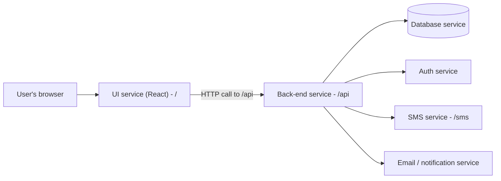
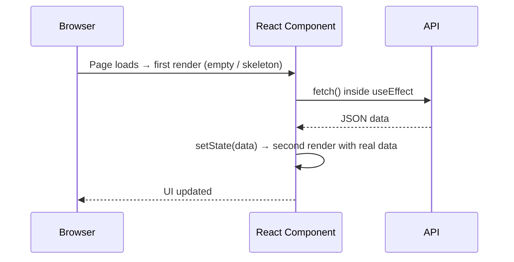
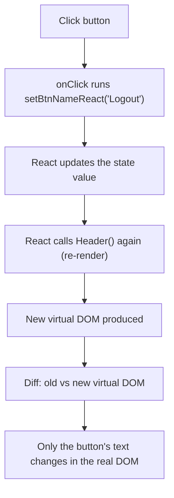
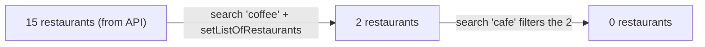
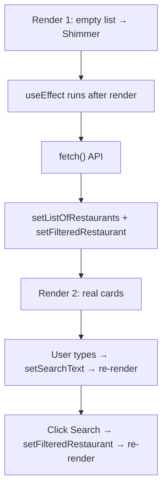

# Namaste React, Episode 6 — "Explore the World": Microservices, `useEffect`, Fetching Live APIs, Shimmer UI, State-Driven Re-renders, and Search

## Overview

This document turns the transcript of **Namaste React, Episode 6** into standalone learning notes. The episode takes the food-ordering app from "a static page with hard-coded mock data" to "an app that talks to the outside world". It covers:

1. **Architecture background:** monolith vs microservice architecture, and where a React app fits.
2. **Two strategies for loading data** and why React apps use "render first, fetch after".
3. **The `useEffect` hook** and the exact order of render vs effect.
4. **Calling a live API with `fetch`**, the browser **CORS** error, and how to work around it locally.
5. **Loading experience:** conditional rendering, spinner vs **Shimmer UI**.
6. **Why state variables exist**, shown with a login/logout toggle, and what really happens on each re-render.
7. **A working search box:** controlled inputs, `onChange`, case-insensitive filtering, and the classic "searching the already-filtered list" bug with its fix.

> **Labelling convention**
> - **[Transcript]**: material taken from the episode (cleaned of filler and transcription errors).
> - **[Supplementary]**: explanations or examples I added for clarity.
> - **[Unclear]**: details the transcript does not settle.

---

## Learning Objectives

After studying these notes you should be able to:

- Describe monolith and microservice architecture, and explain "separation of concerns" and the "single responsibility principle".
- Explain how services are deployed (ports/domains) and how a React UI talks to a back-end service.
- Compare "fetch then render" with "render then fetch" and justify React's preferred approach.
- Use `useEffect` with a callback and a dependency array, and predict when the callback runs relative to the render.
- Fetch JSON from an API using `async`/`await`, and understand why a CORS error appears.
- Populate a state variable from an API response and handle the empty/loading state.
- Build a **Shimmer UI** component and apply **conditional rendering** (`if` and ternary).
- Explain, in depth, why a normal variable cannot update the UI but a state variable can, and why the component function runs again on every state change.
- Build a controlled search input and a filter that works correctly across repeated searches.
- Answer the interview question "Why is React fast?" accurately.

## Prerequisites

- Episodes 1–5: JSX, components, props, `map`, `key`, project structure, import/export, `useState`, event handlers.
- Basic JavaScript: promises, `async`/`await`, arrow functions, `filter`, string methods.
- Chrome DevTools basics (Network and Elements tabs).
- The running project from Episode 5 (`npm start`, Parcel dev server on `localhost:1234`).

---

## Table of Contents

- [1. Monolith vs Microservice Architecture](#1-monolith-vs-microservice-architecture)
- [2. Two Approaches to Loading Data](#2-two-approaches-to-loading-data)
- [3. The `useEffect` Hook](#3-the-useeffect-hook)
- [4. Fetching Live Data from an API](#4-fetching-live-data-from-an-api)
- [5. Handling the Loading State: Spinner, Shimmer UI, and Conditional Rendering](#5-handling-the-loading-state-spinner-shimmer-ui-and-conditional-rendering)
- [6. Why We Need State Variables: The Login/Logout Button](#6-why-we-need-state-variables-the-loginlogout-button)
- [7. Building the Search Feature](#7-building-the-search-feature)
- [8. How the Concepts Connect](#8-how-the-concepts-connect)
- [9. Common Mistakes and Troubleshooting](#9-common-mistakes-and-troubleshooting)
- [10. Best Practices](#10-best-practices)
- [11. Exercises and Practice Tasks](#11-exercises-and-practice-tasks)
- [12. Key Takeaways](#12-key-takeaways)
- [13. Glossary](#13-glossary)
- [14. References and Further Learning](#14-references-and-further-learning)

---

## 1. Monolith vs Microservice Architecture

### Why this appears in a React episode [Transcript]

The episode's theme is *exploring the world outside our app*. To understand what "outside" means, you need to know how large applications are organized.

### 1.1 Monolith architecture

**Definition:** A single, large project that contains everything: API code, UI code, authentication, database connectivity, notification/SMS code, and so on.

**Example [Transcript]:** At an earlier company (Lendingkart), the instructor worked on a single **Java** project that included APIs, JSP pages (Java Servlet pages) for the UI, authentication, DB connection, and notifications. Front-end and back-end developers shared one repository.

**Consequence:** Even a tiny change (for example changing a button's color) requires **building, compiling, and deploying the whole big project**.

### 1.2 Microservice architecture

**Definition:** The application is split into many **small, independent services**, each with one job. Together they form the big app.

| Service (example) | Responsibility |
|---|---|
| UI service | The user interface (this is our React app) |
| Back-end service | Business logic and APIs |
| Authentication service | Login/identity |
| Database service | Data access |
| SMS service | Sending text messages |
| Email/notification service | Sending emails/notifications |

**Key ideas [Transcript]:**

- **Separation of concerns:** each service does one thing.
- **Single responsibility principle:** each service has its own job, and nobody interferes with another's.
- **Independent teams and deployments:** each team owns its own service, repository, and deployment cycle. (The instructor cites Uber as a microservice company with many services.)
- **Different tech stacks per service:** UI in React, back end in Java, database service in Python, SMS service in Go, and so on. There's no single "company language"; the choice depends on the use case. Many companies standardize on one UI framework, but they don't have to.

> **Note [Transcript]:** The instructor deliberately says he won't enter the "monolith vs microservices" debate; he only wants you to understand the concepts.

### 1.3 How services are deployed and reach each other

- Each service runs on its **own port** (the React dev server runs on port `1234`; a back end might run on `1000`; an SMS service on `3000`).
- Those ports are mapped to a **domain name**, for example:
  - `/` → the UI service
  - `/api` → the back-end service
  - `/sms` → the SMS service
- Services interact by **calling each other's URLs** (for example the UI calls `/api` to fetch data).



**Where our project fits:** The Namaste React project is the **UI microservice**, written in React. In this episode it will reach out to a back-end service (Swiggy's API) to get data.

---

## 2. Two Approaches to Loading Data

**Context:** Until now the app displayed `resList`, mock data copied from Swiggy's API into the code. That is not a good way to build an app; we want data fetched **dynamically**.

### Approach 1: fetch, then render

1. Page loads.
2. Make the API call and **wait** for it.
3. Render the UI once data arrives.

If the call takes 500 ms, the user sees **nothing** for 500 ms, then everything appears at once.

### Approach 2: render, then fetch (React's way)

1. Page loads.
2. **Render the UI immediately** (for example a skeleton).
3. Make the API call.
4. When the data arrives, **re-render** with the real data.

### Which one and why [Transcript]

| | Approach 1 | Approach 2 |
|---|---|---|
| Initial experience | Blank/frozen page until data arrives | Something appears immediately |
| Perceived speed | Poor UX, sudden appearance | Better UX, gradual |
| Renders | One | Two |

- In React we **always use Approach 2**.
- "Two renders" is fine because **React's render cycle is very fast**. You shouldn't worry about rendering twice (the episode later shows React happily rendering dozens of times).



---

## 3. The `useEffect` Hook

### Definition

`useEffect` is a **React Hook**, which, like `useState`, is just a **normal JavaScript function provided by React** with a specific purpose. `useState` creates state variables; `useEffect` lets you run code **after a component has rendered**.

### Why it matters

It's the tool for Approach 2: render first, then do the API call.

### Import

It comes from the React library as a **named import**:

```js
import { useState, useEffect } from "react";
```

### Syntax

```js
useEffect(() => {
  console.log("useEffect called");
}, []);
```

| Part | Meaning |
|---|---|
| First argument | A **callback function** (an arrow function) |
| Second argument | A **dependency array** |

> **[Transcript]** The instructor says "parameters" and then corrects himself: these are **arguments** at the call site.
>
> **[Unclear/Supplementary]** In this episode the dependency array is shown as the second argument but its behavior is not explained in detail (it is covered later). The commonly known behavior is: **an empty array `[]` means "run the callback once, after the first render"**. This is what you need for a one-time API call.

### How it works

**Rule [Transcript]:** *The callback passed to `useEffect` is called **after** the component renders.*

1. React calls your component function from top to bottom.
2. When it reaches `useEffect`, it **saves** the callback to run later and moves on.
3. It finishes the function (including returning the JSX) and renders.
4. Only after the render cycle is finished does React call the saved callback.

### Demonstration [Transcript]

The instructor proved the order with the debugger:

1. Put a `debugger` before the `useEffect` and refresh. The body renders with the dummy data, but **"useEffect called" has not been printed yet**.
2. Resume the script. Now "useEffect called" appears.

**Trick question [Transcript]:** If the component has `console.log("Body rendered")` and also a `useEffect` that logs `"useEffect called"`, which prints first?

```jsx
const Body = () => {
  console.log("Body rendered");           // 1st

  useEffect(() => {
    console.log("useEffect called");      // 2nd (after render)
  }, []);

  return <div>...</div>;
};
```

**Answer:** `Body rendered` prints first, then `useEffect called`. Many developers get this wrong, which is why the instructor stresses it.

### Common mistakes

| Mistake | Explanation |
|---|---|
| Thinking the effect runs before the render | It always runs **after** the render |
| Forgetting the import | `useEffect is not defined` |
| Using default import | It's a **named** import: `{ useEffect }` |

---

## 4. Fetching Live Data from an API

### 4.1 `fetch` is a browser superpower

**[Transcript]** `fetch` is **not** part of React and not part of the JavaScript language itself; it's provided by the **browser** (the JS engine's environment). Fetching data in React is *exactly* the same as in plain JavaScript.

### 4.2 Using `async`/`await`

`fetch(url)` returns a **promise**. You can resolve it with `.then()/.catch()` or with `async`/`await`. The instructor recommends **`async`/`await`**, the industry standard and cleaner syntax.

```jsx
useEffect(() => {
  fetchData();
}, []);

const fetchData = async () => {
  const data = await fetch("<LIVE_API_URL>");   // resolves the promise → a Response
  const json = await data.json();               // converts the readable stream to JSON
  console.log(json);
};
```

| Line | Purpose |
|---|---|
| `async` | Lets you use `await` inside |
| `await fetch(...)` | Waits for the response |
| `await data.json()` | Waits while the body is converted to a JS object (this is also a promise) |

> **[Supplementary]** In real code define `fetchData` (or use a function expression) before calling it, or call it in a way that avoids the temporal-dead-zone issue with `const`. In the instructor's code the call happens inside the effect callback, which runs after render, so by then the `const` has been defined.

### 4.3 Where did the URL come from?

**[Transcript]** From Swiggy's website: open DevTools → **Network** tab, set the location, refresh, and find the restaurant-list API call; copy that URL. (A dedicated video later covers this in detail.)

**Disclaimer [Transcript]:**

- Swiggy can change this API (name, URL, or response format) at any time. **Do not copy the URL from the instructor's code; copy the latest from the Network tab.**
- This is **not sponsored** by Swiggy; live APIs are used because real production APIs are what you'll meet at work. Dummy APIs were considered and rejected.
- For any other site, use the same method: find the API in the Network tab and use it.

### 4.4 The CORS error

**Symptom [Transcript]:** The console shows an error saying access to `fetch` at the Swiggy URL from `localhost` has been **blocked by CORS policy**.

**Explanation [Transcript]:** The **browser (Chrome)** blocks API calls from one **origin** to a different origin if the server doesn't permit it. `localhost:1234` and `swiggy.com` are different origins. The instructor refers to his separate CORS video for details.

**Workaround for learning [Transcript]:**

1. Search for a **"CORS Chrome extension"** (Firefox and other browsers have equivalents).
2. Install it and **turn it on**.
3. Reload the page. The request succeeds and the JSON appears in the console.

> **[Supplementary]** This extension only changes behavior **in your own browser**. It's fine for local learning, but a deployed app needs a proper solution (e.g., the API allowing your origin, or a server-side proxy). A later short video in the series promises a better approach (mentioned at the end of the follow-up Swiggy video).

### 4.5 Putting the data into state

Before: the state was initialized with mock data.

```jsx
const [listOfRestaurants, setListOfRestaurants] = useState(resList);
```

After: start **empty**, fill from the API.

```jsx
const [listOfRestaurants, setListOfRestaurants] = useState([]);

const fetchData = async () => {
  const data = await fetch("<LIVE_API_URL>");
  const json = await data.json();
  setListOfRestaurants(
    json?.data?.cards[2]?.data?.data?.cards   // path at the time of recording
  );
};
```

**Why `setListOfRestaurants`?** Updating a state variable makes React **re-render** the body with the new data.

**What you see [Transcript]:** With mock data as the initial value, you first see the old mock cards, and then they suddenly change to the live data (for example "Biryani Pot", "Burger King"). Once the initial value is `[]`, the page starts empty and then fills in. The mock data file (`mockData.js`) can then be **deleted**, and the app no longer depends on any dummy data.

> **[Unclear]** The path the instructor speaks aloud is garbled ("json.data.cards of 2 … data.data.cards"). It is reproduced above as `json?.data?.cards[2]?.data?.data?.cards`. The data format has since changed; see the companion notes on the Swiggy API fix. Always inspect the live response yourself.

### 4.6 Messy real-world data and optional chaining

**[Transcript]** The API returns a huge, nested JSON with lots of irrelevant data (here, 15 restaurant objects hidden several levels deep). That's normal in the real world.

Writing a long chain like `json.data.cards[2].data.data.cards` is fragile. Use **optional chaining (`?.`)**: if any part is `undefined`/`null`, the expression becomes `undefined` instead of throwing. The instructor recommends learning it (covered in his *Namaste JavaScript* series).

---

## 5. Handling the Loading State: Spinner, Shimmer UI, and Conditional Rendering

### 5.1 The problem

With the initial state `[]`, the page is blank until the API replies. The `Body` *is* rendered, but you can't see anything. The instructor wants to give the user something to look at.

### 5.2 First attempt: a loading message [Transcript]

```jsx
if (listOfRestaurants.length === 0) {
  return <h1>Loading...</h1>;
}
```

- If the list is empty, React returns this JSX **instead of** the rest of the component's JSX.
- A spinner image could be used the same way.

**But spinners aren't the modern standard.** Content then "pops" onto the screen, which is jarring.

### 5.3 The modern way: Shimmer UI

**Definition:** A **Shimmer UI** shows a **fake, skeleton version of the page** (grey placeholder cards) while the real data is loading. It resembles the final layout so the user can anticipate what's coming.

**Why [Transcript]:** It has a *psychological* benefit. The user feels the site is loading and sees structure instead of a blank screen. Swiggy, YouTube, and many modern sites use it.

### 5.4 Tutorial: build a Shimmer component

**Objective:** Show grey placeholder cards until the API data arrives.

**Files:** `src/components/Shimmer.js`, CSS file, `Body.js`.

**Step 1: create the component**

```jsx
// src/components/Shimmer.js
const Shimmer = () => {
  return (
    <div className="shimmer-container">
      <div className="shimmer-card"></div>
      <div className="shimmer-card"></div>
      <div className="shimmer-card"></div>
      {/* repeat as many placeholder cards as you like (the instructor used about 15) */}
    </div>
  );
};

export default Shimmer;
```

**Step 2: style it**

```css
.shimmer-container {
  display: flex;
  flex-wrap: wrap;
}

.shimmer-card {
  width: 200px;
  height: 400px;
  margin: 20px;
  background-color: #f0f0f0;
}
```

(The instructor first used gray, then `#f0f0f0`. Initially cards didn't line up until he added `display: flex`, and then `flex-wrap: wrap` so they wrap onto multiple rows.)

**Step 3: use it in `Body.js`**

```jsx
import Shimmer from "./Shimmer";

if (listOfRestaurants.length === 0) {
  return <Shimmer />;
}
```

**Troubleshooting from the video:**

| Problem | Cause | Fix |
|---|---|---|
| Cards stack vertically | Missing `display: flex` | Add it to the container |
| Cards overflow in one row | Missing wrap | Add `flex-wrap: wrap` |
| Nothing styled | Class name typo (`cards` vs `card`) | Match class names in JSX and CSS |
| Import error | Wrong export type | `export default Shimmer;` and `import Shimmer from "./Shimmer"` |

**Expected result:** On reload you briefly see grey placeholder cards, then the real restaurant cards replace them.

### 5.5 Conditional rendering

**Definition [Transcript]:** *Rendering on the basis of a condition* is called **conditional rendering**. It's just a fancy name for a simple idea, but interviewers may ask for the term.

**Form 1: early `return` with `if`** (shown above).

**Form 2: ternary operator inside a single `return`** (plain JavaScript, not a React concept):

```jsx
return listOfRestaurants.length === 0 ? (
  <Shimmer />
) : (
  <div className="body">
    {/* filter, search, restaurant cards */}
  </div>
);
```

Read it as: *if the list is empty, show the shimmer; otherwise show the page.* Both forms behave identically. If you see this pattern in other code, don't panic; it's a ternary.

---

## 6. Why We Need State Variables: The Login/Logout Button

### 6.1 The question

**[Transcript]** Many React developers wonder: *"Why do we even need `useState`? Can't I use a normal local variable?"* and *"What superpower does a state variable have that a normal variable doesn't?"* The instructor wants you to know the **why**, not only the **how**. He builds a tiny feature to prove it.

### 6.2 Feature

In `Header.js`, add a **Login** button next to Home / About Us / Contact Us / Cart. Clicking it should change the label to **Logout**, and clicking again should change it back. (There's no real authentication, it only demonstrates UI behavior.)

```jsx
<button className="login">Login</button>
```

```css
.login {
  padding: 0 20px;
  cursor: pointer;
}
```

### 6.3 Attempt 1: a normal variable (fails)

```jsx
const Header = () => {
  let btnName = "Login";

  return (
    <div className="header">
      {/* ... */}
      <button
        className="login"
        onClick={() => {
          btnName = "Logout";
          console.log(btnName);
        }}
      >
        {btnName}
      </button>
    </div>
  );
};
```

- `btnName` must be `let` (not `const`) or JavaScript refuses to reassign it.
- **Result:** Clicking logs `Logout` to the console (so the variable **did** change and the click handler **did** run), but **the button still says "Login"**.

**Why [Transcript]:** React has **no way to know** that a plain JavaScript variable changed. Nothing tells React to refresh the component, so the old UI stays.

### 6.4 Attempt 2: a state variable (works)

```jsx
import { useState } from "react";

const Header = () => {
  const [btnNameReact, setBtnNameReact] = useState("Login");

  console.log("Header rendered");

  return (
    <div className="header">
      {/* ... */}
      <button
        className="login"
        onClick={() => {
          btnNameReact === "Login"
            ? setBtnNameReact("Logout")
            : setBtnNameReact("Login");
        }}
      >
        {btnNameReact}
      </button>
    </div>
  );
};
```

**How it works:**

1. `useState("Login")` returns `[currentValue, setterFunction]`; the default is `"Login"`.
2. Use `btnNameReact` in JSX like any variable.
3. **Never assign directly** to it. Call `setBtnNameReact(newValue)`.
4. Naming convention: `setXxx`. (The instructor notes you could name it anything, but follow the convention.)
5. The `onClick` uses a conditional (ternary) so the button **toggles** between the two labels.

**Expected result:** Click **Login** → it becomes **Logout**; click again → it goes back to **Login**.

### 6.5 What really happens behind the scenes [Transcript]

> **The rule:** *Whenever a state variable is updated through its setter, React re-renders the component.*

**Proof:** The `console.log("Header rendered")` prints once on load and **again on every click**. That means the **entire `Header` function is called again** each time.



**"How can a `const` change?" [Transcript]** This puzzles many developers: `btnNameReact` is declared with `const`, yet its displayed value changes.

- It isn't being *modified*. Each re-render **calls the component function again**, so `useState` runs again and creates a **brand-new `btnNameReact` variable**, this time initialized with the **updated value** React stored, not the default.
- Each render has its own constants. The old one is gone.

**Only the button changes in the DOM:**

- React re-renders the *whole* `Header` function, but through **reconciliation** it compares the new virtual DOM with the old one, finds that **only the button text differs**, and updates only that in the real DOM.
- Watching the Elements tab, the logo and the other items stay untouched and only the button flashes as it updates. This is why React is fast.

> **Interview-level answer [Transcript]:** *"React re-renders the component, but only updates the part of the actual DOM that changed."*

---

## 7. Building the Search Feature

### 7.1 Goal

A search box and a **Search** button above the **Top Rated Restaurants** button. Typing "coffee" and clicking Search should show only matching restaurants (for example "Third Wave Coffee"); "cafe" should show the cafes.

### 7.2 Step 1: markup and layout

```jsx
<div className="filter">
  <div className="search">
    <input type="text" className="search-box" />
    <button>Search</button>
  </div>
  <button className="filter-btn" onClick={/* top-rated filter */}>
    Top Rated Restaurants
  </button>
</div>
```

```css
.filter {
  display: flex;
}
```

`display: flex` puts the search area and the Top Rated button side by side. The instructor uses plain CSS here and notes **Tailwind** is coming later in the series.

### 7.3 Step 2: the input that "doesn't work"

To read what the user types, we **bind** the input to a state variable:

```jsx
const [searchText, setSearchText] = useState("");

<input type="text" className="search-box" value={searchText} />
```

**Symptom [Transcript]:** You type in the box and **nothing appears**.

**Why:** The input's `value` is tied to `searchText`, which is `""`. React renders the input with that value on every render. Typing doesn't change `searchText`, so the input stays empty. The state is the **single source of truth**.

> **[Supplementary]** This pattern, where React state controls the input's value, is called a **controlled input** (or controlled component). The transcript doesn't use the term, but it's what is being built. React also logs a warning in the console when you provide `value` without `onChange`.

### 7.4 Step 3: add `onChange`

```jsx
<input
  type="text"
  className="search-box"
  value={searchText}
  onChange={(e) => {
    setSearchText(e.target.value);
  }}
/>
```

- `e` is the **event object**, as in a normal event handler.
- `e.target` is the input element; `e.target.value` is what the user has typed so far.
- Each keystroke updates the state, React re-renders, and the input shows the new `value`.

**Expected result:** Typing now works; `searchText` always equals what's in the box.

### 7.5 Every keystroke re-renders the whole component [Transcript]

```jsx
const Body = () => {
  console.log("Body rendered");
  ...
```

- On **page load** the body renders **twice**: once initially and once after the API data arrives (`setListOfRestaurants`). This is Approach 2 in action.
- When you type "cafe", `Body rendered` prints **once per key press**. After more typing the counter reached the dozens (the instructor mentions 11, 53, and then 94 renders in his session).

**Message [Transcript]:** React re-renders the **entire `Body` component** every time state changes, yet the page doesn't lag. React finds the difference between the old and new virtual DOM and updates **only the input box's value** in the real DOM. Many developers assume only the input updates, and don't realize the whole component function runs again.

> **Why is React fast? [Transcript answer]** Saying "because of the virtual DOM" is too shallow. The fuller answer: React's **reconciliation algorithm (React Fiber)** compares the old and new virtual DOM and updates **only the portions of the real DOM that need to change**. DOM manipulation is expensive, and React minimizes it. (Compare Episode 5, Section 8.)

### 7.6 Step 4: the first filter implementation

```jsx
<button
  onClick={() => {
    const filteredRestaurant = listOfRestaurants.filter((res) =>
      res.data.name.toLowerCase().includes(searchText.toLowerCase())
    );
    setListOfRestaurants(filteredRestaurant);   // <-- this has a bug (see 7.8)
  }}
>
  Search
</button>
```

The instructor made several corrections while building it:

| Attempt | Problem | Fix |
|---|---|---|
| `res.data.name === searchText` | "Third Wave Coffee" never equals "coffee" | Use `.includes(...)` (the name should **include** the search text) |
| `includes("coffee")` | Search for "Coffee" fails; case mismatch | Convert **both** sides with `toLowerCase()` |

**Result:** A case-insensitive search. Typing "COFfEE" in any mix of cases finds the two coffee restaurants, and the 15 cards drop to 2. As soon as `setListOfRestaurants` runs, React re-renders `Body` with the smaller list.

> **[Unclear]** The field `res.data.name` reflects the data format at the time of recording. The later Swiggy-API video renamed `data` to `info`; adjust to your own data.

### 7.7 The bug the instructor leaves as homework

After searching for "coffee" (2 results), searching for "cafe" returns **nothing**, no error in the console. But searching for something *within* the 2 coffee results (for example "wave") still works.

**Cause [Transcript]:** We **overwrote** `listOfRestaurants` with the filtered list, so the **original 15 restaurants are lost**. Every later search filters only the previous results.



### 7.8 The fix: keep two lists

**Idea:** Never modify the original data. Keep a **second state variable** for what is *displayed*.

```jsx
const [listOfRestaurants, setListOfRestaurants] = useState([]);       // full copy, never filtered
const [filteredRestaurant, setFilteredRestaurant] = useState([]);     // what the UI shows
const [searchText, setSearchText] = useState("");

useEffect(() => { fetchData(); }, []);

const fetchData = async () => {
  const data = await fetch("<LIVE_API_URL>");
  const json = await data.json();
  const restaurants = json?.data?.cards[2]?.data?.data?.cards;  // path at the time of recording
  setListOfRestaurants(restaurants);     // keep the full list
  setFilteredRestaurant(restaurants);    // initially show all
};
```

```jsx
// Search button
onClick={() => {
  const filtered = listOfRestaurants.filter((res) =>
    res.data.name.toLowerCase().includes(searchText.toLowerCase())
  );
  setFilteredRestaurant(filtered);       // update ONLY the displayed list
}}

// Rendering
<div className="res-container">
  {filteredRestaurant.map((restaurant) => (
    <RestaurantCard key={restaurant.data.id} resData={restaurant} />
  ))}
</div>
```

**What each variable does:**

| State | Set when | Used for |
|---|---|---|
| `listOfRestaurants` | Once, after the API call | The **source** to filter from (never modified by search) |
| `filteredRestaurant` | After the API call and after each search | What gets **rendered** |
| `searchText` | Every keystroke | Controls the input box |

**Expected result:**

- Search "coffee" → 2 results.
- Then search "cafe" → the cafes appear (it filters the full 15).
- Search with an empty box and click Search → all restaurants appear again.
- Searching "Namaste" finds the "Namaste" restaurant.

> **Note about the loading check [Supplementary]:** The loading condition in the instructor's code checks `listOfRestaurants.length === 0`. That's why a search with zero matches shows an empty list (not the shimmer): the full list is still non-empty. If you check `filteredRestaurant` instead, a no-match search would show the shimmer forever.
>
> **Related code to update [Supplementary]:** The earlier "Top Rated" button from Episode 5 still calls `setListOfRestaurants`. For consistency with this fix, it should filter `listOfRestaurants` and call `setFilteredRestaurant`. The transcript doesn't cover this; it is left for you to align.

---

## 8. How the Concepts Connect

| Idea | Role in this episode |
|---|---|
| Microservices | The React app is just the UI service; it calls other services' APIs |
| Render, then fetch | Gives a better UX; needs a way to run code after render → `useEffect` |
| `useEffect` | Runs the API call after the first render |
| `fetch` + `async`/`await` | Gets the JSON |
| CORS | Browser rule that blocks cross-origin calls unless allowed |
| `useState` setter | Putting API data in state triggers the second render |
| Shimmer + conditional rendering | Fills the gap between render 1 and render 2 |
| State variable re-render | Explains login/logout and search typing |
| Virtual DOM + diff | Why re-rendering whole components is still fast |
| Two state variables | Keep source data safe, display derived data |



---

## 9. Common Mistakes and Troubleshooting

| # | Problem | Cause | Fix |
|---|---|---|---|
| 1 | CORS error in console | Browser blocks cross-origin call | Enable a CORS extension for local dev |
| 2 | API data format differs from the video | Live APIs change | Inspect the response; adjust the path |
| 3 | Effect seems to run before render | Misunderstanding of order | Remember: render first, effect after |
| 4 | Blank page before data arrives | Empty initial state | Show a Shimmer using conditional rendering |
| 5 | Button label doesn't change | Using a plain `let` variable | Use `useState` and the setter |
| 6 | `Assignment to constant variable` | Reassigning a `const` | Use the state setter instead |
| 7 | Can't type in the input | `value` bound without `onChange` | Add `onChange={(e) => setSearchText(e.target.value)}` |
| 8 | Search finds nothing for "coffee" | Used `===` instead of `includes` | Use `includes` |
| 9 | Search is case-sensitive | Cases differ | `toLowerCase()` on both sides |
| 10 | Later searches return nothing | Original list overwritten by filtered list | Keep a separate `filteredRestaurant` state |
| 11 | Page empty after adding `filteredRestaurant` | Never populated | Set both lists after the API call |
| 12 | Shimmer cards in a single column | Missing `display: flex; flex-wrap: wrap` | Add to `.shimmer-container` |

---

## 10. Best Practices

1. Prefer **render first, fetch after** for a better user experience.
2. Do side effects such as API calls inside **`useEffect`**, not in the component body.
3. Use **`async`/`await`** for promises.
4. Use **optional chaining** with deep, external API data.
5. Show a **Shimmer UI** instead of a spinner when the layout is known.
6. Update state **only through its setter**; never assign directly.
7. **Don't overwrite your source data** when filtering. Keep the original list and a separate "view" list.
8. Make searches **case-insensitive** and use `includes` for partial matches.
9. Don't worry about re-rendering; React is efficient, but still avoid unnecessary work. **[Supplementary]**
10. Understand the **why**: ask *why, how, when* for everything you learn (the instructor's theme).
11. **Code slowly.** The instructor's closing advice: question every line you write (*"Why am I writing this? Is it required? Could it be better?"*) because slow, deliberate coding saves debugging time.
12. Practice on your own. Watching alone won't teach you, like learning to drive from a video. **[Transcript analogy]**

---

## 11. Exercises and Practice Tasks

- [ ] **Order of execution:** Add `console.log` statements to a component and a `useEffect`; predict the order, then verify.
- [ ] **Fetch practice:** Fetch data from another public API (find its URL in the Network tab or use a documented one) and log it.
- [ ] **State from API:** Start with `useState([])`, fill it from the API, and render the list.
- [ ] **Shimmer:** Build your own Shimmer component with 10–15 placeholder cards. *Expected:* it appears briefly and is replaced by real cards.
- [ ] **Conditional rendering:** Rewrite your `if (...) return <Shimmer />` as a ternary inside a single `return`.
- [ ] **Login/logout toggle:** Implement it, add `console.log("Header rendered")`, and count re-renders as you click.
- [ ] **Break it on purpose:** Change `btnName` to a plain variable and confirm the UI doesn't update while the console shows it changing.
- [ ] **Controlled input:** Bind an input to state, remove `onChange`, and observe the "can't type" behavior; then add `onChange`.
- [ ] **Search bug:** Reproduce the "second search returns nothing" bug, then fix it with two state variables.
- [ ] **Stretch:** Make pressing **Enter** in the search box trigger the search.
- [ ] **Stretch:** Update the Top Rated button so it also filters `listOfRestaurants` and sets `filteredRestaurant`.
- [ ] **Explain it:** In 4–5 sentences, explain why typing in the box re-renders `Body` yet the page stays fast.

---

## 12. Key Takeaways

- A React app is typically the **UI microservice** that talks to back-end services via URLs.
- React apps **render first and fetch after**: initial render → API call → re-render with data.
- **`useEffect(callback, dependencyArray)`** runs the callback **after** the component renders.
- **`fetch`** is provided by the browser; use `async`/`await` and `.json()`.
- **CORS** is a browser restriction; a CORS extension is only a local workaround.
- **Shimmer UI** + **conditional rendering** give a better loading experience than a spinner.
- A normal variable change **doesn't update the UI**; a **state variable** change makes React **re-render the component**.
- Re-rendering means **calling the component function again**; the new `const` gets the updated value.
- React re-renders whole components but updates **only the changed DOM parts**, via the **virtual DOM, diffing, and reconciliation (React Fiber)**.
- A **controlled input** needs both `value` and `onChange`.
- Don't filter your only copy of the data; keep an **original list** and a **filtered list**.
- *Code slow* and keep asking **why**.

---

## 13. Glossary

| Term | Definition |
|---|---|
| **Monolith** | One large project containing all parts of an application |
| **Microservice** | A small, independent service with a single responsibility |
| **Separation of concerns** | Splitting code/services by responsibility |
| **Single responsibility principle** | Each unit has one job |
| **Port** | A numbered network endpoint on which a service listens |
| **`useEffect`** | Hook that runs code after a component renders |
| **Dependency array** | Second argument of `useEffect` controlling when it re-runs |
| **Callback function** | A function passed to another function to be called later |
| **`fetch`** | Browser function for making HTTP requests; returns a promise |
| **`async`/`await`** | Syntax for working with promises sequentially |
| **CORS** | Browser mechanism restricting cross-origin requests |
| **Origin** | Protocol + domain + port of a page or API |
| **Optional chaining (`?.`)** | Safe property access that yields `undefined` instead of throwing |
| **Shimmer UI** | A placeholder/skeleton UI displayed while data loads |
| **Conditional rendering** | Rendering different UI based on a condition |
| **Ternary operator** | `condition ? a : b` expression |
| **State variable** | Variable created with `useState` that triggers re-renders |
| **Re-render** | React calling the component function again after state changes |
| **Controlled input** | An input whose value is controlled by React state |
| **Event object (`e`)** | Object describing an event; `e.target.value` is the input's value |
| **Virtual DOM** | In-memory JavaScript representation of the DOM |
| **Reconciliation** | React's process of diffing old/new virtual DOM and updating the real DOM |
| **React Fiber** | React's reconciliation implementation (introduced in React 16) |

---

## 14. References and Further Learning

- React docs: **`useEffect`**, **`useState`**, **Conditional Rendering**, **Reconciliation**, **Controlled components / forms**
- MDN Web Docs: **Using the Fetch API**, **`async` function**, **Cross-Origin Resource Sharing (CORS)**, **Optional chaining**, **`Array.prototype.filter`**, **`String.prototype.includes`**, **`toLowerCase`**
- The instructor's videos referenced in the episode: *CORS*, *Map, Filter, Reduce*, and *Namaste JavaScript* (optional chaining)
- Companion notes: the **Swiggy API fix** video (how to re-find the API and extract data when the format changes)
- Companion notes: **Episode 5** (hooks, `useState`, virtual DOM, diff algorithm, React Fiber)
- Look up **Tailwind CSS**, which the instructor says is coming later in the series

> **Verification note:** This document was prepared from the transcript only, without live lookups of external documentation or Swiggy's API. Check the official React documentation for current API details.
