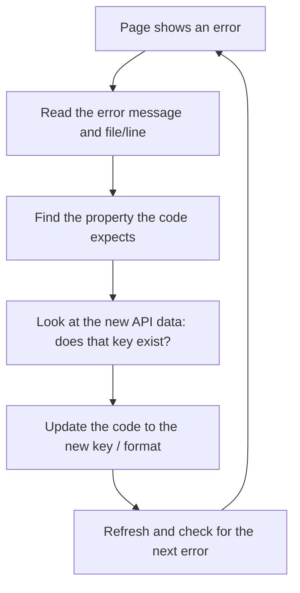
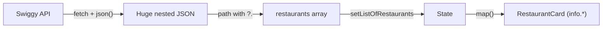

# Namaste React — Fixing the Swiggy API: Finding an API, Reading Nested JSON, and Adapting Your Code When the Data Format Changes

## Overview

This document turns the transcript of the "Swiggy API fix" video (a follow-up to Namaste React Episode 6) into standalone learning notes. The Swiggy restaurant-list API kept the same name and URL but changed the **structure of the data it returns**, which broke the food-ordering app. Instead of just handing over a patch, the instructor teaches a repeatable method:

1. **Find** the API call a website makes (browser DevTools → Network tab).
2. **Read** a huge, deeply nested JSON response and locate the data you need.
3. **Extract** that data with a property path (with optional chaining).
4. **Debug** the follow-on errors in components when key names change.
5. **Extend** the app (homework: load more restaurants on scroll using a POST call).

> **Labelling convention**
> - **[Transcript]**: material taken from the video (cleaned of filler and transcription errors).
> - **[Supplementary]**: explanations or examples I added for clarity.
> - **[Unclear]**: details the transcript doesn't settle.

---

## Learning Objectives

After studying these notes you should be able to:

- Explain why live third-party APIs change and why front-end developers must adapt.
- Locate an API request on any website using the **Network** tab and the **Fetch/XHR** filter.
- Copy an API URL and open or inspect its response in a readable form (JSON viewer).
- Navigate a large nested JSON response to find the exact array you need.
- Write a property path such as `json?.data?.cards[5]?.card?.card?.gridElements?.infoWithStyle?.restaurants`.
- Use **optional chaining** safely when reading deeply nested data.
- Diagnose `Cannot read properties of undefined` errors caused by renamed keys and fix them one by one.
- Adapt UI code when a value changes type or location (number → string, top-level key → nested object).
- Explain why the API response is a **config-driven UI** payload.
- Describe how lazy loading works from the network calls and outline how to call a POST API with `fetch`.

## Prerequisites

- The food-ordering app from the earlier episodes (`Body.js`, `RestaurantCard.js`, `useState`, `useEffect`, `fetch`, `async/await`).
- Basic understanding of JSON, objects, arrays, and destructuring/property access.
- Chrome (or another browser) with DevTools.
- A **CORS browser extension** (the instructor uses one for this series; see [Section 9](#9-the-cors-error)).
- Recommended: knowing what **optional chaining** (`?.`) is (the instructor refers to his *Namaste JavaScript* videos).

---

## Table of Contents

- [1. Background: What Broke and Why](#1-background-what-broke-and-why)
- [2. Finding the API URL](#2-finding-the-api-url)
- [3. Reading the Response](#3-reading-the-response)
- [4. Studying the Structure: Which Card Holds the Restaurants?](#4-studying-the-structure-which-card-holds-the-restaurants)
- [5. Writing the Extraction Path](#5-writing-the-extraction-path)
- [6. Updating the Code Step by Step](#6-updating-the-code-step-by-step)
- [7. Debugging the Follow-On Errors](#7-debugging-the-follow-on-errors)
- [8. Lazy Loading and the Homework](#8-lazy-loading-and-the-homework)
- [9. The CORS Error](#9-the-cors-error)
- [10. How the Concepts Connect](#10-how-the-concepts-connect)
- [11. Common Mistakes and Troubleshooting](#11-common-mistakes-and-troubleshooting)
- [12. Best Practices](#12-best-practices)
- [13. Exercises and Practice Tasks](#13-exercises-and-practice-tasks)
- [14. Key Takeaways](#14-key-takeaways)
- [15. Glossary](#15-glossary)
- [16. References and Further Learning](#16-references-and-further-learning)

---

## 1. Background: What Broke and Why

### What happened [Transcript]

- In Episode 6 the app fetched **live data** from Swiggy's restaurant-list API and displayed it.
- Later, the API's **name/URL stayed essentially the same**, but the **format (structure) of the returned data changed**.
- The extraction code written earlier (for example `json.data.cards[2]...`) no longer pointed at the right place, so the app broke for many students.

### Why the instructor still uses live APIs [Transcript]

- He wants students to work with **real production data**, not random dummy APIs. He deliberately won't go back to dummy data.
- The trade-off: live APIs **keep changing**. Swiggy is a company running in production; its back-end team changes APIs and its front-end team adapts the UI.

> **Real-world lesson [Transcript]:** In a job, the back-end team will keep changing APIs and *you, as the React developer, will need to accommodate those changes*. Swiggy's own front-end developers face exactly the same thing. So learning to adapt is more valuable than any one fix.

### Goal of the video

Teach a **method**, not just a one-time patch, so that the next time the API changes you can fix it yourself.

> **Disclaimer [Transcript]:** The path shown in this video **can change again** in 3–6 months. Do not rely on the exact string; rely on the method.

---

## 2. Finding the API URL

### Why you may need to do this

The whole URL can change (the transcript mentions a path like `swiggy.com/dapi/restaurants/list/v5`; tomorrow it could be `v6` or a different endpoint). You must know how to rediscover it.

### Tutorial: find an API call in the browser

**Objective:** Locate the request that returns the restaurant list.

**Prerequisites:** Chrome DevTools; the target website (Swiggy) with a location selected (the instructor chose an area in Bangalore).

**Steps**

1. Open the website and select a location.
2. Right-click the page → **Inspect** (or use the DevTools shortcut).
3. Open the **Network** tab.
4. **Refresh the page** so requests are recorded. You'll see many calls (images, JavaScript, CSS, fonts, and so on).
5. Click the **Fetch/XHR** filter. This hides everything except API calls (the "All" filter shows images and static files too).
6. Look for the call that returns the restaurant data. In this case a `v5` restaurant-list request.
7. **Right-click it → Copy → Copy link address.**
8. Paste this URL into your code where the old API URL was.

> **[Transcript]** Notably, at the end of the fix the instructor found that the **old URL still worked**; only the extraction logic needed changing. He therefore kept the older URL. Always check whether the URL really needs replacing.

**Expected result:** You have the exact URL the website itself calls.

**Troubleshooting**

| Problem | Likely cause | Fix |
|---|---|---|
| No API calls listed | You didn't refresh after opening Network | Refresh with the Network tab open |
| Too many entries | Filter is on "All" | Choose **Fetch/XHR** |
| Several similar calls | Page makes multiple API requests | Click each; check **Preview/Response** for the restaurant data |

---

## 3. Reading the Response

### The Preview and Response tabs

Clicking a request shows **Preview** (a collapsible tree) and **Response** (raw text). The response is **huge and heavily nested**.

### Making JSON readable [Transcript]

- Copy the link address, open it in a **new browser tab**, and you'll see raw, hard-to-read JSON.
- Install a **JSON Viewer** Chrome extension (search "JSON viewer Chrome extension" → Add extension). After refreshing, the same data is displayed in a formatted, collapsible way, and you can use **Ctrl/Cmd+F** to search.
- The instructor demonstrated the difference by removing and re-installing the extension.

### Why the response contains much more than restaurants [Transcript]

The API returns data for **many parts of the page**: best offers, "What's on your mind", top restaurant chains, filters, and the restaurant list. This is called a **config-driven UI**: the back end sends a configuration describing what the page should contain for that user and location.

- If you pick a different city (or a tiny remote town), you may get *no offers* at all. The UI renders only what the config says.
- Our app only builds the **restaurant list**, so we extract just that part.

---

## 4. Studying the Structure: Which Card Holds the Restaurants?

The instructor "studied" the response by collapsing objects one at a time and matching each to what appears on the website.

`data.cards` is an **array of objects**. Mapping from the transcript:

| Index | Position | What it builds on the Swiggy page |
|---|---|---|
| `cards[0]` | 1st | Best offers for you (e.g., "50% off on your first order", KFC offers) |
| `cards[1]` | 2nd | "What's on your mind?" |
| `cards[2]` | 3rd | "Top restaurant chains in Bangalore" |
| `cards[3]` | 4th | Only the heading "Restaurants with online food delivery in …" |
| `cards[4]` | 5th | Sort/filter options (relevance, delivery time, cost low-to-high, cost high-to-low) |
| `cards[5]` | 6th | **The restaurant list** (Pizza Hut, Haldiram's, KFC, McDonald's, Burger King …) |

> **Observation [Transcript]:** The heading and the list are separate cards. The instructor notes it would have been more natural for the title and the restaurants to share one object, but "no", they are separate.

**Why this matters:** Today the restaurants are in the **6th card (index 5)**. Tomorrow they might be in the 7th, in the 1st, or in a completely new API. The skill is **finding where they are**, not memorizing the index.

### Method summary

1. Open the response in a JSON viewer.
2. Collapse each object in `cards`.
3. Compare each to the website's sections until one matches the restaurant list.
4. Note every key you passed through to get there.

---

## 5. Writing the Extraction Path

### Step-by-step path [Transcript]

After the JSON is parsed (named `json` in the code):

| Step | Expression | What it refers to |
|---|---|---|
| 1 | `json.data` | The top-level data object |
| 2 | `json.data.cards` | The array of cards |
| 3 | `json.data.cards[5]` | The 6th card |
| 4 | `...cards[5].card.card` | A `card` object nested inside a `card` object |
| 5 | `...card.card.gridElements` | Grid layout information |
| 6 | `...gridElements.infoWithStyle` | Info plus styling |
| 7 | `...infoWithStyle.restaurants` | **The list of restaurants** |

> **[Unclear]** The video builds this path by clicking through the JSON viewer and narrating `.card.card`. The final path is the one given above; verify against the live response in case it has changed.

The instructor first used the **browser console** to build up this path piece by piece (`json.data`, then `.cards`, then `[5]`, and so on), checking each level. He then logged the final result and confirmed it printed a **list of 9 restaurants**, the first being Pizza Hut.

### Optional chaining [Transcript]

Because the data is deeply nested and may change, use **optional chaining** (`?.`):

```js
const restaurants =
  json?.data?.cards[5]?.card?.card?.gridElements?.infoWithStyle?.restaurants;
```

**What it does [Supplementary]:** If any link in the chain is `undefined` or `null`, the expression evaluates to `undefined` instead of throwing *"Cannot read properties of undefined"*.

| Without `?.` | With `?.` |
|---|---|
| `json.data.cards[5].card.card` → **throws** if `cards[5]` is missing | `json?.data?.cards[5]?.card?.card` → `undefined` if anything is missing |

> The instructor strongly recommends you know optional chaining (he covers it in *Namaste JavaScript*).

### A more robust alternative [Supplementary]

Hard-coding the index `5` breaks if Swiggy reorders cards. A sturdier approach searches for the card that has the data you want:

```js
const restaurants = json?.data?.cards
  ?.map((c) => c?.card?.card?.gridElements?.infoWithStyle?.restaurants)
  .find((list) => Array.isArray(list));
```

This is **not** from the transcript; it's an optional improvement for the same problem. The instructor's approach (inspect, then point to the index) is the one used in the video.

---

## 6. Updating the Code Step by Step

### The original code (before the fix) [Transcript]

In `Body.js` there is an `async` function (named `fetchData` in the video) that:

1. Calls `fetch(<Swiggy API URL>)`.
2. Converts the response with `.json()`.
3. Extracts the restaurant list with a path like `json.data.cards[2]...` (the old format).
4. Calls the state setters.

### The fix

Only **two** things changed in `Body.js`:

1. (The URL: replaced with the freshly copied one, later reverted to the old URL because it still worked.)
2. **The extraction path.**

```jsx
// src/components/Body.js (relevant part)
const fetchData = async () => {
  const data = await fetch(API_URL);               // same API
  const json = await data.json();

  // NEW extraction path
  const restaurants =
    json?.data?.cards[5]?.card?.card?.gridElements?.infoWithStyle?.restaurants;

  setListOfRestaurants(restaurants);
  setFilteredRestaurant(restaurants);              // same path for the second state variable
};
```

> **[Transcript]** The instructor copied the same path into **both** setters ("let me put it in set filtered restaurant also"). In the earlier episode the app kept two state variables: the full list and a filtered list. **[Unclear]** the exact variable names in your own code may differ.

### Verify first with a log [Transcript]

Before changing the UI, he logged the extracted value:

```js
console.log(restaurants);
```

**Expected result:** The console shows an array of **9 restaurant objects**; expanding the first shows `info.name` = "Pizza Hut". Remove the `console.log` once verified.

> **Good habit:** *Log the data first, then wire it into the UI.*

---

## 7. Debugging the Follow-On Errors

After fixing extraction, the page still crashed. The instructor fixed each problem by reading the error, comparing it with the new data, and changing one key at a time. This is the core debugging workflow of the video.



### Issue 1: `data` renamed to `info`

**Error [Transcript]:** *Cannot read properties of undefined (reading 'id')*, at the line using `restaurant.data.id` (in the code that renders `RestaurantCard` with its `key`).

**Cause:** Earlier each restaurant object stored its details under the key **`data`**. In the new format the same details live under **`info`**. `restaurant.data` is now `undefined`, so `restaurant.data.id` throws.

**Fix:**

```jsx
// before
<RestaurantCard key={restaurant.data.id} resData={restaurant} />
// after
<RestaurantCard key={restaurant.info.id} resData={restaurant} />
```

### Issue 2: the same rename inside `RestaurantCard`

**Error [Transcript]:** Failure in `RestaurantCard.js` at the `cloudinaryImageId` access.

**Fix:** Replace every `resData.data...` with `resData.info...` (for example `info.cloudinaryImageId`, `info.name`, `info.cuisines`, `info.avgRating`).

**Expected result:** After fixing both files, cards render again.

### Issue 3: `NaN` for the cost for two

**Symptom:** The card showed `NaN` for cost.

**Debugging steps [Transcript]:**

1. Log the data / open the response and look for the cost key (`costForTwo`).
2. **Observation:** Previously `costForTwo` was a **number** (the code divided it by 100). Now it's a **ready-made string** (such as "₹350 for two").
3. Dividing a string by 100 gives `NaN`.

**Fix:** Don't divide. Display the string directly.

```jsx
// before (number)
<h4>₹{costForTwo / 100} FOR TWO</h4>
// after (string already formatted)
<h4>{costForTwo}</h4>
```

**Expected result:** "₹350 for two", "₹200 for two", "₹400 for two".

### Issue 4: delivery time missing

**Symptom:** Delivery time rendered empty.

**Cause [Transcript]:** Earlier `deliveryTime` was a direct key. It has **moved inside an `sla` object**. There's also a ready-made string `slaString`.

**Fix:**

```jsx
// before
<h4>{deliveryTime} minutes</h4>
// after
<h4>{sla?.slaString}</h4>      // for example "22 mins"
```

The text "minutes" is removed because `slaString` already contains it (otherwise it would read "22 mins minutes").

**Expected result:** "22 mins", "26 mins", and so on.

### Summary of changes

| Old | New |
|---|---|
| Restaurant details under `data` | Restaurant details under **`info`** |
| `costForTwo` is a number (divide by 100) | `costForTwo` is a **string** (show directly) |
| `deliveryTime` at top level | **`sla.slaString`** (inside `sla`) |
| Restaurants at an older card index | `data.cards[5].card.card.gridElements.infoWithStyle.restaurants` |

> **Also noticed [Transcript]:** The API now returns **9** restaurants initially instead of ~15.

---

## 8. Lazy Loading and the Homework

### What lazy loading means here [Transcript]

Swiggy now loads more restaurants **as you scroll**. In DevTools → Network → Fetch/XHR you'll see **new API calls** appear when you scroll down.

- A new API named **`update`** is called to fetch more restaurants.
- It's a **POST** call (not GET), and it needs **latitude and longitude** information. Those are *not* put in the URL query string like the GET call.
- Therefore you use `fetch` with a `POST` method and send the data in the request body.

> **[Unclear]** The transcript doesn't give the endpoint's exact URL or required body. Inspect the request's **Headers** and **Payload** tabs in DevTools to copy them.

### Generic `fetch` POST pattern [Supplementary]

```js
const loadMore = async () => {
  const response = await fetch("<UPDATE_API_URL>", {
    method: "POST",
    headers: { "Content-Type": "application/json" },
    body: JSON.stringify({
      lat: 12.9,   // placeholder values; copy the real names/values from DevTools
      lng: 77.6,
    }),
  });
  const json = await response.json();
  // Find the new restaurants in the response, then append to state
};
```

> This pattern is a **supplementary example** because the instructor left the specifics to you.

### Homework [Transcript]

Build the feature yourself:

1. Call the `update` API using a `fetch` **POST**.
2. As the user scrolls down, **show more restaurants**.

**Hints [Supplementary]:**

- Detect scrolling with an `onScroll`/`scroll` event listener (or an `IntersectionObserver`).
- Merge new results with existing state: `setListOfRestaurants([...listOfRestaurants, ...newRestaurants])`.
- Guard against duplicate loads while a request is in progress.

---

## 9. The CORS Error

**[Transcript]** When the app calls the Swiggy API from `localhost`, the browser console shows a **CORS error** unless a **CORS plugin/extension** is activated. With the plugin on, the request succeeds.

- The instructor uses the plugin throughout the series.
- He promised **a separate short video** on how to **bypass/get rid of** the need for the plugin.

**What CORS is [Supplementary]:** *Cross-Origin Resource Sharing* is a browser security rule. A page served from one origin (here `localhost`) can only read responses from another origin (`swiggy.com`) if that server explicitly allows it through response headers. Swiggy doesn't allow `localhost`, so the browser blocks it. The extension relaxes this rule **in your browser only**, which is fine for learning but is not a production solution.

---

## 10. How the Concepts Connect

| Concept | Role in this video |
|---|---|
| Live API | Source of real data; may change at any time |
| Config-driven UI | Explains why the response contains many unrelated sections (offers, filters, etc.) |
| Network tab | Tool to discover what the website itself calls |
| JSON viewer | Tool to understand nested data |
| Property path | How you pull the restaurant array out of the response |
| Optional chaining | Prevents crashes when part of the path is missing |
| Props/`resData` | The card components depend on the keys inside each restaurant object |
| State (`useState`) | Holds the extracted list; setters update the UI |
| Debugging loop | Read error → compare with data → fix key → repeat |



---

## 11. Common Mistakes and Troubleshooting

| # | Problem | Cause | Fix |
|---|---|---|---|
| 1 | Page broke even though the URL is unchanged | Response **structure** changed | Re-inspect the JSON and rewrite the extraction path |
| 2 | `Cannot read properties of undefined (reading 'id')` | Key renamed (`data` → `info`) | Update every use of `restaurant.data` to `restaurant.info` |
| 3 | Error inside `RestaurantCard` on `cloudinaryImageId` | Same rename, in the card | Use `resData.info.cloudinaryImageId` |
| 4 | `NaN` shown for cost | Value is now a string; code divides it | Remove the division and show the string |
| 5 | Delivery time blank | Key moved into `sla` | Use `sla?.slaString` |
| 6 | "22 mins minutes" | `slaString` already includes "mins" | Delete the extra word |
| 7 | CORS error in the console | Browser blocks cross-origin call | Enable the CORS extension (for local learning) |
| 8 | Only one list updated | Path updated in only one setter | Update every place that sets the list |
| 9 | Nothing renders but no error | Extraction path points to the wrong place | `console.log` the extracted value |
| 10 | Changes not appearing | File not saved or dev server not running | Save, run `npm start`, refresh |

---

## 12. Best Practices

1. **Learn the method, not the path.** Expect APIs to change.
2. **Inspect before coding:** Network tab → Fetch/XHR → Preview/Response.
3. Use a **JSON viewer** to read and search large responses.
4. **Build the path incrementally** in the console, checking each level.
5. **`console.log` the extracted data** before wiring it into the UI; remove the log afterward.
6. Use **optional chaining** on deep paths from external APIs.
7. Fix errors **one at a time**, re-checking the page after each.
8. **Don't assume a key keeps its type or location** (number vs string, top-level vs nested).
9. Check the data to see if a **formatted value is already provided** (like `costForTwo`, `slaString`) before computing your own.
10. Keep API paths **in one place** so changes are quick (the instructor edits only `Body.js` for extraction). **[Supplementary]**
11. Try reproducing the fix **yourself** instead of copying the instructor's code. He emphasizes that doing it yourself makes it "stick".
12. Remember: for production you'd need a proper back end/proxy instead of a CORS extension. **[Supplementary]**

---

## 13. Exercises and Practice Tasks

- [ ] **Find the API:** On the Swiggy site (or any site with dynamic content), use Network → Fetch/XHR to find the request that returns the main listing. Copy the link address.
- [ ] **Map the response:** Open the response in a JSON viewer. Write a table like Section 4 mapping each `cards` index to what appears on the page.
- [ ] **Build the path:** In the browser console, assign the parsed response to a variable and build the path to the restaurants one property at a time. *Expected:* an array of restaurants.
- [ ] **Break and fix:** Intentionally change `info` to `data` in `RestaurantCard.js`. Read the error, then fix it.
- [ ] **Format check:** Log `costForTwo` and `sla` for one restaurant; confirm their types with `typeof`.
- [ ] **Make it robust:** Replace the hard-coded `cards[5]` with the search approach in Section 5. Confirm the app still works.
- [ ] **Homework from the video:** Implement "load more on scroll" using the `update` POST API. *Solution guidance:* copy the request URL and payload from DevTools, call it with `fetch(..., { method: "POST", body })`, append new results to state, and trigger it from a scroll event.
- [ ] **Explore:** Change the location on Swiggy (for example, a small town) and compare which cards appear. Explain why the UI differs.

---

## 14. Key Takeaways

- Live APIs **change**; part of a front-end developer's job is to adapt to those changes.
- The **Network tab → Fetch/XHR** shows the real API a website uses; copy its URL with **Copy link address**.
- A **JSON viewer** makes huge responses readable and searchable.
- The Swiggy response is a **config-driven UI** payload containing many sections; you pick out only what you need.
- At the time of the video the restaurants were at `data.cards[5].card.card.gridElements.infoWithStyle.restaurants`, but **the path may change**.
- Use **optional chaining** and **`console.log`** while building and checking paths.
- Typical breaking changes: **renamed keys** (`data` → `info`), **moved keys** (`deliveryTime` → `sla`), **changed types** (number → string).
- Debug by reading each error, checking the new data, and fixing one thing at a time.
- More restaurants load on scroll through a separate **POST** `update` API (homework).
- A **CORS extension** is needed locally until you learn a proper workaround.

---

## 15. Glossary

| Term | Definition |
|---|---|
| **API** | An interface a program calls to get data (here, over HTTP) |
| **Live API** | A real production API whose data and format can change |
| **Config-driven UI** | A UI built from a configuration sent by the back end |
| **Network tab** | DevTools panel listing all requests a page makes |
| **Fetch/XHR filter** | Network-tab filter showing only API (fetch/XMLHttpRequest) calls |
| **JSON** | Text format for structured data |
| **JSON viewer** | Extension that formats JSON for readability |
| **Nested data** | Objects/arrays inside other objects/arrays |
| **Optional chaining (`?.`)** | Safe property access that returns `undefined` instead of throwing |
| **Extraction logic** | Code that picks the needed data out of a response |
| **`sla` / `slaString`** | Service-level info and its ready-made delivery-time text |
| **Lazy loading** | Loading more data only as the user scrolls |
| **POST request** | HTTP request that sends data in the body |
| **CORS** | Browser rule restricting cross-origin requests |

---

## 16. References and Further Learning

- MDN Web Docs: **Optional chaining (`?.`)**, **Using the Fetch API** (including POST), **Cross-Origin Resource Sharing (CORS)**
- Chrome DevTools documentation: **Network features reference**
- The instructor's *Namaste JavaScript* videos on optional chaining
- Your course materials: the committed reference code and Discord community the instructor mentions (the video says the commit link will be shared in the description/Discord)
- Next in the series: the instructor's short video on bypassing the CORS plugin

> **Verification note:** This document was prepared from the transcript only; I didn't call Swiggy's live API or check its current structure, so confirm the extraction path against the live response.
