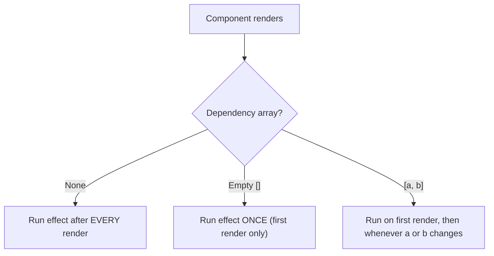
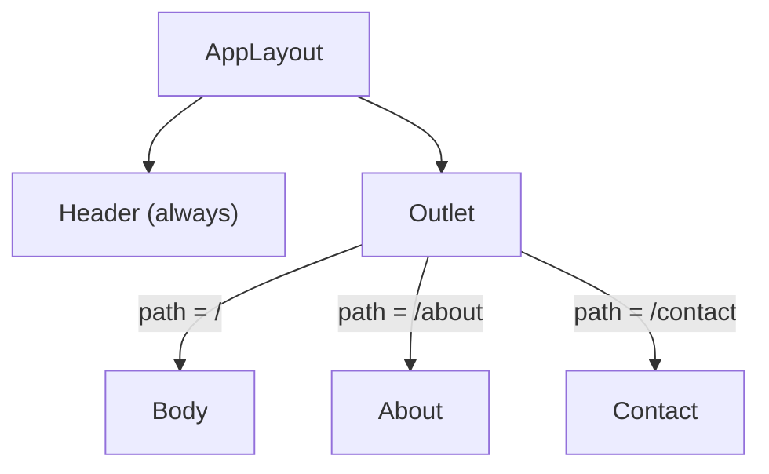
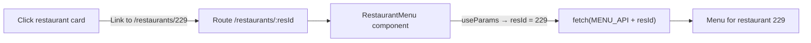
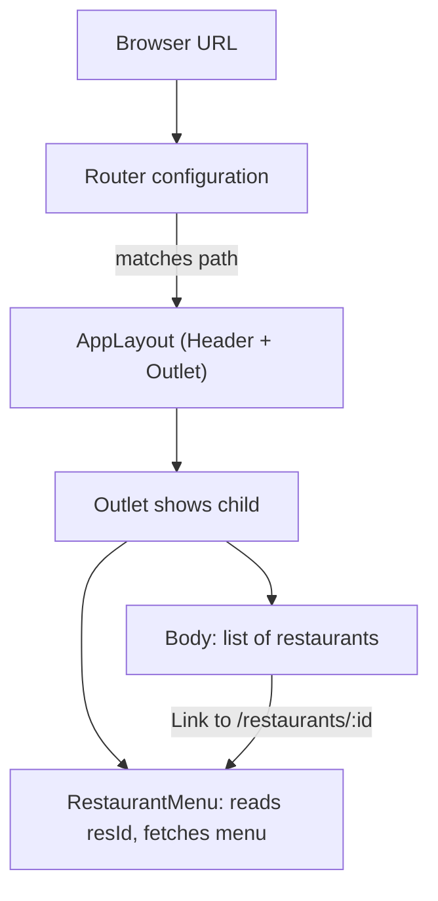

# Namaste React, Episode 7 — "Finding the Path": Hook Rules, `useEffect` Dependencies, Routing with React Router, and Dynamic Restaurant Pages

## Overview

This document turns the transcript of **Namaste React, Episode 7** into standalone learning notes. The episode has two big parts:

1. **Going deeper into hooks:** the three behaviors of `useEffect` depending on its dependency array, and the rules for where `useState` (and every hook) may be called.
2. **Routing with `react-router-dom` (v6):** creating multiple "pages", custom error pages, nested (children) routes with `<Outlet>`, navigation with `<Link>`, client-side vs server-side routing, and finally **dynamic routes** (`/restaurants/:resId`) that load a different restaurant menu for each restaurant by reading the URL parameter with `useParams`.

> **Labelling convention**
> - **[Transcript]**: material from the episode (cleaned of filler and transcription errors).
> - **[Supplementary]**: explanations or examples I added for clarity.
> - **[Unclear]**: details the transcript does not settle.

---

## Learning Objectives

After studying these notes you should be able to:

- Predict when `useEffect` runs with **no dependency array**, an **empty array**, and an array **with dependencies**.
- State and apply the rules for calling hooks (top level of a function component; never in `if`, loops, or nested functions).
- Install React Router and create a routing configuration with `createBrowserRouter`; provide it with `RouterProvider`.
- Build "pages" (components) and map them to URL paths.
- Create a custom error page with `errorElement` and read error details with `useRouteError`.
- Create **children routes** and render them in a parent layout using `<Outlet />`.
- Navigate without a page reload using `<Link to="...">` and explain why `<a href>` is the wrong tool in React.
- Explain **single-page applications** and the difference between **client-side** and **server-side** routing.
- Create a **dynamic route** with a `:param` and read it with `useParams`.
- Fetch and display data for a specific restaurant, including the early-return-before-destructuring pattern for null state.
- Make a list of cards clickable so each opens its own dynamic page.

## Prerequisites

- Episodes 1–6: components, JSX, props, `useState`, `useEffect`, `fetch`, `async`/`await`, Shimmer UI, conditional rendering, named/default imports and project structure.
- `npm` and a running Parcel dev server (`npm start`, `localhost:1234`).
- Optional chaining and array methods (`map`, `join`).

---

## Table of Contents

- [1. Deep Dive into `useEffect`](#1-deep-dive-into-useeffect)
- [2. Rules for Using `useState` (and Other Hooks)](#2-rules-for-using-usestate-and-other-hooks)
- [3. Routing Basics with React Router](#3-routing-basics-with-react-router)
- [4. Error Pages and `useRouteError`](#4-error-pages-and-userouteerror)
- [5. Children Routes and `Outlet`](#5-children-routes-and-outlet)
- [6. `Link`, Single-Page Applications, and Client-Side Routing](#6-link-single-page-applications-and-client-side-routing)
- [7. Dynamic Routing: One Component, Many Restaurants](#7-dynamic-routing-one-component-many-restaurants)
- [8. How the Concepts Connect](#8-how-the-concepts-connect)
- [9. Common Mistakes and Troubleshooting](#9-common-mistakes-and-troubleshooting)
- [10. Best Practices](#10-best-practices)
- [11. Exercises and Practice Tasks](#11-exercises-and-practice-tasks)
- [12. Key Takeaways](#12-key-takeaways)
- [13. Glossary](#13-glossary)
- [14. References and Further Learning](#14-references-and-further-learning)

---

## 1. Deep Dive into `useEffect`

### Definition

`useEffect(callback, dependencyArray)` runs `callback` **after a component renders**. Only the callback is mandatory; the **dependency array** is optional but changes *when* the callback runs.

> **[Transcript]** The instructor calls this "a very important interview question" that many developers get wrong.

### Why it matters

Without understanding the dependency array you'll either call APIs on every render (wasteful, potentially infinite loops) or miss updates.

### The three cases

| Case | Code | When the callback runs |
|---|---|---|
| **1. No dependency array** | `useEffect(() => {...})` | After **every** render of the component |
| **2. Empty dependency array** | `useEffect(() => {...}, [])` | **Only once**, after the **initial** render |
| **3. Dependencies listed** | `useEffect(() => {...}, [btnNameReact])` | After the initial render, and again **whenever a listed dependency changes** |

### Demonstration [Transcript]

In `Header.js` (which has a Login/Logout button with state `btnNameReact`):

```jsx
const Header = () => {
  const [btnNameReact, setBtnNameReact] = useState("Login");

  console.log("Header rendered");

  useEffect(() => {
    console.log("useEffect called");
  });                       // case 1: no dependency array

  // ...
};
```

- **Case 1:** Console shows `Header rendered`, then `useEffect called`. Each click on Login/Logout re-renders the header, so **both logs repeat on every click**.
- **Case 2:** Change to `useEffect(() => {...}, [])`. `useEffect called` prints **once** on load. Clicking Login/Logout keeps increasing the "Header rendered" count, but **`useEffect called` doesn't print again**.
- **Case 3:** Change to `useEffect(() => {...}, [btnNameReact])`. It prints on load, and **each time `btnNameReact` changes** (Login ↔ Logout).



### Which case for an API call? [Transcript]

For a one-time data fetch (like loading a restaurant menu), use an **empty array**: fetching again on every render would be wasteful. The instructor suggests explaining this reasoning aloud to interviewers.

### Common mistakes

| Mistake | Result | Fix |
|---|---|---|
| Omitting the array for an API call | Refetches on every render | Add `[]` |
| Listing a dependency that changes every render | Effect runs too often | Think about what the effect truly depends on |
| Expecting the effect to run *before* render | Wrong mental model | It always runs **after** render |

---

## 2. Rules for Using `useState` (and Other Hooks)

`useState` creates **local state variables inside a functional component**. The instructor's rules:

### Rule 1: Only call it inside a function component

Calling it outside any component (for example at the top of a file) throws:

> *Invalid hook call. Hooks can only be called inside of the body of a function component.*

### Rule 2: Call it at the top of the component

Create your state variables first, at the beginning of the function, before other logic. This keeps code consistent and predictable (code runs line by line) and helps React.

### Rule 3: Never inside `if`/`else`, `for` loops, or nested functions

```jsx
// ❌ Don't do this
const Body = () => {
  if (someCondition) {
    const [searchText, setSearchText] = useState("");   // conditional hook
  }
  // ...
};
```

**Why [Transcript]:** On some renders the state would exist and on others it wouldn't, creating *inconsistency*, and "React does not like inconsistency". The React documentation says the same. The instructor says he has never needed a conditional `useState` in his career.

> **[Supplementary]** The underlying reason: React remembers each hook by **the order in which it is called** on every render. If a hook is skipped on one render, the order shifts and React matches values to the wrong hooks. These rules are officially called the **Rules of Hooks**, and they apply to *all* hooks (`useEffect`, `useParams`, and so on), not only `useState`.

> **Quick summary [Transcript]:** Create state variables at the top level of the functional component, nowhere else (not in conditions, loops, or inner functions).

---

## 3. Routing Basics with React Router

### 3.1 What we're building

Different URLs showing different "pages" inside one React app:

| URL | Page |
|---|---|
| `localhost:1234/` | Home (the restaurant list) |
| `localhost:1234/about` | About Us |
| `localhost:1234/contact` | Contact Us |
| `localhost:1234/restaurants/<id>` | A restaurant's menu (built later) |

> **[Transcript]** A "page" in React is just **a component** (or composition of components). "Everything is a component in React." The instructor says "pages" is a convenient word even though they're really just components being swapped.

### 3.2 Install the library

```bash
npm install react-router-dom
```

- Stop the dev server first, then run the install, then `npm start` again.
- **Version [Transcript]:** The course uses **v6** (the instructor saw `6.11.2` installed in `package.json`; he mentions "6.4" as when the new features arrived). If your project is on v5, migrate to v6, since its docs and APIs differ.

### 3.3 Create the routing configuration

Routing configuration is created in the **root-level file** (`app.js`):

```jsx
import { createBrowserRouter, RouterProvider } from "react-router-dom";
import About from "./components/About";
import Contact from "./components/Contact";

const appRouter = createBrowserRouter([
  { path: "/",        element: <AppLayout /> },
  { path: "/about",   element: <About /> },
  { path: "/contact", element: <Contact /> },
]);
```

**Explanation**

| Piece | Meaning |
|---|---|
| `createBrowserRouter` | Creates the routing configuration (imported from `react-router-dom`) |
| The array | A **list of route objects** |
| `path` | The URL path to match |
| `element` | What to render when the path matches |

> **Router types [Transcript]:** React Router also offers hash, memory, and static routers, but `createBrowserRouter` is the one the library itself recommends for web projects. Use others only for specific use cases.

### 3.4 Provide the configuration to the app

The configuration alone does nothing. Instead of rendering `<AppLayout />` directly, render a **`RouterProvider`**:

```jsx
const root = ReactDOM.createRoot(document.getElementById("root"));

// before:
// root.render(<AppLayout />);

// after:
root.render(<RouterProvider router={appRouter} />);
```

- `RouterProvider` is a component exported by `react-router-dom`.
- Its `router` prop receives the configuration.

**Expected result:** `/` shows the home page, `/about` shows the About page, and `/contact` shows the Contact page.

### 3.5 Creating the page components

```jsx
// src/components/About.js
const About = () => {
  return (
    <div>
      <h1>About</h1>
      <h2>This is Namaste React web series.</h2>
    </div>
  );
};

export default About;
```

`Contact.js` is the same idea (the instructor wrote `Contact Us`). Remember `export default`.

### 3.6 About the `rafce` shortcut [Transcript]

A VS Code extension snippet (`rafce` + Enter) auto-generates a component boilerplate. The instructor's advice:

- Fine for speed in real work once you're experienced.
- **As a learner, type everything yourself** at least for the first few months; it makes the syntax stick and helps in interviews where such tools aren't available.

---

## 4. Error Pages and `useRouteError`

### 4.1 The default error page [Transcript]

Visiting an unknown path (for example `/xyz` or `/akshay`) shows React Router's own **"Unexpected Application Error! 404 Not Found"** page instead of a raw red React error.

### 4.2 Create your own error page

```jsx
// src/components/Error.js
import { useRouteError } from "react-router-dom";

const Error = () => {
  const err = useRouteError();
  console.log(err);

  return (
    <div>
      <h1>Oops!!!</h1>
      <h2>Something went wrong!!</h2>
      <h3>{err.status}: {err.statusText}</h3>
    </div>
  );
};

export default Error;
```

```jsx
const appRouter = createBrowserRouter([
  {
    path: "/",
    element: <AppLayout />,
    errorElement: <Error />,        // shown if this route (or an unknown path) errors
  },
  // ...
]);
```

**How it works [Transcript]:**

- **`errorElement`** tells the router what to render when there's an error on the route.
- **`useRouteError`** is a hook from React Router that returns an **object describing the error** (status, statusText, and so on). Showing `err.status` and `err.statusText` produces output like `404: Not Found`.

> **Convention [Transcript]:** Any function starting with `use` is a **hook** (a normal JavaScript function with a special purpose).

**Expected result:** `/akshay` (or any unknown path) now shows your custom page; `/` still works.

---

## 5. Children Routes and `Outlet`

### 5.1 The problem

With the routes above, visiting `/about` **replaces the entire page**, so the **header disappears**. We want the header to stay while only the area below it changes.

```text
Home (/):      [Header] [Body (restaurants)]
About (/about):[Header] [About]
Contact:       [Header] [Contact]
```

### 5.2 The solution: children routes

Make `About` and `Contact` **children** of the layout route:

```jsx
const appRouter = createBrowserRouter([
  {
    path: "/",
    element: <AppLayout />,
    children: [
      { path: "/",        element: <Body /> },
      { path: "/about",   element: <About /> },
      { path: "/contact", element: <Contact /> },
    ],
    errorElement: <Error />,
  },
]);
```

- The parent (`AppLayout`) stays the same.
- `children` is again an **array of route objects**, each with `path` and `element`.
- The home path `/` as a child renders **`<Body />`** (the restaurant list).

### 5.3 Render the matching child with `<Outlet />`

In `AppLayout`, replace the hard-coded `<Body />` with an **Outlet**:

```jsx
import { Outlet } from "react-router-dom";

const AppLayout = () => {
  return (
    <div className="app">
      <Header />
      <Outlet />
    </div>
  );
};
```

**How it works [Transcript]:**

- `Outlet` is a component from `react-router-dom`.
- It acts like a **tunnel**: depending on the current path, the matching child is "pushed" into the Outlet's position.
  - `/` → `Body`
  - `/about` → `About`
  - `/contact` → `Contact`
- The Outlet **doesn't appear in the HTML**. It's replaced by the child component's output, and the end user can't tell it exists.



**Expected result:** The header stays on screen on every route; only the part below changes.

---

## 6. `Link`, Single-Page Applications, and Client-Side Routing

### 6.1 Why not an anchor tag?

```jsx
<li><a href="/about">About Us</a></li>
```

This **works**, but **reloads the entire page** (visible in the browser's reload indicator, and in the logo reloading). Never use `<a href>` for in-app navigation in React.

### 6.2 Use `Link`

```jsx
import { Link } from "react-router-dom";

<ul>
  <li><Link to="/">Home</Link></li>
  <li><Link to="/about">About Us</Link></li>
  <li><Link to="/contact">Contact Us</Link></li>
  <li>Cart</li>
</ul>
```

| Anchor | React Router Link |
|---|---|
| `<a href="/about">` | `<Link to="/about">` |
| Reloads the whole page | **Doesn't reload**; swaps components |

**Evidence [Transcript]:** In the Elements panel, when you click between pages with `Link`, **only the body area flashes** (changes). The header stays untouched, and the browser's reload icon doesn't spin.

### 6.3 Link is a wrapper over the anchor tag

**[Transcript]** If you inspect the HTML, `Link` renders as a plain **`<a>`** tag. Browsers don't understand a capital-L `Link`. `Link` is React Router's **wrapper** that renders an anchor but **intercepts the click** and tracks navigation itself, so there's no refresh.

### 6.4 Single-page application (SPA)

- The browser loads the app **once**.
- Navigating to other "pages" just **interchanges components**; no new HTML page is requested.
- That's why React apps are called **single-page applications**.

### 6.5 Client-side vs server-side routing

| | Server-side routing | Client-side routing |
|---|---|---|
| Pages | Separate files (`index.html`, `about.html`, `contact.html`) | One app; pages are components |
| On navigation | Network call to the server for the new HTML; **full page reload** | **No network call** for the page; component swap |
| Where code lives | Server returns each page | All components already loaded in the browser |
| This episode | ❌ | ✅ **React Router does client-side routing** |

> **[Transcript]** Not to be confused with **server-side rendering** (a different topic). The only network calls in our app are *data* (API) calls, not page fetches.

---

## 7. Dynamic Routing: One Component, Many Restaurants

### 7.1 Goal

Clicking a restaurant card (for example "Meghna Foods") should open **that restaurant's menu page** with its own URL, like Swiggy does (`/restaurants/<something>`). The same `RestaurantMenu` component is **reused** and shows different data depending on the URL.



### 7.2 Step 1: create the `RestaurantMenu` component (static first)

```jsx
// src/components/RestaurantMenu.js
const RestaurantMenu = () => {
  return (
    <div className="menu">
      <h1>Name of the restaurant</h1>
      <h2>Menu</h2>
      <ul>
        <li>Biryani</li>
        <li>Burgers</li>
        <li>Diet Coke</li>
      </ul>
    </div>
  );
};

export default RestaurantMenu;
```

### 7.3 Step 2: add a dynamic route

```jsx
children: [
  { path: "/",        element: <Body /> },
  { path: "/about",   element: <About /> },
  { path: "/contact", element: <Contact /> },
  { path: "/restaurants/:resId", element: <RestaurantMenu /> },
],
```

- **`:resId`** (colon + name) marks that part of the URL as **dynamic**. It can be any value (`/restaurants/123`, `/restaurants/229`).
- Using the restaurant's **ID** is best because every restaurant has a unique one.

> **[Unclear]** The transcript sometimes says `restaurant` and sometimes `restaurants`. Pick one spelling and use it **identically** in the route path and in the `Link`. This document uses `/restaurants/:resId`.

**Test:** Visit `/restaurants/123`. The static `RestaurantMenu` renders.

### 7.4 Step 3: find the menu API

**[Transcript]** Open Swiggy in the browser, open **Network → Fetch/XHR**, and click a restaurant. You'll see a **menu API** call. The only difference between restaurants' API URLs is the **restaurant ID** (the instructor compared Hotel Empire's ID `425` with Meghna Foods' ID `229`).

> The instructor stresses (again) that Swiggy may change the API, structure, or name (for example a "v2"). The *skill* of finding the API in the Network tab keeps working.

> **Tip [Transcript]:** An optional tracking parameter (`submitAction=ENTER`) in the URL turned out **not to be required**; he removed it and the API still worked.

### 7.5 Step 4: fetch the data with `useEffect` + state

```jsx
import { useState, useEffect } from "react";
import Shimmer from "./Shimmer";

const RestaurantMenu = () => {
  const [resInfo, setResInfo] = useState(null);

  useEffect(() => {
    fetchMenu();
  }, []);                                   // empty array: fetch once

  const fetchMenu = async () => {
    const data = await fetch("<MENU_API_URL>" + "425");
    const json = await data.json();
    setResInfo(json.data);
  };

  if (resInfo === null) return <Shimmer />;   // early return BEFORE using resInfo

  // ... use resInfo below
};
```

**Key points**

- State starts as **`null`** (no data yet).
- The `useEffect` has `[]` so the menu is fetched **once** after the first render.
- Show `Shimmer` while data is `null`.

### 7.6 The "Cannot destructure property" error and the early return [Transcript]

The instructor first used a ternary operator and destructured data **before** checking for `null`, which caused:

> *Cannot destructure property 'name' of ... as it is null.*

**Why:** On the first render `resInfo` is `null`. Destructuring `name` out of it **fails** because the code runs top to bottom.

**Fix:** Put the null check **first** with an early `return`, so the code below never runs while data is missing:

```jsx
if (resInfo === null) return <Shimmer />;

const { name, cuisines, costForTwoMessage } =
  resInfo?.cards[0]?.card?.card?.info;
```

> **Lesson [Transcript]:** Don't use a ternary blindly; here an early return was the right tool. The instructor leaves this as "think about why" homework and says every error teaches you something.

### 7.7 Step 5: show restaurant info

```jsx
const { name, cuisines, costForTwoMessage } =
  resInfo?.cards[0]?.card?.card?.info;

return (
  <div className="menu">
    <h1>{name}</h1>
    <h3>{cuisines.join(", ")}</h3>
    <h3>{costForTwoMessage}</h3>
    {/* menu below */}
  </div>
);
```

- `cuisines` is an **array of strings**, so `.join(", ")` turns it into "North Indian, Kebabs".
- Other available fields mentioned: image ID (`cloudinaryImageId`), rating, offers, locality. Add as many as you like.
- **Result at the time:** "Hotel Empire", its cuisines, and "₹450 for two".

### 7.8 Step 6: the menu items (digging through nested data)

**[Transcript]** The menu items are deep in the JSON. At the time of recording the instructor reached them through (reproduced as spoken, then cleaned up):

```jsx
const { itemCards } =
  resInfo?.cards[2]?.groupedCard?.cardGroupMap?.REGULAR?.cards[1]?.card?.card;
```

> **[Unclear]** The path is garbled in the transcript, and he fixed several typos live (for example `card.group.map` vs `cardGroupMap`). Verify against your own response. The idea: the three top-level cards were roughly (0) restaurant info, (1) offers, and (2) the menu; inside the menu card there are several category cards (Recommended, Thalis, and so on), and the one he used (`cards[1]`) is **Recommended**, with **22 items**.

**Aside [Transcript]:** Such messy, deeply nested responses are exactly the over-fetching/under-fetching problem **GraphQL** was designed to solve (only requesting the data you need). The instructor mentions it in passing.

**Render the items:**

```jsx
<h2>Menu</h2>
<ul>
  {itemCards.map((item) => (
    <li key={item.card.info.id}>
      {item.card.info.name} - Rs.{" "}
      {(item.card.info.price || item.card.info.defaultPrice) / 100}
    </li>
  ))}
</ul>
```

**Walkthrough [Transcript]:**

1. First print just one item to prove the path: `itemCards[0].card.info.name` → "Lemon Rice". Then `itemCards[1]...` → the next item. Writing one item first makes `map` easier to write.
2. `itemCards.map(item => <li>...)` renders all items (22 here).
3. **Key:** always give `map` output a unique `key`. Each menu item has an `id`: `key={item.card.info.id}`. Without it React logs *"Each child in a list should have a unique key"*.
4. **Price inconsistency:** some items have `price`, others only `defaultPrice`. Use `price || defaultPrice`. The value is in **paise**, so divide by 100 (for example 13600 → ₹136).

> The instructor remarks that inconsistencies like this are common in real production APIs.

### 7.9 Step 7: use the ID from the URL with `useParams`

So far the ID was hard-coded. To read it from the route:

```jsx
import { useParams } from "react-router-dom";

const RestaurantMenu = () => {
  const { resId } = useParams();
  // ...
  const data = await fetch(MENU_API + resId);
```

- **`useParams`** is a React Router hook returning an **object of the dynamic route parameters** (here `{ resId: "229" }`).
- The property name matches the `:resId` you wrote in the route.
- Destructure it directly: `const { resId } = useParams();`.

**Test [Transcript]:** Visiting `/restaurants/425` shows **Hotel Empire**; `/restaurants/229` shows **Meghna Foods**. Same component, different data.

### 7.10 Step 8: move the API URL into constants

Following Episode 5's rule (no hard-coded strings in components):

```js
// src/utils/constants.js
export const MENU_API = "<MENU_API_URL_UP_TO_THE_ID_PARAMETER>";
```

```jsx
import { MENU_API } from "../utils/constants";
// ...
const data = await fetch(MENU_API + resId);
```

### 7.11 Step 9: make restaurant cards clickable with `Link`

In `Body.js`, wrap each card in a `Link` whose target uses the restaurant's ID:

```jsx
import { Link } from "react-router-dom";

{filteredRestaurant.map((restaurant) => (
  <Link
    key={restaurant.info.id}
    to={"/restaurants/" + restaurant.info.id}
  >
    <RestaurantCard resData={restaurant} />
  </Link>
))}
```

**Notes [Transcript]:**

- Use **`Link`, not `<a>`**, so the page doesn't reload.
- Because the `Link` is now the **outermost element returned by `map`**, the **`key` must move to the `Link`** (not the inner `RestaurantCard`).
- The target is built by **string concatenation** (`"/restaurants/" + id`), inside curly braces because it's JavaScript within JSX.
- Wrapping in a link adds the default blue underline styling; **fix with CSS** (the instructor says "it looks ugly, fix it yourself").

> **[Unclear]** The restaurant data field names (`restaurant.info.id` vs the older `restaurant.data.id`) depend on the API version in use; see the companion notes on the Swiggy API fix.

**Expected result:** Click "Kanur Food Point" → its menu (Paneer dishes, ₹260, and so on); go back and click "Burger King" → crispy chicken burgers; "Cafe Amudham" → its menu. **The header stays intact and the page never reloads.**

### 7.12 Homework and stretch goals [Transcript]

- Render **all menu categories**, not just "Recommended" (loop over every category card).
- Build a **Veg-only** option.
- Build **collapsible accordions** for categories.
- Use CSS to make the page look like Swiggy's (images, ratings, prices).

> **Soft skill [Transcript]:** *Speak while you code.* Practice explaining your reasoning aloud while writing code; it's valuable in interviews.

---

## 8. How the Concepts Connect

| Concept | Role |
|---|---|
| `useEffect` + `[]` | Fetches the menu once per page load |
| `useState(null)` + Shimmer | Handles the time before data arrives |
| `createBrowserRouter` | Defines which component shows for which URL |
| `RouterProvider` | Activates the configuration |
| `children` + `Outlet` | Keeps shared layout (header) while swapping page content |
| `Link` | Navigates without reloading (SPA) |
| `:resId` + `useParams` | Reads the dynamic part of the URL |
| `errorElement` + `useRouteError` | Friendly error handling |
| `constants.js` | Central place for API URLs |



---

## 9. Common Mistakes and Troubleshooting

| # | Problem | Cause | Fix |
|---|---|---|---|
| 1 | `Invalid hook call` | Hook used outside a function component | Move it inside the component |
| 2 | Hooks behave inconsistently | Hook inside `if`/loop/function | Call hooks at the top level |
| 3 | Effect runs on every render | No dependency array | Add `[]` or proper dependencies |
| 4 | Routes don't work | Forgot `RouterProvider` | Render `<RouterProvider router={appRouter} />` |
| 5 | Header disappears on `/about` | About is a top-level route, not a child | Use `children` + `<Outlet />` |
| 6 | Nothing appears in the layout for child routes | Missing `<Outlet />` | Add it where children should render |
| 7 | Whole page reloads on navigation | Used `<a href>` | Use `<Link to>` |
| 8 | `Link` ignores the path | Used `href` on `Link` | Use the `to` prop |
| 9 | `Cannot destructure property ... of null` | Reading `resInfo` before data exists | Early `return <Shimmer />` **before** destructuring |
| 10 | Unique `key` warning | Missing/wrong `key` in `map` | Use the item's unique `id` (on the outermost mapped element) |
| 11 | Price shows empty for some items | Data has `defaultPrice` instead of `price` | `price || defaultPrice` |
| 12 | Menu doesn't change with the URL | Hard-coded ID or no `useParams` | Read `resId` with `useParams` and add it to the fetch URL |
| 13 | `/restaurant/..` not found | Mismatch between route path and link (`restaurant` vs `restaurants`) | Make both identical |
| 14 | API path errors after some time | Swiggy changed the data | Re-inspect the response in the Network tab |

---

## 10. Best Practices

1. Use `[]` for one-time effects such as initial API calls.
2. Follow the **Rules of Hooks**: top level of the component, never conditional or nested.
3. Keep routing configuration in the root file; keep pages as separate components.
4. Use **`createBrowserRouter`** with **`RouterProvider`** (the recommended approach).
5. Provide a custom **`errorElement`** and use **`useRouteError`** to show helpful details.
6. Use **children routes + `Outlet`** for shared layouts.
7. Always use **`Link`** (never `<a href>`) for internal navigation.
8. Use unique, stable IDs in dynamic URLs.
9. **Check for missing data first** (early return) before reading nested properties; use optional chaining.
10. Keep API URLs in `utils/constants.js`.
11. Always give mapped elements a unique `key`, on the outermost element in the `map`.
12. Type code yourself while learning; skip snippet generators at first.
13. Practice (the instructor: "this is not a Netflix series"), and **speak while you code**.

---

## 11. Exercises and Practice Tasks

- [ ] **Effect behaviors:** In a component with state, test `useEffect` with no array, `[]`, and `[stateVar]`. Log and count how often it runs for each.
- [ ] **Hook rules:** Intentionally place `useState` outside a component and inside an `if`. Read the error/warning.
- [ ] **Basic routes:** Create `About` and `Contact` pages and connect them via `createBrowserRouter`.
- [ ] **Error page:** Add `errorElement` and display `err.status` / `err.statusText`. Visit a nonsense URL.
- [ ] **Layout:** Convert the pages to children routes with `<Outlet />`. *Expected:* the header stays on every route.
- [ ] **Navigation:** Replace `<a>` with `<Link>`. Compare page reload behavior using DevTools.
- [ ] **Dynamic route:** Add `/restaurants/:resId`. Log `useParams()` to see the object.
- [ ] **Menu page:** Fetch a restaurant's menu by ID and display the name, cuisines, cost for two, and items.
- [ ] **Clickable cards:** Wrap each restaurant card with a `Link` to its page. Verify the `key` placement.
- [ ] **Homework:** Show **all** menu categories; add a **veg-only** toggle; build collapsible category accordions.
- [ ] **Explain:** Write 4–5 sentences explaining the difference between client-side and server-side routing.

---

## 12. Key Takeaways

- `useEffect` timing depends on the dependency array: **none = every render, `[]` = once, `[x]` = when `x` changes**.
- Hooks must be called **at the top level of function components**, never inside conditions, loops, or nested functions.
- **React Router v6**: `createBrowserRouter` (configuration) + `RouterProvider` (activation).
- Pages are just **components mapped to paths**.
- **`errorElement`** and **`useRouteError`** give custom error pages with details.
- **`children` + `<Outlet />`** keep shared UI (header) while swapping page content.
- **`<Link to>`** navigates without reloading; it **renders an anchor tag** behind the scenes but manages navigation itself.
- React apps are **single-page applications** using **client-side routing**.
- **Dynamic routes** use `:param` in the path and **`useParams`** to read it.
- Handle the "no data yet" state with an **early return** before touching nested data.
- Don't panic when APIs change; learn the method of finding and reading them.

---

## 13. Glossary

| Term | Definition |
|---|---|
| **Dependency array** | Second argument to `useEffect` controlling when it re-runs |
| **Rules of Hooks** | Rules requiring hooks to be called unconditionally at the top level of components |
| **React Router DOM** | Library providing routing for React web apps |
| **`createBrowserRouter`** | Function that builds the routing configuration |
| **`RouterProvider`** | Component that supplies the router to the app |
| **Route** | Mapping from a URL path to an element |
| **`errorElement`** | Element shown when a route errors |
| **`useRouteError`** | Hook returning information about the routing error |
| **Children routes / nested routes** | Routes defined inside a parent route |
| **`Outlet`** | Placeholder in a parent where the matching child route renders |
| **`Link`** | React Router component for navigation without page reload |
| **Single-page application (SPA)** | App loaded once, swapping components instead of loading new pages |
| **Client-side routing** | Routing handled in the browser by JavaScript |
| **Server-side routing** | Each URL fetches a new page from the server |
| **Dynamic route** | Route with a variable segment, such as `/restaurants/:resId` |
| **`useParams`** | Hook returning the dynamic parameters of the current route |
| **Early return** | Returning from a function before the rest of the code runs |
| **GraphQL** | Query language letting clients request exactly the data they need |

---

## 14. References and Further Learning

- React Router documentation: `createBrowserRouter`, `RouterProvider`, `Outlet`, `Link`, `useParams`, `useRouteError`, and error handling
- React documentation: **`useEffect`** (dependency array behavior) and the **Rules of Hooks**
- MDN Web Docs: **`Array.prototype.join`**, **optional chaining**, and the **Fetch API**
- Companion notes in this series: **Episodes 5 and 6** (hooks, state, `useEffect`, Shimmer) and the **Swiggy API fix** video (re-finding API paths when the format changes)
- Look up **GraphQL** for the over-fetching/under-fetching problem the instructor mentioned

> **Verification note:** This document was prepared from the transcript only, without live lookups of external documentation or Swiggy's APIs. The data paths and field names reflect the API at the time of recording and may have changed; confirm them against your own responses.
