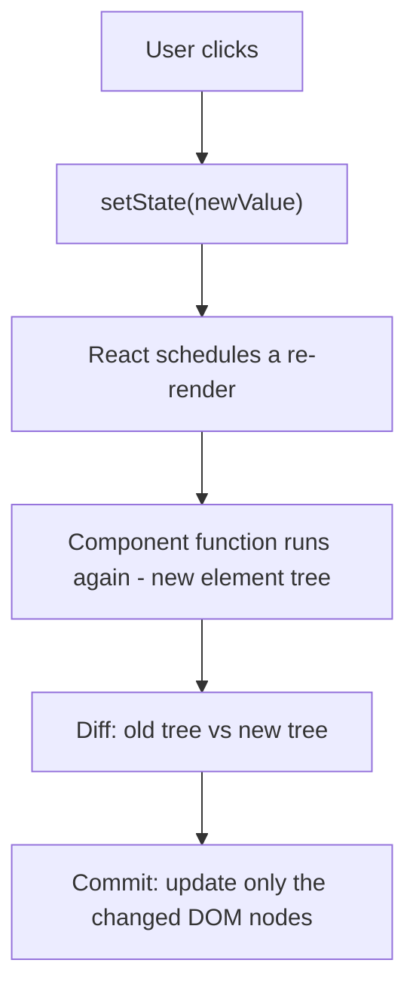
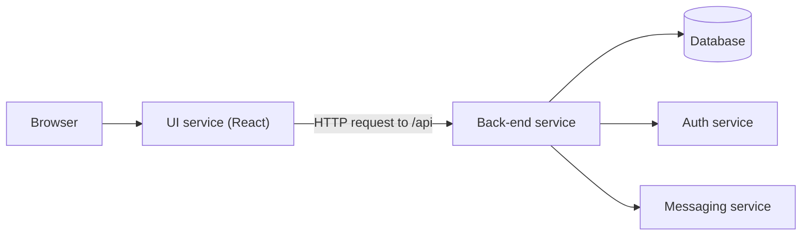
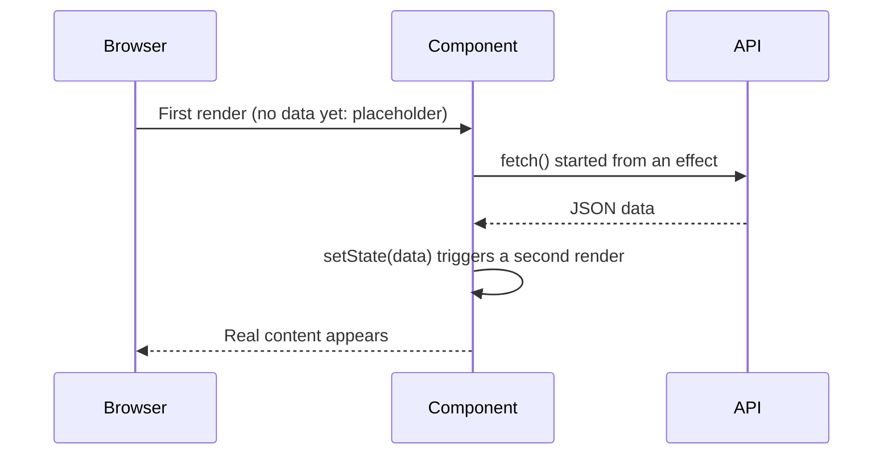
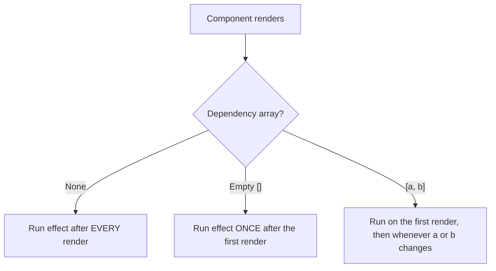

# React State, Effects, and Routing: Learning Notes

A standalone guide to React state, side effects, API data fetching, and client-side routing, written for React with TypeScript.

---

## Introduction

These notes take you from the question *"why doesn't my UI update when I change a variable?"* to building a multi-page application that loads live data and navigates between pages.

By the end you will be able to:

- Explain why ordinary variables cannot update the UI and use `useState` correctly.
- Describe what happens during a re-render: Virtual DOM, diffing, reconciliation, and Fiber.
- Load data from an API with `useEffect`, `fetch`, and `async`/`await`, including loading and error states.
- Predict exactly when an effect runs for each dependency-array form.
- Apply the Rules of Hooks and diagnose "Invalid hook call" errors.
- Build multi-page apps with React Router's declarative API (`BrowserRouter`, `Routes`, `Route`, `useNavigate`, `Navigate`), and compare it with the data-router API (`createBrowserRouter`, `RouterProvider`).

**Assumptions.** You already have a working React + TypeScript project with `react`, `react-dom`, and `react-router-dom` installed. These notes never repeat project setup. Most examples are a complete `App.tsx` that you can paste over your existing one. Where a second file is needed, the note says where it belongs.

---

## Table of Contents

1. [Introduction and How to Use These Notes](#1-introduction-and-how-to-use-these-notes)
2. [Organizing Code with Files, Folders, and Modules](#2-organizing-code-with-files-folders-and-modules)
3. [React State and UI Updates](#3-react-state-and-ui-updates)
4. [React Hooks and `useState`](#4-react-hooks-and-usestate)
5. [Rendering, Virtual DOM, Reconciliation, and Fiber](#5-rendering-virtual-dom-reconciliation-and-fiber)
6. [Array Destructuring](#6-array-destructuring)
7. [Data-Loading Approaches](#7-data-loading-approaches)
8. [`useEffect` Fundamentals](#8-useeffect-fundamentals)
9. [Fetching Live Data from an API](#9-fetching-live-data-from-an-api)
10. [Dependency Arrays and Effect Behavior](#10-dependency-arrays-and-effect-behavior)
11. [Common Effect Mistakes](#11-common-effect-mistakes)
12. [Rules of Hooks](#12-rules-of-hooks)
13. [React Router Fundamentals](#13-react-router-fundamentals)
14. [Declarative Routing with `Routes` and `Route`](#14-declarative-routing-with-routes-and-route)
15. [Programmatic Navigation with `useNavigate`](#15-programmatic-navigation-with-usenavigate)
16. [Redirects with `Navigate`](#16-redirects-with-navigate)
17. [Error Pages and `useRouteError`](#17-error-pages-and-userouteerror)
18. [Nested Routes and `Outlet`](#18-nested-routes-and-outlet)
19. [Comparison with `createBrowserRouter` and `RouterProvider`](#19-comparison-with-createbrowserrouter-and-routerprovider)
20. [Connecting State, Effects, API Data, and Routing](#20-connecting-state-effects-api-data-and-routing)
21. [Common Mistakes and Troubleshooting](#21-common-mistakes-and-troubleshooting)
22. [Practice Exercises](#22-practice-exercises)
23. [Exercise Solutions](#23-exercise-solutions)
24. [Key Takeaways](#24-key-takeaways)
25. [Glossary](#25-glossary)
26. [Official References](#26-official-references)

---

## 1. Introduction and How to Use These Notes

### 1.1 Why use React at all?

Everything React does can be done with plain HTML, CSS, and JavaScript, because React is JavaScript. A framework or library earns its place by making large applications **easier to build and maintain**:

- You write less code to do more on the page.
- You describe *what the UI should look like for the current data*, and React keeps the page in sync.
- React minimizes expensive browser DOM updates.
- Components make large, team-built, production-grade apps manageable.

The central problem all UI libraries solve (React, Angular, Vue, and others) is **keeping the data layer and the UI layer in sync, efficiently**. Most of these notes are about that one idea.

### 1.2 How the notes are organized

Every major topic follows the same pattern where it makes sense:

| Label | Meaning |
|---|---|
| **Objective** | What the example demonstrates |
| **Complete code** | Everything you need to run it |
| **Explanation** | How the code works, step by step |
| **Expected behavior** | What you should see |
| **Common mistakes** | Errors you may hit, and fixes |
| **Key lesson** | The one thing to remember |

Small concepts use a shorter form.

### 1.3 Callout labels

> **Supplementary:** Extra background that helps understanding but is not strictly required.

> **Correction:** A commonly repeated simplification, or a version-dependent detail, stated precisely.

> **Teaching simplification vs. implementation detail:** Where an everyday explanation differs from how React actually works internally, both are given and labeled.

### 1.4 Versions

- **React:** examples work with React 18 and 19.
- **React Router:** examples import from `react-router-dom`, which works in React Router **v6.4+** and **v7** (v7 re-exports everything from the `react-router` package). The `Routes`/`Route` APIs are the same in both. Check your installed version in `package.json` and use the matching documentation at [reactrouter.com](https://reactrouter.com/).
- **TypeScript:** examples use `.tsx` files and explicit types where they teach something.

### 1.5 Study habits that make this stick

1. **Type the code yourself** at first. Snippet generators are fine once you are fluent, but typing builds recall for interviews and everyday work.
2. **Ask "why?" about every line.** *Why am I writing this? Is it required? Could it be better?* Slow, deliberate coding saves debugging time.
3. **Break things on purpose.** Many exercises ask you to reproduce a bug so you recognize it later.
4. **Explain aloud while you code.** Being able to narrate your reasoning is a skill interviewers look for.
5. **Practice, don't just read.** Reading about React is like learning to drive from a video.

---

## 2. Organizing Code with Files, Folders, and Modules

Before state and routing, you need a clear picture of how React code is split across files. Every later example relies on `import` and `export`.

### 2.1 Why split one large file?

Putting every component in one file is **technically fine**: the bundler combines, minifies, and compresses all your code into a few files before it reaches the browser. But *source code is written for humans*:

| Aspect | One big file | One file per component |
|---|---|---|
| Reading and navigating | Lots of scrolling | The file name tells you what's inside |
| Team collaboration | Frequent merge conflicts | People work on separate files |
| Reuse | Hard to reuse a component elsewhere | Import it anywhere |
| Scalability | Real apps have thousands of components | Scales naturally |

> **Rule of thumb (not a hard rule):** Many teams aim to keep a file under roughly 100 lines. If a component file passes 100–200 lines, it is probably doing too much. Split it into smaller components.

### 2.2 A simple, conventional layout

React has **no official opinion** on folder structure. Two common strategies:

| Strategy | Description | Example |
|---|---|---|
| **Group by feature or route** | Keep everything for one feature together | `features/users/`, `features/search/` |
| **Group by file type** | Keep similar files together | `components/`, `utils/` |

Advice that applies to both: avoid deep nesting, find a sweet spot, **don't overthink it**, and restructure later as the app grows.

A simple layout used throughout these notes:

```text
src/
├── App.tsx                 ← root-level component (and, later, routing)
├── components/
│   ├── Header.tsx
│   └── BookCard.tsx
└── utils/
    ├── constants.ts        ← shared constants (named exports)
    └── books.ts            ← sample data (default export)
```

- `src` is a convention (short for "source"), not a requirement.
- **Component files** are named exactly like the component, starting with a capital letter: `Header` → `Header.tsx`. Anyone can then tell what a file contains.
- **Non-component files** use lowercase names (`constants.ts`, `books.ts`). The capitalization itself hints at what the file holds.
- Files containing JSX use `.tsx`; plain TypeScript uses `.ts`. (In JavaScript projects, `.js` and `.jsx` are both used. Follow your team's convention, and if you are free to choose, keep it simple.)

### 2.3 Exporting and importing

> **"First give, then take."** You must **export** something from a file before you can **import** it elsewhere.

There are two kinds of export:

| Feature | Default export / import | Named export / import |
|---|---|---|
| Export syntax | `export default Header;` | `export const APP_NAME = "...";` |
| Import syntax | `import Header from "./Header";` | `import { APP_NAME } from "./constants";` |
| How many per file | **One** | **Many** |
| Curly braces on import | No | **Yes** |
| Import name | Any name you choose | Must match the exported name |
| Typical use | One component per file | Constants, utilities, several exports |

Why a file can have only one default export: the default is "the main thing this file gives you." Writing two causes the error *"A module cannot have multiple default exports."* Use named exports for the rest.

A file may have **one default export plus any number of named exports**, and you can import them together: `import books, { type Book } from "./utils/books";`.

> **Guideline:** Prefer a default export for a file's main component. Use named exports when a file exports several things.

### 2.4 Keep hard-coded data out of components

Avoid hard-coding URLs, strings, and sample data inside component files:

- The same value may be needed in several components (a logo URL, an API base URL).
- One central file makes updates trivial and avoids duplication.
- Components stay short and readable.

By convention, constants are written in `UPPER_SNAKE_CASE`.

### 2.5 Complete example: a small multi-file setup

**Objective:** See default exports, named exports, and import paths working together.

**`src/utils/constants.ts`** (new file; named exports)

```ts
export const APP_NAME = "Reading List";
export const TOP_RATING_THRESHOLD = 4;
```

**`src/utils/books.ts`** (new file; one default export plus a named type export)

```ts
export interface Book {
  id: number;
  title: string;
  rating: number;
}

const books: Book[] = [
  { id: 1, title: "The Pragmatic Programmer", rating: 4.6 },
  { id: 2, title: "Clean Code", rating: 4.2 },
  { id: 3, title: "Refactoring", rating: 4.4 },
  { id: 4, title: "Code Complete", rating: 3.9 },
];

export default books;
```

**`src/components/BookCard.tsx`** (new file; default export)

```tsx
import type { Book } from "../utils/books";

interface BookCardProps {
  book: Book;
}

const BookCard = ({ book }: BookCardProps) => {
  return (
    <li>
      {book.title} (rating {book.rating})
    </li>
  );
};

export default BookCard;
```

**`src/App.tsx`**

```tsx
import BookCard from "./components/BookCard";
import books from "./utils/books";
import { APP_NAME } from "./utils/constants";

export default function App() {
  return (
    <div>
      <h1>{APP_NAME}</h1>
      <ul>
        {books.map((book) => (
          <BookCard key={book.id} book={book} />
        ))}
      </ul>
    </div>
  );
}
```

**Explanation**

1. `constants.ts` uses `export const`, so each constant is a **named export** and is imported with braces: `{ APP_NAME }`.
2. `books.ts` has a **default export** (`books`) and a **named** type export (`Book`).
3. `BookCard.tsx` imports only the type, using `import type`. Type imports are erased at build time.
4. Paths are **relative to the importing file**. `./` means "this folder." `../` means "go up one folder," which is why `BookCard.tsx` (inside `components/`) reaches `utils/` with `../utils/books`.
5. Import paths omit the extension; the bundler (Vite, Parcel, webpack, and so on) resolves `.ts`/`.tsx`.

**Expected behavior:** A "Reading List" heading with four books.

**Common mistakes**

| Symptom | Cause | Fix |
|---|---|---|
| `X is not defined` | Component moved to another file but never imported | Export it, then import it where it's used |
| `... has no exported member` / `undefined` import | Mixed up default and named syntax | Default: `import X from`; Named: `import { X } from` |
| `Cannot find module './constant'` | File is `constants.ts` but import says `constant` | File name and import must match exactly |
| Image shows the literal text `LOGO_URL` | Wrote `src="LOGO_URL"` (a string) | Use `src={LOGO_URL}` (a JavaScript expression) |
| `A module cannot have multiple default exports` | Two `export default` in one file | Keep one; make the rest named |

**Key lesson:** Export first, import second. Default exports have no braces on import; named exports do.

> **Supplementary:** `import React from "react"` is no longer needed in projects using the modern JSX transform (React 17+ tooling). Hooks such as `useState` and `useEffect` are **named exports** of the `react` package, which is why you write `import { useState } from "react"` with braces.

---

## 3. React State and UI Updates

### 3.1 The UI is driven by data

In React, the screen is a **function of your data**. If the data is a list of three books, you render three cards. If it becomes two books, you should see two cards. This is sometimes called a **config-driven** or **data-driven UI**: what you see is determined by data (which may come from a server).

```tsx
const books = ["Clean Code", "Refactoring"];

// The UI is derived from the data:
books.map((title) => <li key={title}>{title}</li>);
```

An empty list renders nothing. One item renders one `<li>`. The data decides.

> **Supplementary:** When rendering lists with `map`, every element needs a stable, unique `key`. React uses it to match items between renders (see [Section 5.8](#58-keys-and-reconciliation)). If you copy and paste sample objects and forget to change their `id`, React warns that two children have the same key.

### 3.2 Event handlers in React

Making a UI respond to the user starts with **event handlers**. An event handler is a function that runs when something happens (a click, a hover, a keystroke).

In JSX you pass a **function** to a camelCase attribute:

```tsx
<button onClick={() => console.log("Button clicked")}>Click me</button>
```

| Plain HTML | React JSX |
|---|---|
| `onclick="fn()"` (lowercase, a string) | `onClick={fn}` (camelCase, a function) |
| `onmouseover` | `onMouseOver` |
| `onblur` | `onBlur` |
| `onchange` | `onChange` |

There is no `onHover`. Use `onMouseEnter`, `onMouseOver`, and `onMouseLeave`.

**Common mistake: calling the handler instead of passing it.**

```tsx
// Wrong: runs during render and passes its result (undefined) to onClick
<button onClick={handleClick()}>Save</button>

// Right: passes the function; React calls it on click
<button onClick={handleClick}>Save</button>

// Right: wrapper arrow function when you need arguments
<button onClick={() => handleClick(item.id)}>Save</button>
```

### 3.3 The problem: a normal variable does not update the UI

**Objective:** Prove that changing an ordinary variable changes the data but not the screen.

**Complete code (`App.tsx`)**

```tsx
export default function App() {
  let count = 0;

  function handleClick() {
    count = count + 1;
    console.log("count is now", count);
  }

  return (
    <div>
      <h1>Count: {count}</h1>
      <button onClick={handleClick}>Add one</button>
    </div>
  );
}
```

**Explanation**

1. `count` is a plain local variable inside the component function.
2. Clicking the button runs `handleClick`, which really does change `count`. The console proves it.
3. The page still shows `Count: 0`.

**Expected behavior:** The console prints 1, 2, 3 on successive clicks, but the heading stays at `Count: 0`.

**Why?** Two independent reasons:

1. **React does not watch ordinary variables.** Nothing tells React "the data changed, redraw." You would have to update the DOM yourself, which is the tedious, error-prone work React exists to remove.
2. **Local variables don't survive renders.** Even if something did cause a re-render, React would call `App()` again, and `let count = 0` would run again from scratch.

A related mistake is using `const` for a variable and then reassigning it. That fails earlier with `Assignment to constant variable`, a plain JavaScript error. Switching to `let` fixes the error but not the real problem.

**Common mistakes**

| Mistake | Fix |
|---|---|
| Expecting the UI to follow a normal variable | Store the value in state |
| Reassigning a `const` | Use state and its setter instead |
| Manually editing the DOM (`document.getElementById(...)`) | Let React do it from state |

**Key lesson:** To change what's on screen, change **state**, not a local variable. State is the way to give React two things a plain variable can't: **memory between renders** and a **trigger to re-render**.

---

## 4. React Hooks and `useState`

### 4.1 What is a Hook?

- A functional component is a normal JavaScript **function**.
- A React element is a plain JavaScript **object**.
- A **Hook** is also just a JavaScript **function**, written by the React team and shipped inside the `react` package, that lets your component use React features.

Hooks look ordinary, but React keeps internal bookkeeping for each call, which gives them "superpowers" (remembering values, running code after render, and so on). By convention, **names that start with `use`** are hooks.

The two hooks you will use most often:

| Hook | Purpose | Where covered |
|---|---|---|
| `useState` | Remember values and re-render when they change | This section |
| `useEffect` | Run code after render (data fetching, subscriptions, timers) | [Section 8](#8-useeffect-fundamentals) |

### 4.2 Definition and syntax

A **state variable** is a special variable created with `useState`. React stores it for you between renders and re-renders the component whenever you change it through its setter.

```tsx
import { useState } from "react";            // a NAMED import

const [value, setValue] = useState(initialValue);
```

Step by step:

1. **Import** `useState` as a named import from `"react"`.
2. **Call it at the top level of your component** (see [Section 12](#12-rules-of-hooks)).
3. The argument is the **initial value**, used only on the first render.
4. It returns an **array of exactly two items**: the current value, and a **setter function**. You unpack them with [array destructuring](#6-array-destructuring).

### 4.3 Initial values and TypeScript

| Call | Initial value | Inferred type |
|---|---|---|
| `useState(0)` | `0` | `number` |
| `useState("Login")` | `"Login"` | `string` |
| `useState(false)` | `false` | `boolean` |
| `useState<string[]>([])` | empty list | `string[]` |
| `useState<User \| null>(null)` | `null` | `User \| null` |

TypeScript infers the type from the initial value. For an empty array or `null`, pass the type explicitly as a generic (`useState<User[]>([])`), otherwise TypeScript infers `never[]` or `null`.

**Lazy initialization (optional):** if computing the initial value is expensive, pass a function. React calls it only on the first render.

```tsx
const [items, setItems] = useState(() => loadItemsFromStorage());
```

### 4.4 Scope and naming

- A state variable created in a component is **local** to that component. Two instances of the same component each get their own independent state.
- Name the setter **`set` + variable name**: `listOfBooks` → `setListOfBooks`. This is a convention, not a rule, but everyone follows it.

### 4.5 Normal variable vs. state variable

```tsx
// Normal JavaScript variable: forgotten each render, no re-render on change
let count = 0;

// React state variable: remembered, and the setter triggers a re-render
const [count, setCount] = useState(0);
```

| | Normal variable | State variable |
|---|---|---|
| Survives re-renders | No (re-created each call) | Yes (React stores it) |
| Changing it re-renders | No | Yes, **if** changed via the setter |
| How to change | `x = newValue` | `setX(newValue)` |
| Read it in JSX | `{x}` | `{x}` (identical) |

State variables **read exactly like normal variables**, so `books.map(...)` works unchanged.

### 4.6 Updating state: always use the setter

```tsx
count = count + 1;     // Wrong: React is never told
setCount(count + 1);   // Right: updates state and triggers a re-render
```

Why two parts (a value and a setter)? There must be a **trigger** that tells React to start working out what changed. Calling the setter is that trigger. Assigning with `=` triggers nothing.

### 4.7 Complete example: a working counter

**Objective:** Fix the broken counter from Section 3.3 with `useState`.

**Complete code (`App.tsx`)**

```tsx
import { useState } from "react";

export default function App() {
  const [count, setCount] = useState(0);

  console.log("App rendered, count =", count);

  return (
    <div>
      <h1>Count: {count}</h1>
      <button onClick={() => setCount(count + 1)}>Add one</button>
      <button onClick={() => setCount(0)}>Reset</button>
    </div>
  );
}
```

**Explanation**

1. `useState(0)` returns `[0, setCount]` on the first render.
2. Clicking **Add one** calls `setCount(count + 1)`. React stores the new value and **calls `App()` again**.
3. On that second call, `useState(0)` ignores its initial value and returns the stored value, `1`.
4. React compares what the component now returns against what it returned before and updates only the heading's text in the real DOM.

**Expected behavior:** The number updates on every click. The console prints `App rendered` once on load and once per click (two prints on load in development if React Strict Mode is on; see [Section 10.6](#106-react-strict-mode-in-development)).

**Common mistakes**

| Mistake | Fix |
|---|---|
| `count++` or `count = count + 1` | `setCount(count + 1)` |
| Passing a call instead of a function: `onClick={setCount(1)}` | `onClick={() => setCount(1)}` |
| Declaring state outside the component | Call `useState` inside the component body |

**Key lesson:** State = memory + re-render trigger. Change it only through the setter.

### 4.8 State is a snapshot

> **Supplementary (important):** Setting state does **not** change the variable in the render that's currently running. Each render sees a fixed snapshot of state.

```tsx
function handleClick() {
  setCount(count + 1);   // count is 0 in this render, so this requests 1
  setCount(count + 1);   // still 0 in this render, so this also requests 1
  setCount(count + 1);   // and again: 1
}
// Result after one click: count is 1, not 3
```

When the next value depends on the previous one, pass an **updater function**:

```tsx
function handleClick() {
  setCount((c) => c + 1);  // 0 → 1
  setCount((c) => c + 1);  // 1 → 2
  setCount((c) => c + 1);  // 2 → 3
}
// Result after one click: count is 3
```

Also, `console.log(count)` immediately after `setCount(...)` prints the *old* value. The new value appears in the next render.

### 4.9 Never mutate state: create new values

React decides whether state changed by comparing the new value with the old one using `Object.is`. If you mutate an array or object in place and pass the same reference, React sees "no change" and may skip the re-render.

```tsx
// Wrong: same array, mutated in place
books.push(newBook);
setBooks(books);

// Right: a new array
setBooks([...books, newBook]);

// Right: filter / map already return new arrays
setBooks(books.filter((b) => b.rating > 4));
setBooks(books.map((b) => (b.id === id ? { ...b, rating: 5 } : b)));
```

If you call the setter with a value identical to the current one, React skips re-rendering the component's children and effects.

### 4.10 Example: Login / Logout toggle

**Objective:** Show a single piece of state controlling what a button says.

**Complete code (`App.tsx`)**

```tsx
import { useState } from "react";

export default function App() {
  const [buttonLabel, setButtonLabel] = useState("Login");

  console.log("Header rendered");

  return (
    <header style={{ display: "flex", gap: 16, alignItems: "center" }}>
      <strong>My App</strong>
      <nav>Home | About | Contact</nav>
      <button
        onClick={() =>
          setButtonLabel(buttonLabel === "Login" ? "Logout" : "Login")
        }
      >
        {buttonLabel}
      </button>
    </header>
  );
}
```

**Explanation**

1. The initial state is `"Login"`.
2. The click handler uses a ternary to choose the opposite label and passes it to the setter.
3. React re-renders, and the button shows the new label.

**Expected behavior:** Click **Login** and it becomes **Logout**; click again and it returns to **Login**. `Header rendered` prints once on load and once per click. In the browser's **Elements** panel, only the button text flashes. The rest of the header is untouched.

**Key lesson:** The entire function re-runs on each state change, but React updates only the part of the real DOM that changed. See [Section 5](#5-rendering-virtual-dom-reconciliation-and-fiber).

A TypeScript refinement: for a two-value toggle, a boolean is more natural than a string label:

```tsx
const [isLoggedIn, setIsLoggedIn] = useState(false);
// ...
<button onClick={() => setIsLoggedIn(!isLoggedIn)}>
  {isLoggedIn ? "Logout" : "Login"}
</button>
```

### 4.11 Example: filtering a list with state

**Objective:** Show only top-rated items when a button is clicked, then restore the full list.

**Complete code (`App.tsx`)**

```tsx
import { useState } from "react";

interface Book {
  id: number;
  title: string;
  rating: number;
}

const ALL_BOOKS: Book[] = [
  { id: 1, title: "The Pragmatic Programmer", rating: 4.6 },
  { id: 2, title: "Clean Code", rating: 4.2 },
  { id: 3, title: "Refactoring", rating: 4.4 },
  { id: 4, title: "Code Complete", rating: 3.9 },
  { id: 5, title: "Peopleware", rating: 3.8 },
];

export default function App() {
  const [books, setBooks] = useState<Book[]>(ALL_BOOKS);

  return (
    <div>
      <button onClick={() => setBooks(ALL_BOOKS.filter((b) => b.rating > 4))}>
        Top rated (above 4)
      </button>
      <button onClick={() => setBooks(ALL_BOOKS)}>Show all</button>

      <ul>
        {books.map((book) => (
          <li key={book.id}>
            {book.title}: {book.rating}
          </li>
        ))}
      </ul>
    </div>
  );
}
```

**Explanation**

1. `useState<Book[]>(ALL_BOOKS)` starts with every book.
2. `.filter(...)` is plain JavaScript. It returns a **new array**.
3. Passing the new array to `setBooks` triggers the re-render.
4. **Show all** restores the list from the untouched `ALL_BOOKS` constant.

**Expected behavior:** Initially five books. **Top rated** leaves three. **Show all** restores five.

**Common mistakes**

| Mistake | Fix |
|---|---|
| Filtering `books` (the state) instead of the original list, so **Show all** can't restore removed items | Filter from a source that you keep intact |
| Assigning `books = filtered` | `setBooks(filtered)` |
| Missing or duplicate `key` | Use a unique `id` |

### 4.12 Example: controlled input, search, and the "second search returns nothing" bug

**Objective:** Build a search box, then understand and fix the classic bug of overwriting your only copy of the data.

#### Step 1: a controlled input

To read what a user types, bind the input to state with both `value` and `onChange`:

```tsx
const [searchText, setSearchText] = useState("");

<input
  value={searchText}
  onChange={(e) => setSearchText(e.target.value)}
/>
```

- If you set `value` **without** `onChange`, the box looks frozen: React renders the input with `value={searchText}` every time, typing doesn't change `searchText`, so the box stays `""`. State is the **single source of truth**. (React also warns in the console.)
- `e` is the event object. `e.target` is the input element and `e.target.value` is what has been typed so far.
- An input driven by state like this is called a **controlled input**.
- **Every keystroke triggers a re-render** of the whole component. That's fine. React updates only the input's value in the real DOM.

#### Step 2: the buggy version

```tsx
// BUG: overwrites the only copy of the data
const [books, setBooks] = useState<Book[]>(ALL_BOOKS);

function handleSearch() {
  const result = books.filter((b) =>
    b.title.toLowerCase().includes(searchText.toLowerCase())
  );
  setBooks(result);   // the original list is now gone from state
}
```

Search for `code` → two results. Now search for `refactor` → **nothing**, even though "Refactoring" exists. The second search filters the *already filtered* list. There is no error because nothing is technically wrong. The data was just thrown away.

Notes on the filter itself:

- Use `.includes(...)`, not `===`. "Clean Code" never equals "code", but it *includes* it.
- Lowercase **both** sides so the search is case-insensitive.

#### Step 3: the fix, keeping a source list and a displayed list

**Complete code (`App.tsx`)**

```tsx
import { useState } from "react";
import type { ChangeEvent, KeyboardEvent } from "react";

interface Book {
  id: number;
  title: string;
  rating: number;
}

const INITIAL_BOOKS: Book[] = [
  { id: 1, title: "The Pragmatic Programmer", rating: 4.6 },
  { id: 2, title: "Clean Code", rating: 4.2 },
  { id: 3, title: "Refactoring", rating: 4.4 },
  { id: 4, title: "Code Complete", rating: 3.9 },
  { id: 5, title: "Peopleware", rating: 3.8 },
];

export default function App() {
  // Source of truth: never filtered. (In a real app this often arrives from an API.)
  const [allBooks] = useState<Book[]>(INITIAL_BOOKS);
  // What the UI shows
  const [visibleBooks, setVisibleBooks] = useState<Book[]>(INITIAL_BOOKS);
  // What is in the input box
  const [searchText, setSearchText] = useState("");

  function handleChange(e: ChangeEvent<HTMLInputElement>) {
    setSearchText(e.target.value);
  }

  function handleSearch() {
    const result = allBooks.filter((b) =>
      b.title.toLowerCase().includes(searchText.toLowerCase())
    );
    setVisibleBooks(result);
  }

  function handleKeyDown(e: KeyboardEvent<HTMLInputElement>) {
    if (e.key === "Enter") handleSearch();
  }

  return (
    <div>
      <input
        value={searchText}
        onChange={handleChange}
        onKeyDown={handleKeyDown}
        placeholder="Search books"
      />
      <button onClick={handleSearch}>Search</button>
      <button onClick={() => setVisibleBooks(allBooks.filter((b) => b.rating > 4))}>
        Top rated
      </button>

      {visibleBooks.length === 0 && <p>No books match.</p>}

      <ul>
        {visibleBooks.map((book) => (
          <li key={book.id}>{book.title}</li>
        ))}
      </ul>
    </div>
  );
}
```

**Explanation**

| State | Changes when | Used for |
|---|---|---|
| `allBooks` | Never here (or once, after an API call) | The **source** that every search filters from |
| `visibleBooks` | After each search or filter | What is **rendered** |
| `searchText` | Every keystroke | Controls the input box |

**Expected behavior:** Type `code` and click Search → two results. Then search `refactor` → Refactoring appears. An empty search followed by Search restores all five. Pressing Enter also searches.

**Common mistakes**

| Mistake | Fix |
|---|---|
| `value` without `onChange` (input can't be typed in) | Add `onChange` |
| `===` instead of `.includes` | Use `.includes` |
| Case-sensitive match | `toLowerCase()` on both sides |
| Later searches return nothing | Filter from the unmodified source list |
| Top-rated button still calling the old setter after you add a second list | Make every filter read from `allBooks` and write to `visibleBooks` |

> **Supplementary refinement: derive instead of storing.** React's documentation recommends *not* storing values you can compute from other state. A cleaner version keeps only `allBooks`, `searchText`, and (optionally) a `minRating` state, and **computes** the visible list while rendering:
>
> ```tsx
> const visibleBooks = allBooks.filter((b) =>
>   b.title.toLowerCase().includes(searchText.toLowerCase())
> );
> ```
>
> This removes the possibility of the two lists drifting apart. Two lists are a good first step to understand the bug; derived values are the cleaner long-term pattern. (The search then filters live as you type, without a Search button.)

**Key lesson:** Never overwrite your only copy of the data when filtering. Keep a source and a view, or derive the view.

### 4.13 Where this fits next

You now know **what** state does. Section 5 explains **what React does behind the scenes** when state changes.

---

## 5. Rendering, Virtual DOM, Reconciliation, and Fiber

### 5.1 Re-rendering

> **The key rule:** When a state variable is updated through its setter, React **re-renders** the component.

*Rendering* means **React calls your component function** to find out what the UI should look like for the current props and state. The function returns JSX, which becomes a tree of plain JavaScript objects (React elements).

A re-render is therefore just *calling the function again*. React is "watching" state created by `useState`; it cannot watch ordinary variables.

> **Teaching simplification vs. implementation detail:**
> *Simplification:* "Render means the page is redrawn."
> *Precisely:* React works in two phases. In the **render phase** it calls your components and computes the new element tree (no DOM changes yet). In the **commit phase** it applies the minimal set of changes to the real DOM. If nothing changed, the commit touches nothing. A component can render without the browser DOM changing at all. See [Render and Commit](https://react.dev/learn/render-and-commit).

### 5.2 "How can a `const` change?"

A common puzzle:

```tsx
const [label, setLabel] = useState("Login");   // const!
// ...later, after a click, label shows "Logout"
```

`label` is never *modified*. Each render calls the component function again, which runs `useState` again and creates a **brand-new `label` constant** initialized with the value React has stored. Every render has its own constants, and the old ones are discarded. This is the "snapshot" idea from [Section 4.8](#48-state-is-a-snapshot).

### 5.3 Virtual DOM

| Term | Meaning |
|---|---|
| **Actual DOM** | The browser's real tree of HTML elements |
| **Virtual DOM** | A lightweight, in-memory JavaScript representation of the UI that React uses to work out what to change |

When you write JSX, your build tool turns it into function calls that create plain objects. You can see one:

```tsx
const element = <h1 className="title">Hello</h1>;
console.log(element);
// An object like: { type: "h1", props: { className: "title", children: "Hello" }, key: null, ... }
```

A whole component tree becomes one large nested object. That tree is the "virtual DOM" in everyday explanations.

> **Correction:** Virtual DOM is not unique to React; the idea predates it. And React's own documentation avoids the term, speaking instead of the *render tree* and *reconciliation*. "Virtual DOM" is still the common name in interviews and tutorials, so it's worth knowing.

### 5.4 The diff algorithm

After a state change React builds a **new** element tree and compares it with the **previous** one, like a `git diff` between two versions of a file. It does this by comparing cheap JavaScript objects, not by reading the expensive real DOM.

Comparing two arbitrary trees optimally is expensive, so React uses two heuristics that make it roughly linear in the number of elements:

1. **Different element types produce different trees.** If a `<div>` becomes a `<section>`, or `<Profile>` becomes `<Settings>`, React discards the old subtree and builds a new one.
2. **Keys identify items in lists.** React uses `key` to tell which child is which across renders, even if they move.

Same type at the same position? React keeps the existing DOM node and updates only the changed attributes or text.

*Example:* A list contains 7 cards. After a filter only 3 remain. The diff concludes 4 cards must be removed, and only those 4 DOM nodes are removed.

### 5.5 Reconciliation

**Reconciliation** is the overall process: render a new tree, diff it against the previous one, and apply the minimal set of changes to the real DOM.



### 5.6 React Fiber

**React Fiber** is the implementation of the reconciliation algorithm introduced in **React 16**. It reorganizes rendering work into small units, which makes **incremental rendering** possible: splitting work into chunks that can be paused, resumed, or prioritized instead of blocking the main thread in one long task.

> **Correction on dates:** Fiber's development began around 2016, but React 16, the first release built on it, shipped in **2017**. Modern React (18 and later) builds its concurrent features, such as transitions and Suspense improvements, on this foundation.

For deeper reading, see the React team's *React Fiber Architecture* write-up (the `acdlite/react-fiber-architecture` repository on GitHub) and the official React documentation on [Render and Commit](https://react.dev/learn/render-and-commit). These are advanced topics and not needed to use React effectively.

### 5.7 Why React is fast

**A strong interview answer:**

> React makes UI updates efficient by minimizing real-DOM work. When state changes, it re-renders the component to produce a new element tree, diffs it against the previous tree, and the reconciliation process updates only the parts of the real DOM that actually changed.

Common **wrong** answers:

- *"React minifies and bundles our code."* That's the **bundler** (Vite, Parcel, webpack), not React.
- *"Because it has a virtual DOM."* Too shallow. The virtual DOM is a *means*; the benefit comes from diffing plus minimal DOM updates.

> **Correction:** React is not magically faster than carefully hand-written DOM code. Its value is that it is **fast enough by default** and keeps the UI in sync with data without you writing DOM code. Re-rendering a component on every keystroke is fine because the expensive part, DOM manipulation, is kept small. (If a component's render itself becomes expensive, tools like `React.memo` and `useMemo` exist. They are out of scope here.)

### 5.8 Keys and reconciliation

A `key` is how React matches list items between renders.

```tsx
{books.map((book) => (
  <li key={book.id}>{book.title}</li>   // stable, unique id: good
))}
```

- Use a **stable unique id** from your data.
- Avoid the array index as a key if the list can be reordered, filtered, or inserted into. React could attach the wrong state or DOM node to the wrong item.
- If the `map` returns a wrapper (for example a `Link` around a card), the `key` goes on the **outermost element returned by `map`**.
- Missing keys produce the warning *"Each child in a list should have a unique key."* Duplicate keys produce *"Encountered two children with the same key."*

### 5.9 Complete example: seeing re-renders and minimal DOM updates

**Objective:** Observe that the whole component function re-runs on each keystroke while the real DOM changes only where needed.

**Complete code (`App.tsx`)**

```tsx
import { useState } from "react";

function StaticFooter() {
  console.log("StaticFooter rendered");
  return <footer>This text never changes.</footer>;
}

export default function App() {
  const [text, setText] = useState("");

  console.log("App rendered, text =", JSON.stringify(text));

  return (
    <div>
      <input
        value={text}
        onChange={(e) => setText(e.target.value)}
        placeholder="Type here"
      />
      <p>You typed: {text}</p>
      <StaticFooter />
    </div>
  );
}
```

**Explanation**

1. Each keystroke calls `setText`, so React calls `App()` again.
2. By default, when a parent re-renders, its child components re-render too, so `StaticFooter rendered` also prints.
3. The new element tree differs from the old one only in the input's `value` and the paragraph text. React commits only those changes.

**Expected behavior:** The console logs on every keystroke. Open the browser's **Elements** panel and type: only the input value and the paragraph text flash. The footer node is never touched, even though its function ran.

**Common mistakes**

| Mistake | Correction |
|---|---|
| "Only the input re-renders." | The **whole component** function runs; only the changed DOM parts update. |
| "A re-render means the DOM was rebuilt." | A render can produce no DOM change at all. |
| Worrying about two renders on load (state set after fetch) | Normal. Rendering is cheap. |

**Key lesson:** React re-runs components freely and protects the expensive part, the real DOM.

---

## 6. Array Destructuring

### 6.1 What it is

`useState` returns an **array**. The syntax most people copy without thinking:

```tsx
const [count, setCount] = useState(0);
```

is **plain JavaScript array destructuring**. It is not special React syntax. It is shorthand for:

```tsx
const pair = useState(0);
const count = pair[0];      // current value
const setCount = pair[1];   // setter function
```

Both forms behave identically. Destructuring unpacks array items into named variables in one step.

### 6.2 Syntax and variations

```ts
const colors = ["red", "green", "blue"];

const [first, second] = colors;
console.log(first, second);        // "red" "green"

const [, , third] = colors;        // skip items with empty slots
console.log(third);                // "blue"

const [a, b, c, d = "none"] = colors;   // default for a missing item
console.log(d);                    // "none"

const [head, ...rest] = colors;    // collect the remainder
console.log(rest);                 // ["green", "blue"]

let x = 1, y = 2;
[x, y] = [y, x];                   // swap without a temp variable
```

### 6.3 Why does `useState` return an array?

Because position gives the meaning, **you** choose the names:

```tsx
const [count, setCount] = useState(0);
const [name, setName] = useState("");
const [isOpen, setIsOpen] = useState(false);
```

If `useState` returned an object (`{ value, setValue }`), you would need to rename every pair (`{ value: count, setValue: setCount }`). The array-of-two design keeps repeated use compact. Always follow the `thing` / `setThing` convention.

### 6.4 Complete example: destructuring in your own hook

**Objective:** Return a tuple from a custom hook and destructure it, the same way `useState` works.

**Complete code (`App.tsx`)**

```tsx
import { useState } from "react";

// A custom hook: a function whose name starts with "use" and that calls other hooks
function useToggle(initial = false): [boolean, () => void] {
  const [on, setOn] = useState(initial);
  const toggle = () => setOn((current) => !current);
  return [on, toggle];
}

export default function App() {
  const [isVisible, toggleVisible] = useToggle(true);

  return (
    <div>
      <button onClick={toggleVisible}>{isVisible ? "Hide" : "Show"} details</button>
      {isVisible && <p>Here are the details.</p>}
    </div>
  );
}
```

**Explanation**

1. `useToggle` returns a two-item array, typed as a **tuple** (`[boolean, () => void]`). Without the annotation TypeScript would infer `(boolean | (() => void))[]` and destructuring would be awkward.
2. In `App`, destructuring gives meaningful local names (`isVisible`, `toggleVisible`).
3. `{isVisible && <p>...</p>}` renders the paragraph only when `isVisible` is true.

**Expected behavior:** The button toggles between "Hide details" and "Show details", and the paragraph appears and disappears.

**Common mistakes**

| Mistake | Fix |
|---|---|
| Using `{ }` instead of `[ ]` for `useState` | Array destructuring uses square brackets |
| Swapping the order: `const [setCount, count]` | Value first, setter second |
| Returning an untyped array from a custom hook | Annotate the tuple return type or use `as const` |

**Key lesson:** `const [value, setValue] = useState(...)` is ordinary array destructuring. Be curious about every small piece of syntax.

---

## 7. Data-Loading Approaches

### 7.1 Background: where does the data come from?

Real applications get their data from other programs over the network. Two architectural styles help explain where a React app sits.

**Monolith architecture.** One large project contains everything: API code, UI code, authentication, database access, notifications. Even a tiny change (a button's color) means building and deploying the whole project.

**Microservice architecture.** The system is split into many small, independent services, each with a single job:

| Service (example) | Responsibility |
|---|---|
| UI service | The user interface (a React app) |
| Back-end service | Business logic and APIs |
| Authentication service | Login and identity |
| Database service | Data access |
| Messaging service | SMS, email, notifications |

Key ideas:

- **Separation of concerns** and the **single responsibility principle**: each service has one job.
- Teams can own, deploy, and use different technology for each service (React for the UI, Java or Go or Python behind it).
- Each service listens on its own **port** (the dev server for your UI might be on `5173` or `3000`, a back end on another). In production, ports are usually mapped behind one **domain** with paths such as `/` for the UI and `/api` for the back end.
- Services talk to each other by **calling URLs**.



> **Supplementary:** Whether monoliths or microservices are "better" is a long-running debate you don't need to settle. What matters here is the picture: **your React app is typically the UI service, and it fetches data from other services by URL.**

### 7.2 Two approaches to loading data

| | Approach 1: fetch, then render | Approach 2: render, then fetch |
|---|---|---|
| Sequence | Load page, call API, **wait**, render once data arrives | Load page, **render immediately**, call API, re-render when data arrives |
| First impression | Blank or frozen until data arrives | Something appears immediately (a placeholder) |
| Perceived speed | Poor | Better |
| Number of renders | One | Two (or more) |

**React's approach is Approach 2.** Rendering twice is not a problem, because React's render cycle is fast and the DOM is touched minimally (see [Section 5](#5-rendering-virtual-dom-reconciliation-and-fiber)).



This requires a way to run code **after** the first render, which is exactly what [`useEffect`](#8-useeffect-fundamentals) provides.

### 7.3 Conditional rendering

**Rendering based on a condition is called conditional rendering.** It's ordinary JavaScript, not a special React feature. Three common forms:

```tsx
// 1. Early return with if
if (isLoading) {
  return <p>Loading...</p>;
}
return <List items={items} />;

// 2. Ternary operator inside JSX
return isLoading ? <p>Loading...</p> : <List items={items} />;

// 3. Logical AND: render something or nothing
return <div>{hasError && <p>Something went wrong.</p>}</div>;
```

- Forms 1 and 2 behave identically for "either/or." If you see a ternary with parentheses around JSX, don't panic: it is just the ternary operator.
- Form 3 is for "show this or nothing." Careful with numbers: `{count && <X />}` renders `0` when `count` is `0`. Use `{count > 0 && <X />}`.
- When using an early `return`, make sure **all hooks have already been called above it** ([Section 12](#12-rules-of-hooks)).

### 7.4 Spinner vs. shimmer (skeleton) UI

- A spinner or "Loading..." message is the simplest placeholder. Content then pops in abruptly.
- A **shimmer UI** (also called a skeleton screen) shows grey placeholder shapes that resemble the final layout. Users see structure instead of a blank page, so waiting *feels* shorter. Many modern sites use this.

#### Complete example: a skeleton you can toggle

**Objective:** Build a shimmer placeholder and switch between loading and loaded views with conditional rendering. (No network yet; Section 9 connects it to real data.)

**Complete code (`App.tsx`)**

```tsx
import { useState } from "react";
import type { CSSProperties } from "react";

const CARD_STYLE: CSSProperties = {
  width: 160,
  height: 90,
  margin: 8,
  padding: 8,
  borderRadius: 8,
  boxSizing: "border-box",
};

function Shimmer({ count = 6 }: { count?: number }) {
  return (
    <div style={{ display: "flex", flexWrap: "wrap" }}>
      {Array.from({ length: count }, (_, i) => (
        <div key={i} style={{ ...CARD_STYLE, background: "#e5e7eb" }} />
      ))}
    </div>
  );
}

const NAMES = ["Asha", "Ben", "Chen", "Dara", "Eli", "Farah"];

export default function App() {
  const [isLoading, setIsLoading] = useState(true);

  return (
    <div>
      <button onClick={() => setIsLoading(!isLoading)}>
        {isLoading ? "Finish loading" : "Start loading"}
      </button>

      {isLoading ? (
        <Shimmer />
      ) : (
        <div style={{ display: "flex", flexWrap: "wrap" }}>
          {NAMES.map((name) => (
            <div key={name} style={{ ...CARD_STYLE, border: "1px solid #ccc" }}>
              {name}
            </div>
          ))}
        </div>
      )}
    </div>
  );
}
```

**Explanation**

1. `Shimmer` renders `count` grey boxes. `key={i}` is acceptable here because the list is static and never reorders.
2. `display: flex` with `flexWrap: "wrap"` lays the cards out in rows that wrap.
3. `isLoading ? <Shimmer /> : <real content>` is the conditional rendering.
4. `CSSProperties` is the TypeScript type for inline style objects.

**Expected behavior:** The page starts with grey placeholders. The button swaps them with real cards and back.

**Common mistakes**

| Symptom | Cause | Fix |
|---|---|---|
| Placeholders stack in one column | Missing `display: flex` | Add it to the container |
| Placeholders overflow in a single row | Missing wrap | Add `flexWrap: "wrap"` |
| Nothing is styled | Typo in a class or style name | Match names exactly |
| Import error | Wrong export type | `export default Shimmer` goes with `import Shimmer from ...` |

**Key lesson:** Render something immediately, then replace it when data arrives. Conditional rendering is just JavaScript.

---

## 8. `useEffect` Fundamentals

### 8.1 Definition and purpose

`useEffect` is a React Hook, like `useState`, that lets you **run code after a component has rendered**, in order to synchronize the component with something *outside* React.

Typical uses:

- Fetching data from an API after the first render.
- Setting up timers or subscriptions (and cleaning them up).
- Reading or writing browser APIs such as `document.title` or `localStorage`.

It is the tool that makes **"render first, fetch after"** possible.

> **Supplementary:** Don't reach for an effect for everything. Responding to a click belongs in the **event handler**. Values you can calculate from props or state belong in the **render body**. Effects are for *synchronizing with external systems*. See [You Might Not Need an Effect](https://react.dev/learn/you-might-not-need-an-effect).

### 8.2 Import and syntax

`useEffect` is a **named import** from `"react"`:

```tsx
import { useEffect, useState } from "react";

useEffect(() => {
  // runs after render
}, [/* dependency array */]);
```

| Part | Meaning |
|---|---|
| First argument | A **callback function** (the effect) |
| Second argument | The optional **dependency array**, which controls *when* the effect runs ([Section 10](#10-dependency-arrays-and-effect-behavior)) |
| Optional return value | A **cleanup function** that React calls before re-running the effect and when the component unmounts |

(You *pass arguments* when calling a function. *Parameters* are the names in the function's definition.)

### 8.3 How it behaves

> **The rule:** The callback passed to `useEffect` runs **after** the component renders (and after React has committed the result to the screen).

What actually happens, in order:

1. React calls your component function from top to bottom.
2. When it reaches `useEffect`, it **remembers** the callback for later and keeps going.
3. The component returns its JSX.
4. React commits the result to the DOM.
5. **Then** React runs the saved effect callbacks.

### 8.4 Complete example: render first, effect second

**Objective:** Prove the order of execution.

**Complete code (`App.tsx`)**

```tsx
import { useEffect, useState } from "react";

export default function App() {
  const [count, setCount] = useState(0);

  console.log("1. App rendered (count =", count, ")");

  useEffect(() => {
    console.log("2. useEffect callback ran (after render)");
  }, []);

  return (
    <div>
      <p>Count: {count}</p>
      <button onClick={() => setCount(count + 1)}>Add one</button>
    </div>
  );
}
```

**Explanation**

- The `console.log` in the component body runs **during** render.
- The `console.log` inside `useEffect` runs **after** render.
- The empty array `[]` means "run once, after the first render" (details in Section 10).

**Expected behavior:** On load, the console shows `1. App rendered` followed by `2. useEffect callback ran`. Clicking the button prints only the render message again.

> In development with React Strict Mode on, you may see each message twice on load. That is intentional ([Section 10.6](#106-react-strict-mode-in-development)).

**Trick question:** *A component has a `console.log` in its body and another in a `useEffect`. Which prints first?* **The body's.** The effect always runs after render.

**Common mistakes**

| Mistake | Fix |
|---|---|
| Thinking an effect runs before render | It always runs **after** |
| `useEffect is not defined` | Add `import { useEffect } from "react"` |
| `import useEffect from "react"` (default import) | It is a **named** import, so use braces |
| Putting an API call directly in the component body | Put it inside `useEffect` |

**Key lesson:** Render first, effect after.

---

## 9. Fetching Live Data from an API

### 9.1 URLs and endpoints

An **API** (Application Programming Interface) is a set of URLs a program can call to get or change data. Each URL is an **endpoint**.

```text
https://jsonplaceholder.typicode.com/users/3?_limit=1
\_____/ \_________________________/\_______/ \_______/
protocol        host (origin)         path     query string
```

- **Origin** = protocol + host + port. `https://jsonplaceholder.typicode.com` and `http://localhost:5173` are **different origins**.
- **Path** identifies the resource: `/users` (all users), `/users/3` (user number 3).
- **Query string** adds options: `?_limit=1`.
- The **HTTP method** says what to do. `GET` reads data (the default for `fetch`).
- Responses usually arrive as **JSON**, a text format for objects and arrays.

> **The examples use [JSONPlaceholder](https://jsonplaceholder.typicode.com/)**, a free fake API for learning. If it ever changes, replace the URL with any JSON endpoint you have access to.

### 9.2 Finding an API in real websites

Production sites load their data from APIs you can inspect:

1. Open the browser's **DevTools → Network** tab.
2. Reload the page, filter by **Fetch/XHR**.
3. Click a request to see its URL, method, status, and JSON response.

Important cautions:

- Private APIs of third-party sites can **change without notice** (path, name, response shape), so don't rely on them for real projects. The *skill* of finding and reading an API in the Network tab keeps working.
- Terms of service may restrict using another company's private API. For learning, prefer open or documented APIs.

### 9.3 The browser Fetch API

`fetch` is **not part of React**, and not part of the JavaScript language itself. It is provided by the **browser** (and by modern server runtimes). Fetching data in React works exactly as in plain JavaScript.

```ts
const response = await fetch(url);        // 1. Promise<Response>: headers have arrived
const data = await response.json();       // 2. Promise<unknown>: body parsed from JSON
```

- `fetch(url)` returns a **promise** that resolves to a `Response` object.
- `response.json()` **also returns a promise**, because the body arrives as a stream.
- You can handle promises with `.then()/.catch()` or `async`/`await`. This guide uses `async`/`await`, which reads top to bottom.

### 9.4 `async`/`await` inside an effect

```tsx
useEffect(() => {
  async function loadUsers() {
    const response = await fetch(url);
    const data = await response.json();
    setUsers(data);
  }
  loadUsers();
}, []);
```

> **Do not make the effect callback itself `async`.**
>
> ```tsx
> useEffect(async () => { ... }, []);   // wrong
> ```
>
> An `async` function always returns a promise, but an effect may only return nothing or a **cleanup function**. Define an inner async function and call it, as above.

> **Supplementary:** Defining the async function *inside* the effect keeps everything the effect uses visible in one place, which helps the dependency-array rules in Section 10. A function declared with `const` *below* the effect also works at runtime (the effect runs after render, so the constant exists by then), but it is harder to reason about.

### 9.5 HTTP status codes and `response.ok`

> **Important:** `fetch` only rejects its promise on **network failure** (offline, DNS error, blocked request). A `404` or `500` response is **not** an exception. You must check it yourself.

| Status | Meaning | `response.ok` |
|---|---|---|
| `200` OK | Success | `true` |
| `201` Created | Resource created | `true` |
| `204` No Content | Success, no body (calling `.json()` would fail) | `true` |
| `400` Bad Request | Invalid request | `false` |
| `401` / `403` | Not authenticated / not allowed | `false` |
| `404` Not Found | No such resource | `false` |
| `500`+ | Server error | `false` |

`response.ok` is `true` for statuses 200-299. Always check it before calling `.json()`:

```ts
if (!response.ok) {
  throw new Error(`Request failed with status ${response.status}`);
}
```

### 9.6 CORS

If your page at `http://localhost:5173` calls an API on another origin, the **browser** (not React, not the server) may block the *response* with an error such as:

> Access to fetch at '...' from origin 'http://localhost:5173' has been blocked by CORS policy

**CORS (Cross-Origin Resource Sharing)** is a browser security rule: a page may read a cross-origin response only if the server opts in with the right response headers (such as `Access-Control-Allow-Origin`).

What to do:

| Situation | Solution |
|---|---|
| You control the API | Add the correct CORS headers on the server |
| You don't control the API (in development) | Use your dev server's **proxy** feature, so the browser calls your own origin and the dev server forwards the request |
| Quick local experiment only | A browser CORS extension disables checks in **your** browser. It does not fix anything for real users, so never rely on it for a deployed app |
| Production | Allow your origin on the API, or call it through your own back-end |

JSONPlaceholder allows cross-origin requests, so the examples here work without extra setup.

### 9.7 Messy, nested real-world data

Real APIs often return large, deeply nested JSON with a lot you don't need, and sometimes with inconsistent fields. Defensive habits:

**Optional chaining (`?.`)** returns `undefined` instead of throwing when a link in the chain is `null` or `undefined`:

```ts
const name = json?.data?.cards?.[0]?.info?.name;   // safe even if something is missing
```

**Fallbacks (`??`, `||`)** for inconsistent fields. Use `??` when `0` or `""` are valid values:

```ts
const price = item.price ?? item.defaultPrice;      // some items only have defaultPrice
```

**Units:** APIs often send money in the smallest unit (cents, paise). Divide by 100 before showing it.

**Check "no data yet" first**, before reading nested fields. This pattern prevents the classic *"Cannot destructure property 'name' of ... as it is null"* error (Section 9.9).

**Type the data you use.** Define a TypeScript interface for just the fields you read. `response.json()` returns `any`/`unknown`, so a typed variable documents what you expect. (TypeScript does not validate the response at runtime.)

> **Supplementary:** Over-fetching and under-fetching (getting too much or too little data per request) is the problem that **GraphQL** was designed to solve by letting the client request exactly the fields it needs. It's mentioned here only for context.

### 9.8 Complete example: loading, success, and error states

**Objective:** Load a user list with `useEffect`, show a shimmer while loading, show an error with a retry button, and avoid state updates after unmounting.

**Complete code (`App.tsx`)**

```tsx
import { useEffect, useState } from "react";

interface User {
  id: number;
  name: string;
  email: string;
}

type Status = "loading" | "success" | "error";

const USERS_URL = "https://jsonplaceholder.typicode.com/users";

function Shimmer({ count = 6 }: { count?: number }) {
  return (
    <ul style={{ padding: 0, listStyle: "none" }}>
      {Array.from({ length: count }, (_, i) => (
        <li
          key={i}
          style={{ height: 20, margin: "8px 0", background: "#e5e7eb", borderRadius: 4 }}
        />
      ))}
    </ul>
  );
}

export default function App() {
  // Start with an empty list, then fill it after the fetch.
  const [users, setUsers] = useState<User[]>([]);
  const [status, setStatus] = useState<Status>("loading");
  const [errorMessage, setErrorMessage] = useState("");
  const [attempt, setAttempt] = useState(0); // changing this re-runs the effect

  useEffect(() => {
    const controller = new AbortController();

    async function loadUsers() {
      setStatus("loading");
      try {
        const response = await fetch(USERS_URL, { signal: controller.signal });
        if (!response.ok) {
          throw new Error(`Request failed with status ${response.status}`);
        }
        const data: User[] = await response.json();
        setUsers(data);
        setStatus("success");
      } catch (error) {
        // An aborted request is expected during cleanup; ignore it.
        if (error instanceof DOMException && error.name === "AbortError") return;
        setErrorMessage(error instanceof Error ? error.message : "Unknown error");
        setStatus("error");
      }
    }

    loadUsers();

    // Cleanup: cancel the request if the component unmounts or the effect re-runs.
    return () => controller.abort();
  }, [attempt]);

  if (status === "loading") return <Shimmer />;

  if (status === "error") {
    return (
      <div>
        <p>Could not load users: {errorMessage}</p>
        <button onClick={() => setAttempt((a) => a + 1)}>Try again</button>
      </div>
    );
  }

  return (
    <ul>
      {users.map((user) => (
        <li key={user.id}>
          {user.name} ({user.email})
        </li>
      ))}
    </ul>
  );
}
```

**Explanation**

1. **Initial state:** `users` is `[]` and `status` is `"loading"`, so the first render shows the shimmer. This is "render first."
2. **Effect after render:** React runs the effect, which starts the request.
3. **Success path:** `setUsers(data)` and `setStatus("success")` trigger the **second render** with real data.
4. **Error path:** both network failures (thrown by `fetch`) and HTTP failures (thrown by our `response.ok` check) land in `catch`, which shows a message.
5. **Retry:** the effect lists `attempt` as a dependency. Clicking **Try again** changes it, so React cleans up the previous effect and runs it again.
6. **Cleanup:** `controller.abort()` cancels an in-flight request when the effect is replaced or the component unmounts. That prevents out-of-date responses from overwriting newer ones (a "race condition"). The `AbortError` check avoids reporting that expected cancellation as an error.
7. **Early returns come after all hooks.** All `useState` and `useEffect` calls are above the `if (status === ...)` returns ([Section 12](#12-rules-of-hooks)).

**Expected behavior:** Grey bars briefly, then a list of ten users. To see the error state, temporarily change the URL to `.../userz` (404): you'll see "Could not load users: Request failed with status 404" and a retry button.

**Common mistakes**

| Symptom | Cause | Fix |
|---|---|---|
| Blank page until data arrives | Empty initial state with nothing rendered | Show a shimmer or loading text |
| Error page never shows for a 404 | Didn't check `response.ok` | Throw when `!response.ok` |
| CORS error | Cross-origin call without server permission | See Section 9.6 |
| `Cannot read properties of undefined` | Reading nested fields before data arrives | Check for loading/null **before** reading them |
| Endless refetching | Missing or wrong dependency array | See [Section 10](#10-dependency-arrays-and-effect-behavior) and [11](#11-common-effect-mistakes) |
| Data shape differs from your interface | API changed or fields optional | Inspect the real response; adjust the interface; use optional chaining |

### 9.9 The "null state" early-return pattern

When state starts as `null` and you destructure it before checking, the code fails on the first render, because the first render happens **before** the data arrives:

```tsx
const [user, setUser] = useState<User | null>(null);
// ...effect that eventually calls setUser(...)

// Wrong: runs on the first render, when user is null
const { name, email } = user;           // TypeScript error and runtime crash

// Right: check first, with an early return
if (user === null) return <Shimmer />;
const { name, email } = user;           // TypeScript now knows user is a User
```

Code runs top to bottom, so the check has to come first. An early return is the right tool here, since a ternary evaluated *after* the destructuring is too late.

**Key lesson (Section 9):** Start with an empty or `null` state, show a placeholder, fetch in an effect, check `response.ok`, handle errors, and clean up.

---

## 10. Dependency Arrays and Effect Behavior

### 10.1 The three common cases

The optional second argument, the **dependency array**, controls *when* the effect runs. This is a very common interview question.

| Case | Code | When the callback runs |
|---|---|---|
| **1. No array** | `useEffect(() => {...})` | After **every** render |
| **2. Empty array** | `useEffect(() => {...}, [])` | **Once**, after the first render (see 10.6 for development behavior) |
| **3. With dependencies** | `useEffect(() => {...}, [count])` | After the first render, **and again whenever a listed value changes** |



### 10.2 Complete example: compare all three

**Objective:** Watch the three behaviors side by side in the console.

**Complete code (`App.tsx`)**

```tsx
import { useEffect, useState } from "react";

export default function App() {
  const [count, setCount] = useState(0);
  const [name, setName] = useState("Ada");

  console.log("--- render ---");

  useEffect(() => {
    console.log("Effect A: no array (every render)");
  });

  useEffect(() => {
    console.log("Effect B: [] (first render only)");
  }, []);

  useEffect(() => {
    console.log("Effect C: [count] (first render, then when count changes)");
  }, [count]);

  return (
    <div>
      <p>
        count = {count}, name = {name}
      </p>
      <button onClick={() => setCount(count + 1)}>Increase count</button>
      <button onClick={() => setName(name === "Ada" ? "Grace" : "Ada")}>
        Change name
      </button>
    </div>
  );
}
```

**Explanation and expected behavior** (open the browser console; ignore doubled logs from Strict Mode on load):

| Action | Render? | Effect A | Effect B | Effect C |
|---|---|---|---|---|
| Page loads | Yes | Runs | Runs | Runs |
| Click **Increase count** | Yes | Runs | No | **Runs** (`count` changed) |
| Click **Change name** | Yes | Runs | No | No (`count` unchanged) |

**Common mistakes**

| Mistake | Result | Fix |
|---|---|---|
| Omitting the array on an API call | Refetches on every render, and if the effect sets state, an infinite loop | Add `[]` or the right dependencies |
| Listing a value the effect never uses | Effect runs for no reason | List only what the effect reads |
| Leaving out a value the effect uses | Effect uses stale data | List it |

### 10.3 How React decides "changed"

React compares each dependency with its previous value using `Object.is` (essentially `===`).

- Numbers, strings, booleans: compared by value.
- Objects, arrays, functions: compared by **reference**. A new object or array created during render is "different" every render, which would make the effect run on every render.

```tsx
// Effect runs after every render, because `options` is a new object each time
const options = { limit: 10 };
useEffect(() => { fetchStuff(options); }, [options]);

// Better: depend on the primitive values
const limit = 10;
useEffect(() => { fetchStuff({ limit }); }, [limit]);
```

### 10.4 What belongs in the array?

Include **every reactive value** the effect reads: props, state, and variables or functions declared in the component body. Add the official ESLint rule (`react-hooks/exhaustive-deps`, part of `eslint-plugin-react-hooks`) to warn you when something is missing. It catches most stale-data bugs.

### 10.5 Choosing the right pattern for API requests

| Situation | Dependency array | Why |
|---|---|---|
| Load fixed data once when the component appears | `[]` | One fetch is enough; refetching on every render wastes requests |
| Load data that depends on a prop, state, or URL parameter (such as `userId`) | `[userId]` | Refetch exactly when the input changes |
| Reload on demand (a Retry button) | `[attempt]` or call a function from the handler | Triggered by a user action |
| No array | Almost never for fetching | Runs after every render |

**When explaining aloud:** "I'm using an empty dependency array because I only need the request once after the first render. Fetching again on every render would be wasteful."

### 10.6 React Strict Mode in development

> **Supplementary:** In development, `<React.StrictMode>` (included in most project templates) deliberately **mounts, unmounts, and re-mounts** each component once to expose bugs. As a result an effect with `[]` may appear to run **twice** on load, and so may your component's render logs. This happens **only in development**; production runs once.

Don't "fix" this by removing Strict Mode. Instead make your effect **resilient**: write a **cleanup function** that undoes what the effect did (abort a fetch, clear a timer, remove a listener). Then running twice is harmless. The example in Section 9.8 follows this pattern.

### 10.7 Cleanup functions

```tsx
useEffect(() => {
  const id = setInterval(() => console.log("tick"), 1000);
  return () => clearInterval(id);   // cleanup
}, []);
```

React runs the cleanup (1) before re-running the effect with changed dependencies, and (2) when the component unmounts.

**Key lesson (Section 10):** No array: every render. `[]`: once. `[x]`: when `x` changes. Include everything the effect reads, and clean up what you start.

---

## 11. Common Effect Mistakes

Each mistake below shows the problem and the fix.

### 11.1 Setting state in an effect with no dependency array (infinite loop)

```tsx
// Wrong: setUsers causes a render, which runs the effect, which fetches again...
useEffect(() => {
  fetch(url).then((r) => r.json()).then(setUsers);
});

// Right
useEffect(() => {
  fetch(url).then((r) => r.json()).then(setUsers);
}, []);
```

### 11.2 Passing an `async` function directly

```tsx
// Wrong: returns a Promise instead of a cleanup function
useEffect(async () => {
  const res = await fetch(url);
  setData(await res.json());
}, []);

// Right: inner async function
useEffect(() => {
  async function load() {
    const res = await fetch(url);
    setData(await res.json());
  }
  load();
}, []);
```

### 11.3 Missing dependencies (stale data)

```tsx
// Wrong: userId changes but the effect never re-runs
useEffect(() => { loadUser(userId); }, []);

// Right
useEffect(() => { loadUser(userId); }, [userId]);
```

### 11.4 Race conditions (out-of-order responses)

If `userId` changes quickly, an older, slower response can arrive *after* a newer one and overwrite it. Fix with cleanup:

```tsx
useEffect(() => {
  const controller = new AbortController();
  fetch(`/api/users/${userId}`, { signal: controller.signal })
    .then((r) => r.json())
    .then(setUser)
    .catch(() => { /* ignore AbortError */ });
  return () => controller.abort();
}, [userId]);
```

### 11.5 Fetching in the component body

```tsx
// Wrong: runs on every render and triggers state updates during render
export default function App() {
  fetch(url).then((r) => r.json()).then(setUsers);
  // ...
}
```

Side effects belong in effects (or in event handlers if triggered by a user action).

### 11.6 Using an effect to compute derived data

```tsx
// Unnecessary: extra state plus an extra render
const [visible, setVisible] = useState<Book[]>([]);
useEffect(() => {
  setVisible(books.filter((b) => b.title.includes(search)));
}, [books, search]);

// Better: compute while rendering
const visible = books.filter((b) => b.title.includes(search));
```

### 11.7 Not checking `response.ok`

A `404` page does not throw. Check `response.ok` (Section 9.5), or the app silently shows nothing (or tries to parse an error body as data).

### 11.8 Wrong import or missing import

`import useEffect from "react"` (default) is wrong. Use `import { useEffect } from "react"`.

### 11.9 Reading state right after setting it

```tsx
setCount(count + 1);
console.log(count);   // still the OLD value (snapshot)
```

Use the next render, an updater function, or compute the new value in a local variable first.

### 11.10 Mutating state

`setItems(items.push(x))` is wrong twice: `push` mutates and returns a number. Use `setItems([...items, x])`.

---

## 12. Rules of Hooks

Hooks (`useState`, `useEffect`, `useNavigate`, `useParams`, and every function starting with `use`) follow two rules. The exact rules are in the [official documentation](https://react.dev/reference/rules/rules-of-hooks).

### 12.1 The rules

1. **Only call Hooks from React functions:** the top level of a **function component** or a **custom hook**. Not from plain functions, class components, or event handlers.
2. **Only call Hooks at the top level.** Never inside `if`/`else`, loops, `switch` branches, `try`/`catch`/`finally`, after an early `return`, or inside nested functions.

Also: call state hooks first, at the top of the component, before other logic, so the code stays consistent and predictable.

### 12.2 Why these rules exist

React doesn't know your variable names. It remembers each hook by **the order in which it is called** during a render. The first call is "slot 1," the second is "slot 2," and so on.

```tsx
// First render: [useState(name), useState(age)]  → slot 1 = name, slot 2 = age
// If a hook is skipped on a later render, slot 2 would hold... the wrong thing
```

If a hook only runs *sometimes*, the order shifts and React matches values to the wrong hooks. React "doesn't like inconsistency."

### 12.3 Examples

```tsx
// Rule 1 violation: outside a component
const [count, setCount] = useState(0);      // "Invalid hook call"
export default function App() { /* ... */ }

// Rule 2 violation: conditional hook
function Profile({ show }: { show: boolean }) {
  if (show) {
    const [name, setName] = useState("");    // order changes between renders
  }
  return null;
}

// Rule 2 violation: early return before a hook
function Profile({ user }: { user: User | null }) {
  if (!user) return null;                    // returns before the next hook...
  const [editing, setEditing] = useState(false);   // ...so this hook is sometimes skipped
  return <p>{user.name}</p>;
}

// Rule 2 violation: hook inside an event handler
function Button() {
  function handleClick() {
    const navigate = useNavigate();         // not allowed here
    navigate("/home");
  }
  return <button onClick={handleClick}>Go</button>;
}
```

**Corrected versions**

```tsx
// Hook at the top level; condition goes INSIDE or AFTER
function Profile({ user }: { user: User | null }) {
  const [editing, setEditing] = useState(false);   // hooks first
  if (!user) return null;                           // early return after all hooks
  return <p>{user.name}{editing && " (editing)"}</p>;
}

// Call the hook at the top; call the RETURNED function in the handler
function Button() {
  const navigate = useNavigate();
  function handleClick() {
    navigate("/home");
  }
  return <button onClick={handleClick}>Go</button>;
}
```

### 12.4 Custom hooks

A **custom hook** is a function whose name starts with `use` and that calls other hooks. It's a way to share stateful logic. Because it calls hooks, it follows the same rules and may be called only from components or other custom hooks. ([Section 20](#20-connecting-state-effects-api-data-and-routing) builds one.)

### 12.5 Invalid hook call errors

The message *"Invalid hook call. Hooks can only be called inside of the body of a function component"* usually means one of:

1. You broke one of the rules above (hook in a handler, loop, condition, class, or plain function).
2. React and React DOM versions don't match.
3. More than one copy of React is in the app (for example from a linked package).

### 12.6 Tooling

Install and enable **`eslint-plugin-react-hooks`**. Its `rules-of-hooks` and `exhaustive-deps` rules catch most violations as you type.

**Key lesson (Section 12):** Same hooks, same order, every render. Call hooks at the top level of components and custom hooks only.

---
