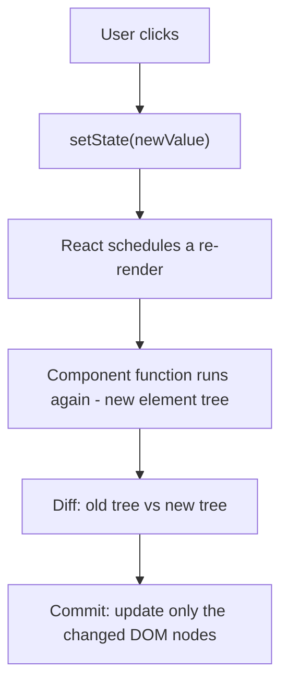
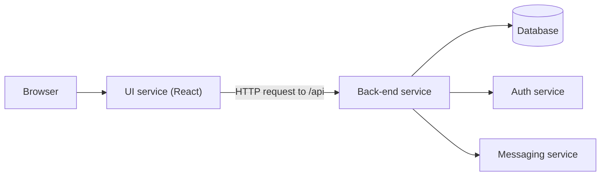
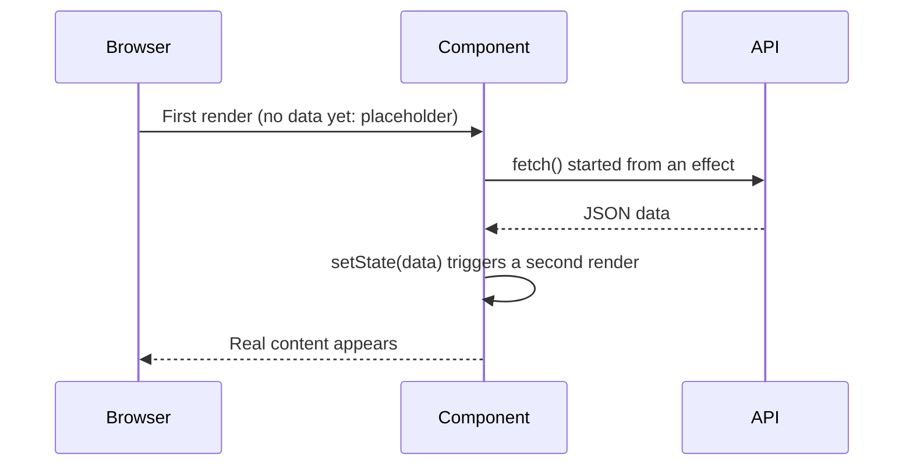
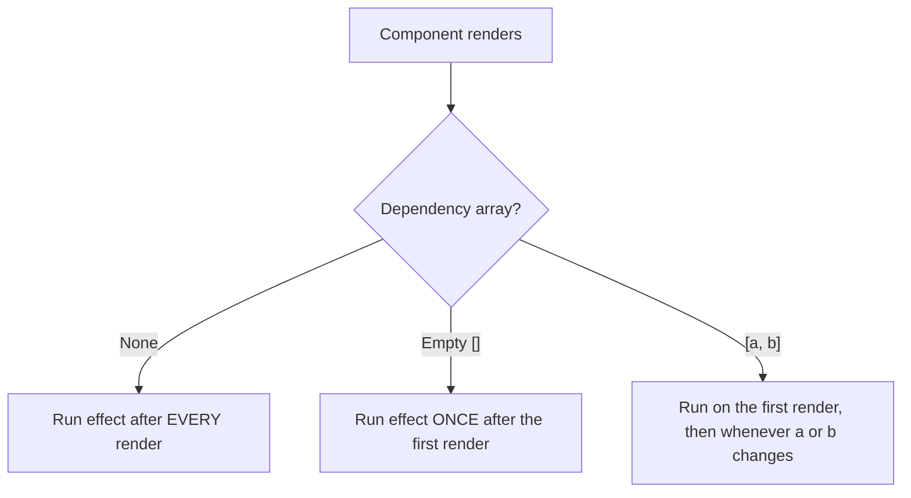
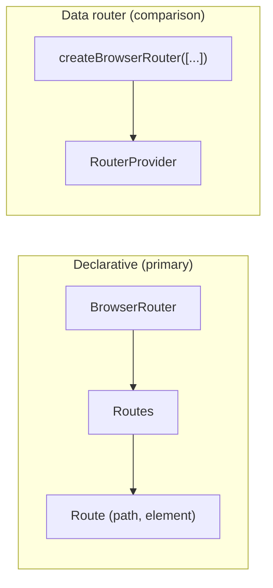
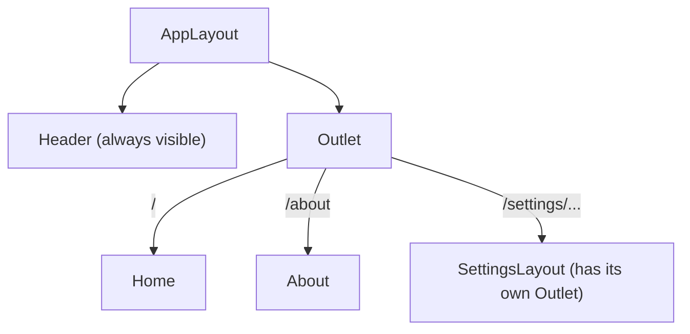
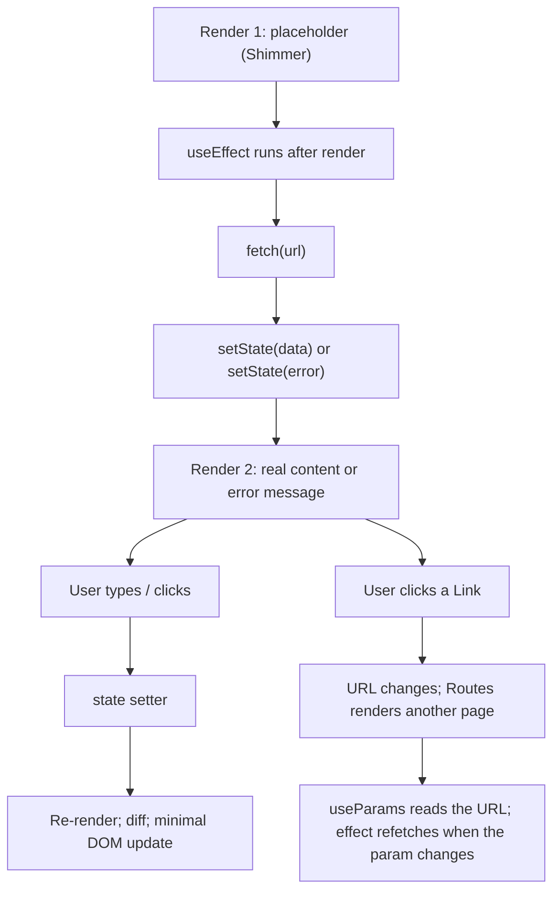

# React State, Effects, and Routing: Learning Notes

A standalone guide to React state, side effects, API data fetching, and client-side routing, written for React with TypeScript.

---

## Introduction

These notes take you from the question *"why doesn't my UI update when I change a variable?"* to building a multi-page application that loads live data and navigates between pages.

By the end you will be able to:

- Explain why ordinary variables cannot update the UI and use `useState` correctly.
- Describe what happens during a re-render: Virtual DOM, diffing, reconciliation, and Fiber.
- Load data from an API with `useEffect`, `fetch`, and `async`/`await`, including loading and error states.
- Predict exactly when an effect runs for each dependency-array form.
- Apply the Rules of Hooks and diagnose "Invalid hook call" errors.
- Build multi-page apps with React Router's declarative API (`BrowserRouter`, `Routes`, `Route`, `useNavigate`, `Navigate`), and compare it with the data-router API (`createBrowserRouter`, `RouterProvider`).

**Assumptions.** You already have a working React + TypeScript project with `react`, `react-dom`, and `react-router-dom` installed. These notes never repeat project setup. Most examples are a complete `App.tsx` that you can paste over your existing one. Where a second file is needed, the note says where it belongs.

---

## Table of Contents

1. [Introduction and How to Use These Notes](#1-introduction-and-how-to-use-these-notes)
2. [Organizing Code with Files, Folders, and Modules](#2-organizing-code-with-files-folders-and-modules)
3. [React State and UI Updates](#3-react-state-and-ui-updates)
4. [React Hooks and `useState`](#4-react-hooks-and-usestate)
5. [Rendering, Virtual DOM, Reconciliation, and Fiber](#5-rendering-virtual-dom-reconciliation-and-fiber)
6. [Array Destructuring](#6-array-destructuring)
7. [Data-Loading Approaches](#7-data-loading-approaches)
8. [`useEffect` Fundamentals](#8-useeffect-fundamentals)
9. [Fetching Live Data from an API](#9-fetching-live-data-from-an-api)
10. [Dependency Arrays and Effect Behavior](#10-dependency-arrays-and-effect-behavior)
11. [Common Effect Mistakes](#11-common-effect-mistakes)
12. [Rules of Hooks](#12-rules-of-hooks)
13. [React Router Fundamentals](#13-react-router-fundamentals)
14. [Declarative Routing with `Routes` and `Route`](#14-declarative-routing-with-routes-and-route)
15. [Programmatic Navigation with `useNavigate`](#15-programmatic-navigation-with-usenavigate)
16. [Redirects with `Navigate`](#16-redirects-with-navigate)
17. [Error Pages and `useRouteError`](#17-error-pages-and-userouteerror)
18. [Nested Routes and `Outlet`](#18-nested-routes-and-outlet)
19. [Comparison with `createBrowserRouter` and `RouterProvider`](#19-comparison-with-createbrowserrouter-and-routerprovider)
20. [Connecting State, Effects, API Data, and Routing](#20-connecting-state-effects-api-data-and-routing)
21. [Common Mistakes and Troubleshooting](#21-common-mistakes-and-troubleshooting)
22. [Practice Exercises](#22-practice-exercises)
23. [Exercise Solutions](#23-exercise-solutions)
24. [Key Takeaways](#24-key-takeaways)
25. [Glossary](#25-glossary)
26. [Official References](#26-official-references)

---

## 1. Introduction and How to Use These Notes

### 1.1 Why use React at all?

Everything React does can be done with plain HTML, CSS, and JavaScript, because React is JavaScript. A framework or library earns its place by making large applications **easier to build and maintain**:

- You write less code to do more on the page.
- You describe *what the UI should look like for the current data*, and React keeps the page in sync.
- React minimizes expensive browser DOM updates.
- Components make large, team-built, production-grade apps manageable.

The central problem all UI libraries solve (React, Angular, Vue, and others) is **keeping the data layer and the UI layer in sync, efficiently**. Most of these notes are about that one idea.

### 1.2 How the notes are organized

Every major topic follows the same pattern where it makes sense:

| Label | Meaning |
|---|---|
| **Objective** | What the example demonstrates |
| **Complete code** | Everything you need to run it |
| **Explanation** | How the code works, step by step |
| **Expected behavior** | What you should see |
| **Common mistakes** | Errors you may hit, and fixes |
| **Key lesson** | The one thing to remember |

Small concepts use a shorter form.

### 1.3 Callout labels

> **Supplementary:** Extra background that helps understanding but is not strictly required.

> **Correction:** A commonly repeated simplification, or a version-dependent detail, stated precisely.

> **Teaching simplification vs. implementation detail:** Where an everyday explanation differs from how React actually works internally, both are given and labeled.

### 1.4 Versions

- **React:** examples work with React 18 and 19.
- **React Router:** examples import from `react-router-dom`, which works in React Router **v6.4+** and **v7** (v7 re-exports everything from the `react-router` package). The `Routes`/`Route` APIs are the same in both. Check your installed version in `package.json` and use the matching documentation at [reactrouter.com](https://reactrouter.com/).
- **TypeScript:** examples use `.tsx` files and explicit types where they teach something.

### 1.5 Study habits that make this stick

1. **Type the code yourself** at first. Snippet generators are fine once you are fluent, but typing builds recall for interviews and everyday work.
2. **Ask "why?" about every line.** *Why am I writing this? Is it required? Could it be better?* Slow, deliberate coding saves debugging time.
3. **Break things on purpose.** Many exercises ask you to reproduce a bug so you recognize it later.
4. **Explain aloud while you code.** Being able to narrate your reasoning is a skill interviewers look for.
5. **Practice, don't just read.** Reading about React is like learning to drive from a video.

---

## 2. Organizing Code with Files, Folders, and Modules

Before state and routing, you need a clear picture of how React code is split across files. Every later example relies on `import` and `export`.

### 2.1 Why split one large file?

Putting every component in one file is **technically fine**: the bundler combines, minifies, and compresses all your code into a few files before it reaches the browser. But *source code is written for humans*:

| Aspect | One big file | One file per component |
|---|---|---|
| Reading and navigating | Lots of scrolling | The file name tells you what's inside |
| Team collaboration | Frequent merge conflicts | People work on separate files |
| Reuse | Hard to reuse a component elsewhere | Import it anywhere |
| Scalability | Real apps have thousands of components | Scales naturally |

> **Rule of thumb (not a hard rule):** Many teams aim to keep a file under roughly 100 lines. If a component file passes 100–200 lines, it is probably doing too much. Split it into smaller components.

### 2.2 A simple, conventional layout

React has **no official opinion** on folder structure. Two common strategies:

| Strategy | Description | Example |
|---|---|---|
| **Group by feature or route** | Keep everything for one feature together | `features/users/`, `features/search/` |
| **Group by file type** | Keep similar files together | `components/`, `utils/` |

Advice that applies to both: avoid deep nesting, find a sweet spot, **don't overthink it**, and restructure later as the app grows.

A simple layout used throughout these notes:

```text
src/
├── App.tsx                 ← root-level component (and, later, routing)
├── components/
│   ├── Header.tsx
│   └── BookCard.tsx
└── utils/
    ├── constants.ts        ← shared constants (named exports)
    └── books.ts            ← sample data (default export)
```

- `src` is a convention (short for "source"), not a requirement.
- **Component files** are named exactly like the component, starting with a capital letter: `Header` → `Header.tsx`. Anyone can then tell what a file contains.
- **Non-component files** use lowercase names (`constants.ts`, `books.ts`). The capitalization itself hints at what the file holds.
- Files containing JSX use `.tsx`; plain TypeScript uses `.ts`. (In JavaScript projects, `.js` and `.jsx` are both used. Follow your team's convention, and if you are free to choose, keep it simple.)

### 2.3 Exporting and importing

> **"First give, then take."** You must **export** something from a file before you can **import** it elsewhere.

There are two kinds of export:

| Feature | Default export / import | Named export / import |
|---|---|---|
| Export syntax | `export default Header;` | `export const APP_NAME = "...";` |
| Import syntax | `import Header from "./Header";` | `import { APP_NAME } from "./constants";` |
| How many per file | **One** | **Many** |
| Curly braces on import | No | **Yes** |
| Import name | Any name you choose | Must match the exported name |
| Typical use | One component per file | Constants, utilities, several exports |

Why a file can have only one default export: the default is "the main thing this file gives you." Writing two causes the error *"A module cannot have multiple default exports."* Use named exports for the rest.

A file may have **one default export plus any number of named exports**, and you can import them together: `import books, { type Book } from "./utils/books";`.

> **Guideline:** Prefer a default export for a file's main component. Use named exports when a file exports several things.

### 2.4 Keep hard-coded data out of components

Avoid hard-coding URLs, strings, and sample data inside component files:

- The same value may be needed in several components (a logo URL, an API base URL).
- One central file makes updates trivial and avoids duplication.
- Components stay short and readable.

By convention, constants are written in `UPPER_SNAKE_CASE`.

### 2.5 Complete example: a small multi-file setup

**Objective:** See default exports, named exports, and import paths working together.

**`src/utils/constants.ts`** (new file; named exports)

```ts
export const APP_NAME = "Reading List";
export const TOP_RATING_THRESHOLD = 4;
```

**`src/utils/books.ts`** (new file; one default export plus a named type export)

```ts
export interface Book {
  id: number;
  title: string;
  rating: number;
}

const books: Book[] = [
  { id: 1, title: "The Pragmatic Programmer", rating: 4.6 },
  { id: 2, title: "Clean Code", rating: 4.2 },
  { id: 3, title: "Refactoring", rating: 4.4 },
  { id: 4, title: "Code Complete", rating: 3.9 },
];

export default books;
```

**`src/components/BookCard.tsx`** (new file; default export)

```tsx
import type { Book } from "../utils/books";

interface BookCardProps {
  book: Book;
}

const BookCard = ({ book }: BookCardProps) => {
  return (
    <li>
      {book.title} (rating {book.rating})
    </li>
  );
};

export default BookCard;
```

**`src/App.tsx`**

```tsx
import BookCard from "./components/BookCard";
import books from "./utils/books";
import { APP_NAME } from "./utils/constants";

export default function App() {
  return (
    <div>
      <h1>{APP_NAME}</h1>
      <ul>
        {books.map((book) => (
          <BookCard key={book.id} book={book} />
        ))}
      </ul>
    </div>
  );
}
```

**Explanation**

1. `constants.ts` uses `export const`, so each constant is a **named export** and is imported with braces: `{ APP_NAME }`.
2. `books.ts` has a **default export** (`books`) and a **named** type export (`Book`).
3. `BookCard.tsx` imports only the type, using `import type`. Type imports are erased at build time.
4. Paths are **relative to the importing file**. `./` means "this folder." `../` means "go up one folder," which is why `BookCard.tsx` (inside `components/`) reaches `utils/` with `../utils/books`.
5. Import paths omit the extension; the bundler (Vite, Parcel, webpack, and so on) resolves `.ts`/`.tsx`.

**Expected behavior:** A "Reading List" heading with four books.

**Common mistakes**

| Symptom | Cause | Fix |
|---|---|---|
| `X is not defined` | Component moved to another file but never imported | Export it, then import it where it's used |
| `... has no exported member` / `undefined` import | Mixed up default and named syntax | Default: `import X from`; Named: `import { X } from` |
| `Cannot find module './constant'` | File is `constants.ts` but import says `constant` | File name and import must match exactly |
| Image shows the literal text `LOGO_URL` | Wrote `src="LOGO_URL"` (a string) | Use `src={LOGO_URL}` (a JavaScript expression) |
| `A module cannot have multiple default exports` | Two `export default` in one file | Keep one; make the rest named |

**Key lesson:** Export first, import second. Default exports have no braces on import; named exports do.

> **Supplementary:** `import React from "react"` is no longer needed in projects using the modern JSX transform (React 17+ tooling). Hooks such as `useState` and `useEffect` are **named exports** of the `react` package, which is why you write `import { useState } from "react"` with braces.

---

## 3. React State and UI Updates

### 3.1 The UI is driven by data

In React, the screen is a **function of your data**. If the data is a list of three books, you render three cards. If it becomes two books, you should see two cards. This is sometimes called a **config-driven** or **data-driven UI**: what you see is determined by data (which may come from a server).

```tsx
const books = ["Clean Code", "Refactoring"];

// The UI is derived from the data:
books.map((title) => <li key={title}>{title}</li>);
```

An empty list renders nothing. One item renders one `<li>`. The data decides.

> **Supplementary:** When rendering lists with `map`, every element needs a stable, unique `key`. React uses it to match items between renders (see [Section 5.8](#58-keys-and-reconciliation)). If you copy and paste sample objects and forget to change their `id`, React warns that two children have the same key.

### 3.2 Event handlers in React

Making a UI respond to the user starts with **event handlers**. An event handler is a function that runs when something happens (a click, a hover, a keystroke).

In JSX you pass a **function** to a camelCase attribute:

```tsx
<button onClick={() => console.log("Button clicked")}>Click me</button>
```

| Plain HTML | React JSX |
|---|---|
| `onclick="fn()"` (lowercase, a string) | `onClick={fn}` (camelCase, a function) |
| `onmouseover` | `onMouseOver` |
| `onblur` | `onBlur` |
| `onchange` | `onChange` |

There is no `onHover`. Use `onMouseEnter`, `onMouseOver`, and `onMouseLeave`.

**Common mistake: calling the handler instead of passing it.**

```tsx
// Wrong: runs during render and passes its result (undefined) to onClick
<button onClick={handleClick()}>Save</button>

// Right: passes the function; React calls it on click
<button onClick={handleClick}>Save</button>

// Right: wrapper arrow function when you need arguments
<button onClick={() => handleClick(item.id)}>Save</button>
```

### 3.3 The problem: a normal variable does not update the UI

**Objective:** Prove that changing an ordinary variable changes the data but not the screen.

**Complete code (`App.tsx`)**

```tsx
export default function App() {
  let count = 0;

  function handleClick() {
    count = count + 1;
    console.log("count is now", count);
  }

  return (
    <div>
      <h1>Count: {count}</h1>
      <button onClick={handleClick}>Add one</button>
    </div>
  );
}
```

**Explanation**

1. `count` is a plain local variable inside the component function.
2. Clicking the button runs `handleClick`, which really does change `count`. The console proves it.
3. The page still shows `Count: 0`.

**Expected behavior:** The console prints 1, 2, 3 on successive clicks, but the heading stays at `Count: 0`.

**Why?** Two independent reasons:

1. **React does not watch ordinary variables.** Nothing tells React "the data changed, redraw." You would have to update the DOM yourself, which is the tedious, error-prone work React exists to remove.
2. **Local variables don't survive renders.** Even if something did cause a re-render, React would call `App()` again, and `let count = 0` would run again from scratch.

A related mistake is using `const` for a variable and then reassigning it. That fails earlier with `Assignment to constant variable`, a plain JavaScript error. Switching to `let` fixes the error but not the real problem.

**Common mistakes**

| Mistake | Fix |
|---|---|
| Expecting the UI to follow a normal variable | Store the value in state |
| Reassigning a `const` | Use state and its setter instead |
| Manually editing the DOM (`document.getElementById(...)`) | Let React do it from state |

**Key lesson:** To change what's on screen, change **state**, not a local variable. State is the way to give React two things a plain variable can't: **memory between renders** and a **trigger to re-render**.

---

## 4. React Hooks and `useState`

### 4.1 What is a Hook?

- A functional component is a normal JavaScript **function**.
- A React element is a plain JavaScript **object**.
- A **Hook** is also just a JavaScript **function**, written by the React team and shipped inside the `react` package, that lets your component use React features.

Hooks look ordinary, but React keeps internal bookkeeping for each call, which gives them "superpowers" (remembering values, running code after render, and so on). By convention, **names that start with `use`** are hooks.

The two hooks you will use most often:

| Hook | Purpose | Where covered |
|---|---|---|
| `useState` | Remember values and re-render when they change | This section |
| `useEffect` | Run code after render (data fetching, subscriptions, timers) | [Section 8](#8-useeffect-fundamentals) |

### 4.2 Definition and syntax

A **state variable** is a special variable created with `useState`. React stores it for you between renders and re-renders the component whenever you change it through its setter.

```tsx
import { useState } from "react";            // a NAMED import

const [value, setValue] = useState(initialValue);
```

Step by step:

1. **Import** `useState` as a named import from `"react"`.
2. **Call it at the top level of your component** (see [Section 12](#12-rules-of-hooks)).
3. The argument is the **initial value**, used only on the first render.
4. It returns an **array of exactly two items**: the current value, and a **setter function**. You unpack them with [array destructuring](#6-array-destructuring).

### 4.3 Initial values and TypeScript

| Call | Initial value | Inferred type |
|---|---|---|
| `useState(0)` | `0` | `number` |
| `useState("Login")` | `"Login"` | `string` |
| `useState(false)` | `false` | `boolean` |
| `useState<string[]>([])` | empty list | `string[]` |
| `useState<User \| null>(null)` | `null` | `User \| null` |

TypeScript infers the type from the initial value. For an empty array or `null`, pass the type explicitly as a generic (`useState<User[]>([])`), otherwise TypeScript infers `never[]` or `null`.

**Lazy initialization (optional):** if computing the initial value is expensive, pass a function. React calls it only on the first render.

```tsx
const [items, setItems] = useState(() => loadItemsFromStorage());
```

### 4.4 Scope and naming

- A state variable created in a component is **local** to that component. Two instances of the same component each get their own independent state.
- Name the setter **`set` + variable name**: `listOfBooks` → `setListOfBooks`. This is a convention, not a rule, but everyone follows it.

### 4.5 Normal variable vs. state variable

```tsx
// Normal JavaScript variable: forgotten each render, no re-render on change
let count = 0;

// React state variable: remembered, and the setter triggers a re-render
const [count, setCount] = useState(0);
```

| | Normal variable | State variable |
|---|---|---|
| Survives re-renders | No (re-created each call) | Yes (React stores it) |
| Changing it re-renders | No | Yes, **if** changed via the setter |
| How to change | `x = newValue` | `setX(newValue)` |
| Read it in JSX | `{x}` | `{x}` (identical) |

State variables **read exactly like normal variables**, so `books.map(...)` works unchanged.

### 4.6 Updating state: always use the setter

```tsx
count = count + 1;     // Wrong: React is never told
setCount(count + 1);   // Right: updates state and triggers a re-render
```

Why two parts (a value and a setter)? There must be a **trigger** that tells React to start working out what changed. Calling the setter is that trigger. Assigning with `=` triggers nothing.

### 4.7 Complete example: a working counter

**Objective:** Fix the broken counter from Section 3.3 with `useState`.

**Complete code (`App.tsx`)**

```tsx
import { useState } from "react";

export default function App() {
  const [count, setCount] = useState(0);

  console.log("App rendered, count =", count);

  return (
    <div>
      <h1>Count: {count}</h1>
      <button onClick={() => setCount(count + 1)}>Add one</button>
      <button onClick={() => setCount(0)}>Reset</button>
    </div>
  );
}
```

**Explanation**

1. `useState(0)` returns `[0, setCount]` on the first render.
2. Clicking **Add one** calls `setCount(count + 1)`. React stores the new value and **calls `App()` again**.
3. On that second call, `useState(0)` ignores its initial value and returns the stored value, `1`.
4. React compares what the component now returns against what it returned before and updates only the heading's text in the real DOM.

**Expected behavior:** The number updates on every click. The console prints `App rendered` once on load and once per click (two prints on load in development if React Strict Mode is on; see [Section 10.6](#106-react-strict-mode-in-development)).

**Common mistakes**

| Mistake | Fix |
|---|---|
| `count++` or `count = count + 1` | `setCount(count + 1)` |
| Passing a call instead of a function: `onClick={setCount(1)}` | `onClick={() => setCount(1)}` |
| Declaring state outside the component | Call `useState` inside the component body |

**Key lesson:** State = memory + re-render trigger. Change it only through the setter.

### 4.8 State is a snapshot

> **Supplementary (important):** Setting state does **not** change the variable in the render that's currently running. Each render sees a fixed snapshot of state.

```tsx
function handleClick() {
  setCount(count + 1);   // count is 0 in this render, so this requests 1
  setCount(count + 1);   // still 0 in this render, so this also requests 1
  setCount(count + 1);   // and again: 1
}
// Result after one click: count is 1, not 3
```

When the next value depends on the previous one, pass an **updater function**:

```tsx
function handleClick() {
  setCount((c) => c + 1);  // 0 → 1
  setCount((c) => c + 1);  // 1 → 2
  setCount((c) => c + 1);  // 2 → 3
}
// Result after one click: count is 3
```

Also, `console.log(count)` immediately after `setCount(...)` prints the *old* value. The new value appears in the next render.

### 4.9 Never mutate state: create new values

React decides whether state changed by comparing the new value with the old one using `Object.is`. If you mutate an array or object in place and pass the same reference, React sees "no change" and may skip the re-render.

```tsx
// Wrong: same array, mutated in place
books.push(newBook);
setBooks(books);

// Right: a new array
setBooks([...books, newBook]);

// Right: filter / map already return new arrays
setBooks(books.filter((b) => b.rating > 4));
setBooks(books.map((b) => (b.id === id ? { ...b, rating: 5 } : b)));
```

If you call the setter with a value identical to the current one, React skips re-rendering the component's children and effects.

### 4.10 Example: Login / Logout toggle

**Objective:** Show a single piece of state controlling what a button says.

**Complete code (`App.tsx`)**

```tsx
import { useState } from "react";

export default function App() {
  const [buttonLabel, setButtonLabel] = useState("Login");

  console.log("Header rendered");

  return (
    <header style={{ display: "flex", gap: 16, alignItems: "center" }}>
      <strong>My App</strong>
      <nav>Home | About | Contact</nav>
      <button
        onClick={() =>
          setButtonLabel(buttonLabel === "Login" ? "Logout" : "Login")
        }
      >
        {buttonLabel}
      </button>
    </header>
  );
}
```

**Explanation**

1. The initial state is `"Login"`.
2. The click handler uses a ternary to choose the opposite label and passes it to the setter.
3. React re-renders, and the button shows the new label.

**Expected behavior:** Click **Login** and it becomes **Logout**; click again and it returns to **Login**. `Header rendered` prints once on load and once per click. In the browser's **Elements** panel, only the button text flashes. The rest of the header is untouched.

**Key lesson:** The entire function re-runs on each state change, but React updates only the part of the real DOM that changed. See [Section 5](#5-rendering-virtual-dom-reconciliation-and-fiber).

A TypeScript refinement: for a two-value toggle, a boolean is more natural than a string label:

```tsx
const [isLoggedIn, setIsLoggedIn] = useState(false);
// ...
<button onClick={() => setIsLoggedIn(!isLoggedIn)}>
  {isLoggedIn ? "Logout" : "Login"}
</button>
```

### 4.11 Example: filtering a list with state

**Objective:** Show only top-rated items when a button is clicked, then restore the full list.

**Complete code (`App.tsx`)**

```tsx
import { useState } from "react";

interface Book {
  id: number;
  title: string;
  rating: number;
}

const ALL_BOOKS: Book[] = [
  { id: 1, title: "The Pragmatic Programmer", rating: 4.6 },
  { id: 2, title: "Clean Code", rating: 4.2 },
  { id: 3, title: "Refactoring", rating: 4.4 },
  { id: 4, title: "Code Complete", rating: 3.9 },
  { id: 5, title: "Peopleware", rating: 3.8 },
];

export default function App() {
  const [books, setBooks] = useState<Book[]>(ALL_BOOKS);

  return (
    <div>
      <button onClick={() => setBooks(ALL_BOOKS.filter((b) => b.rating > 4))}>
        Top rated (above 4)
      </button>
      <button onClick={() => setBooks(ALL_BOOKS)}>Show all</button>

      <ul>
        {books.map((book) => (
          <li key={book.id}>
            {book.title}: {book.rating}
          </li>
        ))}
      </ul>
    </div>
  );
}
```

**Explanation**

1. `useState<Book[]>(ALL_BOOKS)` starts with every book.
2. `.filter(...)` is plain JavaScript. It returns a **new array**.
3. Passing the new array to `setBooks` triggers the re-render.
4. **Show all** restores the list from the untouched `ALL_BOOKS` constant.

**Expected behavior:** Initially five books. **Top rated** leaves three. **Show all** restores five.

**Common mistakes**

| Mistake | Fix |
|---|---|
| Filtering `books` (the state) instead of the original list, so **Show all** can't restore removed items | Filter from a source that you keep intact |
| Assigning `books = filtered` | `setBooks(filtered)` |
| Missing or duplicate `key` | Use a unique `id` |

### 4.12 Example: controlled input, search, and the "second search returns nothing" bug

**Objective:** Build a search box, then understand and fix the classic bug of overwriting your only copy of the data.

#### Step 1: a controlled input

To read what a user types, bind the input to state with both `value` and `onChange`:

```tsx
const [searchText, setSearchText] = useState("");

<input
  value={searchText}
  onChange={(e) => setSearchText(e.target.value)}
/>
```

- If you set `value` **without** `onChange`, the box looks frozen: React renders the input with `value={searchText}` every time, typing doesn't change `searchText`, so the box stays `""`. State is the **single source of truth**. (React also warns in the console.)
- `e` is the event object. `e.target` is the input element and `e.target.value` is what has been typed so far.
- An input driven by state like this is called a **controlled input**.
- **Every keystroke triggers a re-render** of the whole component. That's fine. React updates only the input's value in the real DOM.

#### Step 2: the buggy version

```tsx
// BUG: overwrites the only copy of the data
const [books, setBooks] = useState<Book[]>(ALL_BOOKS);

function handleSearch() {
  const result = books.filter((b) =>
    b.title.toLowerCase().includes(searchText.toLowerCase())
  );
  setBooks(result);   // the original list is now gone from state
}
```

Search for `code` → two results. Now search for `refactor` → **nothing**, even though "Refactoring" exists. The second search filters the *already filtered* list. There is no error because nothing is technically wrong. The data was just thrown away.

Notes on the filter itself:

- Use `.includes(...)`, not `===`. "Clean Code" never equals "code", but it *includes* it.
- Lowercase **both** sides so the search is case-insensitive.

#### Step 3: the fix, keeping a source list and a displayed list

**Complete code (`App.tsx`)**

```tsx
import { useState } from "react";
import type { ChangeEvent, KeyboardEvent } from "react";

interface Book {
  id: number;
  title: string;
  rating: number;
}

const INITIAL_BOOKS: Book[] = [
  { id: 1, title: "The Pragmatic Programmer", rating: 4.6 },
  { id: 2, title: "Clean Code", rating: 4.2 },
  { id: 3, title: "Refactoring", rating: 4.4 },
  { id: 4, title: "Code Complete", rating: 3.9 },
  { id: 5, title: "Peopleware", rating: 3.8 },
];

export default function App() {
  // Source of truth: never filtered. (In a real app this often arrives from an API.)
  const [allBooks] = useState<Book[]>(INITIAL_BOOKS);
  // What the UI shows
  const [visibleBooks, setVisibleBooks] = useState<Book[]>(INITIAL_BOOKS);
  // What is in the input box
  const [searchText, setSearchText] = useState("");

  function handleChange(e: ChangeEvent<HTMLInputElement>) {
    setSearchText(e.target.value);
  }

  function handleSearch() {
    const result = allBooks.filter((b) =>
      b.title.toLowerCase().includes(searchText.toLowerCase())
    );
    setVisibleBooks(result);
  }

  function handleKeyDown(e: KeyboardEvent<HTMLInputElement>) {
    if (e.key === "Enter") handleSearch();
  }

  return (
    <div>
      <input
        value={searchText}
        onChange={handleChange}
        onKeyDown={handleKeyDown}
        placeholder="Search books"
      />
      <button onClick={handleSearch}>Search</button>
      <button onClick={() => setVisibleBooks(allBooks.filter((b) => b.rating > 4))}>
        Top rated
      </button>

      {visibleBooks.length === 0 && <p>No books match.</p>}

      <ul>
        {visibleBooks.map((book) => (
          <li key={book.id}>{book.title}</li>
        ))}
      </ul>
    </div>
  );
}
```

**Explanation**

| State | Changes when | Used for |
|---|---|---|
| `allBooks` | Never here (or once, after an API call) | The **source** that every search filters from |
| `visibleBooks` | After each search or filter | What is **rendered** |
| `searchText` | Every keystroke | Controls the input box |

**Expected behavior:** Type `code` and click Search → two results. Then search `refactor` → Refactoring appears. An empty search followed by Search restores all five. Pressing Enter also searches.

**Common mistakes**

| Mistake | Fix |
|---|---|
| `value` without `onChange` (input can't be typed in) | Add `onChange` |
| `===` instead of `.includes` | Use `.includes` |
| Case-sensitive match | `toLowerCase()` on both sides |
| Later searches return nothing | Filter from the unmodified source list |
| Top-rated button still calling the old setter after you add a second list | Make every filter read from `allBooks` and write to `visibleBooks` |

> **Supplementary refinement: derive instead of storing.** React's documentation recommends *not* storing values you can compute from other state. A cleaner version keeps only `allBooks`, `searchText`, and (optionally) a `minRating` state, and **computes** the visible list while rendering:
>
> ```tsx
> const visibleBooks = allBooks.filter((b) =>
>   b.title.toLowerCase().includes(searchText.toLowerCase())
> );
> ```
>
> This removes the possibility of the two lists drifting apart. Two lists are a good first step to understand the bug; derived values are the cleaner long-term pattern. (The search then filters live as you type, without a Search button.)

**Key lesson:** Never overwrite your only copy of the data when filtering. Keep a source and a view, or derive the view.

### 4.13 Where this fits next

You now know **what** state does. Section 5 explains **what React does behind the scenes** when state changes.

---

## 5. Rendering, Virtual DOM, Reconciliation, and Fiber

### 5.1 Re-rendering

> **The key rule:** When a state variable is updated through its setter, React **re-renders** the component.

*Rendering* means **React calls your component function** to find out what the UI should look like for the current props and state. The function returns JSX, which becomes a tree of plain JavaScript objects (React elements).

A re-render is therefore just *calling the function again*. React is "watching" state created by `useState`; it cannot watch ordinary variables.

> **Teaching simplification vs. implementation detail:**
> *Simplification:* "Render means the page is redrawn."
> *Precisely:* React works in two phases. In the **render phase** it calls your components and computes the new element tree (no DOM changes yet). In the **commit phase** it applies the minimal set of changes to the real DOM. If nothing changed, the commit touches nothing. A component can render without the browser DOM changing at all. See [Render and Commit](https://react.dev/learn/render-and-commit).

### 5.2 "How can a `const` change?"

A common puzzle:

```tsx
const [label, setLabel] = useState("Login");   // const!
// ...later, after a click, label shows "Logout"
```

`label` is never *modified*. Each render calls the component function again, which runs `useState` again and creates a **brand-new `label` constant** initialized with the value React has stored. Every render has its own constants, and the old ones are discarded. This is the "snapshot" idea from [Section 4.8](#48-state-is-a-snapshot).

### 5.3 Virtual DOM

| Term | Meaning |
|---|---|
| **Actual DOM** | The browser's real tree of HTML elements |
| **Virtual DOM** | A lightweight, in-memory JavaScript representation of the UI that React uses to work out what to change |

When you write JSX, your build tool turns it into function calls that create plain objects. You can see one:

```tsx
const element = <h1 className="title">Hello</h1>;
console.log(element);
// An object like: { type: "h1", props: { className: "title", children: "Hello" }, key: null, ... }
```

A whole component tree becomes one large nested object. That tree is the "virtual DOM" in everyday explanations.

> **Correction:** Virtual DOM is not unique to React; the idea predates it. And React's own documentation avoids the term, speaking instead of the *render tree* and *reconciliation*. "Virtual DOM" is still the common name in interviews and tutorials, so it's worth knowing.

### 5.4 The diff algorithm

After a state change React builds a **new** element tree and compares it with the **previous** one, like a `git diff` between two versions of a file. It does this by comparing cheap JavaScript objects, not by reading the expensive real DOM.

Comparing two arbitrary trees optimally is expensive, so React uses two heuristics that make it roughly linear in the number of elements:

1. **Different element types produce different trees.** If a `<div>` becomes a `<section>`, or `<Profile>` becomes `<Settings>`, React discards the old subtree and builds a new one.
2. **Keys identify items in lists.** React uses `key` to tell which child is which across renders, even if they move.

Same type at the same position? React keeps the existing DOM node and updates only the changed attributes or text.

*Example:* A list contains 7 cards. After a filter only 3 remain. The diff concludes 4 cards must be removed, and only those 4 DOM nodes are removed.

### 5.5 Reconciliation

**Reconciliation** is the overall process: render a new tree, diff it against the previous one, and apply the minimal set of changes to the real DOM.



### 5.6 React Fiber

**React Fiber** is the implementation of the reconciliation algorithm introduced in **React 16**. It reorganizes rendering work into small units, which makes **incremental rendering** possible: splitting work into chunks that can be paused, resumed, or prioritized instead of blocking the main thread in one long task.

> **Correction on dates:** Fiber's development began around 2016, but React 16, the first release built on it, shipped in **2017**. Modern React (18 and later) builds its concurrent features, such as transitions and Suspense improvements, on this foundation.

For deeper reading, see the React team's *React Fiber Architecture* write-up (the `acdlite/react-fiber-architecture` repository on GitHub) and the official React documentation on [Render and Commit](https://react.dev/learn/render-and-commit). These are advanced topics and not needed to use React effectively.

### 5.7 Why React is fast

**A strong interview answer:**

> React makes UI updates efficient by minimizing real-DOM work. When state changes, it re-renders the component to produce a new element tree, diffs it against the previous tree, and the reconciliation process updates only the parts of the real DOM that actually changed.

Common **wrong** answers:

- *"React minifies and bundles our code."* That's the **bundler** (Vite, Parcel, webpack), not React.
- *"Because it has a virtual DOM."* Too shallow. The virtual DOM is a *means*; the benefit comes from diffing plus minimal DOM updates.

> **Correction:** React is not magically faster than carefully hand-written DOM code. Its value is that it is **fast enough by default** and keeps the UI in sync with data without you writing DOM code. Re-rendering a component on every keystroke is fine because the expensive part, DOM manipulation, is kept small. (If a component's render itself becomes expensive, tools like `React.memo` and `useMemo` exist. They are out of scope here.)

### 5.8 Keys and reconciliation

A `key` is how React matches list items between renders.

```tsx
{books.map((book) => (
  <li key={book.id}>{book.title}</li>   // stable, unique id: good
))}
```

- Use a **stable unique id** from your data.
- Avoid the array index as a key if the list can be reordered, filtered, or inserted into. React could attach the wrong state or DOM node to the wrong item.
- If the `map` returns a wrapper (for example a `Link` around a card), the `key` goes on the **outermost element returned by `map`**.
- Missing keys produce the warning *"Each child in a list should have a unique key."* Duplicate keys produce *"Encountered two children with the same key."*

### 5.9 Complete example: seeing re-renders and minimal DOM updates

**Objective:** Observe that the whole component function re-runs on each keystroke while the real DOM changes only where needed.

**Complete code (`App.tsx`)**

```tsx
import { useState } from "react";

function StaticFooter() {
  console.log("StaticFooter rendered");
  return <footer>This text never changes.</footer>;
}

export default function App() {
  const [text, setText] = useState("");

  console.log("App rendered, text =", JSON.stringify(text));

  return (
    <div>
      <input
        value={text}
        onChange={(e) => setText(e.target.value)}
        placeholder="Type here"
      />
      <p>You typed: {text}</p>
      <StaticFooter />
    </div>
  );
}
```

**Explanation**

1. Each keystroke calls `setText`, so React calls `App()` again.
2. By default, when a parent re-renders, its child components re-render too, so `StaticFooter rendered` also prints.
3. The new element tree differs from the old one only in the input's `value` and the paragraph text. React commits only those changes.

**Expected behavior:** The console logs on every keystroke. Open the browser's **Elements** panel and type: only the input value and the paragraph text flash. The footer node is never touched, even though its function ran.

**Common mistakes**

| Mistake | Correction |
|---|---|
| "Only the input re-renders." | The **whole component** function runs; only the changed DOM parts update. |
| "A re-render means the DOM was rebuilt." | A render can produce no DOM change at all. |
| Worrying about two renders on load (state set after fetch) | Normal. Rendering is cheap. |

**Key lesson:** React re-runs components freely and protects the expensive part, the real DOM.

---

## 6. Array Destructuring

### 6.1 What it is

`useState` returns an **array**. The syntax most people copy without thinking:

```tsx
const [count, setCount] = useState(0);
```

is **plain JavaScript array destructuring**. It is not special React syntax. It is shorthand for:

```tsx
const pair = useState(0);
const count = pair[0];      // current value
const setCount = pair[1];   // setter function
```

Both forms behave identically. Destructuring unpacks array items into named variables in one step.

### 6.2 Syntax and variations

```ts
const colors = ["red", "green", "blue"];

const [first, second] = colors;
console.log(first, second);        // "red" "green"

const [, , third] = colors;        // skip items with empty slots
console.log(third);                // "blue"

const [a, b, c, d = "none"] = colors;   // default for a missing item
console.log(d);                    // "none"

const [head, ...rest] = colors;    // collect the remainder
console.log(rest);                 // ["green", "blue"]

let x = 1, y = 2;
[x, y] = [y, x];                   // swap without a temp variable
```

### 6.3 Why does `useState` return an array?

Because position gives the meaning, **you** choose the names:

```tsx
const [count, setCount] = useState(0);
const [name, setName] = useState("");
const [isOpen, setIsOpen] = useState(false);
```

If `useState` returned an object (`{ value, setValue }`), you would need to rename every pair (`{ value: count, setValue: setCount }`). The array-of-two design keeps repeated use compact. Always follow the `thing` / `setThing` convention.

### 6.4 Complete example: destructuring in your own hook

**Objective:** Return a tuple from a custom hook and destructure it, the same way `useState` works.

**Complete code (`App.tsx`)**

```tsx
import { useState } from "react";

// A custom hook: a function whose name starts with "use" and that calls other hooks
function useToggle(initial = false): [boolean, () => void] {
  const [on, setOn] = useState(initial);
  const toggle = () => setOn((current) => !current);
  return [on, toggle];
}

export default function App() {
  const [isVisible, toggleVisible] = useToggle(true);

  return (
    <div>
      <button onClick={toggleVisible}>{isVisible ? "Hide" : "Show"} details</button>
      {isVisible && <p>Here are the details.</p>}
    </div>
  );
}
```

**Explanation**

1. `useToggle` returns a two-item array, typed as a **tuple** (`[boolean, () => void]`). Without the annotation TypeScript would infer `(boolean | (() => void))[]` and destructuring would be awkward.
2. In `App`, destructuring gives meaningful local names (`isVisible`, `toggleVisible`).
3. `{isVisible && <p>...</p>}` renders the paragraph only when `isVisible` is true.

**Expected behavior:** The button toggles between "Hide details" and "Show details", and the paragraph appears and disappears.

**Common mistakes**

| Mistake | Fix |
|---|---|
| Using `{ }` instead of `[ ]` for `useState` | Array destructuring uses square brackets |
| Swapping the order: `const [setCount, count]` | Value first, setter second |
| Returning an untyped array from a custom hook | Annotate the tuple return type or use `as const` |

**Key lesson:** `const [value, setValue] = useState(...)` is ordinary array destructuring. Be curious about every small piece of syntax.

---

## 7. Data-Loading Approaches

### 7.1 Background: where does the data come from?

Real applications get their data from other programs over the network. Two architectural styles help explain where a React app sits.

**Monolith architecture.** One large project contains everything: API code, UI code, authentication, database access, notifications. Even a tiny change (a button's color) means building and deploying the whole project.

**Microservice architecture.** The system is split into many small, independent services, each with a single job:

| Service (example) | Responsibility |
|---|---|
| UI service | The user interface (a React app) |
| Back-end service | Business logic and APIs |
| Authentication service | Login and identity |
| Database service | Data access |
| Messaging service | SMS, email, notifications |

Key ideas:

- **Separation of concerns** and the **single responsibility principle**: each service has one job.
- Teams can own, deploy, and use different technology for each service (React for the UI, Java or Go or Python behind it).
- Each service listens on its own **port** (the dev server for your UI might be on `5173` or `3000`, a back end on another). In production, ports are usually mapped behind one **domain** with paths such as `/` for the UI and `/api` for the back end.
- Services talk to each other by **calling URLs**.



> **Supplementary:** Whether monoliths or microservices are "better" is a long-running debate you don't need to settle. What matters here is the picture: **your React app is typically the UI service, and it fetches data from other services by URL.**

### 7.2 Two approaches to loading data

| | Approach 1: fetch, then render | Approach 2: render, then fetch |
|---|---|---|
| Sequence | Load page, call API, **wait**, render once data arrives | Load page, **render immediately**, call API, re-render when data arrives |
| First impression | Blank or frozen until data arrives | Something appears immediately (a placeholder) |
| Perceived speed | Poor | Better |
| Number of renders | One | Two (or more) |

**React's approach is Approach 2.** Rendering twice is not a problem, because React's render cycle is fast and the DOM is touched minimally (see [Section 5](#5-rendering-virtual-dom-reconciliation-and-fiber)).



This requires a way to run code **after** the first render, which is exactly what [`useEffect`](#8-useeffect-fundamentals) provides.

### 7.3 Conditional rendering

**Rendering based on a condition is called conditional rendering.** It's ordinary JavaScript, not a special React feature. Three common forms:

```tsx
// 1. Early return with if
if (isLoading) {
  return <p>Loading...</p>;
}
return <List items={items} />;

// 2. Ternary operator inside JSX
return isLoading ? <p>Loading...</p> : <List items={items} />;

// 3. Logical AND: render something or nothing
return <div>{hasError && <p>Something went wrong.</p>}</div>;
```

- Forms 1 and 2 behave identically for "either/or." If you see a ternary with parentheses around JSX, don't panic: it is just the ternary operator.
- Form 3 is for "show this or nothing." Careful with numbers: `{count && <X />}` renders `0` when `count` is `0`. Use `{count > 0 && <X />}`.
- When using an early `return`, make sure **all hooks have already been called above it** ([Section 12](#12-rules-of-hooks)).

### 7.4 Spinner vs. shimmer (skeleton) UI

- A spinner or "Loading..." message is the simplest placeholder. Content then pops in abruptly.
- A **shimmer UI** (also called a skeleton screen) shows grey placeholder shapes that resemble the final layout. Users see structure instead of a blank page, so waiting *feels* shorter. Many modern sites use this.

#### Complete example: a skeleton you can toggle

**Objective:** Build a shimmer placeholder and switch between loading and loaded views with conditional rendering. (No network yet; Section 9 connects it to real data.)

**Complete code (`App.tsx`)**

```tsx
import { useState } from "react";
import type { CSSProperties } from "react";

const CARD_STYLE: CSSProperties = {
  width: 160,
  height: 90,
  margin: 8,
  padding: 8,
  borderRadius: 8,
  boxSizing: "border-box",
};

function Shimmer({ count = 6 }: { count?: number }) {
  return (
    <div style={{ display: "flex", flexWrap: "wrap" }}>
      {Array.from({ length: count }, (_, i) => (
        <div key={i} style={{ ...CARD_STYLE, background: "#e5e7eb" }} />
      ))}
    </div>
  );
}

const NAMES = ["Asha", "Ben", "Chen", "Dara", "Eli", "Farah"];

export default function App() {
  const [isLoading, setIsLoading] = useState(true);

  return (
    <div>
      <button onClick={() => setIsLoading(!isLoading)}>
        {isLoading ? "Finish loading" : "Start loading"}
      </button>

      {isLoading ? (
        <Shimmer />
      ) : (
        <div style={{ display: "flex", flexWrap: "wrap" }}>
          {NAMES.map((name) => (
            <div key={name} style={{ ...CARD_STYLE, border: "1px solid #ccc" }}>
              {name}
            </div>
          ))}
        </div>
      )}
    </div>
  );
}
```

**Explanation**

1. `Shimmer` renders `count` grey boxes. `key={i}` is acceptable here because the list is static and never reorders.
2. `display: flex` with `flexWrap: "wrap"` lays the cards out in rows that wrap.
3. `isLoading ? <Shimmer /> : <real content>` is the conditional rendering.
4. `CSSProperties` is the TypeScript type for inline style objects.

**Expected behavior:** The page starts with grey placeholders. The button swaps them with real cards and back.

**Common mistakes**

| Symptom | Cause | Fix |
|---|---|---|
| Placeholders stack in one column | Missing `display: flex` | Add it to the container |
| Placeholders overflow in a single row | Missing wrap | Add `flexWrap: "wrap"` |
| Nothing is styled | Typo in a class or style name | Match names exactly |
| Import error | Wrong export type | `export default Shimmer` goes with `import Shimmer from ...` |

**Key lesson:** Render something immediately, then replace it when data arrives. Conditional rendering is just JavaScript.

---

## 8. `useEffect` Fundamentals

### 8.1 Definition and purpose

`useEffect` is a React Hook, like `useState`, that lets you **run code after a component has rendered**, in order to synchronize the component with something *outside* React.

Typical uses:

- Fetching data from an API after the first render.
- Setting up timers or subscriptions (and cleaning them up).
- Reading or writing browser APIs such as `document.title` or `localStorage`.

It is the tool that makes **"render first, fetch after"** possible.

> **Supplementary:** Don't reach for an effect for everything. Responding to a click belongs in the **event handler**. Values you can calculate from props or state belong in the **render body**. Effects are for *synchronizing with external systems*. See [You Might Not Need an Effect](https://react.dev/learn/you-might-not-need-an-effect).

### 8.2 Import and syntax

`useEffect` is a **named import** from `"react"`:

```tsx
import { useEffect, useState } from "react";

useEffect(() => {
  // runs after render
}, [/* dependency array */]);
```

| Part | Meaning |
|---|---|
| First argument | A **callback function** (the effect) |
| Second argument | The optional **dependency array**, which controls *when* the effect runs ([Section 10](#10-dependency-arrays-and-effect-behavior)) |
| Optional return value | A **cleanup function** that React calls before re-running the effect and when the component unmounts |

(You *pass arguments* when calling a function. *Parameters* are the names in the function's definition.)

### 8.3 How it behaves

> **The rule:** The callback passed to `useEffect` runs **after** the component renders (and after React has committed the result to the screen).

What actually happens, in order:

1. React calls your component function from top to bottom.
2. When it reaches `useEffect`, it **remembers** the callback for later and keeps going.
3. The component returns its JSX.
4. React commits the result to the DOM.
5. **Then** React runs the saved effect callbacks.

### 8.4 Complete example: render first, effect second

**Objective:** Prove the order of execution.

**Complete code (`App.tsx`)**

```tsx
import { useEffect, useState } from "react";

export default function App() {
  const [count, setCount] = useState(0);

  console.log("1. App rendered (count =", count, ")");

  useEffect(() => {
    console.log("2. useEffect callback ran (after render)");
  }, []);

  return (
    <div>
      <p>Count: {count}</p>
      <button onClick={() => setCount(count + 1)}>Add one</button>
    </div>
  );
}
```

**Explanation**

- The `console.log` in the component body runs **during** render.
- The `console.log` inside `useEffect` runs **after** render.
- The empty array `[]` means "run once, after the first render" (details in Section 10).

**Expected behavior:** On load, the console shows `1. App rendered` followed by `2. useEffect callback ran`. Clicking the button prints only the render message again.

> In development with React Strict Mode on, you may see each message twice on load. That is intentional ([Section 10.6](#106-react-strict-mode-in-development)).

**Trick question:** *A component has a `console.log` in its body and another in a `useEffect`. Which prints first?* **The body's.** The effect always runs after render.

**Common mistakes**

| Mistake | Fix |
|---|---|
| Thinking an effect runs before render | It always runs **after** |
| `useEffect is not defined` | Add `import { useEffect } from "react"` |
| `import useEffect from "react"` (default import) | It is a **named** import, so use braces |
| Putting an API call directly in the component body | Put it inside `useEffect` |

**Key lesson:** Render first, effect after.

---

## 9. Fetching Live Data from an API

### 9.1 URLs and endpoints

An **API** (Application Programming Interface) is a set of URLs a program can call to get or change data. Each URL is an **endpoint**.

```text
https://jsonplaceholder.typicode.com/users/3?_limit=1
\_____/ \_________________________/\_______/ \_______/
protocol        host (origin)         path     query string
```

- **Origin** = protocol + host + port. `https://jsonplaceholder.typicode.com` and `http://localhost:5173` are **different origins**.
- **Path** identifies the resource: `/users` (all users), `/users/3` (user number 3).
- **Query string** adds options: `?_limit=1`.
- The **HTTP method** says what to do. `GET` reads data (the default for `fetch`).
- Responses usually arrive as **JSON**, a text format for objects and arrays.

> **The examples use [JSONPlaceholder](https://jsonplaceholder.typicode.com/)**, a free fake API for learning. If it ever changes, replace the URL with any JSON endpoint you have access to.

### 9.2 Finding an API in real websites

Production sites load their data from APIs you can inspect:

1. Open the browser's **DevTools → Network** tab.
2. Reload the page, filter by **Fetch/XHR**.
3. Click a request to see its URL, method, status, and JSON response.

Important cautions:

- Private APIs of third-party sites can **change without notice** (path, name, response shape), so don't rely on them for real projects. The *skill* of finding and reading an API in the Network tab keeps working.
- Terms of service may restrict using another company's private API. For learning, prefer open or documented APIs.

### 9.3 The browser Fetch API

`fetch` is **not part of React**, and not part of the JavaScript language itself. It is provided by the **browser** (and by modern server runtimes). Fetching data in React works exactly as in plain JavaScript.

```ts
const response = await fetch(url);        // 1. Promise<Response>: headers have arrived
const data = await response.json();       // 2. Promise<unknown>: body parsed from JSON
```

- `fetch(url)` returns a **promise** that resolves to a `Response` object.
- `response.json()` **also returns a promise**, because the body arrives as a stream.
- You can handle promises with `.then()/.catch()` or `async`/`await`. This guide uses `async`/`await`, which reads top to bottom.

### 9.4 `async`/`await` inside an effect

```tsx
useEffect(() => {
  async function loadUsers() {
    const response = await fetch(url);
    const data = await response.json();
    setUsers(data);
  }
  loadUsers();
}, []);
```

> **Do not make the effect callback itself `async`.**
>
> ```tsx
> useEffect(async () => { ... }, []);   // wrong
> ```
>
> An `async` function always returns a promise, but an effect may only return nothing or a **cleanup function**. Define an inner async function and call it, as above.

> **Supplementary:** Defining the async function *inside* the effect keeps everything the effect uses visible in one place, which helps the dependency-array rules in Section 10. A function declared with `const` *below* the effect also works at runtime (the effect runs after render, so the constant exists by then), but it is harder to reason about.

### 9.5 HTTP status codes and `response.ok`

> **Important:** `fetch` only rejects its promise on **network failure** (offline, DNS error, blocked request). A `404` or `500` response is **not** an exception. You must check it yourself.

| Status | Meaning | `response.ok` |
|---|---|---|
| `200` OK | Success | `true` |
| `201` Created | Resource created | `true` |
| `204` No Content | Success, no body (calling `.json()` would fail) | `true` |
| `400` Bad Request | Invalid request | `false` |
| `401` / `403` | Not authenticated / not allowed | `false` |
| `404` Not Found | No such resource | `false` |
| `500`+ | Server error | `false` |

`response.ok` is `true` for statuses 200-299. Always check it before calling `.json()`:

```ts
if (!response.ok) {
  throw new Error(`Request failed with status ${response.status}`);
}
```

### 9.6 CORS

If your page at `http://localhost:5173` calls an API on another origin, the **browser** (not React, not the server) may block the *response* with an error such as:

> Access to fetch at '...' from origin 'http://localhost:5173' has been blocked by CORS policy

**CORS (Cross-Origin Resource Sharing)** is a browser security rule: a page may read a cross-origin response only if the server opts in with the right response headers (such as `Access-Control-Allow-Origin`).

What to do:

| Situation | Solution |
|---|---|
| You control the API | Add the correct CORS headers on the server |
| You don't control the API (in development) | Use your dev server's **proxy** feature, so the browser calls your own origin and the dev server forwards the request |
| Quick local experiment only | A browser CORS extension disables checks in **your** browser. It does not fix anything for real users, so never rely on it for a deployed app |
| Production | Allow your origin on the API, or call it through your own back-end |

JSONPlaceholder allows cross-origin requests, so the examples here work without extra setup.

### 9.7 Messy, nested real-world data

Real APIs often return large, deeply nested JSON with a lot you don't need, and sometimes with inconsistent fields. Defensive habits:

**Optional chaining (`?.`)** returns `undefined` instead of throwing when a link in the chain is `null` or `undefined`:

```ts
const name = json?.data?.cards?.[0]?.info?.name;   // safe even if something is missing
```

**Fallbacks (`??`, `||`)** for inconsistent fields. Use `??` when `0` or `""` are valid values:

```ts
const price = item.price ?? item.defaultPrice;      // some items only have defaultPrice
```

**Units:** APIs often send money in the smallest unit (cents, paise). Divide by 100 before showing it.

**Check "no data yet" first**, before reading nested fields. This pattern prevents the classic *"Cannot destructure property 'name' of ... as it is null"* error (Section 9.9).

**Type the data you use.** Define a TypeScript interface for just the fields you read. `response.json()` returns `any`/`unknown`, so a typed variable documents what you expect. (TypeScript does not validate the response at runtime.)

> **Supplementary:** Over-fetching and under-fetching (getting too much or too little data per request) is the problem that **GraphQL** was designed to solve by letting the client request exactly the fields it needs. It's mentioned here only for context.

### 9.8 Complete example: loading, success, and error states

**Objective:** Load a user list with `useEffect`, show a shimmer while loading, show an error with a retry button, and avoid state updates after unmounting.

**Complete code (`App.tsx`)**

```tsx
import { useEffect, useState } from "react";

interface User {
  id: number;
  name: string;
  email: string;
}

type Status = "loading" | "success" | "error";

const USERS_URL = "https://jsonplaceholder.typicode.com/users";

function Shimmer({ count = 6 }: { count?: number }) {
  return (
    <ul style={{ padding: 0, listStyle: "none" }}>
      {Array.from({ length: count }, (_, i) => (
        <li
          key={i}
          style={{ height: 20, margin: "8px 0", background: "#e5e7eb", borderRadius: 4 }}
        />
      ))}
    </ul>
  );
}

export default function App() {
  // Start with an empty list, then fill it after the fetch.
  const [users, setUsers] = useState<User[]>([]);
  const [status, setStatus] = useState<Status>("loading");
  const [errorMessage, setErrorMessage] = useState("");
  const [attempt, setAttempt] = useState(0); // changing this re-runs the effect

  useEffect(() => {
    const controller = new AbortController();

    async function loadUsers() {
      setStatus("loading");
      try {
        const response = await fetch(USERS_URL, { signal: controller.signal });
        if (!response.ok) {
          throw new Error(`Request failed with status ${response.status}`);
        }
        const data: User[] = await response.json();
        setUsers(data);
        setStatus("success");
      } catch (error) {
        // An aborted request is expected during cleanup; ignore it.
        if (error instanceof DOMException && error.name === "AbortError") return;
        setErrorMessage(error instanceof Error ? error.message : "Unknown error");
        setStatus("error");
      }
    }

    loadUsers();

    // Cleanup: cancel the request if the component unmounts or the effect re-runs.
    return () => controller.abort();
  }, [attempt]);

  if (status === "loading") return <Shimmer />;

  if (status === "error") {
    return (
      <div>
        <p>Could not load users: {errorMessage}</p>
        <button onClick={() => setAttempt((a) => a + 1)}>Try again</button>
      </div>
    );
  }

  return (
    <ul>
      {users.map((user) => (
        <li key={user.id}>
          {user.name} ({user.email})
        </li>
      ))}
    </ul>
  );
}
```

**Explanation**

1. **Initial state:** `users` is `[]` and `status` is `"loading"`, so the first render shows the shimmer. This is "render first."
2. **Effect after render:** React runs the effect, which starts the request.
3. **Success path:** `setUsers(data)` and `setStatus("success")` trigger the **second render** with real data.
4. **Error path:** both network failures (thrown by `fetch`) and HTTP failures (thrown by our `response.ok` check) land in `catch`, which shows a message.
5. **Retry:** the effect lists `attempt` as a dependency. Clicking **Try again** changes it, so React cleans up the previous effect and runs it again.
6. **Cleanup:** `controller.abort()` cancels an in-flight request when the effect is replaced or the component unmounts. That prevents out-of-date responses from overwriting newer ones (a "race condition"). The `AbortError` check avoids reporting that expected cancellation as an error.
7. **Early returns come after all hooks.** All `useState` and `useEffect` calls are above the `if (status === ...)` returns ([Section 12](#12-rules-of-hooks)).

**Expected behavior:** Grey bars briefly, then a list of ten users. To see the error state, temporarily change the URL to `.../userz` (404): you'll see "Could not load users: Request failed with status 404" and a retry button.

**Common mistakes**

| Symptom | Cause | Fix |
|---|---|---|
| Blank page until data arrives | Empty initial state with nothing rendered | Show a shimmer or loading text |
| Error page never shows for a 404 | Didn't check `response.ok` | Throw when `!response.ok` |
| CORS error | Cross-origin call without server permission | See Section 9.6 |
| `Cannot read properties of undefined` | Reading nested fields before data arrives | Check for loading/null **before** reading them |
| Endless refetching | Missing or wrong dependency array | See [Section 10](#10-dependency-arrays-and-effect-behavior) and [11](#11-common-effect-mistakes) |
| Data shape differs from your interface | API changed or fields optional | Inspect the real response; adjust the interface; use optional chaining |

### 9.9 The "null state" early-return pattern

When state starts as `null` and you destructure it before checking, the code fails on the first render, because the first render happens **before** the data arrives:

```tsx
const [user, setUser] = useState<User | null>(null);
// ...effect that eventually calls setUser(...)

// Wrong: runs on the first render, when user is null
const { name, email } = user;           // TypeScript error and runtime crash

// Right: check first, with an early return
if (user === null) return <Shimmer />;
const { name, email } = user;           // TypeScript now knows user is a User
```

Code runs top to bottom, so the check has to come first. An early return is the right tool here, since a ternary evaluated *after* the destructuring is too late.

**Key lesson (Section 9):** Start with an empty or `null` state, show a placeholder, fetch in an effect, check `response.ok`, handle errors, and clean up.

---

## 10. Dependency Arrays and Effect Behavior

### 10.1 The three common cases

The optional second argument, the **dependency array**, controls *when* the effect runs. This is a very common interview question.

| Case | Code | When the callback runs |
|---|---|---|
| **1. No array** | `useEffect(() => {...})` | After **every** render |
| **2. Empty array** | `useEffect(() => {...}, [])` | **Once**, after the first render (see 10.6 for development behavior) |
| **3. With dependencies** | `useEffect(() => {...}, [count])` | After the first render, **and again whenever a listed value changes** |



### 10.2 Complete example: compare all three

**Objective:** Watch the three behaviors side by side in the console.

**Complete code (`App.tsx`)**

```tsx
import { useEffect, useState } from "react";

export default function App() {
  const [count, setCount] = useState(0);
  const [name, setName] = useState("Ada");

  console.log("--- render ---");

  useEffect(() => {
    console.log("Effect A: no array (every render)");
  });

  useEffect(() => {
    console.log("Effect B: [] (first render only)");
  }, []);

  useEffect(() => {
    console.log("Effect C: [count] (first render, then when count changes)");
  }, [count]);

  return (
    <div>
      <p>
        count = {count}, name = {name}
      </p>
      <button onClick={() => setCount(count + 1)}>Increase count</button>
      <button onClick={() => setName(name === "Ada" ? "Grace" : "Ada")}>
        Change name
      </button>
    </div>
  );
}
```

**Explanation and expected behavior** (open the browser console; ignore doubled logs from Strict Mode on load):

| Action | Render? | Effect A | Effect B | Effect C |
|---|---|---|---|---|
| Page loads | Yes | Runs | Runs | Runs |
| Click **Increase count** | Yes | Runs | No | **Runs** (`count` changed) |
| Click **Change name** | Yes | Runs | No | No (`count` unchanged) |

**Common mistakes**

| Mistake | Result | Fix |
|---|---|---|
| Omitting the array on an API call | Refetches on every render, and if the effect sets state, an infinite loop | Add `[]` or the right dependencies |
| Listing a value the effect never uses | Effect runs for no reason | List only what the effect reads |
| Leaving out a value the effect uses | Effect uses stale data | List it |

### 10.3 How React decides "changed"

React compares each dependency with its previous value using `Object.is` (essentially `===`).

- Numbers, strings, booleans: compared by value.
- Objects, arrays, functions: compared by **reference**. A new object or array created during render is "different" every render, which would make the effect run on every render.

```tsx
// Effect runs after every render, because `options` is a new object each time
const options = { limit: 10 };
useEffect(() => { fetchStuff(options); }, [options]);

// Better: depend on the primitive values
const limit = 10;
useEffect(() => { fetchStuff({ limit }); }, [limit]);
```

### 10.4 What belongs in the array?

Include **every reactive value** the effect reads: props, state, and variables or functions declared in the component body. Add the official ESLint rule (`react-hooks/exhaustive-deps`, part of `eslint-plugin-react-hooks`) to warn you when something is missing. It catches most stale-data bugs.

### 10.5 Choosing the right pattern for API requests

| Situation | Dependency array | Why |
|---|---|---|
| Load fixed data once when the component appears | `[]` | One fetch is enough; refetching on every render wastes requests |
| Load data that depends on a prop, state, or URL parameter (such as `userId`) | `[userId]` | Refetch exactly when the input changes |
| Reload on demand (a Retry button) | `[attempt]` or call a function from the handler | Triggered by a user action |
| No array | Almost never for fetching | Runs after every render |

**When explaining aloud:** "I'm using an empty dependency array because I only need the request once after the first render. Fetching again on every render would be wasteful."

### 10.6 React Strict Mode in development

> **Supplementary:** In development, `<React.StrictMode>` (included in most project templates) deliberately **mounts, unmounts, and re-mounts** each component once to expose bugs. As a result an effect with `[]` may appear to run **twice** on load, and so may your component's render logs. This happens **only in development**; production runs once.

Don't "fix" this by removing Strict Mode. Instead make your effect **resilient**: write a **cleanup function** that undoes what the effect did (abort a fetch, clear a timer, remove a listener). Then running twice is harmless. The example in Section 9.8 follows this pattern.

### 10.7 Cleanup functions

```tsx
useEffect(() => {
  const id = setInterval(() => console.log("tick"), 1000);
  return () => clearInterval(id);   // cleanup
}, []);
```

React runs the cleanup (1) before re-running the effect with changed dependencies, and (2) when the component unmounts.

**Key lesson (Section 10):** No array: every render. `[]`: once. `[x]`: when `x` changes. Include everything the effect reads, and clean up what you start.

---

## 11. Common Effect Mistakes

Each mistake below shows the problem and the fix.

### 11.1 Setting state in an effect with no dependency array (infinite loop)

```tsx
// Wrong: setUsers causes a render, which runs the effect, which fetches again...
useEffect(() => {
  fetch(url).then((r) => r.json()).then(setUsers);
});

// Right
useEffect(() => {
  fetch(url).then((r) => r.json()).then(setUsers);
}, []);
```

### 11.2 Passing an `async` function directly

```tsx
// Wrong: returns a Promise instead of a cleanup function
useEffect(async () => {
  const res = await fetch(url);
  setData(await res.json());
}, []);

// Right: inner async function
useEffect(() => {
  async function load() {
    const res = await fetch(url);
    setData(await res.json());
  }
  load();
}, []);
```

### 11.3 Missing dependencies (stale data)

```tsx
// Wrong: userId changes but the effect never re-runs
useEffect(() => { loadUser(userId); }, []);

// Right
useEffect(() => { loadUser(userId); }, [userId]);
```

### 11.4 Race conditions (out-of-order responses)

If `userId` changes quickly, an older, slower response can arrive *after* a newer one and overwrite it. Fix with cleanup:

```tsx
useEffect(() => {
  const controller = new AbortController();
  fetch(`/api/users/${userId}`, { signal: controller.signal })
    .then((r) => r.json())
    .then(setUser)
    .catch(() => { /* ignore AbortError */ });
  return () => controller.abort();
}, [userId]);
```

### 11.5 Fetching in the component body

```tsx
// Wrong: runs on every render and triggers state updates during render
export default function App() {
  fetch(url).then((r) => r.json()).then(setUsers);
  // ...
}
```

Side effects belong in effects (or in event handlers if triggered by a user action).

### 11.6 Using an effect to compute derived data

```tsx
// Unnecessary: extra state plus an extra render
const [visible, setVisible] = useState<Book[]>([]);
useEffect(() => {
  setVisible(books.filter((b) => b.title.includes(search)));
}, [books, search]);

// Better: compute while rendering
const visible = books.filter((b) => b.title.includes(search));
```

### 11.7 Not checking `response.ok`

A `404` page does not throw. Check `response.ok` (Section 9.5), or the app silently shows nothing (or tries to parse an error body as data).

### 11.8 Wrong import or missing import

`import useEffect from "react"` (default) is wrong. Use `import { useEffect } from "react"`.

### 11.9 Reading state right after setting it

```tsx
setCount(count + 1);
console.log(count);   // still the OLD value (snapshot)
```

Use the next render, an updater function, or compute the new value in a local variable first.

### 11.10 Mutating state

`setItems(items.push(x))` is wrong twice: `push` mutates and returns a number. Use `setItems([...items, x])`.

---

## 12. Rules of Hooks

Hooks (`useState`, `useEffect`, `useNavigate`, `useParams`, and every function starting with `use`) follow two rules. The exact rules are in the [official documentation](https://react.dev/reference/rules/rules-of-hooks).

### 12.1 The rules

1. **Only call Hooks from React functions:** the top level of a **function component** or a **custom hook**. Not from plain functions, class components, or event handlers.
2. **Only call Hooks at the top level.** Never inside `if`/`else`, loops, `switch` branches, `try`/`catch`/`finally`, after an early `return`, or inside nested functions.

Also: call state hooks first, at the top of the component, before other logic, so the code stays consistent and predictable.

### 12.2 Why these rules exist

React doesn't know your variable names. It remembers each hook by **the order in which it is called** during a render. The first call is "slot 1," the second is "slot 2," and so on.

```tsx
// First render: [useState(name), useState(age)]  → slot 1 = name, slot 2 = age
// If a hook is skipped on a later render, slot 2 would hold... the wrong thing
```

If a hook only runs *sometimes*, the order shifts and React matches values to the wrong hooks. React "doesn't like inconsistency."

### 12.3 Examples

```tsx
// Rule 1 violation: outside a component
const [count, setCount] = useState(0);      // "Invalid hook call"
export default function App() { /* ... */ }

// Rule 2 violation: conditional hook
function Profile({ show }: { show: boolean }) {
  if (show) {
    const [name, setName] = useState("");    // order changes between renders
  }
  return null;
}

// Rule 2 violation: early return before a hook
function Profile({ user }: { user: User | null }) {
  if (!user) return null;                    // returns before the next hook...
  const [editing, setEditing] = useState(false);   // ...so this hook is sometimes skipped
  return <p>{user.name}</p>;
}

// Rule 2 violation: hook inside an event handler
function Button() {
  function handleClick() {
    const navigate = useNavigate();         // not allowed here
    navigate("/home");
  }
  return <button onClick={handleClick}>Go</button>;
}
```

**Corrected versions**

```tsx
// Hook at the top level; condition goes INSIDE or AFTER
function Profile({ user }: { user: User | null }) {
  const [editing, setEditing] = useState(false);   // hooks first
  if (!user) return null;                           // early return after all hooks
  return <p>{user.name}{editing && " (editing)"}</p>;
}

// Call the hook at the top; call the RETURNED function in the handler
function Button() {
  const navigate = useNavigate();
  function handleClick() {
    navigate("/home");
  }
  return <button onClick={handleClick}>Go</button>;
}
```

### 12.4 Custom hooks

A **custom hook** is a function whose name starts with `use` and that calls other hooks. It's a way to share stateful logic. Because it calls hooks, it follows the same rules and may be called only from components or other custom hooks. ([Section 20](#20-connecting-state-effects-api-data-and-routing) builds one.)

### 12.5 Invalid hook call errors

The message *"Invalid hook call. Hooks can only be called inside of the body of a function component"* usually means one of:

1. You broke one of the rules above (hook in a handler, loop, condition, class, or plain function).
2. React and React DOM versions don't match.
3. More than one copy of React is in the app (for example from a linked package).

### 12.6 Tooling

Install and enable **`eslint-plugin-react-hooks`**. Its `rules-of-hooks` and `exhaustive-deps` rules catch most violations as you type.

**Key lesson (Section 12):** Same hooks, same order, every render. Call hooks at the top level of components and custom hooks only.

---

## 13. React Router Fundamentals

### 13.1 What is routing?

**Routing** means showing different content for different URLs:

| URL | Page |
|---|---|
| `/` | Home |
| `/about` | About |
| `/contact` | Contact |
| `/users/3` | Details of user 3 |

In React, a **"page" is just a component** (or a composition of components). "Everything is a component." Routing decides *which component to show for the current URL*. "Page" is a convenient word, but the router is really swapping components.

React itself has no router. The standard library is **React Router** (`react-router-dom` for web apps).

### 13.2 Single-page applications and client-side routing

A React app is normally a **single-page application (SPA)**: the browser loads the app once, and navigating to another "page" swaps components in the browser without requesting a new HTML document.

| | Server-side routing | Client-side routing |
|---|---|---|
| Pages | Separate documents (`index.html`, `about.html`, ...) | One app; pages are components |
| On navigation | Network request for a new HTML page, **full page reload** | **No page request**; React Router swaps components |
| Where the code lives | The server returns each page | All components were already loaded in the browser |
| React Router | | This is what React Router does |

The only network calls a client-routed app makes during navigation are **data** calls (APIs), not page fetches.

> **Not to be confused with server-side rendering (SSR)**, which is a separate topic about generating the first HTML on a server.

### 13.3 `<a href>` vs. `<Link>`

```tsx
<a href="/about">About</a>        // works, but reloads the whole page: all state is lost
<Link to="/about">About</Link>    // swaps components without reloading
```

`Link` renders a real `<a>` element in the DOM (inspect it and you'll see an anchor). It is React Router's **wrapper** that intercepts the click, updates the URL using the browser's History API, and lets the router render the matching component. Notice the prop is **`to`**, not `href`.

**Evidence that no reload happens:** the browser's reload indicator doesn't spin, and in the Elements panel only the page area changes while the header stays untouched.

> **Rule:** use `Link` or `NavLink` for in-app navigation. Use `<a href>` only for external sites.

### 13.4 Two families of React Router APIs

React Router has evolved. Two related ways to define routes exist in the same library. They are **not separate libraries**:

| | Declarative routing (primary in these notes) | Data router approach |
|---|---|---|
| Routes defined as | JSX: `<Routes>` containing `<Route>` elements | An array of route objects passed to `createBrowserRouter` |
| Router provider | `<BrowserRouter>` | `<RouterProvider router={router} />` |
| Introduced | The classic API | Added in v6.4 |

Shared pieces: `Link`, `NavLink`, `Outlet`, `Navigate`, `useNavigate`, `useParams`, and `useLocation` work in both. The main exceptions are data-router-only features (loaders, actions, `errorElement`, `useRouteError`, `useLoaderData`), covered in [Sections 17](#17-error-pages-and-userouteerror) and [19](#19-comparison-with-createbrowserrouter-and-routerprovider).

> **Important rule for all examples:** **never mix both configurations in one example.** Don't render a `RouterProvider` inside a `BrowserRouter` or the reverse. Use one router at the root.



### 13.5 Router types

`BrowserRouter` (and `createBrowserRouter`) use the browser's History API and give clean URLs like `/about`. This is the right choice for normal web apps. Others exist for special cases:

| Router | Use |
|---|---|
| `BrowserRouter` / `createBrowserRouter` | Standard web apps |
| `HashRouter` | URLs like `/#/about`, for hosts that can't redirect all paths to `index.html` |
| `MemoryRouter` / `createMemoryRouter` | Tests and non-browser environments |
| `StaticRouter` | Server rendering |

> **Supplementary:** A deployed SPA needs the host to serve `index.html` for any unknown path, otherwise refreshing `/about` produces a server 404. This is a hosting setting, not a React issue.

### 13.6 Versions

- **v6.4+ and v7:** both approaches are available. v7 consolidates the code in the `react-router` package; `react-router-dom` re-exports it, so the imports in these notes keep working.
- **v5:** has `Switch` and `component=` props, which are different APIs. If your project is on v5, migrate to v6 or later, because the documentation and syntax in these notes won't match.

### 13.7 Route matching

When the URL changes, the router compares it with your route patterns and renders the **best match**:

- Static segments (`/about`) beat dynamic ones (`/users/:id`).
- Dynamic segments beat the catch-all `*`.
- Order of `<Route>` elements doesn't matter: React Router ranks matches rather than taking the first one.
- Paths are case-insensitive by default.

**Key lesson (Section 13):** Pages are components. A router maps URLs to components. `Link` navigates without reloading.

---

## 14. Declarative Routing with `Routes` and `Route`

This is the **primary** approach in these notes.

### 14.1 The building blocks

| Piece | Purpose |
|---|---|
| `BrowserRouter` | Provides routing context (the current URL and navigation tools) to everything inside it. Place it **once**, near the root. |
| `Routes` | A container that looks at the current URL and renders the best matching child `Route` |
| `Route` | One mapping. `path` is the URL pattern; `element` is the JSX to render |
| `Link` / `NavLink` | Navigation links without page reloads |
| `useParams` | Reads dynamic URL segments such as `:userId` |

```tsx
<BrowserRouter>
  <Routes>
    <Route path="/" element={<Home />} />
    <Route path="/about" element={<About />} />
  </Routes>
</BrowserRouter>
```

Where `BrowserRouter` lives: you can wrap `<App />` in `main.tsx`, **or** put it inside `App.tsx` as the examples here do (so one file is enough). Do it in **only one place**. A second router produces: *"You cannot render a `<Router>` inside another `<Router>`."*

### 14.2 Route patterns

| Pattern | Matches | Notes |
|---|---|---|
| `path="/"` or `index` | The parent's own URL | `index` marks the default child route |
| `path="/about"` | `/about` | Static segment |
| `path="users/:userId"` | `/users/3`, `/users/abc` | `:userId` is a **dynamic segment** (route parameter) |
| `path="*"` | Anything unmatched | Catch-all, used for **not-found pages** |

Prefer a stable, unique **id** in dynamic URLs (`/users/3`), not a name.

### 14.3 Creating page components

A page is a normal component, usually in its own file (for example `src/pages/About.tsx`, with a default export):

```tsx
const About = () => {
  return (
    <div>
      <h1>About</h1>
      <p>This is the About page.</p>
    </div>
  );
};

export default About;
```

**The `rafce` shortcut.** In VS Code, the *ES7+ React/Redux/React-Native snippets* extension expands the abbreviation `rafce` (then Enter) into a **r**eact **a**rrow **f**unction **c**omponent with **e**xport: the boilerplate above, including an `import React` line your modern setup doesn't need (delete it). Some snippet packs also offer TypeScript variants; check your extension's snippet list.

- It's fine for speed once you are experienced.
- **While learning, type components yourself.** It makes the syntax stick and prepares you for interviews where snippets aren't available.
- Remember `export default` so other files can import the page.

### 14.4 Complete example: a multi-page app with routes, links, params, and not-found

**Objective:** Build a small multi-page app: Home, About, Contact, a Users list, a User detail page using a route parameter, and a custom not-found page.

**Complete code (`App.tsx`)**

```tsx
import {
  BrowserRouter,
  Link,
  NavLink,
  Route,
  Routes,
  useParams,
} from "react-router-dom";

interface User {
  id: number;
  name: string;
  role: string;
}

const USERS: User[] = [
  { id: 1, name: "Ada Lovelace", role: "Mathematician" },
  { id: 2, name: "Grace Hopper", role: "Computer scientist" },
  { id: 3, name: "Alan Turing", role: "Logician" },
];

function Home() {
  return <h1>Home</h1>;
}

function About() {
  return (
    <div>
      <h1>About</h1>
      <p>This is a small routing demo.</p>
    </div>
  );
}

function Contact() {
  return <h1>Contact</h1>;
}

function UsersList() {
  return (
    <div>
      <h1>Users</h1>
      <ul>
        {USERS.map((user) => (
          <li key={user.id}>
            <Link to={`/users/${user.id}`}>{user.name}</Link>
          </li>
        ))}
      </ul>
    </div>
  );
}

function UserDetail() {
  // Hooks first. The key "userId" matches ":userId" in the route path.
  const { userId } = useParams<{ userId: string }>();
  const user = USERS.find((u) => u.id === Number(userId));

  if (!user) {
    return (
      <div>
        <h1>User not found</h1>
        <Link to="/users">Back to users</Link>
      </div>
    );
  }

  return (
    <div>
      <h1>{user.name}</h1>
      <p>{user.role}</p>
      <Link to="/users">Back to users</Link>
    </div>
  );
}

function NotFound() {
  return (
    <div>
      <h1>404: Page not found</h1>
      <Link to="/">Go home</Link>
    </div>
  );
}

const navLinkStyle = ({ isActive }: { isActive: boolean }) => ({
  fontWeight: isActive ? "bold" : "normal",
  marginRight: 12,
});

export default function App() {
  return (
    <BrowserRouter>
      {/* Outside <Routes>, so it stays on screen for every page */}
      <nav>
        <NavLink to="/" end style={navLinkStyle}>Home</NavLink>
        <NavLink to="/about" style={navLinkStyle}>About</NavLink>
        <NavLink to="/contact" style={navLinkStyle}>Contact</NavLink>
        <NavLink to="/users" style={navLinkStyle}>Users</NavLink>
      </nav>

      <Routes>
        <Route path="/" element={<Home />} />
        <Route path="/about" element={<About />} />
        <Route path="/contact" element={<Contact />} />
        <Route path="/users" element={<UsersList />} />
        <Route path="/users/:userId" element={<UserDetail />} />
        <Route path="*" element={<NotFound />} />
      </Routes>
    </BrowserRouter>
  );
}
```

> If your `main.tsx` already wraps `<App />` in `<BrowserRouter>`, delete the `BrowserRouter` wrapper from this `App.tsx`. Don't change `main.tsx` unless you need to.

**Explanation**

1. `BrowserRouter` supplies routing context to everything inside it.
2. The `<nav>` is **outside** `Routes`, so it never disappears. (A header placed *inside* a page component would vanish when the page changes. [Section 18](#18-nested-routes-and-outlet) shows the layout-route alternative.)
3. `NavLink` is like `Link` but passes an `isActive` flag, used here to bold the current link. The `end` prop on the Home link stops `/` from counting as active on every URL.
4. `Routes` picks the best match for the URL and renders its `element`.
5. `:userId` makes that segment dynamic. `useParams` returns an object such as `{ userId: "2" }`. **Route params are always strings**, so convert with `Number(...)` when comparing with numeric ids.
6. `path="*"` matches anything not matched above and renders the custom not-found page.
7. `useParams` is called **before** the early return, as the Rules of Hooks require.

**Expected behavior**

| URL | Result |
|---|---|
| `/` | Home |
| `/about`, `/contact` | Matching page, nav stays |
| `/users` | List of users with links |
| `/users/2` | Grace Hopper's page |
| `/users/99` | "User not found" with a back link |
| `/anything-else` | Custom 404 page |

Clicking links never reloads the page.

**Common mistakes**

| Symptom | Cause | Fix |
|---|---|---|
| Blank page, console warning *"No routes matched location"* | No matching `Route` and no `*` route | Add `<Route path="*" ... />` |
| `useRoutes() may be used only in the context of a <Router>` / `useNavigate() may be used only in the context of a <Router>` | Component is outside `BrowserRouter` | Wrap in `BrowserRouter` |
| `Cannot render a <Router> inside another <Router>` | Two routers | Keep only one |
| `Link` ignores the path | Used `href` | Use `to` |
| `<Route>` used outside `<Routes>` | Wrong nesting | Routes must be inside `<Routes>` |
| `userId` is `undefined` | Param name doesn't match the route | `:userId` in the path and `userId` in `useParams` must be identical |
| Comparing `"2" === 2` fails | Params are strings | `Number(userId)` |
| Route works by typing the URL but page reloads on click | Used `<a href>` | Use `Link` |
| Link works but route is `/restaurant/..` vs `/restaurants/..` | Spelling mismatch between link and route | Make them identical |

**Key lesson:** `Routes` + `Route` map URLs to components. `:param` makes segments dynamic. `*` handles unmatched URLs.

### 14.5 Organizing routes and page components

A common layout for growing apps:

```text
src/
├── App.tsx            ← BrowserRouter + Routes
├── pages/
│   ├── Home.tsx
│   ├── About.tsx
│   ├── Contact.tsx
│   ├── UsersList.tsx
│   ├── UserDetail.tsx
│   └── NotFound.tsx
└── components/        ← shared pieces (NavBar, Shimmer, ...)
```

- Keep the **route table** (`Routes` / `Route`) in one place, usually `App.tsx`, so the URL structure is easy to read.
- Keep each page a default-exported component in its own file, and import them in `App.tsx`.
- Keep the link text and `to` paths consistent; consider constants for paths used in many places.

---

## 15. Programmatic Navigation with `useNavigate`

### 15.1 Links vs. programmatic navigation

| | Declarative navigation | Programmatic navigation |
|---|---|---|
| Tool | `Link`, `NavLink` | `useNavigate` |
| Triggered by | The user clicking a visible link | Code: after a form submit, a finished request, a timer, a button |
| Renders an `<a>` | Yes (good for accessibility, middle-click, "open in new tab") | No |
| Use when | Navigation is the point of the element | Navigation is a *consequence* of something else |

Prefer `Link` when something looks like a link. Use `useNavigate` when navigation follows logic (for example, after saving a form).

### 15.2 How it works

`useNavigate` is a **Hook** that returns a **navigation function**.

```tsx
import { useNavigate } from "react-router-dom";

function SaveButton() {
  const navigate = useNavigate();        // 1. call the HOOK at the top level

  function handleClick() {
    navigate("/dashboard");              // 2. call the returned FUNCTION in the handler
  }

  return <button onClick={handleClick}>Save</button>;
}
```

The navigate function accepts:

| Call | Effect |
|---|---|
| `navigate("/path")` | Go to a path (adds a history entry) |
| `navigate("/path", { replace: true })` | Go there **replacing** the current history entry (the back button skips this page) |
| `navigate("/path", { state: { ... } })` | Pass hidden state to the next page (read with `useLocation().state`) |
| `navigate(-1)` / `navigate(1)` | Back / forward in history |
| `navigate("../sibling")` | Relative to the current route |

### 15.3 Hooks rules apply

> **Calling the hook vs. calling the function.** `useNavigate()` is a Hook: it must follow the [Rules of Hooks](#12-rules-of-hooks): top level of a component or custom hook, not in a loop, condition, or **event handler**. The **function it returns** (`navigate`) *can* be called from handlers, effects, or callbacks.
>
> ```tsx
> // Wrong
> function handleClick() {
>   const navigate = useNavigate();   // hook inside a handler
>   navigate("/");
> }
> ```
>
> Also don't call `navigate(...)` directly **during render**. Navigation is a side effect and React warns about it. To redirect while rendering, use the `Navigate` component ([Section 16](#16-redirects-with-navigate)); to navigate after something happens, call it from an event handler or an effect.

`useNavigate` only works **inside a router**. The component using it must be rendered under `BrowserRouter` (or `RouterProvider`).

### 15.4 Complete example: navigating after an action

**Objective:** Use `useNavigate` for a simple jump, a "Back" button, and a navigation that happens after an async action, passing data with `state`.

**Complete code (`App.tsx`)**

```tsx
import { useState } from "react";
import { BrowserRouter, Route, Routes, useLocation, useNavigate } from "react-router-dom";

function Home() {
  const navigate = useNavigate();
  return (
    <div>
      <h1>Home</h1>
      <button onClick={() => navigate("/products")}>Browse products</button>
    </div>
  );
}

function Products() {
  const navigate = useNavigate();
  const [isSaving, setIsSaving] = useState(false);

  async function handleBuy() {
    setIsSaving(true);
    // Simulate a request to a server
    await new Promise((resolve) => setTimeout(resolve, 800));
    // Navigation is a consequence of the finished action.
    // `replace` prevents Back from returning to a finished checkout.
    navigate("/thanks", { replace: true, state: { orderId: 1042 } });
  }

  return (
    <div>
      <h1>Products</h1>
      <button onClick={() => navigate(-1)}>Back</button>{" "}
      <button onClick={handleBuy} disabled={isSaving}>
        {isSaving ? "Processing..." : "Buy now"}
      </button>
    </div>
  );
}

function Thanks() {
  const location = useLocation();
  const state = location.state as { orderId: number } | null;
  const navigate = useNavigate();

  return (
    <div>
      <h1>Thank you!</h1>
      <p>{state ? `Your order number is ${state.orderId}.` : "No order found."}</p>
      <button onClick={() => navigate("/")}>Home</button>
    </div>
  );
}

export default function App() {
  return (
    <BrowserRouter>
      <Routes>
        <Route path="/" element={<Home />} />
        <Route path="/products" element={<Products />} />
        <Route path="/thanks" element={<Thanks />} />
        <Route path="*" element={<h1>Not found</h1>} />
      </Routes>
    </BrowserRouter>
  );
}
```

**Explanation**

1. Each page that navigates calls `useNavigate()` **once, at the top**, and stores the function.
2. `navigate("/products")` is a plain jump.
3. `navigate(-1)` mimics the browser Back button.
4. `handleBuy` is `async`. `setIsSaving(true)` re-renders the button as "Processing...", then after the simulated request, `navigate(...)` moves on. The hook was called at the top of the component, not inside `handleBuy`.
5. `state` carries data to the next page without putting it in the URL. `Thanks` reads it with `useLocation`. It's `null` if the user opens `/thanks` directly, so the code handles that.

**Expected behavior:** Home → click **Browse products** → Products → **Buy now** shows "Processing...", then the Thank-you page with the order number. **Back** on the Products page returns to Home. Pressing the browser Back button on Thanks does **not** return to the checkout (because of `replace`).

**Common mistakes**

| Mistake | Fix |
|---|---|
| `useNavigate()` inside an event handler | Call the hook at the top; call `navigate` in the handler |
| `navigate("/x")` directly in the render body | Use `<Navigate>` or call it from a handler/effect |
| `useNavigate() may be used only in the context of a <Router>` | Render the component inside the router |
| Relying on `location.state` without a `null` check | State is lost on refresh or direct visits |
| Using `useNavigate` for ordinary menu links | Use `Link`/`NavLink` |

**Key lesson:** `useNavigate` gives you a function. Get it at the top level; call it from logic.

---

## 16. Redirects with `Navigate`

### 16.1 `Navigate` vs. `useNavigate`

| | `useNavigate` | `Navigate` |
|---|---|---|
| Kind | **Hook** returning a function | **Component** |
| How it navigates | You call the function from event/effect logic | It navigates **when it is rendered** |
| Typical use | After a click, form submit, or finished request | Redirects decided during rendering |
| Rules of Hooks | Yes (the hook call) | No (it's a component; use it like any JSX) |

```tsx
<Navigate to="/login" replace />    // when this renders, the user is sent to /login
```

- `to`: destination.
- `replace`: replace the current history entry. Usually what you want for redirects, so Back doesn't bounce the user into the redirect again.
- `state`: pass data to the destination (for example where the user came from).

### 16.2 Where redirects are used

1. **Renamed or moved URLs:** `/old-about` → `/about`.
2. **Protected pages:** send signed-out users to `/login`.
3. **Default pages:** `/` → `/dashboard`.
4. **After-the-fact redirects:** once logged in, don't show the login page.

### 16.3 Complete example: a redirect route and a protected route

**Objective:** Demonstrate a redirect route and a route guard using `Navigate`, and use `useNavigate` to finish login.

**Complete code (`App.tsx`)**

```tsx
import { useState } from "react";
import type { ReactNode } from "react";
import {
  BrowserRouter,
  Link,
  Navigate,
  Route,
  Routes,
  useLocation,
  useNavigate,
} from "react-router-dom";

function Home() {
  return (
    <div>
      <h1>Home</h1>
      <Link to="/dashboard">Dashboard (protected)</Link>{" "}
      <Link to="/old-about">Old About link</Link>
    </div>
  );
}

function About() {
  return <h1>About</h1>;
}

interface LoginProps {
  onLogin: () => void;
}

function Login({ onLogin }: LoginProps) {
  const navigate = useNavigate();
  const location = useLocation();
  // Where the user was trying to go, if a guard redirected them here
  const from =
    (location.state as { from?: { pathname: string } } | null)?.from?.pathname ?? "/dashboard";

  function handleLogin() {
    onLogin();
    navigate(from, { replace: true });
  }

  return (
    <div>
      <h1>Login</h1>
      <button onClick={handleLogin}>Log in</button>
    </div>
  );
}

function Dashboard({ onLogout }: { onLogout: () => void }) {
  return (
    <div>
      <h1>Dashboard</h1>
      <button onClick={onLogout}>Log out</button>
    </div>
  );
}

interface RequireAuthProps {
  isLoggedIn: boolean;
  children: ReactNode;
}

function RequireAuth({ isLoggedIn, children }: RequireAuthProps) {
  const location = useLocation();
  if (!isLoggedIn) {
    // Rendering <Navigate> sends the user away; remember where they wanted to go
    return <Navigate to="/login" replace state={{ from: location }} />;
  }
  return <>{children}</>;
}

export default function App() {
  const [isLoggedIn, setIsLoggedIn] = useState(false);

  return (
    <BrowserRouter>
      <Routes>
        <Route path="/" element={<Home />} />
        <Route path="/about" element={<About />} />

        {/* 1. A pure redirect route */}
        <Route path="/old-about" element={<Navigate to="/about" replace />} />

        <Route path="/login" element={<Login onLogin={() => setIsLoggedIn(true)} />} />

        {/* 2. A protected route */}
        <Route
          path="/dashboard"
          element={
            <RequireAuth isLoggedIn={isLoggedIn}>
              <Dashboard onLogout={() => setIsLoggedIn(false)} />
            </RequireAuth>
          }
        />

        <Route path="*" element={<h1>Not found</h1>} />
      </Routes>
    </BrowserRouter>
  );
}
```

**Explanation**

1. **Pure redirect:** the route for `/old-about` renders `<Navigate to="/about" replace />`. The moment it renders, the URL becomes `/about`.
2. **Guard:** `RequireAuth` checks `isLoggedIn`. If false, it **renders** `Navigate`, which redirects to `/login` and attaches the attempted location in `state`. If true, it renders its `children`.
3. **Finishing login:** `Login` uses `useNavigate` (a **user action** triggered the navigation, so a function call is the right tool) and sends the user to where they originally wanted to go.
4. `isLoggedIn` lives in `App`'s state and is passed down. In real apps this often lives in context or a library, and **real security must be enforced by the server**. Client-side guards only control the UI.
5. Both Hooks (`useNavigate`, `useLocation`) are called at the top level of their components.

**Expected behavior**

| Action | Result |
|---|---|
| Visit `/old-about` | Immediately becomes `/about` (Back doesn't return to `/old-about` because of `replace`) |
| Visit `/dashboard` while logged out | Redirected to `/login` |
| Click **Log in** | Lands on `/dashboard` (where you were heading) |
| Click **Log out** | State resets; visiting `/dashboard` redirects again |
| Refresh the page | State resets (it's in memory only) |

**Common mistakes**

| Mistake | Fix |
|---|---|
| Calling `navigate()` in the render body to redirect | Return `<Navigate />` instead |
| Forgetting `replace` on redirects | Add `replace` so Back doesn't loop |
| Infinite redirect loop (guard redirects to a page that itself is guarded) | Keep the login route unguarded |
| Treating client guards as security | Always authorize on the server too |
| Using `Navigate` inside an event handler | Handlers should call the `navigate` function; `Navigate` is JSX to render |

**Key lesson:** `Navigate` redirects by being rendered. `useNavigate` redirects when you call its function.

### 16.4 Handling unmatched routes (recap)

A catch-all route sends users somewhere helpful:

```tsx
{/* A custom not-found page */}
<Route path="*" element={<NotFound />} />

{/* Or redirect unknown URLs home */}
<Route path="*" element={<Navigate to="/" replace />} />
```

A custom page is usually friendlier and clearer, and avoids hiding typos in URLs. Without any `*` route, an unmatched URL renders nothing and logs a console warning.

---

## 17. Error Pages and `useRouteError`

### 17.1 What kinds of errors are there?

| Situation | What happens by default |
|---|---|
| **Unknown URL** (nothing matches) | Declarative `<Routes>`: renders nothing and logs a console warning. Data router: React Router's built-in "404 Not Found" error page |
| **Error while rendering** a route (an exception thrown in a component) | Without handling, the React tree can unmount and show a blank page or the development error overlay |
| **Error thrown from a loader or action** (data router only) | Rendered by the nearest route error element |

Custom error pages let you replace these defaults with a helpful message and a way back.

### 17.2 `useRouteError` and `errorElement` (data router)

`errorElement` and `useRouteError` belong to the **data router** API (`createBrowserRouter`). They are covered here because they are part of React Router's error-page toolkit, and demonstrated with a self-contained data-router example. Do **not** add this example's router into a `BrowserRouter` app.

- **`errorElement`** (or the equivalent `ErrorBoundary` route property) is the element a route renders when it, or something below it, throws or when the URL doesn't match.
- **`useRouteError()`** is a Hook, callable only inside an error element, that returns whatever was thrown. For routing errors (404, or a `Response` thrown from a loader) it's an **error response object** with `status` and `statusText`. For a runtime exception it's the `Error` object.
- **`isRouteErrorResponse(error)`** tells the two apart, which matters for TypeScript.

**Complete code (`App.tsx`)**

```tsx
import {
  Link,
  RouterProvider,
  createBrowserRouter,
  isRouteErrorResponse,
  useRouteError,
} from "react-router-dom";

function Home() {
  return (
    <div>
      <h1>Home</h1>
      <Link to="/crash">Go to a page that throws</Link>
    </div>
  );
}

function Crash(): never {
  // Throwing during render sends the error to the nearest errorElement
  throw new Error("This page crashed on purpose.");
}

function ErrorPage() {
  const error = useRouteError();
  console.log(error);

  let title = "Oops! Something went wrong.";
  let detail = "An unexpected error occurred.";

  if (isRouteErrorResponse(error)) {
    // e.g. 404 Not Found for an unknown URL
    title = `${error.status}: ${error.statusText}`;
    detail =
      error.status === 404 ? "That page doesn't exist." : "The server reported a problem.";
  } else if (error instanceof Error) {
    detail = error.message;
  }

  return (
    <div>
      <h1>{title}</h1>
      <p>{detail}</p>
      <Link to="/">Back to home</Link>
    </div>
  );
}

const router = createBrowserRouter([
  {
    path: "/",
    element: <Home />,
    errorElement: <ErrorPage />,
  },
  {
    path: "/crash",
    element: <Crash />,
    errorElement: <ErrorPage />,
  },
]);

export default function App() {
  return <RouterProvider router={router} />;
}
```

**Explanation**

1. `createBrowserRouter([...])` takes an array of **route objects** (`path`, `element`, `errorElement`). Create it **outside** the component so it isn't rebuilt on every render.
2. For an unknown URL such as `/akshay`, the router itself generates a **404 error response**, so `ErrorPage` shows `404: Not Found`.
3. For `/crash`, the component throws a normal `Error`, which `ErrorPage` shows via `error.message`.
4. `useRouteError` is a normal Hook, so it follows the Rules of Hooks.
5. `RouterProvider` is rendered **instead of** `BrowserRouter` and `Routes`. Do not nest it inside `BrowserRouter`.

**Expected behavior:** `/` shows Home. `/crash` shows "This page crashed on purpose." in your custom page. `/anything-else` shows "404: Not Found." In development, a red error overlay may also appear, so dismiss it to see your page.

**Common mistakes**

| Mistake | Fix |
|---|---|
| `useRouteError` in a component rendered via `<Routes>` | It requires a data router. Use the approach in 17.3 instead |
| Accessing `error.status` without narrowing in TypeScript | Use `isRouteErrorResponse(error)` first |
| Placing `useRouteError` in a regular page component | Use it in the `errorElement` component |
| Creating the router inside the component | Create it once at module level |

### 17.3 Custom error handling with declarative routing

With `BrowserRouter` + `Routes` there is no `errorElement`, but the same two needs are met differently:

1. **Unmatched URLs:** a catch-all `path="*"` route renders your custom not-found page (see Sections 14 and 16.4).
2. **Errors thrown while rendering:** use a React **error boundary**. Error boundaries must be class components (or you can use the `react-error-boundary` package).

**Complete code (`App.tsx`)**

```tsx
import { Component, useState } from "react";
import type { ErrorInfo, ReactNode } from "react";
import {
  BrowserRouter,
  Link,
  Route,
  Routes,
  useLocation,
} from "react-router-dom";

interface BoundaryProps {
  children: ReactNode;
}
interface BoundaryState {
  error: Error | null;
}

class ErrorBoundary extends Component<BoundaryProps, BoundaryState> {
  state: BoundaryState = { error: null };

  static getDerivedStateFromError(error: Error): BoundaryState {
    return { error };
  }

  componentDidCatch(error: Error, info: ErrorInfo) {
    console.error("Caught by boundary:", error, info.componentStack);
  }

  render() {
    if (this.state.error) {
      return (
        <div>
          <h1>Oops! Something went wrong.</h1>
          <p>{this.state.error.message}</p>
          <Link to="/">Back to home</Link>
        </div>
      );
    }
    return this.props.children;
  }
}

function Home() {
  return (
    <div>
      <h1>Home</h1>
      <Link to="/buggy">Open the buggy page</Link>
    </div>
  );
}

function Buggy() {
  const [explode, setExplode] = useState(false);
  if (explode) {
    throw new Error("The buggy page failed while rendering.");
  }
  return <button onClick={() => setExplode(true)}>Click to break this page</button>;
}

function NotFound() {
  return (
    <div>
      <h1>404: Page not found</h1>
      <Link to="/">Go home</Link>
    </div>
  );
}

// Inside BrowserRouter so useLocation works. The boundary is keyed by the URL, so
// navigating to a different page gives it a fresh start after an error.
function AppRoutes() {
  const location = useLocation();
  return (
    <ErrorBoundary key={location.pathname}>
      <Routes>
        <Route path="/" element={<Home />} />
        <Route path="/buggy" element={<Buggy />} />
        <Route path="*" element={<NotFound />} />
      </Routes>
    </ErrorBoundary>
  );
}

export default function App() {
  return (
    <BrowserRouter>
      <AppRoutes />
    </BrowserRouter>
  );
}
```

**Explanation**

1. `ErrorBoundary` catches errors thrown while rendering its descendants and shows a fallback instead of crashing the whole app.
2. It does **not** catch errors in event handlers or async code. Handle those with `try/catch` and state (as in Section 9.8).
3. `key={location.pathname}` resets the boundary when the URL changes, so the "Back to home" link works.
4. `path="*"` handles URLs that don't match any route.

**Expected behavior:** `/` works. `/buggy` shows a button; clicking it shows the fallback error page. `/nonsense` shows the 404 page.

**Key lesson (Section 17):** Not-found pages are a routing matter (`*` route, or the router's built-in 404). Runtime errors need an error element (data router) or an error boundary (declarative). `useRouteError` belongs to the data router.

---

## 18. Nested Routes and `Outlet`

### 18.1 The problem: shared layout

Suppose every page needs the same header. If the header lives inside each page component, or if each page is a separate top-level route that replaces the whole screen, the header **disappears** or has to be duplicated.

```text
Home:     [Header] [Home content]
About:    [Header] [About content]
Settings: [Header] [Settings content]
```

The solution is a **layout route**: a parent route whose component renders the shared UI and an **`Outlet`**, and **child routes** that supply what goes into the outlet.

### 18.2 `Outlet`

`Outlet` is a component from `react-router-dom` that marks **where the matching child route renders** inside the parent's layout.

- It acts like a tunnel: depending on the URL, the matching child is pushed into the outlet's position.
- It doesn't appear in the final HTML. It's replaced by the child's output, and users can't tell it exists.
- If no child matches, the outlet renders nothing.



### 18.3 Nested routes with `Routes` and `Route`

In the declarative API, **nest `<Route>` elements**. The parent has an `element` that contains `<Outlet />`.

```tsx
<Routes>
  <Route path="/" element={<AppLayout />}>        {/* parent: layout + <Outlet /> */}
    <Route index element={<Home />} />            {/* "/" */}
    <Route path="about" element={<About />} />     {/* "/about" */}
  </Route>
</Routes>
```

Key points:

- **`index`** marks the child shown when the URL matches the parent's path exactly (here `/`).
- **Child paths are relative** to the parent. Write `path="about"`, not `path="/about"`. A child path with a leading slash is treated as absolute and must still start with the parent's path.
- A parent may omit `path` entirely to become a **pathless layout route**: it adds shared UI without adding a URL segment.
- Nesting can go as deep as needed. Each level has its own `Outlet`.

### 18.4 Complete example: a layout, a nested section, and an index redirect

**Objective:** Keep one header on every page, add a nested "Settings" section with its own sub-navigation, and show a not-found page that still has the header.

**Complete code (`App.tsx`)**

```tsx
import {
  BrowserRouter,
  Navigate,
  NavLink,
  Outlet,
  Route,
  Routes,
} from "react-router-dom";

const linkStyle = ({ isActive }: { isActive: boolean }) => ({
  marginRight: 12,
  fontWeight: isActive ? "bold" : "normal",
});

// Parent layout: shared header + Outlet
function AppLayout() {
  return (
    <div>
      <header style={{ borderBottom: "1px solid #ccc", marginBottom: 16 }}>
        <strong style={{ marginRight: 16 }}>My App</strong>
        <NavLink to="/" end style={linkStyle}>Home</NavLink>
        <NavLink to="/about" style={linkStyle}>About</NavLink>
        <NavLink to="/settings" style={linkStyle}>Settings</NavLink>
      </header>
      <main>
        <Outlet />
      </main>
    </div>
  );
}

// Nested layout: sub-navigation + its own Outlet
function SettingsLayout() {
  return (
    <div>
      <h1>Settings</h1>
      <nav style={{ marginBottom: 12 }}>
        <NavLink to="profile" style={linkStyle}>Profile</NavLink>
        <NavLink to="account" style={linkStyle}>Account</NavLink>
      </nav>
      <Outlet />
    </div>
  );
}

function Home() {
  return <h2>Home</h2>;
}
function About() {
  return <h2>About</h2>;
}
function Profile() {
  return <p>Profile settings</p>;
}
function Account() {
  return <p>Account settings</p>;
}
function NotFound() {
  return <h2>404: Page not found</h2>;
}

export default function App() {
  return (
    <BrowserRouter>
      <Routes>
        <Route path="/" element={<AppLayout />}>
          <Route index element={<Home />} />
          <Route path="about" element={<About />} />

          <Route path="settings" element={<SettingsLayout />}>
            {/* /settings → redirect to /settings/profile */}
            <Route index element={<Navigate to="profile" replace />} />
            <Route path="profile" element={<Profile />} />
            <Route path="account" element={<Account />} />
          </Route>

          <Route path="*" element={<NotFound />} />
        </Route>
      </Routes>
    </BrowserRouter>
  );
}
```

**Explanation**

1. The top route has `path="/"` and renders `AppLayout`. Everything else is nested inside it, so the header persists on every URL, including the 404.
2. `AppLayout` renders `<Outlet />`, where the matching child appears.
3. `settings` is both a child of the top route and the parent of `profile` and `account`. `SettingsLayout` has its own `Outlet` for those two.
4. `NavLink to="profile"` is **relative**: inside the settings layout it resolves to `/settings/profile`.
5. The settings index route renders `<Navigate to="profile" replace />`, so `/settings` redirects to `/settings/profile`.
6. The `*` route is nested inside the layout, so unknown URLs still show the header.

**Expected behavior**

| URL | What you see |
|---|---|
| `/` | Header + Home |
| `/about` | Header + About |
| `/settings` | Redirects to `/settings/profile`; header + Settings heading + sub-nav + "Profile settings" |
| `/settings/account` | Header + Settings + "Account settings" |
| `/nope` | Header + 404 |

Navigation never reloads the page. Only the area where the `Outlet` sits changes.

**Common mistakes**

| Symptom | Cause | Fix |
|---|---|---|
| Header disappears on other pages | Pages are top-level routes instead of children | Make them children of a layout route |
| Layout shows but children don't | Parent has no `<Outlet />` | Add it where children should render |
| Child route 404s | Used an absolute child path like `/about` under a parent with another prefix | Use relative child paths (`about`) |
| `/settings` shows an empty section | No `index` route for the parent | Add an `index` route (content or `Navigate`) |
| Home link is always bold | `/` matches every URL as a prefix | Add the `end` prop |
| Nested `Outlet` shows nothing | Forgot nested `<Route>` children | Nest the child routes inside the parent route |

> **Supplementary:** To pass data from a layout to its children without props, a parent can supply `<Outlet context={value} />` and children read it with `useOutletContext()`.

**Key lesson:** Layout route + `Outlet` + child routes = shared UI that persists while the content changes.

---

## 19. Comparison with `createBrowserRouter` and `RouterProvider`

### 19.1 The data-router approach

This is the alternative way to configure the same library. Instead of JSX routes, you pass an **array of route objects** to `createBrowserRouter` and hand the result to `RouterProvider`.

| Piece | Purpose |
|---|---|
| `createBrowserRouter(routes)` | Creates a browser-history router from route objects (`path`, `element`, `children`, `errorElement`, `loader`, `action`, ...). Called **once at module level** |
| `RouterProvider router={router}` | Renders the router: it replaces `BrowserRouter` + `Routes` |
| `Link` | Declarative navigation link (`to="..."`). Renders an `<a>`; no page reload |
| `NavLink` | Like `Link`, plus **active-state** information: `isActive`, `isPending`, `isTransitioning`, usable in `className`/`style` functions, plus an automatic `active` class |
| `Outlet` | Renders the matching child route inside a parent layout (same as in declarative routing) |

`Link` and `NavLink` give **declarative** navigation (the user clicks a visible link). `useNavigate` gives **programmatic** navigation. Both work with either approach.

### 19.2 Comparison table

| Aspect | Declarative routing | Data router approach |
|---|---|---|
| Main configuration | `Routes` and `Route` (JSX) | `createBrowserRouter` (array of route objects) |
| Router provider | Commonly `BrowserRouter` | `RouterProvider` |
| Typical navigation | `Link`, `NavLink`, or `useNavigate` | `Link`, `NavLink`, or `useNavigate` |
| Redirect component | `Navigate` | `Navigate` also works; loaders can also `redirect()` |
| Nested layouts | Nested `<Route>` elements and `<Outlet />` | Nested route objects (`children`) and `<Outlet />` |
| Error pages | Catch-all `*` route plus an error boundary | `errorElement` / `ErrorBoundary` and `useRouteError` |
| Data-loading capabilities | Commonly handled in component logic with `useEffect` or a custom hook, or other supported patterns | Route **`loader`** and **`action`** functions load and mutate data as part of routing, with `useLoaderData`, `useNavigation`, and so on |
| Typical use case | Straightforward declarative routing, small to medium apps, learning | Apps that benefit from route-level data loading, built-in error handling, and pending UI |

> **Version note:** The table assumes React Router v6.4+ or v7. If you're on an older version, only the declarative column applies. Newer v7 releases also offer a "framework mode" with its own tooling. It's a different setup and is outside the scope of these notes.

### 19.3 These are related APIs, not different libraries

- They are both part of `react-router-dom` (and `react-router` in v7).
- `Link`, `NavLink`, `Outlet`, `Navigate`, `useNavigate`, `useParams`, and `useLocation` are shared.
- What differs is **how routes are declared** and **which extra features are available**.
- **Don't mix the two configurations.** Choose one root: `BrowserRouter` **or** `RouterProvider`.

### 19.4 Complete example: the same ideas with the data router

**Objective:** See how a layout, nested routes, `NavLink`, `Outlet`, an error page, and a route `loader` look in the data-router style.

**Complete code (`App.tsx`)**

```tsx
import {
  Link,
  NavLink,
  Outlet,
  RouterProvider,
  createBrowserRouter,
  isRouteErrorResponse,
  useLoaderData,
  useNavigation,
  useRouteError,
} from "react-router-dom";
import type { LoaderFunctionArgs } from "react-router-dom";

interface User {
  id: number;
  name: string;
  email: string;
}

const API = "https://jsonplaceholder.typicode.com";

// ---- Loaders: run by the router BEFORE the page renders ----
async function usersLoader(): Promise<User[]> {
  const response = await fetch(`${API}/users`);
  if (!response.ok) {
    throw new Response("Could not load users", { status: response.status, statusText: "Error" });
  }
  return response.json();
}

async function userLoader({ params }: LoaderFunctionArgs): Promise<User> {
  const response = await fetch(`${API}/users/${params.userId}`);
  if (!response.ok) {
    throw new Response("User not found", { status: response.status, statusText: "Not Found" });
  }
  return response.json();
}

// ---- Components ----
const linkStyle = ({ isActive }: { isActive: boolean }) => ({
  marginRight: 12,
  fontWeight: isActive ? "bold" : "normal",
});

function Layout() {
  const navigation = useNavigation(); // "idle" | "loading" | "submitting"
  return (
    <div>
      <nav>
        <NavLink to="/" end style={linkStyle}>Home</NavLink>
        <NavLink to="/users" style={linkStyle}>Users</NavLink>
      </nav>
      {navigation.state === "loading" && <p>Loading...</p>}
      <Outlet />
    </div>
  );
}

function Home() {
  return <h1>Home</h1>;
}

function UsersPage() {
  const users = useLoaderData() as User[];
  return (
    <ul>
      {users.map((u) => (
        <li key={u.id}>
          <Link to={`/users/${u.id}`}>{u.name}</Link>
        </li>
      ))}
    </ul>
  );
}

function UserPage() {
  const user = useLoaderData() as User;
  return (
    <div>
      <h1>{user.name}</h1>
      <p>{user.email}</p>
      <Link to="/users">Back</Link>
    </div>
  );
}

function ErrorPage() {
  const error = useRouteError();
  const message = isRouteErrorResponse(error)
    ? `${error.status}: ${error.statusText}`
    : error instanceof Error
    ? error.message
    : "Unknown error";
  return (
    <div>
      <h1>Oops!</h1>
      <p>{message}</p>
      <Link to="/">Home</Link>
    </div>
  );
}

// ---- Route configuration: an array of objects ----
const router = createBrowserRouter([
  {
    path: "/",
    element: <Layout />,
    errorElement: <ErrorPage />,
    children: [
      { index: true, element: <Home /> },
      { path: "users", element: <UsersPage />, loader: usersLoader },
      { path: "users/:userId", element: <UserPage />, loader: userLoader },
    ],
  },
]);

export default function App() {
  return <RouterProvider router={router} />;
}
```

**Explanation: how it differs from declarative routing**

| Declarative example (Sections 14 and 18) | This data-router example |
|---|---|
| `<BrowserRouter><Routes><Route .../></Routes></BrowserRouter>` | `createBrowserRouter([...])` + `<RouterProvider />` |
| Child `<Route>` elements nested in JSX | `children: [...]` arrays of objects |
| Fetch in `useEffect` inside the page, with its own loading/error state | A **loader** fetches before the page renders; `useLoaderData` reads the result; thrown errors go to `errorElement` |
| Loading UI written by hand in each page | `useNavigation().state` tells the layout when a navigation is loading |
| Error boundary or catch-all route | `errorElement` + `useRouteError` |
| Same `Link`, `NavLink`, `Outlet` | Same `Link`, `NavLink`, `Outlet` |

Steps in the code:

1. Two **loader** functions fetch data. When a URL matches a route, its loader runs first.
2. A loader that throws a `Response` sends it to the `errorElement`, which uses `isRouteErrorResponse` to show `404: Not Found`.
3. `UsersPage` and `UserPage` get their data from `useLoaderData()` with **no `useEffect`, no loading state, and no `null` check**, because the data exists before they render. (TypeScript can't infer the type, so the cast documents it.)
4. `Layout` uses `Outlet` for children and `useNavigation` for a global loading hint.

**Expected behavior:** `/users` lists ten users, `/users/3` shows one user, `/users/999` shows the error page "404: Not Found". The nav highlights the active link.

**Common mistakes**

| Mistake | Fix |
|---|---|
| Wrapping `RouterProvider` in `BrowserRouter` | Use only one router |
| Calling `createBrowserRouter` inside the component | Define it at module level |
| Using `<Routes>`/`<Route>` inside this setup for the main config | Use route objects (nested `Routes` are a different, advanced pattern) |
| Using `useLoaderData` in a route without a loader | Add a `loader` to the route |
| Forgetting that params are strings | `params.userId` is a string (or undefined) |

### 19.5 Which should you choose?

- **Declarative routing** is simpler to read and write for small and medium apps, and it composes naturally with `useEffect`/custom-hook data fetching. It is the primary approach in these notes.
- **The data router** pays off when you want route-level loading, mutations (`action`), built-in error handling, and pending-navigation UI.
- Concepts such as nested layouts, `Outlet`, `Link`, params, and redirects transfer directly between the two.

**Key lesson (Section 19):** Same library, two ways to declare routes. Know the vocabulary of both, don't mix them in one app, and choose based on whether you want route-level data features.

---

## 20. Connecting State, Effects, API Data, and Routing

### 20.1 How the pieces fit together



| Idea | Role |
|---|---|
| State | Remembers data, loading status, and input; changing it re-renders |
| `useEffect` | Starts fetches after render; dependencies decide when to refetch |
| Conditional rendering | Shows a shimmer, error, or content |
| Router | Maps URLs to pages; a URL parameter becomes an effect dependency |
| Rules of Hooks | Keep all hooks above any early return |
| Custom hooks | Share the fetching logic between pages |

### 20.2 Complete example: a small user directory

**Objective:** Combine everything in one runnable file: a layout route with `Outlet`, a users list loaded with a reusable `useFetch` hook, live search, a detail page that reads a route parameter and refetches when it changes, `useNavigate` for Back, shimmer/loading/error states, and a not-found page.

**Complete code (`App.tsx`)**

```tsx
import { useEffect, useState } from "react";
import {
  BrowserRouter,
  Link,
  NavLink,
  Outlet,
  Route,
  Routes,
  useNavigate,
  useParams,
} from "react-router-dom";

// ---------- Types and constants ----------
interface User {
  id: number;
  name: string;
  email: string;
  phone: string;
  company: { name: string };
}

const API = "https://jsonplaceholder.typicode.com";

type FetchState<T> =
  | { status: "loading" }
  | { status: "success"; data: T }
  | { status: "error"; message: string };

// ---------- A custom hook: fetch JSON when the URL changes ----------
function useFetch<T>(url: string): FetchState<T> {
  const [state, setState] = useState<FetchState<T>>({ status: "loading" });

  useEffect(() => {
    const controller = new AbortController();
    setState({ status: "loading" });

    fetch(url, { signal: controller.signal })
      .then((response) => {
        if (!response.ok) throw new Error(`Request failed with status ${response.status}`);
        return response.json() as Promise<T>;
      })
      .then((data) => setState({ status: "success", data }))
      .catch((error: unknown) => {
        if (error instanceof DOMException && error.name === "AbortError") return;
        setState({
          status: "error",
          message: error instanceof Error ? error.message : "Unknown error",
        });
      });

    return () => controller.abort();
  }, [url]); // refetch only when the URL changes

  return state;
}

// ---------- Small shared UI ----------
function Shimmer({ rows = 6 }: { rows?: number }) {
  return (
    <div>
      {Array.from({ length: rows }, (_, i) => (
        <div
          key={i}
          style={{ height: 18, margin: "10px 0", background: "#e5e7eb", borderRadius: 4 }}
        />
      ))}
    </div>
  );
}

const linkStyle = ({ isActive }: { isActive: boolean }) => ({
  marginRight: 12,
  fontWeight: isActive ? "bold" : "normal",
});

// ---------- Layout route ----------
function Layout() {
  return (
    <div style={{ maxWidth: 560, margin: "0 auto", padding: 16 }}>
      <nav style={{ marginBottom: 16 }}>
        <NavLink to="/" end style={linkStyle}>Home</NavLink>
        <NavLink to="/users" style={linkStyle}>Users</NavLink>
      </nav>
      <Outlet />
    </div>
  );
}

// ---------- Pages ----------
function Home() {
  return (
    <div>
      <h1>User Directory</h1>
      <Link to="/users">Browse users</Link>
    </div>
  );
}

function UsersPage() {
  // All hooks first
  const state = useFetch<User[]>(`${API}/users`);
  const [searchText, setSearchText] = useState("");

  if (state.status === "loading") return <Shimmer />;
  if (state.status === "error") return <p>Could not load users: {state.message}</p>;

  // Derived value: no second list in state, so nothing can drift out of sync
  const visibleUsers = state.data.filter((user) =>
    user.name.toLowerCase().includes(searchText.toLowerCase())
  );

  return (
    <div>
      <h1>Users</h1>
      <input
        value={searchText}
        onChange={(e) => setSearchText(e.target.value)}
        placeholder="Search by name"
      />
      {visibleUsers.length === 0 && <p>No users match "{searchText}".</p>}
      <ul>
        {visibleUsers.map((user) => (
          <li key={user.id}>
            <Link to={`/users/${user.id}`}>{user.name}</Link>
          </li>
        ))}
      </ul>
    </div>
  );
}

function UserDetail() {
  const { userId } = useParams<{ userId: string }>();
  const navigate = useNavigate();
  const state = useFetch<User>(`${API}/users/${userId}`);

  if (state.status === "loading") return <Shimmer rows={4} />;
  if (state.status === "error") {
    return (
      <div>
        <p>Could not load this user: {state.message}</p>
        <button onClick={() => navigate("/users")}>Back to users</button>
      </div>
    );
  }

  const user = state.data;
  return (
    <div>
      <h1>{user.name}</h1>
      <p>Email: {user.email}</p>
      <p>Phone: {user.phone}</p>
      <p>Company: {user.company.name}</p>
      <button onClick={() => navigate(-1)}>Back</button>
    </div>
  );
}

function NotFound() {
  return (
    <div>
      <h1>404: Page not found</h1>
      <Link to="/">Go home</Link>
    </div>
  );
}

// ---------- Routes ----------
export default function App() {
  return (
    <BrowserRouter>
      <Routes>
        <Route path="/" element={<Layout />}>
          <Route index element={<Home />} />
          <Route path="users" element={<UsersPage />} />
          <Route path="users/:userId" element={<UserDetail />} />
          <Route path="*" element={<NotFound />} />
        </Route>
      </Routes>
    </BrowserRouter>
  );
}
```

**Explanation**

1. **`useFetch`** is a custom hook: it calls `useState` and `useEffect`, so it follows the Rules of Hooks and can only be used in components or other hooks. Its state is a **discriminated union**, so TypeScript knows `data` exists only when `status === "success"`.
2. The effect depends on `[url]`. The list page's URL never changes, so it fetches once. The detail page's URL contains `userId`, so **navigating from one user to another refetches automatically**, and `controller.abort()` cancels the earlier request.
3. **Render first, fetch after:** both pages show a shimmer on the first render, then re-render with data or an error.
4. In `UsersPage`, both hooks (`useFetch`, `useState`) are called **before** the early returns. The filtered list is **derived** during render from `state.data` and `searchText`, which is the cleaner pattern from Section 4.12.
5. `UserDetail` reads the URL with `useParams`, and uses `useNavigate` for a **Back** action. Visiting `/users/999` returns a 404 from the API, which reaches the error branch through the `response.ok` check.
6. The layout route supplies the nav and an `Outlet`. The `*` route lives inside the layout, so the 404 page keeps the nav.

**Expected behavior**

| Action | Result |
|---|---|
| Open `/users` | Shimmer, then ten users |
| Type "er" in the search box | The list filters live as you type |
| Click a name | `/users/N` shows details after a short shimmer |
| Click **Back** | Returns to the list (the search text resets because the page re-mounted) |
| Visit `/users/999` | Error message with a "Back to users" button |
| Visit `/nonsense` | 404 page with the nav still visible |

**Common mistakes**

| Symptom | Cause | Fix |
|---|---|---|
| "Rendered more hooks than during the previous render" | A hook placed after an early return | Move all hooks above the returns |
| Detail page keeps showing the previous user | Missing `url` (or `userId`) in the effect dependencies | Put it in the dependency array |
| Old data flashes after quick navigation | No cleanup | Abort in the cleanup function |
| Search typed but nothing filters | Forgot `onChange` or filtered the wrong list | Controlled input + derived filter |
| TypeScript error accessing `state.data` | Not narrowed | Check `state.status === "success"` first |

**Key lesson:** State holds data and status, effects load it after render, the URL supplies parameters that drive effects, and hooks always run in the same order.

---

## 21. Common Mistakes and Troubleshooting

### 21.1 State and rendering

| Symptom | Likely cause | Fix |
|---|---|---|
| Console shows the new value but the screen doesn't change | Plain variable instead of state | `useState` + setter |
| `Assignment to constant variable` | Reassigning a `const` | Use the state setter |
| UI doesn't update after `list = newList` on state | Assigned directly | `setList(newList)` |
| UI doesn't update after `push`/`sort` on state | Mutated the existing array | Create a new array (`[...list]`, `filter`, `map`) |
| Value is stale right after `setX` | State is a snapshot | Use the next render, or `setX(prev => ...)` |
| Three `setCount(count + 1)` calls add only 1 | Same snapshot value each time | `setCount(c => c + 1)` |
| Can't type in an input | `value` without `onChange` | Add `onChange` that sets state |
| Second search returns nothing | Overwrote the only copy of the data | Keep source data; derive or store a separate view |
| Duplicate-key or missing-key warning | Bad or absent `key` | Unique, stable `id` on the outermost mapped element |
| `onClick` runs on render | `onClick={fn()}` | `onClick={fn}` or `onClick={() => fn(x)}` |

### 21.2 Effects and fetching

| Symptom | Likely cause | Fix |
|---|---|---|
| Effect runs "before" render | Misunderstood timing | Effects run **after** render |
| Request fires endlessly | No dependency array, and the effect sets state | Add `[]` or correct dependencies |
| Effect runs twice on load (development only) | React Strict Mode | Normal. Write a cleanup |
| `async` effect warning | `useEffect(async () => ...)` | Inner async function |
| 404 or 500 treated like success | `fetch` doesn't reject on HTTP errors | Check `response.ok` |
| CORS error | Cross-origin request not allowed by the server | Server headers, dev-server proxy, or your own back-end |
| `Cannot destructure property ... of null` | Reading data before it exists | Early return (placeholder) **before** destructuring |
| Old response overwrites new one | Race condition | Abort or ignore stale responses in cleanup |
| Data shape differs from the interface | API changed or fields optional | Inspect the response; optional chaining; update types |
| `useEffect is not defined` | Missing named import | `import { useEffect } from "react"` |

### 21.3 Hooks

| Symptom | Likely cause | Fix |
|---|---|---|
| `Invalid hook call` | Hook outside a component/hook, in a handler, loop, or condition; or duplicate React | Follow the Rules of Hooks; check for one React copy and matching versions |
| `Rendered more/fewer hooks than during the previous render` | Hook after an early return or inside a condition | Call all hooks first |
| Effect uses outdated values | Missing dependency | Add it; enable `exhaustive-deps` lint rule |

### 21.4 Routing

| Symptom | Likely cause | Fix |
|---|---|---|
| Blank page and *No routes matched location* | No match and no `*` route | Add a catch-all route |
| `useNavigate() may be used only in the context of a <Router>` | Component outside the router | Render it inside `BrowserRouter` / `RouterProvider` |
| `You cannot render a <Router> inside another <Router>` | Two routers | Keep exactly one |
| Whole page reloads on navigation | `<a href>` | `Link` / `NavLink` with `to` |
| Header vanishes on other pages | Pages are not children of a layout route | Layout route + `Outlet` |
| Layout appears, content missing | No `<Outlet />` in the parent | Add `<Outlet />` |
| Child route doesn't match | Absolute child path under a different parent | Use relative child paths |
| Parent URL shows an empty area | No `index` route | Add an `index` route |
| Home link always active | `/` is a prefix of every URL | `end` prop |
| `useParams()` value is `undefined` | Name mismatch with `:param` | Make names identical |
| Param compares unequal to a number | Params are strings | `Number(param)` |
| `useRouteError` returns nothing useful / fails | Used outside a data-router error element | Use only in `errorElement` or fall back to an error boundary |
| Calling `useNavigate()` in a click handler fails | Hook in a handler | Call the hook at the top; call the returned function in the handler |
| Warning about navigating during render | `navigate()` in the render body | Use `<Navigate />` or an effect or handler |
| Refresh on `/about` gives a server 404 after deploy | Host doesn't serve `index.html` for unknown paths | Configure the host's SPA fallback |
| `RouterProvider` and `BrowserRouter` mixed | Incompatible configurations | Choose one |

### 21.5 TypeScript

| Symptom | Fix |
|---|---|
| `useState([])` infers `never[]` | `useState<Item[]>([])` |
| `useState(null)` can't later hold data | `useState<Item \| null>(null)` |
| `Object is possibly 'null'` | Narrow with an early return or optional chaining |
| Event type errors | `ChangeEvent<HTMLInputElement>`, `KeyboardEvent<HTMLInputElement>` from `react` |
| `useLoaderData` returns `unknown` | Cast to the loader's return type |
| `location.state` is `unknown` | Cast or validate it, and handle `null` |

---

## 22. Practice Exercises

Attempt each exercise before opening the solution in [Section 23](#23-exercise-solutions). Each is solved in a single `App.tsx` unless noted. For routing exercises, assume `BrowserRouter` is **not** already in `main.tsx` (or remove it from your solution if it is). The API used is `https://jsonplaceholder.typicode.com`.

### Part A: State and rendering

**Exercise 1: Normal variable vs. state**
- *Task:* Build a counter with a plain `let` variable and a button. Confirm the UI doesn't update while `console.log` shows the value changing. Then convert it to `useState`.
- *Learning objective:* Experience why state is needed.
- *Expected behavior:* The broken version logs but never updates the screen; the fixed version updates.
- *Constraints:* Show both versions on one page.

**Exercise 2: Creating and updating state**
- *Task:* Build a counter with **+**, **−**, and **Reset** buttons and a step size selector (1, 5, 10). Add an `onMouseOver` handler on the heading that logs a message.
- *Learning objective:* Setter usage, updater functions, event handlers.
- *Expected behavior:* The count changes by the chosen step; `Reset` returns to 0. Pressing + three times in one handler (as an experiment) adds three steps when you use the updater form.
- *Constraints:* Use `setCount(c => ...)`. Don't mutate anything.

**Exercise 3: Array destructuring**
- *Task:* (a) Swap two variables using destructuring. (b) Write a custom hook `useCounter(initial)` that returns a typed tuple `[count, increment, decrement]`, and use it in a component.
- *Learning objective:* Understand why `useState` returns an array.
- *Expected behavior:* Swapped values print correctly; the counter works through destructured names of your choice.
- *Constraints:* Annotate the tuple return type.

**Exercise 4: Re-renders and reconciliation**
- *Task:* Build a parent with a text input and two child components: one displays the typed text, the other is static. Log each render. Predict, then verify, which logs appear per keystroke. Then inspect the Elements panel to see which DOM nodes change.
- *Learning objective:* Whole-component re-rendering vs. minimal DOM updates.
- *Expected behavior:* Parent and both children log on each keystroke (default behavior), but only the input value and displayed text change in the DOM.
- *Constraints:* Don't use `React.memo`.

**Exercise 5: Search and the "overwritten list" bug**
- *Task:* Using the book list from Section 4.11, add a search box and a **Search** button. First implement it the buggy way (filter the state and overwrite it), observe the bug, then fix it with a source list and a displayed list. Add the Enter key to trigger search and a "rating above 4.2" filter button.
- *Learning objective:* Controlled inputs and not destroying source data.
- *Expected behavior:* After searching "code" then "refactor", the second search still works. An empty search restores all books.
- *Constraints:* Match case-insensitively with `includes`.

### Part B: Effects and data fetching

**Exercise 6: Compare the three dependency cases**
- *Task:* Create a component with two state values and three effects: no array, `[]`, and one listing only the first state value. Click both buttons and note when each effect logs.
- *Learning objective:* Predict effect timing.
- *Expected behavior:* See the table in Section 10.2. Remember that Strict Mode doubles mount logs in development.
- *Constraints:* Use `console.log` only.

**Exercise 7: Fetch data with loading, success, and error states**
- *Task:* Fetch `/posts?_limit=10` and display titles. Show a shimmer while loading and an error message with a **Retry** button on failure. Test the error state by breaking the URL.
- *Learning objective:* Complete fetching pattern.
- *Expected behavior:* Shimmer → list; broken URL → error and Retry.
- *Constraints:* Check `response.ok`. Abort in cleanup. Initial status must be `"loading"`.

**Exercise 8: Correct the effect mistakes**
- *Task:* Fix this component. List every problem you find.

```tsx
import { useEffect, useState } from "react";

export default function App() {
  const [posts, setPosts] = useState([]);

  useEffect(async () => {
    const res = await fetch("https://jsonplaceholder.typicode.com/posts?_limit=5");
    setPosts(await res.json());
  });

  return (
    <ul>
      {posts.map((p) => (
        <li>{p.title}</li>
      ))}
    </ul>
  );
}
```

- *Learning objective:* Recognize common effect and typing errors.
- *Expected behavior:* Five titles load once, with no console warnings.
- *Constraints:* Keep it in one file.

**Exercise 9: Apply the Rules of Hooks**
- *Task:* Fix every Rules-of-Hooks violation and explain each.

```tsx
import { useState } from "react";
import { useNavigate } from "react-router-dom";

export function Profile({ userId }: { userId: number | null }) {
  if (userId === null) return <p>Please sign in.</p>;

  const [editing, setEditing] = useState(false);

  function goHome() {
    const navigate = useNavigate();
    navigate("/");
  }

  return (
    <div>
      <button onClick={() => setEditing(!editing)}>{editing ? "Done" : "Edit"}</button>
      <button onClick={goHome}>Home</button>
    </div>
  );
}
```

- *Learning objective:* Keep hook order stable and call hooks only at the top level.
- *Expected behavior:* No hook-order errors; both buttons work (the component is rendered inside a router).
- *Constraints:* Don't remove the early return. Move it.

### Part C: Routing

**Exercise 10: Configure declarative routes**
- *Task:* Create Home, About, and Contact pages with `BrowserRouter`, `Routes`, `Route`, and `NavLink`. Add a Posts page and a dynamic `/posts/:postId` page that shows the id.
- *Learning objective:* Route table, dynamic segments, `useParams`.
- *Expected behavior:* Each URL shows the right page; links don't reload the page.
- *Constraints:* One router. Navigation outside `Routes` so it persists.

**Exercise 11: Navigate with `useNavigate`**
- *Task:* Add a **Contact** form (name and message). On submit, prevent the default behavior and navigate to `/thanks`, passing the name via `state`. Add a **Back** button using `navigate(-1)`.
- *Learning objective:* Programmatic navigation and Rules of Hooks with router hooks.
- *Expected behavior:* The thanks page greets the user by name; refreshing it handles the missing state gracefully.
- *Constraints:* Call `useNavigate` at the top of the component.

**Exercise 12: Redirect with `Navigate`**
- *Task:* Add a route `/home` that redirects to `/`. Add a protected `/account` page that redirects to `/login` when a boolean in state is false and returns the user to `/account` after login.
- *Learning objective:* Redirect routes and route guards.
- *Expected behavior:* `/home` becomes `/`. `/account` while logged out → `/login` → after login → `/account`.
- *Constraints:* Use `replace`. Don't call `navigate()` during render.

**Exercise 13: Custom not-found page**
- *Task:* Add a `path="*"` route showing a 404 message with a link home. Visit three made-up URLs. Then remove the route and read the console warning.
- *Learning objective:* Handling unmatched routes.
- *Expected behavior:* 404 page appears for unknown URLs.
- *Constraints:* Put the catch-all inside the layout so the nav stays.

**Exercise 14: Compare declarative and data-router configuration**
- *Task:* Convert the route table from Exercise 10 to `createBrowserRouter` + `RouterProvider`, keeping all pages. Add an `errorElement` that uses `useRouteError`. Write three sentences on what changed.
- *Learning objective:* Compare the two APIs without mixing them.
- *Expected behavior:* Same pages and URLs; unknown URLs show your error element.
- *Constraints:* Don't render `BrowserRouter` in this version.

**Exercise 15: Nested layouts with `Outlet`**
- *Task:* Build a layout route with a persistent header and an `Outlet`. Add a nested `/dashboard` section with sub-pages `overview` and `reports` and its own tab links. `/dashboard` itself should redirect to `/dashboard/overview`.
- *Learning objective:* Layout routes, index routes, relative paths.
- *Expected behavior:* The header never disappears; the tabs switch only the inner area.
- *Constraints:* Use relative child paths.

### Part D: Stretch and review

**Exercise 16: Modules**
- *Task:* Create `utils/constants.ts` with two named exports and `utils/posts.ts` with a default export plus a named type export. Import both in `App.tsx`.
- *Learning objective:* Default vs. named exports, relative paths.
- *Expected behavior:* App renders using both.
- *Constraints:* Don't use hard-coded strings in `App.tsx`.

**Exercise 17: Grouped, collapsible list**
- *Task:* Given items grouped by category (with a `vegetarian` boolean), render every category as a collapsible section and add a "vegetarian only" checkbox.
- *Learning objective:* Combine lists, keys, state, and derived data.
- *Expected behavior:* Clicking a category toggles its items; the checkbox hides non-vegetarian items.
- *Constraints:* Derive the filtered data during render.

**Exercise 18: Explain it**
- *Task:* In 4-5 sentences, explain why typing in a controlled input re-renders the component but the page stays fast.
- *Learning objective:* Articulate reconciliation clearly.
- *Expected behavior:* Your answer mentions state changes, re-render, new element tree, diff, and minimal DOM updates.

---

## 23. Exercise Solutions

Solutions are one possible answer. Yours may differ and still be correct.

### Solution 1: Normal variable vs. state

```tsx
import { useState } from "react";

function Broken() {
  let count = 0;
  return (
    <div>
      <p>Broken count: {count}</p>
      <button
        onClick={() => {
          count += 1;
          console.log("broken count is", count); // changes, but the screen doesn't
        }}
      >
        +1 (broken)
      </button>
    </div>
  );
}

function Fixed() {
  const [count, setCount] = useState(0);
  return (
    <div>
      <p>Fixed count: {count}</p>
      <button onClick={() => setCount(count + 1)}>+1 (state)</button>
    </div>
  );
}

export default function App() {
  return (
    <>
      <Broken />
      <Fixed />
    </>
  );
}
```

*Why:* `Broken` changes a variable React can't observe, and re-running the function would reset it anyway. `Fixed` stores the value in React and the setter triggers a re-render.

### Solution 2: Creating and updating state

```tsx
import { useState } from "react";

export default function App() {
  const [count, setCount] = useState(0);
  const [step, setStep] = useState(1);

  return (
    <div>
      <h1 onMouseOver={() => console.log("Hovering over the heading")}>Count: {count}</h1>

      <label>
        Step:{" "}
        <select value={step} onChange={(e) => setStep(Number(e.target.value))}>
          <option value={1}>1</option>
          <option value={5}>5</option>
          <option value={10}>10</option>
        </select>
      </label>

      <div>
        <button onClick={() => setCount((c) => c + step)}>+</button>
        <button onClick={() => setCount((c) => c - step)}>-</button>
        <button onClick={() => setCount(0)}>Reset</button>
        <button
          onClick={() => {
            // Updater form: each call sees the latest value, so this adds 3 steps
            setCount((c) => c + step);
            setCount((c) => c + step);
            setCount((c) => c + step);
          }}
        >
          Add 3 steps
        </button>
      </div>
    </div>
  );
}
```

*Note:* `e.target.value` is always a string, hence `Number(...)`. With `setCount(count + step)` three times, only one step would be added, because `count` is a snapshot.

### Solution 3: Array destructuring

```tsx
import { useState } from "react";

function useCounter(initial = 0): [number, () => void, () => void] {
  const [count, setCount] = useState(initial);
  const increment = () => setCount((c) => c + 1);
  const decrement = () => setCount((c) => c - 1);
  return [count, increment, decrement];
}

export default function App() {
  // (a) swapping with destructuring
  let a = 1;
  let b = 2;
  [a, b] = [b, a];

  // (b) destructuring a tuple with names of our choice
  const [likes, addLike, removeLike] = useCounter(10);

  return (
    <div>
      <p>
        After swap: a = {a}, b = {b}
      </p>
      <p>Likes: {likes}</p>
      <button onClick={addLike}>Like</button>
      <button onClick={removeLike}>Unlike</button>
    </div>
  );
}
```

### Solution 4: Re-renders and reconciliation

```tsx
import { useState } from "react";

function TextDisplay({ text }: { text: string }) {
  console.log("TextDisplay rendered");
  return <p>You typed: {text}</p>;
}

function StaticNote() {
  console.log("StaticNote rendered");
  return <p>This note never changes.</p>;
}

export default function App() {
  const [text, setText] = useState("");
  console.log("App rendered");

  return (
    <div>
      <input value={text} onChange={(e) => setText(e.target.value)} />
      <TextDisplay text={text} />
      <StaticNote />
    </div>
  );
}
```

*Answer:* all three log on every keystroke (children re-render when the parent does). In the Elements panel only the input's `value` and the `TextDisplay` text node change. React diffed the new tree against the old and committed only the differences.

### Solution 5: Search and the overwritten-list bug

*The buggy version* filtered the same state it then overwrote:

```tsx
setBooks(books.filter((b) => b.title.toLowerCase().includes(searchText.toLowerCase())));
```

*The fix:*

```tsx
import { useState } from "react";
import type { KeyboardEvent } from "react";

interface Book {
  id: number;
  title: string;
  rating: number;
}

const INITIAL_BOOKS: Book[] = [
  { id: 1, title: "The Pragmatic Programmer", rating: 4.6 },
  { id: 2, title: "Clean Code", rating: 4.2 },
  { id: 3, title: "Refactoring", rating: 4.4 },
  { id: 4, title: "Code Complete", rating: 3.9 },
  { id: 5, title: "Peopleware", rating: 3.8 },
];

export default function App() {
  const [allBooks] = useState<Book[]>(INITIAL_BOOKS); // never filtered
  const [visibleBooks, setVisibleBooks] = useState<Book[]>(INITIAL_BOOKS);
  const [searchText, setSearchText] = useState("");

  function search() {
    const term = searchText.toLowerCase();
    setVisibleBooks(allBooks.filter((b) => b.title.toLowerCase().includes(term)));
  }

  function handleKeyDown(e: KeyboardEvent<HTMLInputElement>) {
    if (e.key === "Enter") search();
  }

  return (
    <div>
      <input
        value={searchText}
        onChange={(e) => setSearchText(e.target.value)}
        onKeyDown={handleKeyDown}
      />
      <button onClick={search}>Search</button>
      <button onClick={() => setVisibleBooks(allBooks.filter((b) => b.rating > 4.2))}>
        Rating above 4.2
      </button>

      <ul>
        {visibleBooks.map((b) => (
          <li key={b.id}>
            {b.title} ({b.rating})
          </li>
        ))}
      </ul>
    </div>
  );
}
```

*Check:* "code" gives Clean Code and Code Complete; then "refactor" gives Refactoring. Rating above 4.2 leaves Pragmatic Programmer (4.6) and Refactoring (4.4). Clean Code (4.2) is excluded because the test is strictly greater.

### Solution 6: Compare the three dependency cases

```tsx
import { useEffect, useState } from "react";

export default function App() {
  const [first, setFirst] = useState(0);
  const [second, setSecond] = useState(0);

  console.log("--- render ---");

  useEffect(() => {
    console.log("A: no array");
  });

  useEffect(() => {
    console.log("B: empty array");
  }, []);

  useEffect(() => {
    console.log("C: [first]");
  }, [first]);

  return (
    <div>
      <button onClick={() => setFirst(first + 1)}>first: {first}</button>
      <button onClick={() => setSecond(second + 1)}>second: {second}</button>
    </div>
  );
}
```

| Action | A | B | C |
|---|---|---|---|
| Load | runs | runs | runs |
| Click `first` | runs | no | runs |
| Click `second` | runs | no | no |

### Solution 7: Loading, success, and error

```tsx
import { useEffect, useState } from "react";

interface Post {
  id: number;
  title: string;
}

type State =
  | { status: "loading" }
  | { status: "success"; posts: Post[] }
  | { status: "error"; message: string };

const URL = "https://jsonplaceholder.typicode.com/posts?_limit=10";

export default function App() {
  const [state, setState] = useState<State>({ status: "loading" });
  const [attempt, setAttempt] = useState(0);

  useEffect(() => {
    const controller = new AbortController();
    setState({ status: "loading" });

    async function load() {
      try {
        const response = await fetch(URL, { signal: controller.signal });
        if (!response.ok) throw new Error(`Status ${response.status}`);
        const posts: Post[] = await response.json();
        setState({ status: "success", posts });
      } catch (error) {
        if (error instanceof DOMException && error.name === "AbortError") return;
        setState({
          status: "error",
          message: error instanceof Error ? error.message : "Unknown error",
        });
      }
    }

    load();
    return () => controller.abort();
  }, [attempt]);

  if (state.status === "loading") {
    return (
      <div>
        {Array.from({ length: 6 }, (_, i) => (
          <div key={i} style={{ height: 16, margin: "10px 0", background: "#e5e7eb" }} />
        ))}
      </div>
    );
  }

  if (state.status === "error") {
    return (
      <div>
        <p>Something went wrong: {state.message}</p>
        <button onClick={() => setAttempt((a) => a + 1)}>Retry</button>
      </div>
    );
  }

  return (
    <ul>
      {state.posts.map((p) => (
        <li key={p.id}>{p.title}</li>
      ))}
    </ul>
  );
}
```

*To test the error state:* change `posts` to `postz` in the URL. You'll get `Status 404`.

### Solution 8: Correct the effect mistakes

Problems found:

1. `useEffect(async () => ...)`: the callback returns a Promise, but an effect may return only a cleanup function.
2. **No dependency array:** the effect runs after every render, and `setPosts` causes a render, so it loops forever.
3. `useState([])` is typed `never[]`; `p.title` is a type error. Provide a type.
4. Missing `key` on `<li>`.
5. No `response.ok` check, no loading state, no error handling, and no cleanup.

```tsx
import { useEffect, useState } from "react";

interface Post {
  id: number;
  title: string;
}

export default function App() {
  const [posts, setPosts] = useState<Post[]>([]);
  const [error, setError] = useState<string | null>(null);

  useEffect(() => {
    const controller = new AbortController();

    async function load() {
      try {
        const res = await fetch("https://jsonplaceholder.typicode.com/posts?_limit=5", {
          signal: controller.signal,
        });
        if (!res.ok) throw new Error(`Status ${res.status}`);
        setPosts(await res.json());
      } catch (e) {
        if (e instanceof DOMException && e.name === "AbortError") return;
        setError(e instanceof Error ? e.message : "Unknown error");
      }
    }

    load();
    return () => controller.abort();
  }, []); // one request after the first render

  if (error) return <p>Error: {error}</p>;
  if (posts.length === 0) return <p>Loading...</p>;

  return (
    <ul>
      {posts.map((p) => (
        <li key={p.id}>{p.title}</li>
      ))}
    </ul>
  );
}
```

### Solution 9: Apply the Rules of Hooks

Violations: (1) `useState` appears **after** an early return, so it's skipped on some renders; (2) `useNavigate()` is called **inside an event handler**.

```tsx
import { useState } from "react";
import { useNavigate } from "react-router-dom";

export function Profile({ userId }: { userId: number | null }) {
  // All hooks first, at the top level
  const [editing, setEditing] = useState(false);
  const navigate = useNavigate();

  function goHome() {
    navigate("/"); // call the returned function, not the hook
  }

  // The early return now comes after every hook
  if (userId === null) return <p>Please sign in.</p>;

  return (
    <div>
      <button onClick={() => setEditing(!editing)}>{editing ? "Done" : "Edit"}</button>
      <button onClick={goHome}>Home</button>
    </div>
  );
}
```

### Solution 10: Declarative routes

```tsx
import { BrowserRouter, NavLink, Route, Routes, useParams } from "react-router-dom";

const linkStyle = ({ isActive }: { isActive: boolean }) => ({
  marginRight: 12,
  fontWeight: isActive ? "bold" : "normal",
});

const Home = () => <h1>Home</h1>;
const About = () => <h1>About</h1>;
const Contact = () => <h1>Contact</h1>;

function Posts() {
  return (
    <div>
      <h1>Posts</h1>
      <ul>
        {[1, 2, 3].map((id) => (
          <li key={id}>
            <NavLink to={`/posts/${id}`}>Post {id}</NavLink>
          </li>
        ))}
      </ul>
    </div>
  );
}

function PostDetail() {
  const { postId } = useParams<{ postId: string }>();
  return <h1>Post number {postId}</h1>;
}

export default function App() {
  return (
    <BrowserRouter>
      <nav>
        <NavLink to="/" end style={linkStyle}>Home</NavLink>
        <NavLink to="/about" style={linkStyle}>About</NavLink>
        <NavLink to="/contact" style={linkStyle}>Contact</NavLink>
        <NavLink to="/posts" style={linkStyle}>Posts</NavLink>
      </nav>
      <Routes>
        <Route path="/" element={<Home />} />
        <Route path="/about" element={<About />} />
        <Route path="/contact" element={<Contact />} />
        <Route path="/posts" element={<Posts />} />
        <Route path="/posts/:postId" element={<PostDetail />} />
      </Routes>
    </BrowserRouter>
  );
}
```

### Solution 11: Navigate with `useNavigate`

```tsx
import { useState } from "react";
import type { FormEvent } from "react";
import { BrowserRouter, Route, Routes, useLocation, useNavigate } from "react-router-dom";

function Contact() {
  const navigate = useNavigate(); // hook at the top
  const [name, setName] = useState("");
  const [message, setMessage] = useState("");

  function handleSubmit(e: FormEvent<HTMLFormElement>) {
    e.preventDefault(); // stop the browser's page reload
    navigate("/thanks", { state: { name } });
  }

  return (
    <form onSubmit={handleSubmit}>
      <h1>Contact</h1>
      <input value={name} onChange={(e) => setName(e.target.value)} placeholder="Name" required />
      <br />
      <textarea
        value={message}
        onChange={(e) => setMessage(e.target.value)}
        placeholder="Message"
      />
      <br />
      <button type="submit">Send</button>
      <button type="button" onClick={() => navigate(-1)}>Back</button>
    </form>
  );
}

function Thanks() {
  const location = useLocation();
  const name = (location.state as { name?: string } | null)?.name;
  return <h1>{name ? `Thanks, ${name}!` : "Thanks!"}</h1>;
}

export default function App() {
  return (
    <BrowserRouter>
      <Routes>
        <Route path="/" element={<Contact />} />
        <Route path="/thanks" element={<Thanks />} />
      </Routes>
    </BrowserRouter>
  );
}
```

### Solution 12: Redirect with `Navigate`

```tsx
import { useState } from "react";
import type { ReactNode } from "react";
import {
  BrowserRouter,
  Link,
  Navigate,
  Route,
  Routes,
  useLocation,
  useNavigate,
} from "react-router-dom";

function Guard({ allowed, children }: { allowed: boolean; children: ReactNode }) {
  const location = useLocation();
  if (!allowed) return <Navigate to="/login" replace state={{ from: location.pathname }} />;
  return <>{children}</>;
}

function Login({ onLogin }: { onLogin: () => void }) {
  const navigate = useNavigate();
  const location = useLocation();
  const from = (location.state as { from?: string } | null)?.from ?? "/account";

  return (
    <div>
      <h1>Login</h1>
      <button
        onClick={() => {
          onLogin();
          navigate(from, { replace: true });
        }}
      >
        Log in
      </button>
    </div>
  );
}

export default function App() {
  const [loggedIn, setLoggedIn] = useState(false);

  return (
    <BrowserRouter>
      <nav>
        <Link to="/">Home</Link> | <Link to="/account">Account</Link>
      </nav>
      <Routes>
        <Route path="/" element={<h1>Home</h1>} />
        <Route path="/home" element={<Navigate to="/" replace />} />
        <Route path="/login" element={<Login onLogin={() => setLoggedIn(true)} />} />
        <Route
          path="/account"
          element={
            <Guard allowed={loggedIn}>
              <h1>Account</h1>
            </Guard>
          }
        />
        <Route path="*" element={<h1>Not found</h1>} />
      </Routes>
    </BrowserRouter>
  );
}
```

### Solution 13: Custom not-found page

```tsx
import { BrowserRouter, Link, NavLink, Outlet, Route, Routes } from "react-router-dom";

function Layout() {
  return (
    <div>
      <nav>
        <NavLink to="/" end>Home</NavLink> <NavLink to="/about">About</NavLink>
      </nav>
      <Outlet />
    </div>
  );
}

function NotFound() {
  return (
    <div>
      <h1>404: Page not found</h1>
      <Link to="/">Go home</Link>
    </div>
  );
}

export default function App() {
  return (
    <BrowserRouter>
      <Routes>
        <Route path="/" element={<Layout />}>
          <Route index element={<h1>Home</h1>} />
          <Route path="about" element={<h1>About</h1>} />
          <Route path="*" element={<NotFound />} />
        </Route>
      </Routes>
    </BrowserRouter>
  );
}
```

*Without the `*` route,* an unknown URL shows the layout with an empty area (or nothing at all for a flat route table), and the console warns *No routes matched location*.

### Solution 14: Declarative vs. data router

```tsx
import {
  Link,
  NavLink,
  Outlet,
  RouterProvider,
  createBrowserRouter,
  isRouteErrorResponse,
  useParams,
  useRouteError,
} from "react-router-dom";

const linkStyle = ({ isActive }: { isActive: boolean }) => ({
  marginRight: 12,
  fontWeight: isActive ? "bold" : "normal",
});

function Layout() {
  return (
    <div>
      <nav>
        <NavLink to="/" end style={linkStyle}>Home</NavLink>
        <NavLink to="/about" style={linkStyle}>About</NavLink>
        <NavLink to="/contact" style={linkStyle}>Contact</NavLink>
        <NavLink to="/posts" style={linkStyle}>Posts</NavLink>
      </nav>
      <Outlet />
    </div>
  );
}

function PostDetail() {
  const { postId } = useParams<{ postId: string }>();
  return <h1>Post number {postId}</h1>;
}

function ErrorPage() {
  const error = useRouteError();
  const text = isRouteErrorResponse(error)
    ? `${error.status}: ${error.statusText}`
    : error instanceof Error
    ? error.message
    : "Unknown error";
  return (
    <div>
      <h1>Oops!</h1>
      <p>{text}</p>
      <Link to="/">Home</Link>
    </div>
  );
}

const router = createBrowserRouter([
  {
    path: "/",
    element: <Layout />,
    errorElement: <ErrorPage />,
    children: [
      { index: true, element: <h1>Home</h1> },
      { path: "about", element: <h1>About</h1> },
      { path: "contact", element: <h1>Contact</h1> },
      {
        path: "posts",
        element: (
          <ul>
            {[1, 2, 3].map((id) => (
              <li key={id}>
                <Link to={`/posts/${id}`}>Post {id}</Link>
              </li>
            ))}
          </ul>
        ),
      },
      { path: "posts/:postId", element: <PostDetail /> },
    ],
  },
]);

export default function App() {
  return <RouterProvider router={router} />;
}
```

*What changed:* (1) `BrowserRouter` + `Routes` became `RouterProvider` + `createBrowserRouter`; (2) JSX `<Route>` elements became an array of route objects with `children`; (3) unknown URLs now reach an `errorElement` that can use `useRouteError`, whereas the declarative version needed a `*` route. `Link`, `NavLink`, `Outlet`, and `useParams` are unchanged.

### Solution 15: Nested layouts with `Outlet`

```tsx
import { BrowserRouter, Navigate, NavLink, Outlet, Route, Routes } from "react-router-dom";

const linkStyle = ({ isActive }: { isActive: boolean }) => ({
  marginRight: 12,
  fontWeight: isActive ? "bold" : "normal",
});

function AppLayout() {
  return (
    <div>
      <header>
        <NavLink to="/" end style={linkStyle}>Home</NavLink>
        <NavLink to="/dashboard" style={linkStyle}>Dashboard</NavLink>
      </header>
      <hr />
      <Outlet />
    </div>
  );
}

function DashboardLayout() {
  return (
    <div>
      <h1>Dashboard</h1>
      <nav>
        <NavLink to="overview" style={linkStyle}>Overview</NavLink>
        <NavLink to="reports" style={linkStyle}>Reports</NavLink>
      </nav>
      <Outlet />
    </div>
  );
}

export default function App() {
  return (
    <BrowserRouter>
      <Routes>
        <Route path="/" element={<AppLayout />}>
          <Route index element={<h2>Home</h2>} />
          <Route path="dashboard" element={<DashboardLayout />}>
            <Route index element={<Navigate to="overview" replace />} />
            <Route path="overview" element={<p>Overview content</p>} />
            <Route path="reports" element={<p>Reports content</p>} />
          </Route>
          <Route path="*" element={<h2>404</h2>} />
        </Route>
      </Routes>
    </BrowserRouter>
  );
}
```

### Solution 16: Modules

`src/utils/constants.ts`

```ts
export const PAGE_TITLE = "Posts";
export const EMPTY_MESSAGE = "No posts yet.";
```

`src/utils/posts.ts`

```ts
export interface Post {
  id: number;
  title: string;
}

const posts: Post[] = [
  { id: 1, title: "Hello React" },
  { id: 2, title: "Understanding state" },
];

export default posts;
```

`src/App.tsx`

```tsx
import posts, { type Post } from "./utils/posts";
import { EMPTY_MESSAGE, PAGE_TITLE } from "./utils/constants";

export default function App() {
  const list: Post[] = posts;
  return (
    <div>
      <h1>{PAGE_TITLE}</h1>
      {list.length === 0 && <p>{EMPTY_MESSAGE}</p>}
      <ul>
        {list.map((p) => (
          <li key={p.id}>{p.title}</li>
        ))}
      </ul>
    </div>
  );
}
```

### Solution 17: Grouped, collapsible list

```tsx
import { useState } from "react";

interface Item {
  id: number;
  name: string;
  vegetarian: boolean;
}

interface Category {
  id: number;
  title: string;
  items: Item[];
}

const CATEGORIES: Category[] = [
  {
    id: 1,
    title: "Starters",
    items: [
      { id: 11, name: "Spring rolls", vegetarian: true },
      { id: 12, name: "Chicken wings", vegetarian: false },
    ],
  },
  {
    id: 2,
    title: "Mains",
    items: [
      { id: 21, name: "Paneer curry", vegetarian: true },
      { id: 22, name: "Beef stew", vegetarian: false },
      { id: 23, name: "Lentil soup", vegetarian: true },
    ],
  },
];

export default function App() {
  const [vegOnly, setVegOnly] = useState(false);
  const [openIds, setOpenIds] = useState<number[]>([1]); // categories that are expanded

  function toggle(id: number) {
    setOpenIds((ids) => (ids.includes(id) ? ids.filter((x) => x !== id) : [...ids, id]));
  }

  // Derived during render: nothing extra to keep in sync
  const visible = CATEGORIES.map((c) => ({
    ...c,
    items: vegOnly ? c.items.filter((i) => i.vegetarian) : c.items,
  }));

  return (
    <div>
      <label>
        <input type="checkbox" checked={vegOnly} onChange={(e) => setVegOnly(e.target.checked)} />{" "}
        Vegetarian only
      </label>

      {visible.map((category) => (
        <section key={category.id}>
          <h2 onClick={() => toggle(category.id)} style={{ cursor: "pointer" }}>
            {openIds.includes(category.id) ? "▼" : "▶"} {category.title} ({category.items.length})
          </h2>
          {openIds.includes(category.id) && (
            <ul>
              {category.items.map((item) => (
                <li key={item.id}>{item.name}</li>
              ))}
            </ul>
          )}
        </section>
      ))}
    </div>
  );
}
```

### Solution 18: Explain it

> Typing in a controlled input calls a state setter on every keystroke, so React re-runs the component function and produces a new element tree. React diffs that tree against the previous one and finds that only the input's value (and any text that displays it) differs. During the commit phase it updates just those pieces of the real DOM and leaves everything else alone. The whole function runs again, but cheap JavaScript objects are compared and the expensive DOM work stays minimal. That's why the page stays fast.

---

## 24. Key Takeaways

**State and rendering**

- The UI is a function of data. Change the data and React updates the UI.
- A normal variable can't update the UI: React doesn't watch it, and it's recreated on each render.
- `useState` returns `[value, setter]`. Change state **only** through the setter, and never mutate arrays or objects.
- State is a snapshot per render. Use updater functions when the next value depends on the previous.
- A state change re-renders the component (it calls the function again). React diffs the new element tree against the old and updates **only the changed DOM**. Fiber (React 16+) is the reconciliation implementation.
- Don't overwrite your only copy of data when filtering. Keep a source and derive the view.
- `const [a, b] = useState(...)` is ordinary array destructuring.

**Effects and data**

- React apps **render first and fetch after**: placeholder, effect, state update, real content.
- `useEffect` runs **after** render. No array: every render. `[]`: once. `[x]`: when `x` changes.
- `fetch` is a browser API. It doesn't reject on HTTP errors, so check `response.ok`.
- Handle loading, success, and error. Clean up with `AbortController`.
- CORS is a browser rule. A browser extension is only a local workaround.
- Check "no data yet" with an early return **before** reading nested data.

**Hooks**

- Call hooks at the top level of components or custom hooks, in the same order every render. No hooks in conditions, loops, handlers, or after early returns.
- `useNavigate()` is a hook. The function it returns can be called in handlers.

**Routing**

- Pages are components. A router maps URLs to components. React apps use client-side routing, so there is no page reload.
- Declarative routing: `BrowserRouter` + `Routes` + `Route`. `path="*"` handles not-found. `:param` + `useParams` handles dynamic URLs.
- `useNavigate` navigates from logic. `Navigate` redirects when rendered. `Link`/`NavLink` navigate from visible links.
- Layout routes use `Outlet`. Child paths are relative; `index` routes are defaults.
- The data router (`createBrowserRouter` + `RouterProvider`) is the same library with route objects, `errorElement`/`useRouteError`, and loaders/actions. **Never mix the two configurations.**

---

## 25. Glossary

| Term | Definition |
|---|---|
| **Action** | A data-router function that handles a route's mutations (such as form submissions) |
| **Actual DOM** | The browser's real tree of page elements |
| **API / endpoint** | A set of URLs a program can call for data; one such URL is an endpoint |
| **Array destructuring** | JavaScript syntax that unpacks array items into variables |
| **`AbortController`** | Browser object that cancels in-flight `fetch` requests |
| **`async`/`await`** | Syntax for working with promises in sequence |
| **Callback function** | A function passed to another function to be called later |
| **Child route** | A route nested inside a parent route |
| **Client-side routing** | Navigation handled in the browser by swapping components |
| **Conditional rendering** | Rendering different UI depending on a condition |
| **Config-driven UI** | A UI whose content is determined by data from a server or configuration |
| **Controlled input** | An input whose value is held in React state |
| **CORS** | Browser rule restricting cross-origin reads unless the server allows them |
| **Custom hook** | A function starting with `use` that calls other hooks |
| **Declarative routing** | Defining routes with JSX (`Routes`/`Route`) |
| **Dependency array** | Second argument of `useEffect` that controls when it re-runs |
| **Diff algorithm** | Comparison of the old and new element trees to find changes |
| **Dynamic route** | Route with a variable segment, such as `/users/:userId` |
| **Early return** | Returning from a function before the rest of its code runs |
| **Effect** | Code run by `useEffect` after render to synchronize with something external |
| **Error boundary** | A class component that catches rendering errors in its subtree |
| **`errorElement`** | Data-router route property: what to render on error |
| **Event handler** | A function that runs in response to an event |
| **Fiber** | React's reconciliation implementation, introduced in React 16 |
| **Hook** | A React function (named `use...`) that adds features to components |
| **Index route** | The default child route when the URL matches the parent exactly |
| **JSON** | Text format for structured data |
| **Layout route** | A parent route that renders shared UI and an `Outlet` |
| **Loader** | A data-router function that loads data before a route renders |
| **Mock data** | Fake data used during development |
| **Named export** | One of many exports from a module (`export const X`) |
| **Default export** | The single main export of a module (`export default X`) |
| **Optional chaining (`?.`)** | Safe property access that yields `undefined` instead of throwing |
| **`Outlet`** | Where a parent route renders its matching child |
| **Reconciliation** | The process of diffing trees and updating the real DOM |
| **Re-render** | React calling a component function again after a change |
| **Route** | A mapping from a URL pattern to an element |
| **Route parameter** | The value of a dynamic URL segment (always a string) |
| **Rules of Hooks** | Only call hooks at the top level of components or custom hooks |
| **Setter function** | The function returned by `useState` for updating state |
| **Shimmer / skeleton UI** | A placeholder layout shown while data loads |
| **Single-page application (SPA)** | An app loaded once that swaps components instead of loading new pages |
| **State variable** | A value remembered by React, whose change via its setter triggers a re-render |
| **State snapshot** | The fixed value of state seen during one particular render |
| **Strict Mode** | A development mode that double-invokes some code to reveal bugs |
| **Virtual DOM** | An in-memory JavaScript representation of the UI used for diffing |

---

## 26. Official References

The links below were selected from the official documentation. Use the documentation version that matches your installed React and React Router versions.

**React**

- React documentation: https://react.dev/
- `useState`: https://react.dev/reference/react/useState
- `useEffect`: https://react.dev/reference/react/useEffect
- Rules of Hooks: https://react.dev/reference/rules/rules-of-hooks
- Render and Commit: https://react.dev/learn/render-and-commit
- State as a Snapshot: https://react.dev/learn/state-as-a-snapshot
- Synchronizing with Effects: https://react.dev/learn/synchronizing-with-effects
- You Might Not Need an Effect: https://react.dev/learn/you-might-not-need-an-effect
- Responding to Events: https://react.dev/learn/responding-to-events
- Updating Objects and Arrays in State: https://react.dev/learn/updating-objects-in-state

**React Router**

- React Router: https://reactrouter.com/
- `Routes`: https://reactrouter.com/api/components/Routes
- `Route`: https://reactrouter.com/api/components/Route
- `useNavigate`: https://reactrouter.com/api/hooks/useNavigate
- `Navigate`: https://reactrouter.com/api/components/Navigate
- `Outlet`: https://reactrouter.com/api/components/Outlet
- `createBrowserRouter`: https://reactrouter.com/api/data-routers/createBrowserRouter
- `RouterProvider`: https://reactrouter.com/api/data-routers/RouterProvider
- `useRouteError`: https://reactrouter.com/api/hooks/useRouteError

**MDN**

- Array destructuring: https://developer.mozilla.org/en-US/docs/Web/JavaScript/Reference/Operators/Destructuring
- Fetch API: https://developer.mozilla.org/en-US/docs/Web/API/Fetch_API
- CORS: https://developer.mozilla.org/en-US/docs/Web/HTTP/CORS
- HTTP response status codes: https://developer.mozilla.org/en-US/docs/Web/HTTP/Status
- Optional chaining: https://developer.mozilla.org/en-US/docs/Web/JavaScript/Reference/Operators/Optional_chaining

**Further reading (advanced)**

- React Fiber Architecture (React team member Andrew Clark's write-up): the `acdlite/react-fiber-architecture` repository on GitHub.

> **Verification note:** These notes were written without live lookups of external documentation. React Router in particular has changed across versions (v6.4 and v7), so confirm API details and URLs against the documentation for the version installed in your project.
