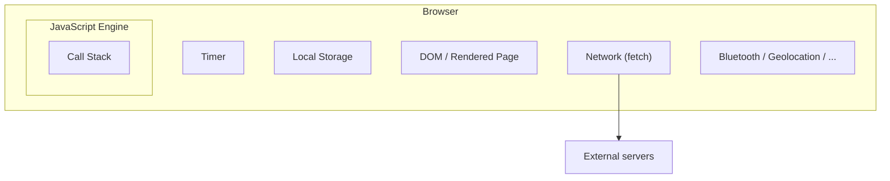
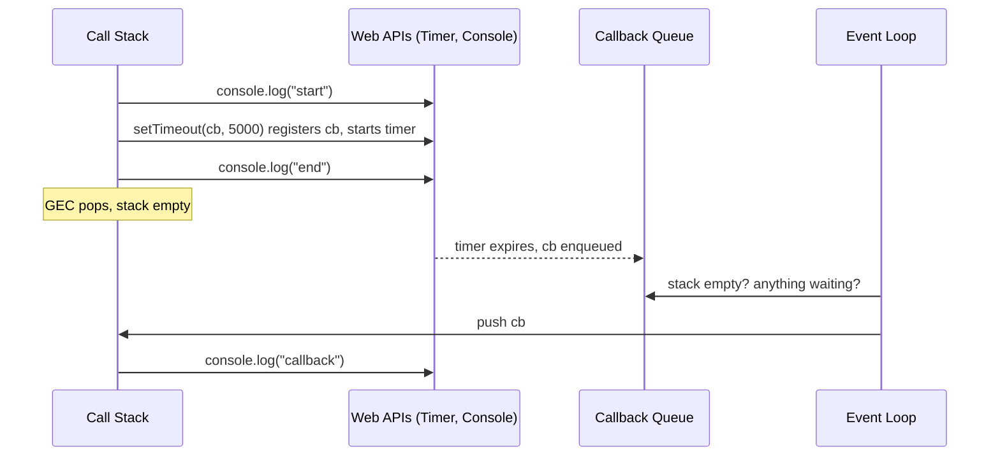
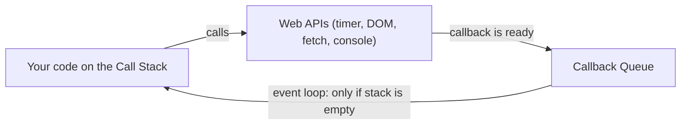
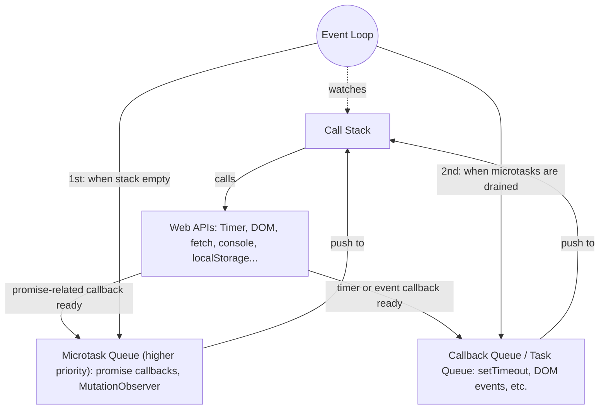
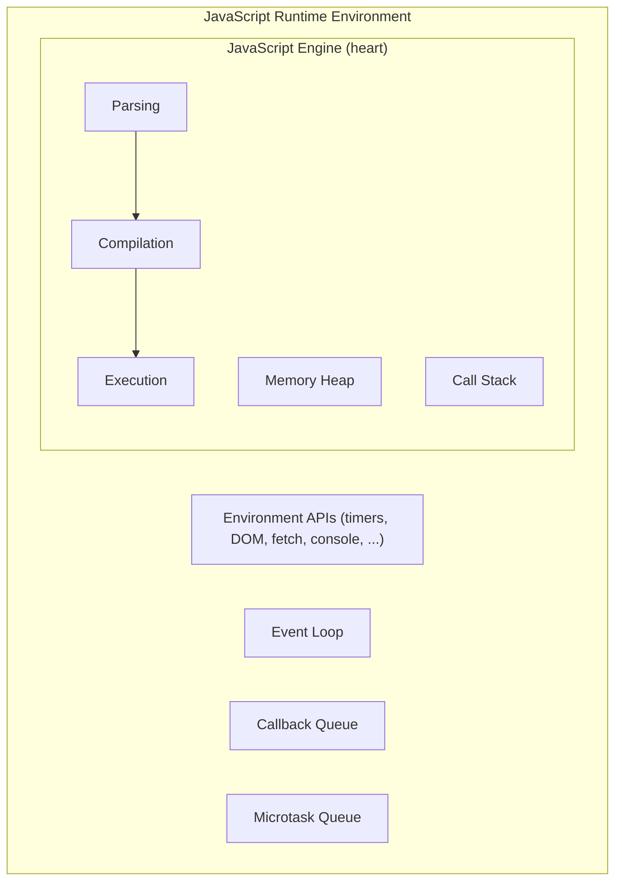
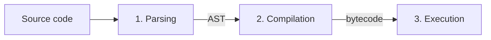
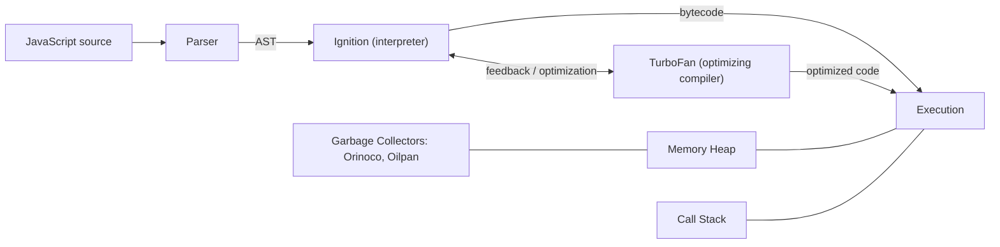
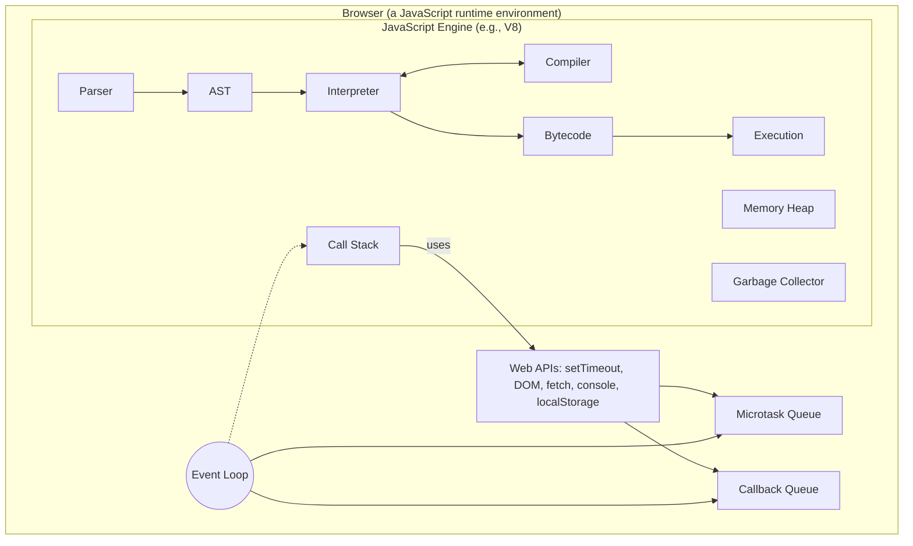

# JavaScript Under the Hood: The Event Loop, Runtime Environment, and Engine Architecture

## Overview

This document turns two lessons from the *Namaste JavaScript* series into one standalone study guide:

1. **The Event Loop lesson**: how a language with a single call stack still handles timers, button clicks, and network requests without freezing. It covers the call stack, Web APIs, the callback queue, the microtask queue, and the event loop that coordinates them.
2. **The JavaScript Runtime and Engine lesson**: what a "JavaScript runtime environment" is, why JavaScript runs in browsers, servers, and even smart devices, and what happens inside a JavaScript engine (parsing, the AST, JIT compilation, the memory heap, garbage collection, and Google's V8).


## Learning Objectives

After studying these notes you should be able to:

- Explain why JavaScript is called synchronous and single-threaded, and what the call stack does.
- Describe what a global execution context is and trace code execution through the call stack.
- Explain why `setTimeout`, `fetch`, `document`, `localStorage`, and `console` are *not* part of the JavaScript language itself, and how they reach your code through the `window` object.
- Trace `setTimeout`, DOM event listeners, and `fetch` through Web APIs, the callback queue, the microtask queue, and the event loop.
- Predict the output order of code mixing synchronous code, timers, and promises.
- Explain microtask priority and callback-queue starvation.
- Define a JavaScript runtime environment and distinguish it from a JavaScript engine.
- Describe the three engine phases (parsing, compilation, execution), the AST, and just-in-time (JIT) compilation.
- Explain the roles of the memory heap, call stack, and garbage collector.
- Name the major engines and the main components of V8 (Ignition, TurboFan, Orinoco, Oilpan).

## Prerequisites

- Basic JavaScript: variables, functions, function calls, and callbacks.
- A browser with Developer Tools (the Console tab) to try the examples.
- Optional but helpful: a rough idea of what a promise is (this document gives a short introduction).

## Table of Contents

**Part I: The Event Loop**

1. [Introduction](#1-introduction)
2. [The Call Stack and Synchronous Execution](#2-the-call-stack-and-synchronous-execution)
3. [The Limits of the Call Stack](#3-the-limits-of-the-call-stack)
4. [The Browser and Web APIs](#4-the-browser-and-web-apis)
5. [Walkthrough: setTimeout](#5-walkthrough-settimeout)
6. [The Event Loop and the Callback Queue](#6-the-event-loop-and-the-callback-queue)
7. [Walkthrough: DOM Event Listeners](#7-walkthrough-dom-event-listeners)
8. [Walkthrough: fetch and the Microtask Queue](#8-walkthrough-fetch-and-the-microtask-queue)
9. [What Goes Into Which Queue, and Starvation](#9-what-goes-into-which-queue-and-starvation)

**Part II: The Runtime Environment and the Engine**

10. [The JavaScript Runtime Environment](#10-the-javascript-runtime-environment)
11. [The JavaScript Engine and Its Variants](#11-the-javascript-engine-and-its-variants)
12. [Phase 1: Parsing and the AST](#12-phase-1-parsing-and-the-ast)
13. [Interpreters, Compilers, and JIT Compilation](#13-interpreters-compilers-and-jit-compilation)
14. [Phase 3: Execution, Memory Heap, and Garbage Collection](#14-phase-3-execution-memory-heap-and-garbage-collection)
15. [Compiler Optimization Techniques](#15-compiler-optimization-techniques)
16. [The V8 Engine Architecture](#16-the-v8-engine-architecture)

**Part III: Putting It Together**

17. [How Everything Fits Together](#17-how-everything-fits-together)
18. [Common Mistakes and Troubleshooting](#18-common-mistakes-and-troubleshooting)
19. [Best Practices](#19-best-practices)
20. [Exercises and Practice Tasks](#20-exercises-and-practice-tasks)
21. [Key Takeaways](#21-key-takeaways)
22. [Glossary](#22-glossary)
23. [References and Further Learning](#23-references-and-further-learning)

---

# Part I: The Event Loop

## 1. Introduction

### Why this topic matters

The instructor opens with a blunt claim: many JavaScript developers cannot explain the event loop, callback queues, and the microtask queue, and these topics come up repeatedly in interviews. (Whether the figure of "90%" is accurate is not something the transcript supports. Treat it as motivational rhetoric.) What is certainly true is that understanding this machinery lets you:

- Predict the order in which code runs.
- Debug "why did my callback run late?" problems.
- Avoid blocking the page and freezing the user interface.
- Answer interview questions about asynchronous behavior with confidence.

### The central puzzle

JavaScript has **one call stack** and can do **one thing at a time**. Yet web pages can run timers, react to clicks, and fetch data from servers seemingly "at once". How?

**The short answer:** JavaScript itself is single-threaded, but the **browser** around it is not. The browser provides timers, network access, and more. These work alongside the engine, and the **event loop** feeds their results back to the call stack one at a time.

The rest of Part I builds this answer step by step.

---

## 2. The Call Stack and Synchronous Execution

### 2.1 Definition

JavaScript is a **synchronous, single-threaded** language. It has **one call stack** and can only do **one thing at a time**. The call stack lives inside the JavaScript engine, and all JavaScript code is executed there.

- **Synchronous**: statements run in order, one after another.
- **Single-threaded**: only one piece of code is executing at any instant.
- **Call stack**: a stack data structure (last in, first out) that tracks which function is currently running and which functions are waiting for it to finish.

### 2.2 Why it matters

The call stack is the *only* place where JavaScript code executes. Every asynchronous mechanism we study later (timers, events, promises) exists to eventually get a function onto this stack.

### 2.3 How it works

1. Whenever a JavaScript program runs, a **Global Execution Context (GEC)** is created and **pushed onto the call stack**.
2. Code inside the global context runs **line by line**.
3. A **function definition** only allocates memory and stores the function. Nothing runs yet.
4. A **function invocation** creates a new **execution context** for that function, which is **pushed onto the call stack**.
5. The function's code runs line by line. When nothing is left to execute, its execution context is **popped off** the stack.
6. Control returns to the code that called it.
7. When the whole program is finished, the global execution context is popped off and the stack is empty.

The transcript summarizes the stack's character: its job is to execute whatever comes into it, **immediately, without waiting for anything**. The instructor's catchphrase: *"Time, tide, and JavaScript wait for none."*

### 2.4 Example (reconstructed)

The narration describes a function `a` that logs `"a"`, a call to `a()`, and then a `console.log("end")`.

```javascript
function a() {
  console.log("a");
}

a();
console.log("end");
```

### 2.5 Explanation, step by step

| Step | Event | Call stack (top at right) | Console |
|------|-------|---------------------------|---------|
| 1 | Program starts, GEC created and pushed | `GEC` | |
| 2 | `function a` definition: memory allocated, function stored | `GEC` | |
| 3 | `a()` invoked, new execution context pushed | `GEC, a` | |
| 4 | `console.log("a")` runs inside `a` | `GEC, a` | `a` |
| 5 | `a` has nothing left, its context is popped | `GEC` | `a` |
| 6 | `console.log("end")` runs | `GEC` | `a`, `end` |
| 7 | Nothing left, GEC is popped | *(empty)* | `a`, `end` |

### 2.6 Expected output

```text
a
end
```

### 2.7 Visualizing the stack

```text
Step 3                 Step 4-5               Step 7
+-----------+          +-----------+          +-----------+
|     a     |  <- top  |           |          |           |
+-----------+          +-----------+          |  (empty)  |
|    GEC    |          |    GEC    |          |           |
+-----------+          +-----------+          +-----------+
```

---

## 3. The Limits of the Call Stack

### 3.1 The problem

What if we want to run a script **after 5 seconds**? The call stack cannot do it, because anything that arrives in the stack is executed immediately, and **the call stack has no timer**.

More generally, the call stack cannot, by itself:

- Keep track of time.
- Talk to servers.
- Store data in the browser.
- Read or modify the web page.

To get these abilities, JavaScript code needs "superpowers" that live **outside** the engine.

### 3.2 Where the engine lives

the call stack is inside the **JavaScript engine**, and the engine is inside the **browser** (the "big red box" in the instructor's diagram). The browser is much more than an engine. It also has:

- **Local storage** for saving data.
- **Timers**.
- The **URL bar** and the ability to communicate with the outside world (for example, Netflix's servers).
- The ability to **render** content onto the user interface (the page you see).
- Access to hardware features such as **Bluetooth** and **geolocation**.



> **Key idea:** The JavaScript engine is *one part* of the browser. Everything else in the diagram above is a browser capability that JavaScript can only reach through a bridge.

---

## 4. The Browser and Web APIs

### 4.1 Definition

**Web APIs** are the bridge through which JavaScript code reaches the browser's capabilities. Examples named in the transcript:

| Web API | Capability it exposes |
|---------|----------------------|
| `setTimeout` | The browser's timer |
| DOM APIs (`document.getElementById`, ...) | The page's HTML structure (the DOM) |
| `fetch` | Network requests to external servers |
| `localStorage` | Browser storage |
| `console` | The developer-tools console |
| Others | Bluetooth, geolocation, and more |

### 4.2 A surprising fact

`setTimeout` is **not part of JavaScript**. Neither are the DOM APIs, `fetch`, `localStorage`, or even `console.log`. They belong to the **browser** (the host environment), which hands them to the JavaScript engine.

> **Supplementary clarification:** The language specification (ECMAScript) defines things such as variables, functions, objects, arrays, and promises. Timers, the DOM, `fetch`, and `console` are defined by host environments (browsers, Node.js) and by web standards. Environments are free to provide them, and they largely agree on names like `setTimeout` and `console.log`, which is why they feel like part of the language.

### 4.3 The global object: `window`

browsers give the engine access to these superpowers through the **global object**. In a browser, the global object is **`window`**. The browser wraps all the Web APIs into `window` and gives it to the call stack's code.

So these are all the same thing:

```javascript
window.setTimeout(() => console.log("hi"), 1000);
setTimeout(() => console.log("hi"), 1000);
```

**Why can you leave out `window.`?** Because `window` is the global object, anything in the global scope can be accessed without the prefix. The transcript states plainly: `window.setTimeout` and `setTimeout` are *one and the same thing*. Likewise `window.localStorage` and `localStorage`, or `window.console.log` and `console.log`.

### 4.4 Common misconception

| Misconception | Reality |
|---------------|---------|
| "`setTimeout` is a JavaScript feature." | It is a browser-provided Web API accessed through the global `window` object. |
| "`console.log` is built into the language." | It is the console Web API, plugged in through `window`. |
| "JavaScript waits during a timer." | JavaScript does not wait; it registers the callback with the browser's timer and keeps going. |

---

## 5. Walkthrough: setTimeout

### 5.1 Objective

Trace exactly how a delayed callback travels from your code, through the browser, and back onto the call stack.

### 5.2 The code (reconstructed)

The narration describes: a `console.log` of start, a `setTimeout` with a callback `cb` and a 5000 ms delay, and a `console.log` of end. The callback logs `"callback"`.

```javascript
console.log("start");

setTimeout(function cb() {
  console.log("callback");
}, 5000);

console.log("end");
```

### 5.3 Step-by-step trace

1. **GEC is created and pushed** onto the call stack.
2. `console.log("start")` runs. It calls the **console Web API**, which prints `start`.
3. `setTimeout(cb, 5000)` runs. It calls the **timer Web API**, which:
   - **Registers** the callback `cb` in the Web API environment.
   - **Starts a 5000 ms timer**.
4. JavaScript does **not wait**. It moves to the next line.
5. `console.log("end")` runs and prints `end`.
6. All code is done, so the **GEC is popped**. The call stack is empty.
7. Meanwhile, the timer counts down in the browser (5, 4, 3, 2, 1...).
8. When the timer expires, `cb` is moved into the **callback queue**.
9. The **event loop** sees the call stack is empty and a function is waiting in the callback queue, and **pushes `cb` onto the call stack**.
10. `cb` runs: its execution context is pushed, `console.log("callback")` prints `callback`, and the context is popped.

### 5.4 Expected output

```text
start
end
callback        <- appears about 5 seconds later
```

### 5.5 Diagram



### 5.6 Supplementary: the delay is a minimum

> **Supplementary:** The delay in `setTimeout` is the *earliest* the callback can be queued, not a guarantee of when it runs. If the call stack is busy when the timer expires, the callback waits in the queue (see section 8 for an example). `setTimeout(fn, 0)` does not mean "run now"; it means "queue this as soon as possible, after the current code finishes".

---

## 6. The Event Loop and the Callback Queue

### 6.1 Definition

- **Callback queue**: a waiting line for callback functions that are ready to run. Callbacks cannot go straight onto the call stack, so they wait here.
- **Event loop**: a process whose **only job** is to **continuously monitor the call stack and the callback queue**. When the call stack is **empty** and there is a function waiting in the callback queue, it takes that function and **pushes it onto the call stack**, where it runs immediately. The instructor compares it to a **gatekeeper**.

### 6.2 Why it matters

The call stack executes whatever it receives, instantly. Without a controlled entry point, a callback arriving mid-execution would interrupt running code. The event loop guarantees that a callback only enters when the stack is empty, so JavaScript's one-thing-at-a-time rule is never broken.

### 6.3 Why do we need a queue at all?

Couldn't the event loop just push a callback onto the stack whenever it is empty, with no queue? No. Imagine a user clicks a button 7 or 8 times quickly. Five or six callbacks become ready at nearly the same moment. They need to **line up** and get their turn one after another, because there is only one call stack. Real applications have many timers and event listeners active at once, so a queue is essential.

### 6.4 The mental model so far



---

## 7. Walkthrough: DOM Event Listeners

### 7.1 Objective

See how a click handler works behind the scenes, and why registered callbacks can "sit" in the Web API environment indefinitely.

### 7.2 The code (reconstructed)

The narration describes: a `console.log` of start, `document.getElementById("btn").addEventListener("click", cb)`, and a `console.log` of end. The callback logs `"callback"`.

```html
<button id="btn">Click me</button>

<script>
  console.log("start");

  document.getElementById("btn").addEventListener("click", function cb() {
    console.log("callback");
  });

  console.log("end");
</script>
```

### 7.3 Step-by-step trace

1. **GEC pushed** onto the call stack.
2. `console.log("start")` prints `start` (via the console Web API).
3. `document.getElementById("btn")` uses the **DOM API** to find the button in the **DOM** (the Document Object Model, a representation of the page's HTML).
4. `.addEventListener("click", cb)`:
   - **Registers** `cb` in the Web API environment.
   - **Attaches** a `click` event to it.
5. Execution continues. `console.log("end")` prints `end`.
6. **GEC is popped**. The call stack is empty.
7. The registered callback **stays in the Web API environment** until the event listener is explicitly removed or the browser is closed. It sits there "hoping" a user will click.
8. **When the user clicks**, `cb` moves into the **callback queue**.
9. The **event loop** sees an empty call stack and a waiting callback, and pushes `cb` onto the call stack.
10. `cb` runs and prints `callback`, then pops off.

### 7.4 Expected output

```text
start
end
callback        <- each time the button is clicked
```

### 7.5 Key points

- Unlike a timer, a click listener has no expiration. It can fire any number of times.
- Each click places **another** copy of the callback in the queue. Click five times quickly and five callbacks line up, running one at a time.
- `document.getElementById` and `addEventListener` are DOM APIs. They are not JavaScript itself, but are reached through `window`.

---

## 8. Walkthrough: fetch and the Microtask Queue

### 8.1 Why fetch is different

`fetch` is *"an interesting case"*. It does not follow the same path as `setTimeout` or event listeners. `fetch` makes a network request and **returns a promise**. You pass a callback that runs **once the promise is resolved**, meaning once the data has arrived. (The instructor notes promises have not been covered yet in the series.)

### 8.2 Definition: the microtask queue

The **microtask queue** is exactly like the callback queue, but with **higher priority**. Functions in it are executed **first**; functions in the callback queue are executed later. Callbacks from **promises** (such as fetch's) go into the microtask queue.

### 8.3 Mini-introduction to promises (supplementary)

> **Supplementary:** A *promise* represents a value that will be available later. `fetch(url)` returns a promise immediately. When the network response arrives, the promise is *resolved*, and callbacks attached with `.then(...)` are scheduled to run.

### 8.4 The code (reconstructed)

The transcript describes code with a start log, a `setTimeout` (callback `cbT`, 5000 ms), a `fetch` to a Netflix API (callback `cbF`), a very long-running stretch of code ("millions of lines"), and an end log. The callbacks print `"CB Netflix"` and `"CB setTimeout"`.

```javascript
console.log("start");

setTimeout(function cbT() {
  console.log("CB setTimeout");
}, 5000);

fetch("https://api.netflix.com").then(function cbF() {
  console.log("CB Netflix");
});

// ... millions of lines of code that take a long time to run ...

console.log("end");
```

> **Note:** The URL is a placeholder from the narration. The "millions of lines" are represented below by a blocking loop so you can reproduce the behavior.

### 8.5 A runnable version (supplementary)

The real `api.netflix.com` is not a public API for this purpose, so this version uses a placeholder public endpoint and a busy-wait loop to simulate the long-running code. It demonstrates the same ordering.

```javascript
console.log("Start");

setTimeout(function cbT() {
  console.log("CB setTimeout");
}, 5000);

fetch("https://jsonplaceholder.typicode.com/todos/1").then(function cbF() {
  console.log("CB Netflix (fetch callback)");
});

// Simulate "millions of lines of code": block the call stack for ~6 seconds
const blockUntil = Date.now() + 6000;
while (Date.now() < blockUntil) {
  // busy-waiting: the call stack is occupied
}

console.log("End");
```

**Expected output:**

```text
Start
End
CB Netflix (fetch callback)
CB setTimeout
```

> If the request fails (for example, you are offline), the `.then` callback will not run. Add `.catch(console.error)` to see the error.

### 8.6 Step-by-step trace

1. **GEC pushed**; `console.log("start")` prints `start`.
2. `setTimeout` **registers `cbT`** in the Web API environment and **starts the 5000 ms timer**.
3. `fetch` calls the **network Web API**. It registers `cbF` and sends a request to the server.
4. Suppose the server answers very fast, say within **50 ms**. `cbF` is now ready. It does **not** go to the callback queue. It goes to the **microtask queue**.
5. But the call stack is **still busy** running the huge block of code. Neither `cbF` nor anything else can run yet. This is the core lesson: **the event loop only dispatches when the call stack is empty**.
6. While the engine is busy, **the browser keeps working**: the timer expires after 5 seconds, so `cbT` moves into the **callback queue**.
7. The long code finishes. `console.log("end")` prints `end`.
8. The GEC pops and the stack is empty.
9. The event loop checks both queues. Both have waiting callbacks, but the **microtask queue has priority**, so `cbF` is pushed onto the stack first. It prints `CB Netflix`, then pops.
10. The event loop checks again and now pushes `cbT`. It prints `CB setTimeout`.

### 8.7 Timeline

| Time | Where `cbF` is | Where `cbT` is | Call stack |
|------|----------------|----------------|------------|
| 0 ms | not yet created | timer started (Web API) | GEC running |
| ~50 ms | **microtask queue** (data arrived) | still counting down | GEC still running long code |
| 5000 ms | microtask queue | **callback queue** (timer expired) | GEC still running long code |
| long code ends | microtask queue | callback queue | `end` logged, GEC pops, stack empty |
| next | pushed to stack, prints `CB Netflix` | callback queue | `cbF` |
| next | done | pushed to stack, prints `CB setTimeout` | `cbT` |

### 8.8 Key insight: the browser does many things, the engine does one

*"The browser isn't doing just one thing. It is just the JavaScript engine which is doing one thing at a time, but the browser is doing a lot of things behind the scenes."* Timers tick, network requests proceed, and events are captured, all concurrently, while the engine runs your code on a single stack.

### 8.9 Full event-loop diagram



---

## 9. What Goes Into Which Queue, and Starvation

### 9.1 Which queue gets what

| Goes into the **Microtask Queue** (high priority) | Goes into the **Callback Queue** (lower priority) |
|---|---|
| Callbacks from **promises** (including `fetch`'s) | `setTimeout` callbacks |
| **MutationObserver** callbacks | DOM event listener callbacks (click, etc.) |
| | Essentially all other callbacks |

**MutationObserver** : watches the DOM tree for changes ("mutations") and runs a callback when one occurs. The instructor leaves it as homework to read more.

### 9.2 Naming

The callback queue is also called the **task queue** (or "macrotask queue" by some). The instructor prefers "callback queue" because "microtask" and "task" sound too alike.

### 9.3 Priority rule

If three microtasks are pending and one task is in the callback queue, the event loop gives the callback-queue task a turn **only after all microtasks have completed**.

### 9.4 Starvation

 Suppose a microtask, when executed, creates **another** microtask, which creates another, and so on. Since microtasks always take priority, the callback-queue tasks **never get a chance to run**, possibly for a very long time. This is called **starvation** of the callback queue.

```javascript
// Supplementary: a (dangerous!) microtask starvation demonstration
// WARNING: this will freeze the tab. Do not run it casually.
function loopForever() {
  Promise.resolve().then(loopForever);
}
setTimeout(() => console.log("I will never run"), 0);
loopForever();
```

> **Supplementary:** Because every microtask schedules a new microtask, the microtask queue never becomes empty, and the timer callback never runs. The page becomes unresponsive.

### 9.5 Supplementary: a classic ordering puzzle

```javascript
console.log("1: sync");

setTimeout(() => console.log("4: timeout (callback queue)"), 0);

Promise.resolve().then(() => console.log("3: promise (microtask)"));

console.log("2: sync");
```

**Output:**

```text
1: sync
2: sync
3: promise (microtask)
4: timeout (callback queue)
```

**Why:** Synchronous code runs first. When the stack empties, microtasks run before the callback queue, so the promise callback beats the zero-delay timeout.

---

# Part II: The Runtime Environment and the Engine

## 10. The JavaScript Runtime Environment

### 10.1 Why JavaScript runs everywhere

JavaScript can run inside a browser, a server, a smartwatch, a light bulb, and even robots. This works because of the **JavaScript runtime environment**.

### 10.2 Definition

A **JavaScript runtime environment** is a big container that has **everything required to run JavaScript code**. It can include:

- A **JavaScript engine** (mandatory, the "heart").
- A set of **APIs** to connect to the outside environment.
- An **event loop**.
- A **callback queue**.
- A **microtask queue**.
- Other things, depending on the environment.

> A runtime environment is **not possible without a JavaScript engine**.

### 10.3 Examples of runtimes

| Runtime | Notes |
|---------|---------------------------|
| **Browser** | Every browser has a runtime environment, which is why it can execute JavaScript. |
| **Node.js** | An open source JavaScript runtime that runs JavaScript **outside the browser**. |
| **Water cooler (hypothetical)** | Would need a JS engine plus its own APIs, for example `getWaterLevel`, exposed via a global object. |

### 10.4 APIs differ between runtimes


- Some APIs are **specific**: for example, `localStorage` exists in the browser but not necessarily in Node.js.
- Some APIs are **shared by name**: `setTimeout` and `console` exist in both browsers and Node.js.
- Same name does **not** mean same implementation. *"The `setTimeout` of the browser might have a different implementation than the `setTimeout` of Node."*

This is what makes JavaScript flexible. The language stays the same while each environment supplies its own superpowers.

### 10.5 Diagram



### 10.6 Engine versus runtime

| | JavaScript Engine | JavaScript Runtime Environment |
|---|---|---|
| Scope | Executes JavaScript code | The whole container needed to run JavaScript usefully |
| Contains | Parser, interpreter, compiler, memory heap, call stack, garbage collector | An engine **plus** Web or other APIs, event loop, queues |
| Example | V8, SpiderMonkey | Chrome's runtime, Node.js |

---

## 11. The JavaScript Engine and Its Variants

### 11.1 What an engine is (and is not)

A JavaScript engine is **not a machine** or hardware. It is a **normal program**, written in a lower-level language. For example, Google's V8 is written in **C++**. It takes high-level code (what we write in JavaScript) and produces **machine-level code** that the computer can execute.

> Diagrams draw the engine as a box only for clarity. It is ordinary software written by engineers.

### 11.2 Well-known engines

| Engine | Used in | Notes |
|--------|---------|-------|
| **V8** | Google Chrome, Node.js, Deno | Mentioned as the most famous. The instructor considers it the fastest at the time of recording. |
| **SpiderMonkey** | Mozilla Firefox | Evolved from the **first JavaScript engine**, created by **Brendan Eich** (JavaScript's creator) at Netscape. |
| **Chakra** | Microsoft Edge (as named in the transcript) | See the correction below. |

> **Supplementary correction:** Chakra was the engine of the *legacy* Microsoft Edge. Modern Edge is built on Chromium and uses V8. The instructor's statement was accurate for the older Edge.

> **Supplementary note on "fastest":** Performance rankings vary by workload and change over time. Treat "V8 is the fastest" as the instructor's opinion at recording time, not a permanent fact.

### 11.3 Engines follow a standard

Anyone can create a JavaScript engine. The key rule is to follow the **ECMAScript standards** (the language specification). ECMAScript is described as a kind of "governing body" of the language.

> **Supplementary:** More precisely, ECMAScript is the *language specification* maintained by Ecma International's TC39 committee. It is a standard document rather than software or an organization of its own.

### 11.4 The three phases

Source code goes into the engine and passes through three major steps:



---

## 12. Phase 1: Parsing and the AST

### 12.1 Definition

**Parsing** breaks your code into pieces and builds a structured representation of it.

1. **Tokenization**: the code is broken into **tokens**. For `let a = 7`, the tokens are `let`, `a`, `=`, and `7`.
2. **Syntax parsing**: the **syntax parser** converts tokens into an **AST** (Abstract Syntax Tree).

### 12.2 What is an AST?

An **Abstract Syntax Tree** is a tree structure that represents the grammatical structure of the program. It sounds complicated, but it is just a hierarchy: the statement at the top, its parts as branches, and basic values as leaves.

### 12.3 Example

For the line:

```javascript
const bestCourse = namasteJavaScript;
```

The transcript describes the tree like this:

- The top node is the whole variable declaration (`const`).
- Inside it is a **declaration**.
- The declaration has a **name** (`bestCourse`) and a **value** (`namasteJavaScript`).

A simplified text sketch (supplementary; the exact node names vary by parser):

```text
VariableDeclaration (kind: const)
└── VariableDeclarator
    ├── id:   Identifier "bestCourse"
    └── init: Identifier "namasteJavaScript"
```

> The instructor notes this is the AST for *one line*. A real program has thousands of lines, so the tree is huge. You do not need to memorize AST structure. It is shown for understanding.

### 12.4 Try it yourself

The instructor recommends **astexplorer.net**, a website that shows the AST generated for pasted JavaScript. This is a good way to build intuition.

**Mini tutorial:**

1. Open astexplorer.net.
2. Choose JavaScript as the language.
3. Paste `let a = 7;` and inspect the tree.
4. Try `function f(x) { return x + 1; }` and observe how it nests.

---

## 13. Interpreters, Compilers, and JIT Compilation

### 13.1 Interpreter versus compiler

| | Interpreter | Compiler |
|---|---|---|
| How it works | Executes code **line by line, in order**; does not know what comes next | Compiles the **whole code first**, producing an **optimized version**, then executes that |
| Strength | **Speed to start**: no waiting for compilation | **Efficiency**: optimized code runs fast with performance improvements |
| Weakness | Less optimization | Upfront wait before anything runs |

### 13.2 Is JavaScript interpreted or compiled?

*It depends on the engine.*

- Originally, Brendan Eich's engine used an **interpreter**. Browsers could not wait for compilation before running code.
- Modern engines use **both an interpreter and a compiler**. This is called **JIT (Just-In-Time) compilation**, "the best of both worlds".

### 13.3 How JIT works 

1. After parsing, the **AST** goes to the **interpreter**.
2. The interpreter converts it to **bytecode**, which moves to execution.
3. While code is being interpreted line by line, the **compiler talks to the interpreter** and optimizes the code as much as it can **at runtime**. This can happen in multiple phases, and each engine has its own algorithms.
4. The result is optimized code that executes.

### 13.4 JIT versus AOT

Some engines use **AOT (Ahead-Of-Time)** compilation. The compiler takes code that will run **later** and optimizes it beforehand, also producing bytecode for execution.

| | JIT | AOT |
|---|---|---|
| When compilation happens | During execution | Before execution |
| Advantage | Fast startup, then optimizes hot code | Optimization is done up front |

### 13.5 Supplementary: why JIT makes sense

> **Supplementary:** Engines can watch which functions run most often ("hot" code) and spend extra effort optimizing exactly those, using what they learn about how the code is actually used. This is something a purely ahead-of-time approach cannot easily do for a dynamic language like JavaScript.

---

## 14. Phase 3: Execution, Memory Heap, and Garbage Collection

### 14.1 The two essential components

Execution is impossible without two components of the engine:

1. **Call stack**: the same stack from Part I, where execution contexts are pushed and popped as functions run.
2. **Memory heap**: where **all variables and functions are assigned memory**. It stays in sync with the call stack, the garbage collector, and other parts.

### 14.2 Garbage collector

The **garbage collector** frees memory whenever possible. When a function is no longer used, or a timeout is cleared, the garbage collector "collects the garbage". It uses the **mark-and-sweep algorithm** (given as homework).

> **Supplementary: mark and sweep in brief.**
> 1. **Mark**: starting from "roots" (such as the global object and the current call stack), follow references and mark everything reachable.
> 2. **Sweep**: free the memory of everything that was not marked, since nothing can reach it any more.

```javascript
let user = { name: "Asha" };   // object allocated on the heap, referenced by `user`
user = null;                   // no reference remains: the object becomes unreachable
// A later garbage collection can reclaim its memory.
```

### 14.3 Relating to Part I

Recall that the call stack executes your code. The memory heap stores the data it uses. The Web APIs, event loop, and queues are **not** inside the engine; they belong to the **runtime** around it.

---

## 15. Compiler Optimization Techniques

Beyond garbage collection, compilers apply many optimizations while compiling. as homework:

| Technique | Brief note (supplementary) |
|-----------|----------------------------|
| **Inlining** | Replacing a function call with the body of the function, avoiding call overhead. |
| **Copy elision** | Avoiding unnecessary copying of values or objects. |
| **Inline caching** | Remembering the result of property lookups at a given place in the code so repeated accesses are faster. |

The instructor stresses that the process described is **generic**. Each engine implements things in its own way. The AST, an interpreter, a compiler, and various optimization tricks are common, but, for example, V8's compilation logic differs from SpiderMonkey's. Engine teams compete to make their engines as fast as possible, "to save your microseconds".

---

## 16. The V8 Engine Architecture

### 16.1 Components named in the transcript

| Component | Role |
|-----------|------|
| **Parser** | Produces the AST |
| **Ignition** | V8's **interpreter**; converts the AST to **bytecode** |
| **TurboFan** | V8's **optimizing compiler**; works alongside the interpreter to optimize code |
| **Orinoco** | A **garbage collector**; uses mark-and-sweep (as stated in the transcript) |
| **Oilpan** | Another garbage collector, "used for a different purpose" |

> **Supplementary:** Oilpan manages memory for C++ objects (in the Blink rendering engine used by Chrome, for example, such as DOM-related objects), rather than for ordinary JavaScript objects. The transcript does not elaborate on this, and the instructor recommends reading the V8 blog.

### 16.2 V8 pipeline



### 16.3 Recommended reading

The instructor encourages reading the official **V8 blog** for deeper articles on everything covered here.

---

# Part III: Putting It Together

## 17. How Everything Fits Together

### 17.1 The complete picture



### 17.2 How the lessons connect

| Concept (from earlier) | Supports (later) |
|------------------------|------------------|
| Call stack executes code immediately | Explains why we need Web APIs for delays and I/O |
| Web APIs offer browser superpowers | Explains why `setTimeout` is not "JavaScript" |
| Callback queue lines up ready callbacks | Event loop feeds them to the stack one at a time |
| Microtask queue has higher priority | Explains promise vs. timer ordering and starvation |
| The engine contains the call stack and heap | The runtime adds Web APIs, queues, and the event loop around it |
| Parsing, then AST, then interpreter plus compiler | Explains how JavaScript source becomes fast machine code |

### 17.3 Execution summary: from code to result

1. The **engine** parses your source into an AST.
2. The **interpreter** produces bytecode; the **compiler** optimizes hot code.
3. Execution happens on the **call stack**, with data in the **memory heap**.
4. When code needs timers, network, DOM, and so on, it calls **Web APIs** in the **runtime**.
5. When those finish, their callbacks go to the **microtask queue** (promises) or the **callback queue** (timers, events).
6. The **event loop** pushes callbacks to the stack when it is empty, microtasks first.
7. The **garbage collector** reclaims unreachable memory.

---

## 18. Common Mistakes and Troubleshooting

| # | Mistake | Why it happens | Fix |
|---|---------|----------------|-----|
| 1 | Believing `setTimeout(fn, 0)` runs `fn` immediately | The callback still goes through the Web API and queue, and runs only after the stack empties | Remember: sync code first, then microtasks, then queued tasks |
| 2 | Thinking `setTimeout` guarantees an exact delay | The delay is a minimum; a busy call stack delays execution | Avoid long-running synchronous code |
| 3 | Expecting a promise callback to run after a timer that expired earlier | Microtasks have priority over the callback queue | Learn the queue priority rule |
| 4 | Writing heavy loops on the main thread | The call stack is blocked; nothing else (clicks, timers, rendering) can run | Split work into chunks, or move it to a Web Worker (supplementary suggestion) |
| 5 | Creating endless microtask chains | Starves the callback queue and freezes the page | Avoid recursive promise or microtask loops without a break |
| 6 | Calling the "engine" and "runtime" the same thing | The runtime contains the engine plus APIs and queues | Use the comparison table in section 10.6 |
| 7 | Assuming `setTimeout` or `fetch` behave identically in every environment | Names match but implementations differ | Check each environment's documentation |
| 8 | Forgetting to remove event listeners | Registered callbacks live in the Web API environment until removed | Use `removeEventListener` when no longer needed (supplementary) |

### Troubleshooting: "My callback runs much later than expected"

1. Is there a long-running synchronous task on the page? (It blocks the stack.)
2. Are many microtasks queued ahead of it? (They run first.)
3. Is a long queue of tasks ahead of it? (They run in order.)
4. Check the Performance tab of your browser's Developer Tools for long tasks.

---

## 19. Best Practices

- **Never block the call stack** with long synchronous work.
- **Prefer asynchronous APIs** (timers, `fetch`, events) for waiting and I/O instead of busy-waiting loops.
- **Know your queues**: reason about order as *sync code, then microtasks, then callback queue*.
- **Clean up**: remove event listeners and clear timers you no longer need, which also helps the garbage collector.
- **Write engine-friendly code** (supplementary): stable object shapes and consistent types tend to help optimizing compilers.
- **Use official docs** (MDN, V8 blog, the ECMAScript spec) to confirm behavior across environments.

---

## 20. Exercises and Practice Tasks

### Exercise 1: Predict the output

```javascript
console.log("A");
setTimeout(() => console.log("B"), 0);
Promise.resolve().then(() => console.log("C"));
console.log("D");
```

- [ ] Write down your predicted order before running.
- [ ] Run it in the browser console and compare.

<details>
<summary>Solution</summary>

`A, D, C, B`. A and D are synchronous. C is a microtask, so it runs before B, the callback-queue task.

</details>

### Exercise 2: Blocked stack

```javascript
setTimeout(() => console.log("timer"), 100);
const end = Date.now() + 2000;
while (Date.now() < end) {}
console.log("done");
```

- [ ] Predict when `timer` appears relative to `done`.
- [ ] Explain why the delay is not 100 ms.

<details>
<summary>Solution</summary>

`done` prints after about 2 seconds, then `timer`. The timer expired at 100 ms and its callback waited in the queue because the call stack was busy until the loop finished.

</details>

### Exercise 3: Click queue

Create a button whose click handler logs a number from a counter. Click it quickly several times.

- [ ] Observe that each click produces its own log line, in order.
- [ ] Explain, in terms of the callback queue, why none are lost.

### Exercise 4: Explore an AST

- [ ] Visit astexplorer.net and paste `const bestCourse = "Namaste JavaScript";`.
- [ ] Identify the declaration, the name, and the value in the tree.

### Exercise 5: Homework from the instructor

- [ ] Read about **MutationObserver** and write a tiny example.
- [ ] Read about the **mark-and-sweep** algorithm and sketch it on paper.
- [ ] Look up **inlining**, **copy elision**, and **inline caching** and write one sentence on each.
- [ ] Read about **callback-queue starvation**.
- [ ] Browse the **V8 blog** for Ignition, TurboFan, and Orinoco.

### Exercise 6: Explain it aloud

- [ ] Without notes, explain the difference between a JavaScript engine and a JavaScript runtime, in under two minutes.

---

## 21. Key Takeaways

1. JavaScript is **synchronous and single-threaded**: one call stack, one thing at a time.
2. The call stack executes whatever arrives immediately; it has **no timer** and **waits for nothing**.
3. `setTimeout`, DOM APIs, `fetch`, `localStorage`, and `console` are **browser Web APIs**, not part of JavaScript itself. They reach your code through the global `window` object.
4. Timer and event callbacks go to the **callback queue**; promise callbacks (and MutationObserver) go to the **microtask queue**, which has **higher priority**.
5. The **event loop** only moves callbacks onto the call stack when the stack is **empty**, serving microtasks before callback-queue tasks.
6. Endless microtask creation can **starve** the callback queue.
7. A **runtime environment** = engine + APIs + event loop + queues. The **engine** is its heart and is itself just a program (V8 is written in C++).
8. Engines work in three phases: **parsing (tokens, AST)**, **compilation**, **execution**.
9. Modern engines use **JIT compilation**: an interpreter plus an optimizing compiler.
10. Execution relies on the **call stack** and the **memory heap**; the **garbage collector** (mark-and-sweep) reclaims memory.
11. V8 uses **Ignition** (interpreter), **TurboFan** (optimizing compiler), and garbage collectors such as **Orinoco** and **Oilpan**.

---

## 22. Glossary

| Term | Definition |
|------|------------|
| **AST (Abstract Syntax Tree)** | Tree representation of a program's structure produced by the parser. |
| **AOT (Ahead-Of-Time) compilation** | Compiling code before it runs. |
| **Bytecode** | A compact intermediate code produced by the interpreter for execution. |
| **Call stack** | The stack where execution contexts are pushed and popped as code runs. |
| **Callback** | A function passed to another function (or API) to be run later. |
| **Callback queue (task queue)** | Queue of callbacks (timers, DOM events, etc.) waiting for the event loop. |
| **Compiler** | Translates and optimizes code, often before or during execution. |
| **DOM** | Document Object Model, a representation of the page's HTML. |
| **ECMAScript** | The language standard that JavaScript engines follow. |
| **Event loop** | The process that moves queued callbacks to the call stack when it is empty. |
| **Execution context** | The environment created to run a piece of code (global or function). |
| **Garbage collector** | Component that frees unreachable memory. |
| **Global execution context (GEC)** | The first context, created when a program starts. |
| **Global object (`window`)** | The object that exposes global APIs; in browsers it is `window`. |
| **Interpreter** | Executes code line by line, quickly. |
| **JIT compilation** | Combining interpreter and compiler so code is optimized at runtime. |
| **JavaScript engine** | The program that parses, compiles, and executes JavaScript (V8, SpiderMonkey, Chakra). |
| **JavaScript runtime environment** | Engine plus APIs, event loop, and queues. |
| **Mark and sweep** | Garbage collection algorithm: mark reachable memory, free the rest. |
| **Memory heap** | Region where variables and functions are allocated memory. |
| **Microtask queue** | High-priority queue for promise callbacks and MutationObserver callbacks. |
| **MutationObserver** | Web API that runs a callback when the DOM changes. |
| **Promise** | An object representing a value available later. |
| **Starvation** | Lower-priority tasks never running because higher-priority work keeps arriving. |
| **Token** | The smallest meaningful unit in source code (for example, `let`, `a`, `=`, `7`). |
| **Web API** | Browser-provided capability (timer, DOM, fetch, etc.) exposed to JavaScript. |

---

## 23. References and Further Learning

- *Namaste JavaScript* video series by Akshay Saini (the source of the transcripts).
- MDN Web Docs: *The event loop* and *Using microtasks in JavaScript with queueMicrotask()*.
- MDN Web Docs: *MutationObserver*, *setTimeout*, *Fetch API*, *Promise*.
- ECMAScript language specification (Ecma International, TC39).
- V8 blog (v8.dev) for Ignition, TurboFan, and Orinoco articles.
- astexplorer.net for exploring ASTs.
- Search terms for homework: "mark and sweep garbage collection", "inline caching", "copy elision", "function inlining", "microtask starvation".

---

> **Notes on accuracy and assumptions**
> - The transcript's code was described aloud; code in the walkthroughs is **reconstructed** from the narration.
> - Corrections and clarifications added in this document are marked **Supplementary**: Chakra and modern Edge, ECMAScript as a specification, the `setTimeout` delay being a minimum, and Oilpan's purpose.
> - The transcript's claims about the percentage of developers who understand the event loop, and that V8 is the fastest engine, are the instructor's statements and are not verified here.
